# AppStream catalogs in pkg.put.gd: lab acceptance (#314, 2026-10-22)

[PR #425](https://github.com/patrick-hudson/put.gd-desktop/pull/425) makes the signer publish AppStream catalogs: DEP-11 for apt, `appstream` and `appstream-icons` for dnf. This lab run checks the result on each test host. Put.gd wasn't installed, and the only put.gd repository added was the lab one. Each host then searched for "put.gd" in its software centre, installed put.gd from there and removed it again.

## What was tested

| | |
| --- | --- |
| Signer | PR #425 at `a94c9b8f`, run from a scratch tree on d69 in a `systemd-run` copy of `putgd-signer.service`'s sandbox and environment (`ProtectSystem=strict`, `UMask=0077`, the signer's GnuPG home and AWS files through the environment). The live signer, its state and its timer weren't touched (live code `ddc7981e`). |
| Packages | The four CI-built packages of the published [`v26.1022.968-nightly`](https://github.com/patrick-hudson/put.gd-desktop/releases/tag/v26.1022.968-nightly), each checked against the release's `SHA256SUMS`. They were published with `pkgrepo.py publish-local --tag v26.1022.968-nightly` to `pkg.put.gd/lab/` and signed with the nightly key. |
| Approval | Patrick approved the lab publication and its deletion. The coordinator gave the go and the desktop slots. Patrick typed the polkit password into the dialogs on k72 and m74. |

| Host | Session | Software centre | Lab repository added |
| --- | --- | --- | --- |
| k72 | Kubuntu 26.04, Plasma 6.6.6 Wayland | Discover 6.6.6 (PackageKit 1.3.4, AppStream 1.1.2) | `/etc/apt/sources.list.d/putgd-lab-314.sources`, `ubuntu26.04` suite |
| f44 | Fedora 44, GNOME Wayland | GNOME Software 50.0 (dnf5 5.4.6, AppStream 1.1.3) | `/etc/yum.repos.d/putgd-lab-314.repo` (`gpgcheck=1`) |
| m74 | Linux Mint 22.3, Cinnamon X11 | Software Manager (mintinstall 8.4.0) | `/etc/apt/sources.list.d/putgd-lab-314.sources`, `ubuntu24.04` suite |

Each lab repository was signed by the nightly key, whose file went into `/etc/apt/keyrings/` or `/etc/pki/rpm-gpg/`. No Firefox, ChatGPT or Codex window was open on any of these desktops. Every picture is the host's whole single output (1920×1080), read from its loopback VNC server and scaled to 1440 px wide. The red boxes and the caption strip below each picture were added afterwards.

## Results

| | Discover (k72) | GNOME Software (f44) | Software Manager (m74) |
| --- | --- | --- | --- |
| Search "put.gd" | put.gd: name, icon and summary from the catalog | put.gd: name, icon and summary from the catalog | "Putgd", generic icon, control-file summary (Mint doesn't read AppStream) |
| App page | Description, version, licences, "Install from put_gd-nightly-main" | Description, Install from `putgd-lab-314` | No description: the DEB has only a summary ([#430](https://github.com/patrick-hudson/put.gd-desktop/issues/430)) |
| Install from the centre | Yes. PackageKit, `install-packages`, after Patrick's polkit password | Yes. dnf5daemon, no password; pulled in 3 dependencies | Yes. PackageKit, after Patrick's polkit password |
| Remove from the centre | Yes, after the polkit password | Yes; the 3 dependencies went too | Yes, after the polkit password |

### Discover on k72

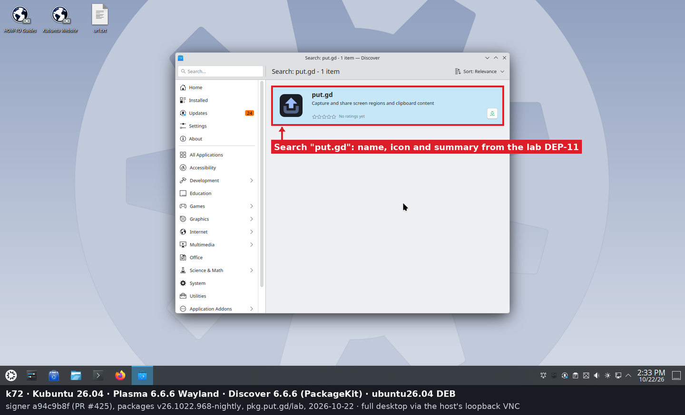
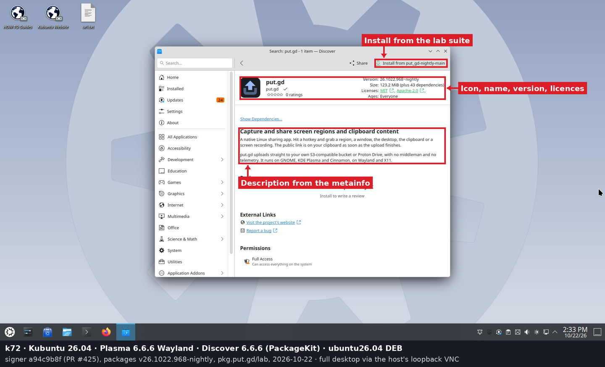
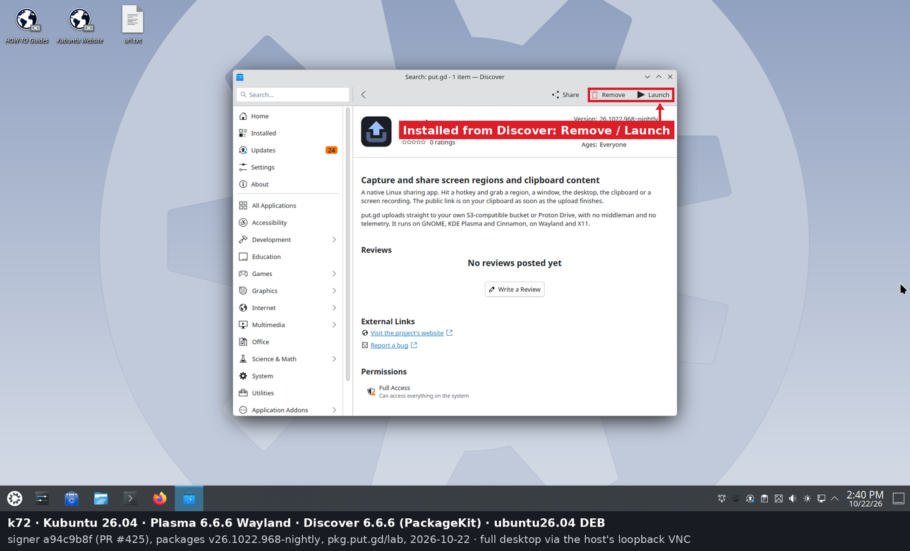
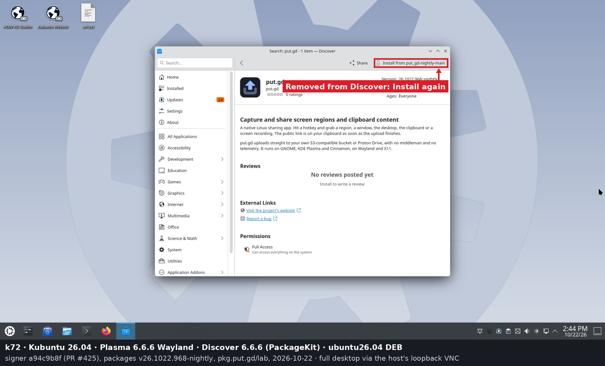

### GNOME Software on f44

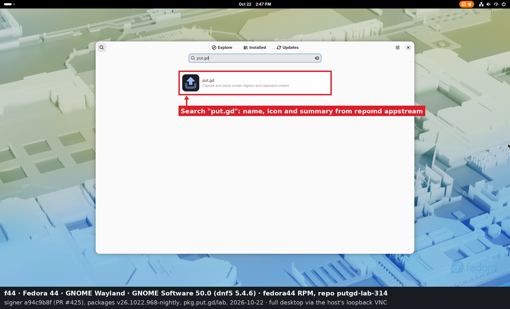
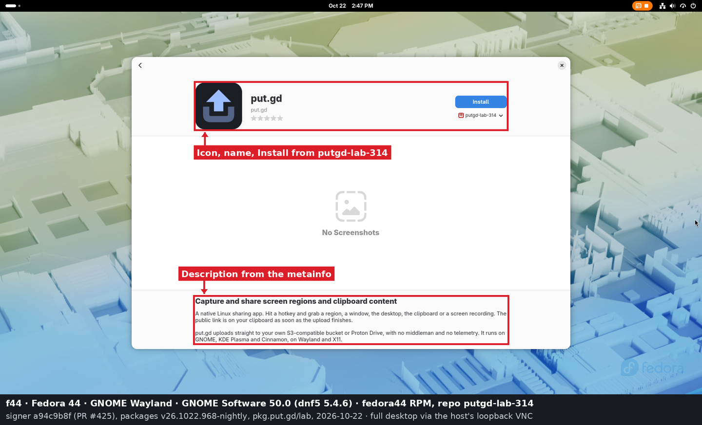
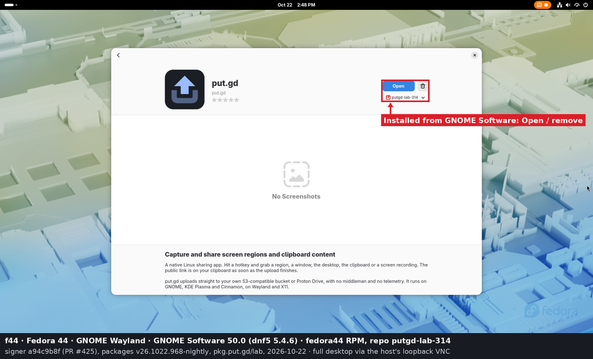
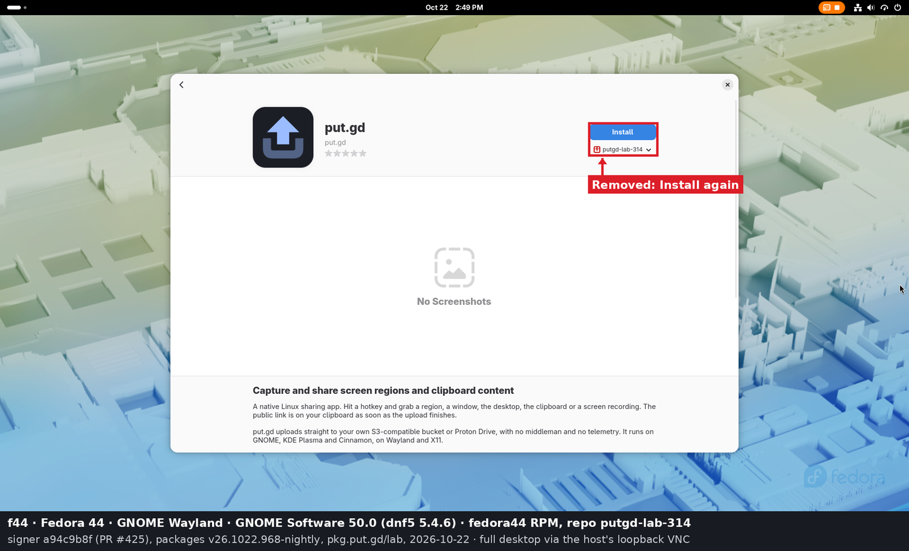

### Software Manager on m74

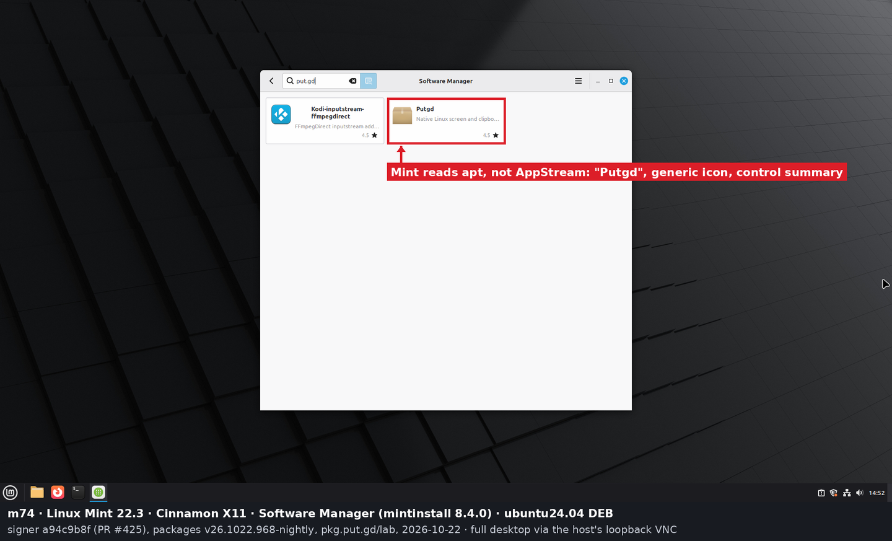
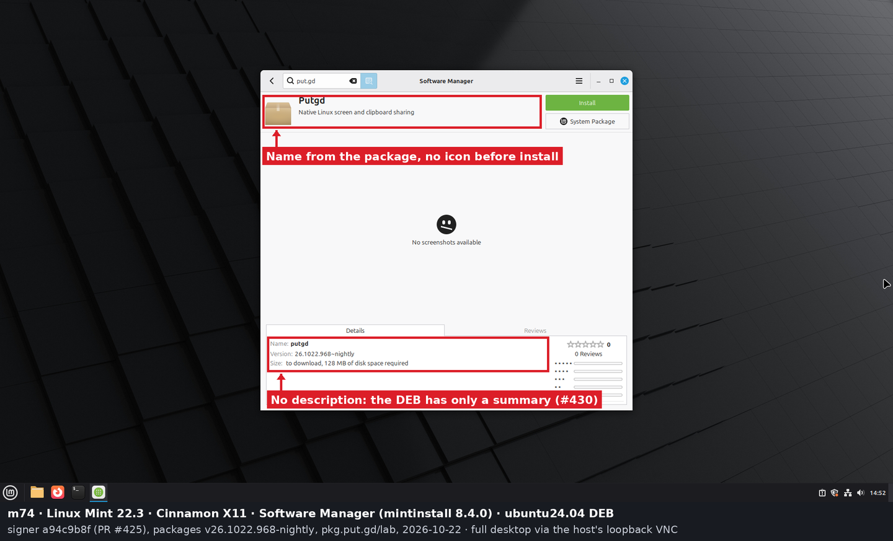
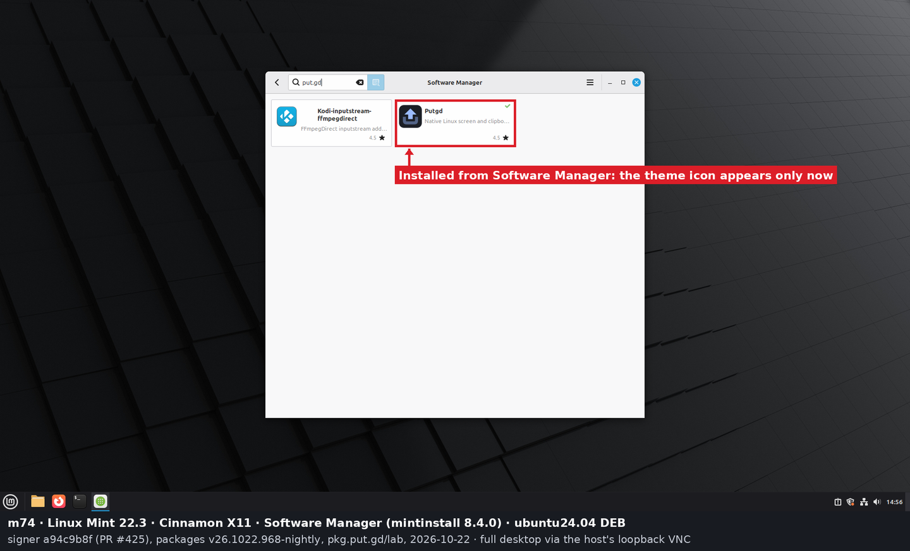
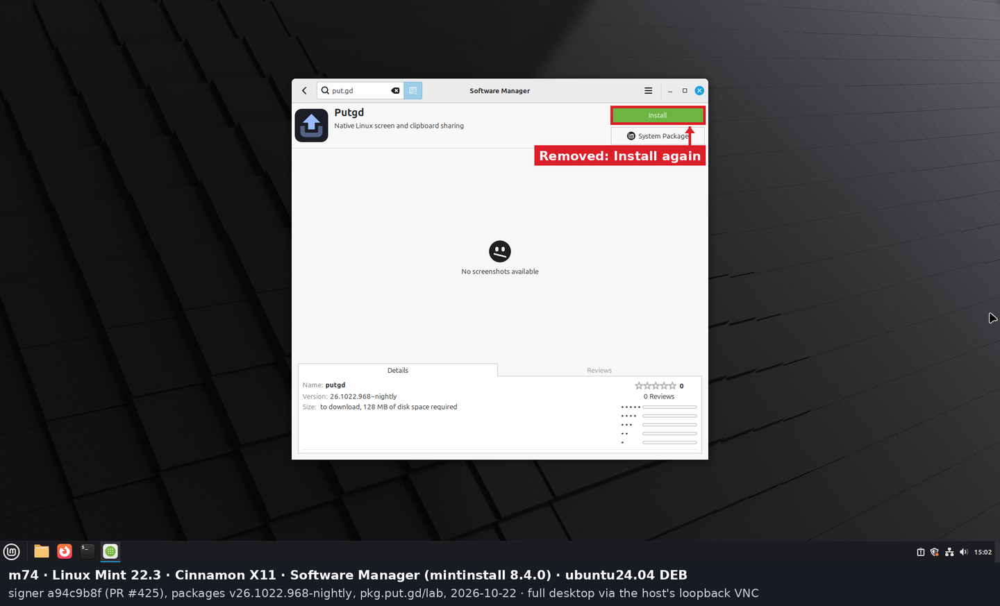

In the last picture Mint still shows the icon it loaded while put.gd was installed. Mint finds icons only in the installed icon theme, so it can't show put.gd's icon before install.

## What the lab found

- **apt needs the uncompressed names in `Release`.** On the first publication, apt on k72 fetched `Packages` but skipped every DEP-11 target. apt skips an optional index target unless `Release` lists its uncompressed MetaKey (`main/dep11/Components-amd64.yml`, `icons-64x64.tar`), and the signer had listed only the `.gz` files.
  - A throwaway apt root on k72 confirmed it: with the uncompressed names listed, apt fetched the `.gz` files.
  - `a94c9b8f` lists and publishes both forms, as Ubuntu's archive does. The lab was emptied (51 objects) and republished. After that, apt on k72 and m74 fetched `Components` and the icons, and `appstreamcli get gd.put.Putgd` returned the entry.
- **Discover started from SSH can't get authorisation.** Discover was first started from an SSH session, so it wasn't in the active graphical session, and its background refresh failed with "Failed to obtain authentication". Started as a user-manager app (`systemd-run --user`), as the Plasma menu does, it refreshed cleanly.
- **GNOME Software needs a refresh after a repository is added.** Its background service had been running since before the repository was added, and found nothing. After a restart it refreshed, dnf5 installed the catalog as `/var/cache/swcatalog/xml/putgd-lab-314.xml` and `icons/putgd-lab-314/`, and the search found put.gd. dnf5 names the catalog after the repo id, whatever the catalog's own origin.
- **Mint's Software Manager doesn't read AppStream for apt packages.** It takes the name ("Putgd"), summary and description from apt, and the icon from the icon theme only (`mintcommon/installer/pkgInfo.py`). The catalog changes nothing there.
  - [#430](https://github.com/patrick-hudson/put.gd-desktop/issues/430) adds an extended package description, which Mint, apt and dnf would show.
  - On m74, `libmng2` and `qt6-image-formats-plugins` were already on the host as automatically installed packages, left over from an earlier put.gd install. Mint offered to remove them along with put.gd. They were marked manual for the removal and set back to automatic afterwards, so the host's package set is unchanged.
- **No screenshots.** Both GNOME Software and Mint show an empty screenshots area; [#431](https://github.com/patrick-hudson/put.gd-desktop/issues/431) adds screenshots to the metainfo.

## Lab objects and cleanup

| Step | Keys | Record |
| --- | --- | --- |
| Dry run (scratch state, nothing uploaded) | 50 `lab/` keys plus `lab/receipts/v26.1022.968-nightly.json` | [lab-dryrun-keys.txt](logs/lab-dryrun-keys.txt) |
| First publication (`.gz`-only DEP-11) | 50 | [receipt-publish1.json](logs/receipt-publish1.json) |
| Cleanup 1 | 51 deleted, `/lab/*` invalidated, 404s checked | [lab-clean1.txt](logs/lab-clean1.txt) |
| Second publication (`a94c9b8f`) | 68 | [receipt-publish2.json](logs/receipt-publish2.json), [lab-keys-publish2.txt](logs/lab-keys-publish2.txt) |
| Cleanup 2 | 69 deleted, `/lab/*` invalidated, 404s checked; `ListObjectsV2` on `lab/` returns 0 | [lab-clean2.txt](logs/lab-clean2.txt) |

- **Keys that differ from the dry run.** Three repodata files in the first publication have different names from the dry run. The RPM is signed afresh on each run, so `createrepo_c` writes new metadata with new hashes; every key was still under `lab/`.
- **Signer state.** The signer's lab workspace and publisher state were removed. Its lab receipts stay in `~/.local/state/putgd-signer/receipts/lab/` on d69.
- **Test hosts.** On each host, putgd was purged and the lab repository file and key removed. The software centre the test started was stopped; on f44, GNOME Software's background service was started again. Each host's package list matches its list from before the test.
  - Records: [k72-apt-history.txt](logs/k72-apt-history.txt), [f44-dnf-history-install.txt](logs/f44-dnf-history-install.txt), [f44-dnf-history-remove.txt](logs/f44-dnf-history-remove.txt) and [m74-apt-history.txt](logs/m74-apt-history.txt).
  - The six `gcc-mingw-w64` packages that appeared on m74 during the slot were installed by someone else and aren't in its apt history.
- **Desktop locks.** All three were released with `--verified-clean`.

## Not covered here

- **The live rollout.** That means pulling the live signer on d69 to the merge commit and checking that the next nightly's repositories carry the catalog. It needs Patrick's OK and happens after the merge.
- **GNOME Software on d69 (Debian 13).** It wasn't run; Discover on k72 already covers the apt path.
