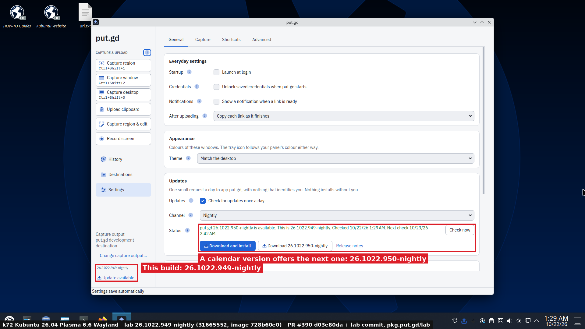
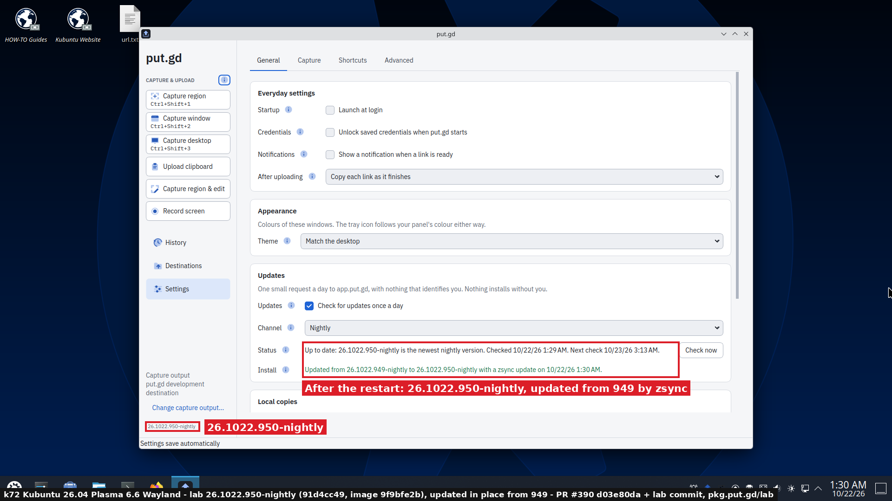
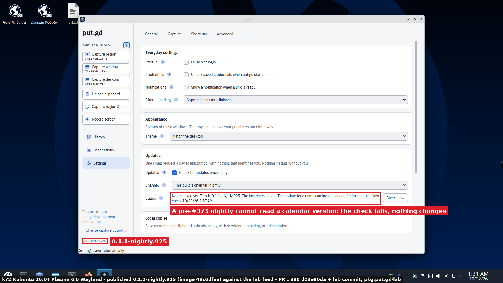

# Calendar versions: lab acceptance, 2026-10-22 (#373)

This is the lab acceptance for [#390](https://github.com/patrick-hudson/put.gd-desktop/pull/390), the code change that switches put.gd to calendar versions `YY.MDD.N`. The design and Patrick's decisions are on [#373](https://github.com/patrick-hudson/put.gd-desktop/issues/373); the contract is in [versioning.md](../../versioning.md).

The point to prove: the first calendar-versioned nightly upgrades an installed `0.1.1-nightly.N`, with no epoch, on every format put.gd ships through pkg.put.gd:

- dnf (RPM),
- apt (DEB),
- the AppImage's zsync updaters,
- and put.gd's own in-app update between calendar versions.

Everything below ran on the builders. Lab objects went to the signer's lab prefix, `pkg.put.gd/lab/`, and were deleted afterwards. The live feeds, the stable channel and the stable key were not touched.

## Builds under test

| Build | Commit | Tag (local, never pushed) | Made by |
| --- | --- | --- | --- |
| Published pre-#373 nightly | `124fb3c0` | `v0.1.1-nightly.925` | the real GitHub release: RPM, ubuntu24.04 DEB, AppImage `49c6dfaa…` |
| Old-format lab AppImage | `7ddc3a9c`, an empty lab commit on `0435ed6a` (nightly before #390) | `v0.1.1-nightly.943` | [calver-appimage-lab.sh](lab/calver-appimage-lab.sh) `legacy`, image `f957e39d…` |
| CalVer lab nightly N | `31665552`, an empty lab commit (2026-10-22 12:00Z) on `d03e80da` (#390 head) | `v26.1022.949-nightly` | native packages on each target host ([calver-labbuild.sh](lab/calver-labbuild.sh)), AppImage `728b60e0…` |
| CalVer lab nightly N+1 | `91d4cc49`, a second lab commit (12:10Z) | `v26.1022.950-nightly` | AppImage `9f9bfe2b…` |

**How the lab commits were made:**

- They use a fixed author, committer and date, so f44, d69, k72, m74 and the AppImage container all made the same commit `31665552`.
- Its version is that commit's UTC date and count: `26.1022.949`.
- #390's later commits change only tests.

**How each package was built:**

- **Native packages** were release builds (`cmake --preset release`, Proton off) on the target hosts at `nice -n 19 -j2`:
  - debian13 DEB on d69,
  - ubuntu26.04 DEB on k72,
  - ubuntu24.04 DEB on m74,
  - fedora44 RPM on f44.
  - All four carry package version `26.1022.949~nightly`, and the RPM release is `1.fc44`. The manifest reports version `26.1022.949-nightly` and baseVersion `26.1022.949`.
- **AppImages** were built the way `package.yml`'s `appimage` job builds them, in a pinned `ubuntu:24.04` podman container on f44.
  - `PUTGD_APPIMAGE_UPDATE_BASE=https://pkg.put.gd/lab/` gives them the update information `zsync|https://pkg.put.gd/lab/dl/nightly/appimage.zsync`.

## Lab publication

[lab/lab373.py](lab/lab373.py) published through the signer's lab scope on d69, running #390's `pkgrepo.py`. The deployed signer at `dc1ab32` can't parse a calendar version, and skips it.

- It reads the live signer's config by path, with its AWS and key files only through the environment the signer's unit names.
- It keeps its own state directory, so the live signer's checkout, state and timer were never touched. The coordinator approved this.
- `lab nightly.json` returned 404 before the first publication.

| Publication | Contents | Keys | Signed |
| --- | --- | --- | --- |
| `v26.1022.949-nightly` (05:50Z) | the four packages; apt for each label, the dnf repository, the feed | 30 (dry run first, all under `lab/`) | nightly key, as in the #293 and #343 lab runs |
| `v26.1022.950-nightly` (06:28Z) | AppImage and `.zsync` only; the apt and dnf repositories stay at 949 | 35 in all (dry run first) | nightly key; trusted comment `put.gd v26.1022.950-nightly nightly` |

The receipts are [receipt-lab-v26.1022.949-nightly.json](results/receipt-lab-v26.1022.949-nightly.json) and [receipt-lab-v26.1022.950-nightly.json](results/receipt-lab-v26.1022.950-nightly.json). The RPM went through the signer's new `~nightly` file-name parsing (`putgd-26.1022.949~nightly-1.fc44.x86_64.rpm`).

## dnf and apt: the published 925 upgrades to the CalVer nightly

[lab/accept-calver.sh](lab/accept-calver.sh) ran on the physical builders over SSH, with no GUI, once the A–K acceptance rerun had released them:

1. Download `putgd-0.1.1-nightly.925-<label>-x86_64.<deb|rpm>` from the GitHub release and check it against the release's `SHA256SUMS`.
2. Install it from the file. It adds the live nightly repository.
3. Add the lab repository beside it, with the same trust.
4. Upgrade through the package manager, then remove everything.

| Host | Before | What the package manager offered | After | Comparison |
| --- | --- | --- | --- | --- |
| f44 Fedora 44 | `putgd-0.1.1~nightly.925-1.fc44` | `putgd 26.1022.949~nightly-1.fc44` from `putgd-lab373` | `putgd-26.1022.949~nightly-1.fc44`, `putgd 26.1022.949-nightly` | `rpm.vercmp(26.1022.949~nightly-1.fc44, 0.1.1~nightly.925-1) = 1` |
| m74 Mint 22.3 | `putgd 0.1.1~nightly.925` | candidate `26.1022.949~nightly` (lab), over the live `0.1.1~nightly.947` | `putgd 26.1022.949~nightly`, `putgd 26.1022.949-nightly` | `dpkg: 26.1022.949~nightly > 0.1.1~nightly.925` |
| ubuntu:24.04 container on f44 | `0.1.1~nightly.925` | as on m74 | `26.1022.949~nightly` | as on m74 |

On both hosts the upgraded binary's manifest names commit `31665552`. On m74, apt's version table listed the live repository's newest pre-#373 nightly, `0.1.1~nightly.947`. It still chose the calendar version, so the first real calendar nightly upgrades even the newest old one. A Fedora container run is not counted: a `sed` delimiter bug in its first version of the script left it without the lab repository, and the host run uses the fixed script.

The logs are:

- [f44-dnf-upgrade.log](results/f44-dnf-upgrade.log),
- [m74-apt-upgrade.log](results/m74-apt-upgrade.log),
- [container-ubuntu2404-apt-upgrade.log](results/container-ubuntu2404-apt-upgrade.log).

**Afterwards** `dnf remove` and `apt purge` removed putgd and the repository files from both hosts. No binary, `/usr/share/putgd`, key, repository file, autostart or desktop entry was left, and no process. m74's earlier `putgd 0.1.1~dev.895` in config-files state (from a #341 DEB check) was purged as part of this, as the coordinator agreed.

## AppImage: in-app update, zsync updaters and an old build

All of this ran on k72 (Kubuntu 26.04, Plasma 6.6, Wayland) under the desktop lock. #343's driver [upd293.py](../2026-10-21-appimage-updater-293/lab/upd293.py) was used unchanged:

- each run had private `XDG_CONFIG/STATE/CACHE_HOME` and runtime directories, and its own copy of the image;
- the lab feed, release and mirror came from `PUTGD_UPDATE_FEED_URL`, `PUTGD_UPDATE_RELEASE_URL` and `PUTGD_UPDATE_MIRROR_URL`;
- appimageupdatetool was continuous build 254, `8d17a50e…`.

| Check | Result |
| --- | --- |
| In-app update, lab 949 → 950 (`update.check`, `update.install`, `update.restart`) | Offered "put.gd 26.1022.950-nightly is available. This is 26.1022.949-nightly". Installed by zsync in 10.8 s (phases: verifying, zsync, verifying, installing). The image became `9f9bfe2b…`, equal to 950's `SHA256SUMS` line. The signature's trusted comment was `put.gd v26.1022.950-nightly nightly`. The backup `.putgd-update-backup-26.1022.949-nightly.AppImage` was removed when 950 started from the same path. After the restart: `current` and `latest` 26.1022.950-nightly, `updateAvailable: false`. [Run record](results/k72-inapp-949-to-950-run.json) |
| appimageupdatetool, old-format lab 943 → 950 | Update information `zsync|https://pkg.put.gd/lab/dl/nightly/appimage.zsync`. It used 109 MB of the old image, fetched 6.8 MB and wrote `putgd-26.1022.950-nightly-x86_64.AppImage` beside the old file, `9f9bfe2b…` as signed. The new image reports `putgd 26.1022.950-nightly`. [Log](results/k72-appimageupdatetool-943-to-950.log) |
| The real published 925 against the calendar feed | `update.check` fails with `update_feed_invalid`, "The update feed names an invalid version for its channel", and nothing changes. A pre-#373 build can't parse `26.1022.949-nightly`. This is the accepted cost of shipping in one pull request ("nobody is using this app"). apt, dnf and the zsync updaters still upgrade it, and [updates.md](../../updates.md) says so. The same check over SSH with the image's `putgd-cli --check-update nightly`: [log](results/check-925-against-lab.log); [run record](results/k72-925-against-lab-run.json) |

When the zsync updaters write the calendar-versioned file beside the old one, start at login picks the newest image across both name formats. The case `0.1.1-nightly.943` beside `26.1022.950-nightly` is in `tests/unit/test_appimage_login_start.py` (#390).

### Pictures

Each picture is a full frame of k72's own VNC wall server. The only window open was put.gd's Settings, with no browser windows. The annotations are drawn by [lab/annotate373.py](lab/annotate373.py), and the footer names the desktop and the exact build.

## Release notes and CHANGELOG preview

`python3 tools/releases/promote.py` on #390 against the real repository was a read-only preview: it fetched, and wrote nothing. It titled the promotion `release: promote nightly 26.1022.947`, after nightly HEAD `476e5c7b`, committed on 2026-10-22 UTC as commit 947. It wrote the change list as CHANGELOG.md's `[Unreleased]` section, and the body names `promote.py --finalize vYY.MDD.N` as the step after publication. The first 135 lines are in [promote-preview-head.txt](results/promote-preview-head.txt).

## Clean-up

| What | Result |
| --- | --- |
| Lab objects | All 35 keys the lab state tracked ([list](results/lab-keys-before-clean.txt)) and both lab receipts were deleted (37 objects), and `/lab/*` was invalidated ([log](results/lab-clean.log)). A `list_objects_v2` of `lab/` then returned 0 keys. These lab URLs answered 404: `lab/update/v1/nightly.json`, `lab/dl/nightly/appimage.zsync`, `lab/releases/v26.1022.950-nightly/SHA256SUMS`, `lab/rpm/…/repomd.xml` and `lab/apt/ubuntu24.04/dists/nightly/InRelease`. The live `update/v1/nightly.json` answered 200. |
| f44, m74 | putgd and its repository files were removed and checked: nothing left. |
| k72 | Each run quit its resident. The lock was released at 06:31Z with `--verified-clean`. No put.gd profile, autostart entry or process of these runs was left. |
| Tags | Every lab tag lives only in the builders' lab clones and was never pushed. |

## Not covered here

- **Deploying the live changes.** These happen when #390 merges, before the first calendar nightly is tagged, and Patrick has approved them:
  - the d69 signer's `git pull` to #390's merge;
  - the put.gd-site nightly-detection fix, [put.gd-site#5](https://github.com/patrick-hudson/put.gd-site/pull/5).
- **The live check on the first real calendar nightly.** It covers the feed, `/dl/nightly`, and apt and dnf from live pkg.put.gd.
- **Stable releases.** They are covered by the unit and CMake/Python tests and the promote preview. No stable release exists yet, and a stable lab publication needs the stable key, which wasn't used.
