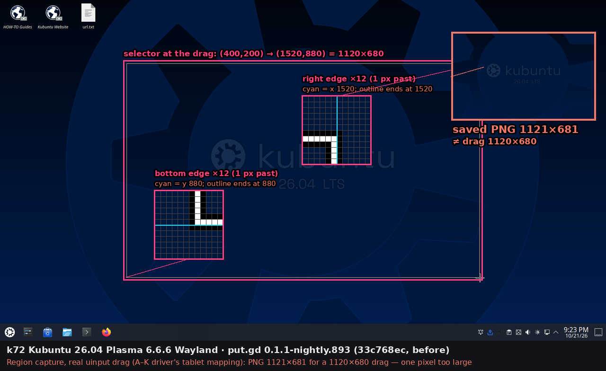
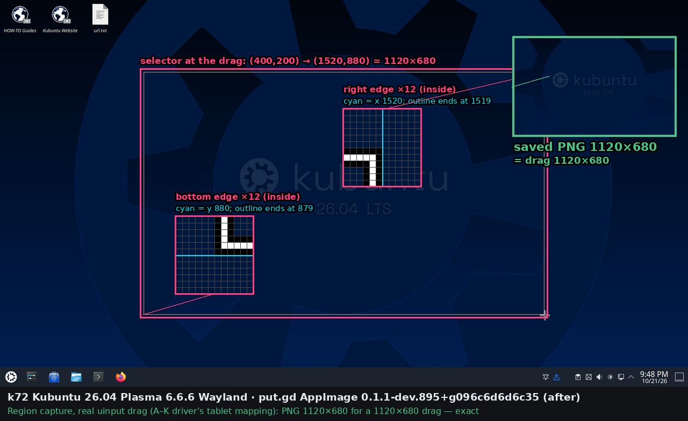
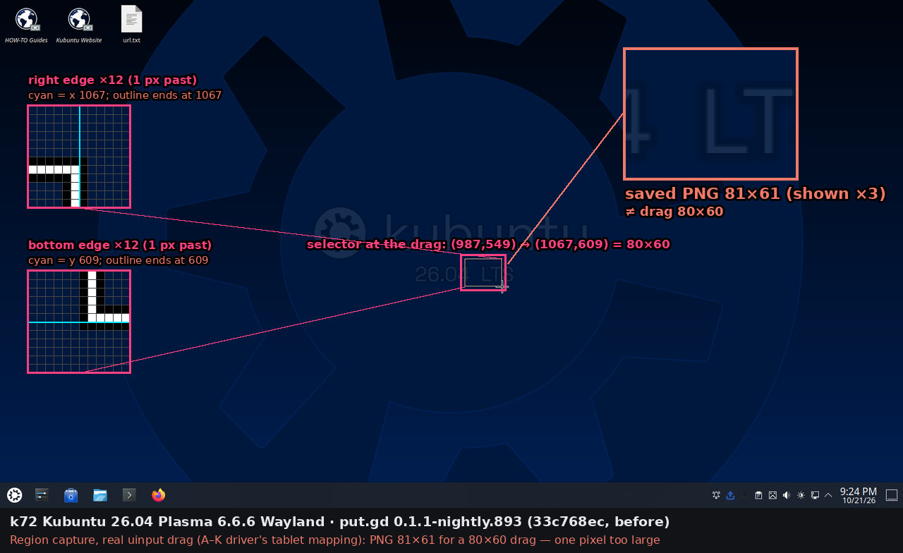
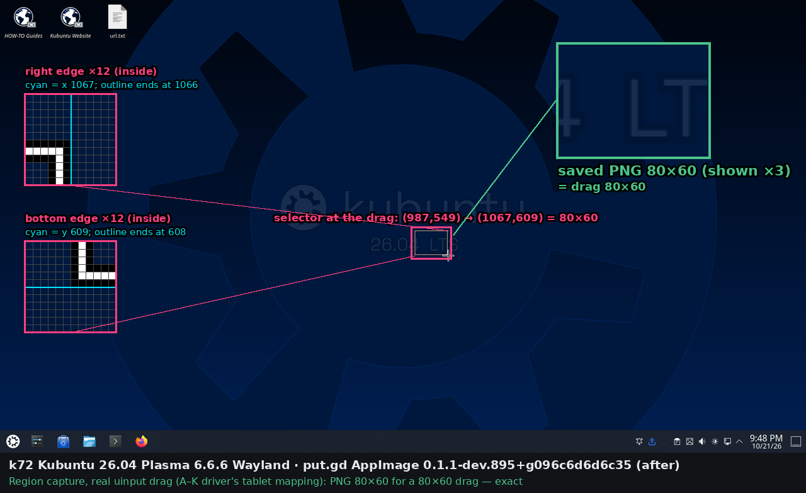

# Plasma region capture one pixel too large (#333)

Code: [#356](https://github.com/patrick-hudson/put.gd-desktop/pull/356) at `096c6d6d`. The build under test is
`0.1.1-dev.895+g096c6d6d6c35`, from CI dispatch run
[39711633638](https://github.com/patrick-hudson/put.gd-desktop/actions/runs/39711633638):

- AppImage, sha256 `38a9706ac1bc04afb5da5535b8d5068ea94ec927b7560077e2f709179c9f4b6f`
- Ubuntu 26.04 DEB, sha256 `59112fb141bb119b3f7810fbf40a4be4f66e9c7a97a5d59e00f485388640e95a`

"Before" is `0.1.1-nightly.893` (`33c768ec`, the branch base), downloaded from its GitHub release and checked
against its `SHA256SUMS`. All runs were on 2026-10-22, between 02:10Z and 03:10Z.

## Cause

`KdeRegionOverlay` rounded the fractional Wayland pointer position to the nearest logical edge (`qRound`). The
2026-10-21 A–K driver (`afa.py`) maps a pixel to the uinput tablet as `int(x*32767/(extent-1))`. KWin and libinput
turn a tick back into `tick*1920/32768`, so the end of a (400,200)→(1520,880) drag arrives 0.74 px *into* pixel
1520. `lab.py`'s `ceil(x*32768/w)` lands just past each edge, and VNC/QEMU input just below it. Positions a
fullscreen and a layer-shell Qt surface received on k72 (KWin 6.6.6, scale 1), logged by `lab/probe.cpp`:

| Input mapping | Press | Release | `qRound` selection | floor selection |
| --- | --- | --- | --- | --- |
| A–K driver `int(x*32767/(w-1))` | 400.195, 200.160 | 1520.742, 880.762 | 1121×681 | 1120×680 |
| `lab.py` `ceil(x*32768/w)` | 400.020, 200.027 | 1520.039, 880.004 | 1120×680 | 1120×680 |
| VNC/QEMU `x*32767//w`, (150,100)→(1130,700) | 149.941, 99.965 | 1129.922, 699.949 | 980×600 at (150,100) | 980×600 at (149,99) |

The fix floors each position to the pixel that holds the hotspot: a pointer at 399.99 is in pixel 399. This
matches X11's integer root positions and the GNOME extension's `Math.floor` selector. KWin 6.3.6 (d69) and
6.6.6 (k72) behave the same. The exact Aurora (KWin 6.7.4) result in the 2026-10-21 pass came from VNC input,
not from a compositor change, so no version-specific handling is needed.

## Results

Real uinput drags on the physical desktops, scale 1, one 1920×1080 output, with a private profile and local-only
output. For each capture, `operation.inspect`'s artifact sha256, the `history.list` record's sha256 and the saved
file's sha256 agree, and the PNG header gives the size. Per-capture data is in `results/`.

| Desktop | Build | A–K 1120×680 | A–K 80×60 at (987,549) | lab 1120×680 | lab 80×60 | A–K 80×60 at (1440,820) |
| --- | --- | --- | --- | --- | --- | --- |
| k72 Kubuntu 26.04, Plasma 6.6.6 | 893 AppImage | **1121×681** | **81×61** | 1120×680 | — | 80×60 |
| k72 | 895 AppImage | 1120×680 | 80×60 | 1120×680 | 80×60 | 80×60 |
| k72 | 895 DEB | 1120×680 | 80×60 | 1120×680 | 80×60 | — |
| d69 Debian 13, Plasma 6.3.6 | 893 AppImage | **1121×681** | **81×61** | 1120×680 | — | — |
| d69 | 895 AppImage | 1120×680 | 80×60 | 1120×680 | 80×60 | 80×60 |

The A–K mapping's 80×60 drag at (987,549) starts 0.48 px into its pixel and ends 0.52 px in. Before the fix only
the end rounded up, so it shows the bug at the small size. At (1440,820) both ends round the same way.

### Fractional scale (k72, 895 AppImage, scale restored to 1 afterwards)

Drag coordinates are logical, and KWin returns native pixels. Edges on the native grid scale exactly. Elsewhere,
the shared composer rounds native boundaries outwards, adding at most one native pixel per axis.
`fractionalScaleKeepsLogicalSize` pins the same numbers.

| Scale (logical size) | Drag | PNG |
| --- | --- | --- |
| 1.5 (1280×720) | (400,200)→(480,260), lab and A–K | 120×90 |
| 1.5 | (401,201)→(481,261) | 121×91 |
| 1.5 | (400,200)→(1040,560) | 960×540 |
| 1.25 (1536×864) | (400,200)→(480,260), lab and A–K | 100×75 |
| 1.25 | (401,201)→(481,261) | 101×76 |
| 1.25 | (400,200)→(1520,840) | 1400×800 |

Earlier 1.5 rows in `results/k72-895.json` (81×61, 641×361 and 161×60) used the driver's default 1920×1080
mapping on the 1280×720 logical screen, which was a mistake in my driver. A full-screen 1.5 drag gave 1918×1078 on
893 and on 895 alike (`k72-893s.json`), because the tablet's last tick stops short of the screen edge.

### Idle memory (k72, AppImage, fresh resident, 180 s idle, load ≈ 0)

| Build | RSS | PSS |
| --- | --- | --- |
| 893 | 29.53 MiB | 23.05 MiB |
| 895 | 29.78 MiB | 23.25 MiB |

The difference is run-to-run noise; the change only touches the region selector's edge rounding.

## Pictures

Full k72 desktop at the drag, with the button still down, captured from its loopback VNC. The insets magnify the
selector's right and bottom edges 12×: cyan is the drag's end edge, and the outline is painted inside the
selection, so its outer black pixel is the selection's last pixel. The saved PNG is shown with its measured size.
d69's frames are not published because its desktop had a browser open; d69's numbers are above.

| Before: 0.1.1-nightly.893 | After: 0.1.1-dev.895+g096c6d6d6c35 |
| --- | --- |
|  |  |
|  |  |

The DEB of the same commit on k72:

## Lab tools

- `lab/probe.cpp`, `lab/CMakeLists.txt`: a Qt surface (fullscreen, or a layer-shell overlay with `PROBE_LAYER=1`)
  that prints the press and release positions it receives.
- `lab/drag.py`: a drag through the `tools/lab/host_input.py` socket with `MAP=lab|afa|vnc`.
- `lab/region333.py`, `lab/seq.sh`: a private-profile put.gd run with local-only output. They run an `action.invoke`
  region capture with a uinput or xdotool drag and record `operation.inspect`, `history.list`, the saved file, its
  sha256 and a VNC frame at the drag. They also measure idle memory.
- `lab/annotate333.py`: the pictures above.

## Host actions and cleanup

- Locks: k72 02:10:54–02:25Z and 02:47:25–03:07Z, d69 02:43:58–02:47Z, all released with `--verified-clean`. The
  `put.gd-flake` CTest processes on k72's Xvfb displays belonged to another session and were named not-mine.
- k72's scale was set to 1.5 and 1.25 temporarily and restored to 1. The DEB was installed with
  `apt-get install --no-install-recommends` (no other packages) and purged.
- Each run's `~/.local/share/putgd` was moved into its run folder under `~/work/put.gd-333/runs/`. No put.gd
  desktop entries, autostart entries or processes remain. The uinput agents were stopped by exact PID.
