# The rail at short heights (#391) and the banner's first click (#415)

Recorded on 2026-10-22 by the rail-391-notify-415 session, for code PR #423.

- **Before:** nightly `26.1022.968-nightly` (ddc7981e), the published CI AppImage.
- **After:** PR #423's CI AppImage `26.1022.987-dev+g9684be5d5e39`, from run [39842648614](https://github.com/patrick-hudson/put.gd-desktop/actions/runs/39842648614). Its sha256 is `5aac86748f60436e058b504248cbe9ababc1b31057a5edfe517d2345df7e13fa`.

Every picture names its build in its caption.

## #391: the rail overlapped at short window heights

**Cause:** the rail was a plain box layout about 780 px tall, and the window's own minimum height (680) let a window manager hold it shorter. The layout then squeezed its items into each other. In the same squeeze, the version link went below its own text: its stylesheet minimum is 6 px. That is the clipped "26.1022.968-nightly" Patrick saw on Cinnamon.

**Fix (PR #423):**
- **Scroll area:** the rail's content sits in a frameless scroll area, and it is never shorter than its laid-out height.
- **Compact mode:** below the natural height the rail turns compact.
  - The capture buttons drop their shortcut line; their tooltip keeps it.
  - The buttons, footer links and gaps close up.
  - The navigation list is as tall as its rows.
- **Version link:** it has one more pixel of padding above and below its line.

**How the pictures were set up:**
- **Worst reachable rail:** a three-line capture output ("Default output", the destination, "1 action exception").
- **Before only, Update available:** 968 checked a loopback test feed naming `26.1022.999-nightly`, in a private profile only. A development build never shows Update available (`development_build`), so the after pictures don't have that row. The GUI test covers it.
- **Aurora VM:** an overlay of the Aurora v3 golden on f44 (`aur-i391a`), 1280×800, the window maximized by a KWin script. These are full VM frames.
- **m74 (physical, Cinnamon X11):** the window is 1280×722, the size a maximized window gets on a 1280×800 screen. These are crops of put.gd's own window, which is 97 % put.gd colours.

**Aurora VM, 1280×800, dark theme:**

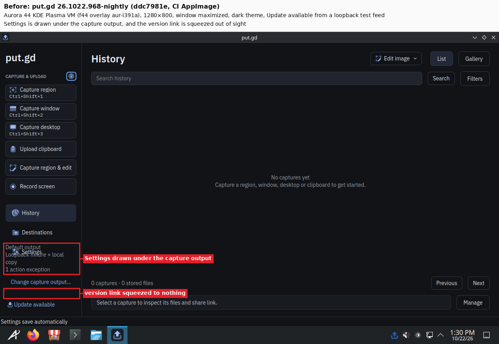

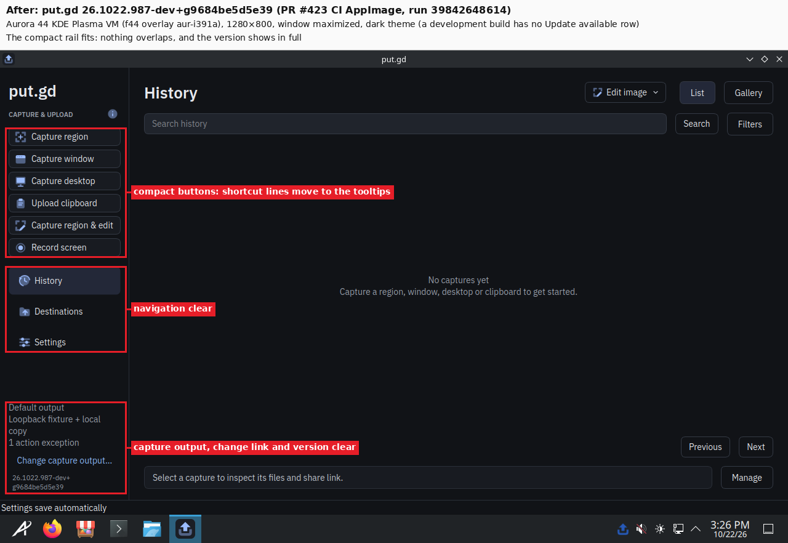

**Aurora VM, 1280×800, light theme:**

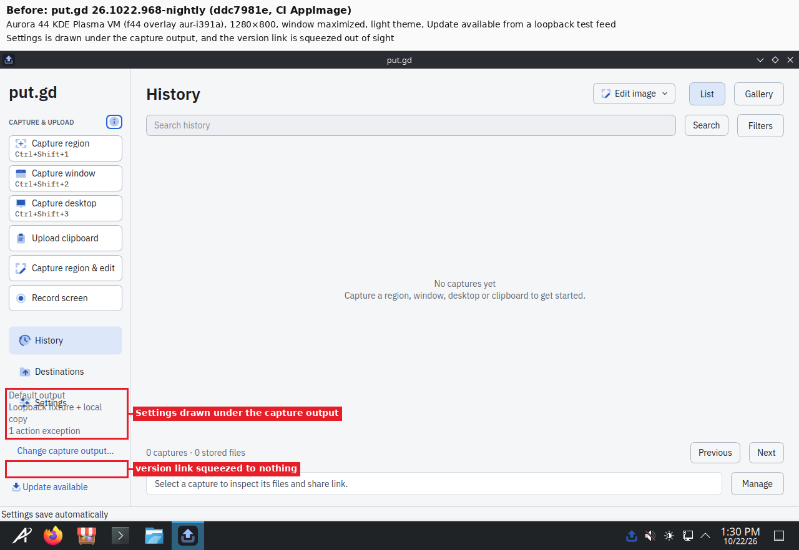

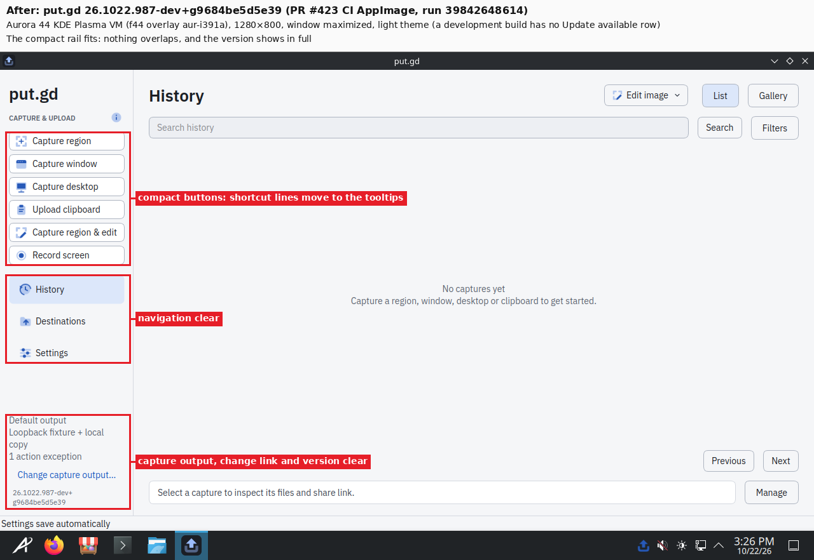

**m74, physical, 1280×722, dark theme:**

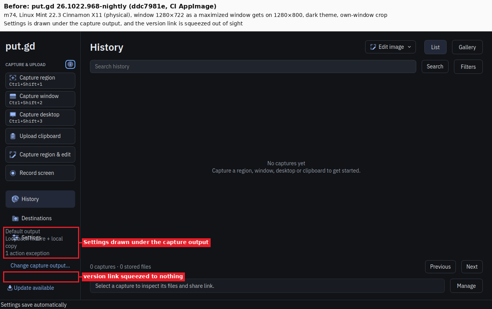

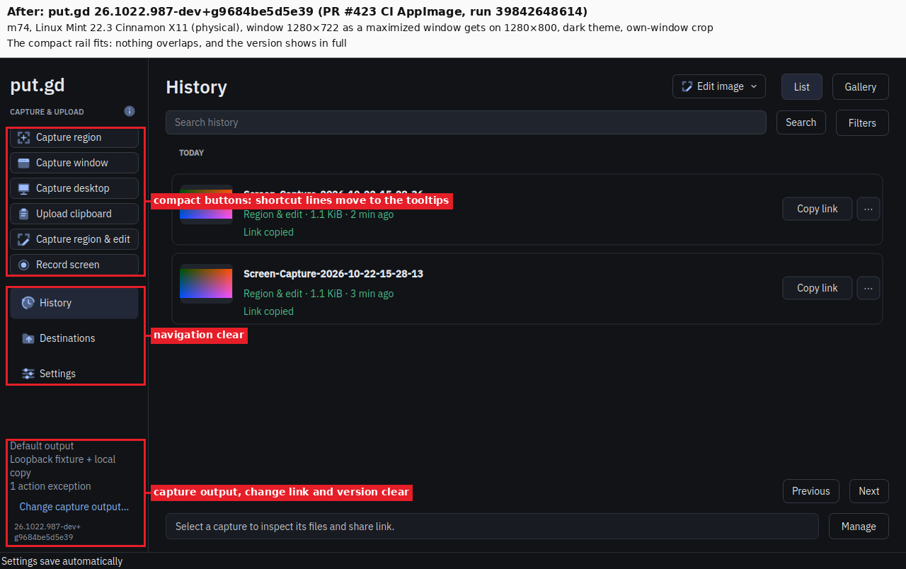

**m74, physical, 1280×722, light theme:**

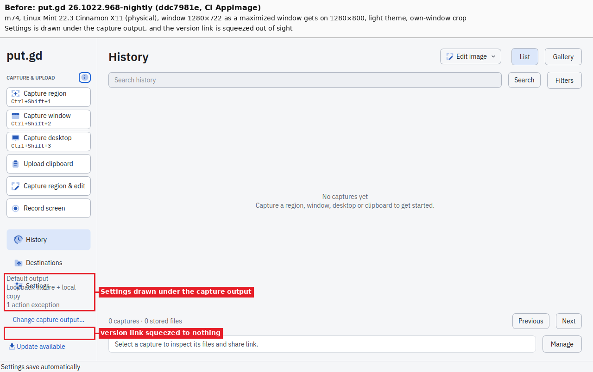

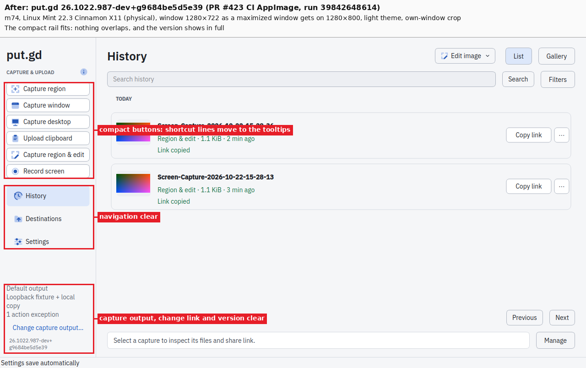

**The version label, m74, window 1280×805, rail footer zoomed 2×:** 968's link has its descenders cut off. The PR build shows its whole version. It is a development build, so its version is plain text, not a release link. The nightly link's height (at least its line plus 8 px) is asserted in `gui_application` `railFitsShortWindows` for the longest CalVer string, `26.1231.99999-nightly`.

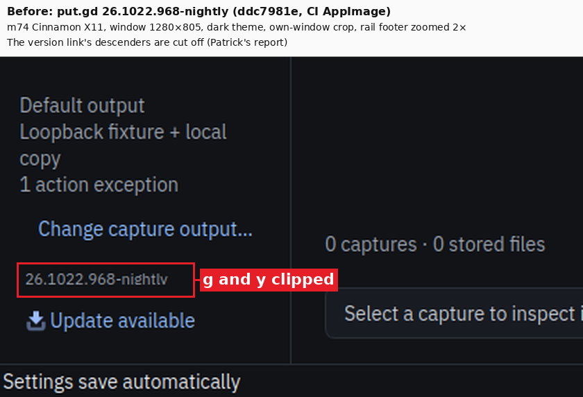

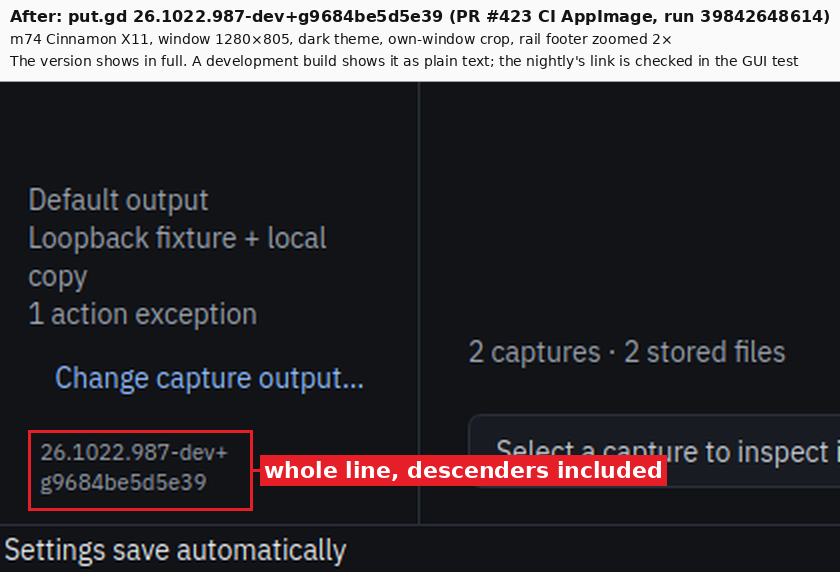

**Still to come:** the "after, with Update available" picture, from the first nightly that contains #423. #391 stays open until it is in.

## #415: the banner's first click

**What the acceptance saw:** on nightly 942 (k72) and 842 (m74), a first real click on the link-ready banner reached no action. put.gd had sent one `Notify`, with `replaces_id` 0 and `default` registered from the start. The server emitted nothing back: no `ActivationToken`, `ActionInvoked` or `NotificationClosed`.

**Reproduction on 968** (2026-10-22, 18:04–18:19Z): this used the acceptance's own `afa.py` and [`lab/trial415.py`](lab/trial415.py). Each trial uploaded through Edit & upload, cropped the banner, clicked it once with real input, and recorded `dbus-monitor`.

| Variant | k72 (Plasma 6.6.6 Wayland, uinput) | m74 (Cinnamon X11, xdotool) |
| --- | --- | --- |
| The acceptance's timing (press 0.2 s after the move, about 2.2 s after the banner) | 3/3 | 3/3 |
| The acceptance's exact steps before F (cover on/off, `region-size --coords`, notifications on) | 2/2 | 2/2 |
| No hover before the press | 3/3 | 3/3 |
| Press 1.6 s after the banner | 3/3 | 3/3 |
| Other banner positions, including the acceptance's own click point | 8/8 | 8/8 |

**Every first click invoked `default`:** 19 of 19 on each host. Two more presses on k72's header close button gave `NotificationClosed`, as expected.

**Conclusion:** the failure doesn't reproduce, and nothing on put.gd's side could cause it. It was a transient in the server or input path. No code change, no workaround needed beyond a second click, and nothing filed upstream, because there is no reproducible case. Raw trials are in [`results/results.json`](results/results.json).

**On the PR build:** with the stand-in URL recorder as the http(s) handler, a single real click on each banner invoked `default` and opened the link in the recorder. That was 2 of 2 on k72 and 2 of 2 on m74.

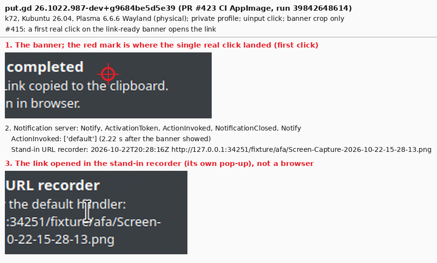

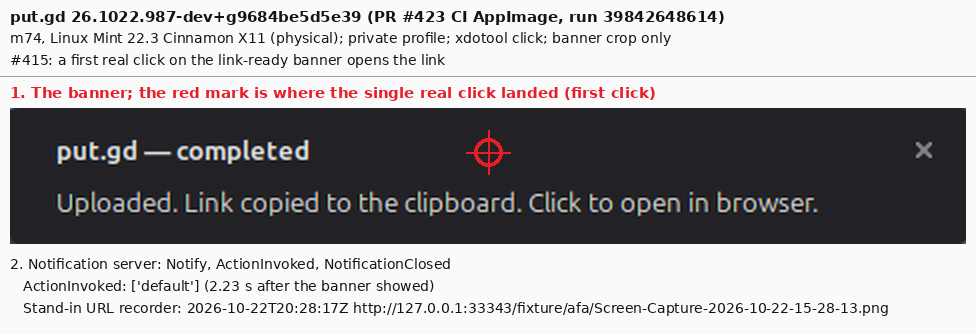

## The link guard

The two mishaps below came from links reaching the user's real browser profile. So the drivers in [`lab/`](lab/) now refuse that outright. These are copies of the acceptance rerun's `afa.py` and `i326.py` with the guard added; the other helpers they import are the rerun's own `lab/` and `tools/lab/`.

**What's guarded:**
- **`afa.require_recorder`:** it checks that `gio`, in the session's real environment, resolves both `x-scheme-handler/http` and `https` to the stand-in recorder, and that the recorder's desktop entry exists. Otherwise it refuses and exits 4. It runs:
  - at the start of `afa.py notify` and right before its banner click;
  - in `i326.py open-link`;
  - at the start of every [`trial415.py`](lab/trial415.py) trial and right before its click.
- **`afa.py cleanup`:**
  - it refuses while any run has the recorder on, so `handler-off` comes first;
  - it never deletes the recorder's entry itself.

**Tested on k72 with the recorder off** (2026-10-22T20:41Z, a throwaway `AFA_ROOT` in /tmp, removed afterwards). All four commands refused: `recorder-check`, `trial415.py` and `afa.py notify` exited 4, and `cleanup` exited 1. The transcript is [`results/guard-test.txt`](results/guard-test.txt).

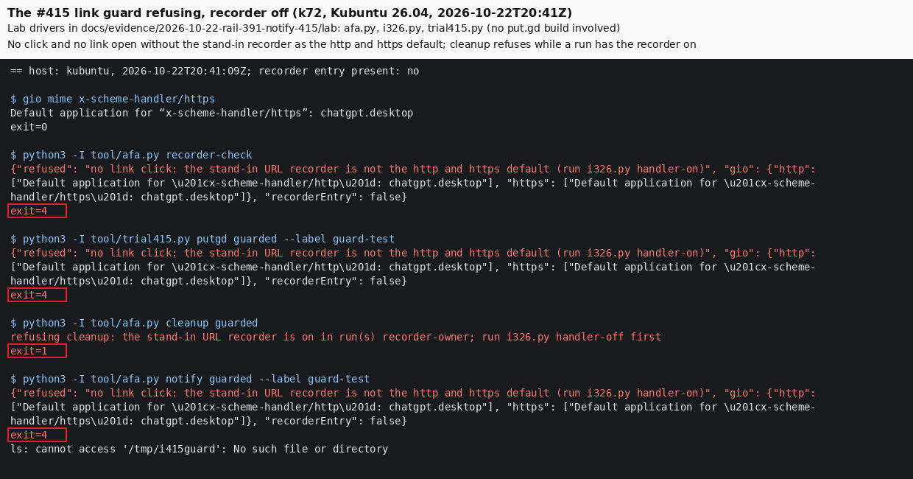

## Idle memory

`afa memory`, 90 s, after the same steps on each build (setup, start, two banner trials):

| Host | PR build RSS / PSS (MiB) | 968 RSS / PSS (MiB) |
| --- | --- | --- |
| k72 | 32.80 / 26.34 | 32.86 / 26.36 |
| m74 | 32.27 / 27.13 | 32.25 / 26.66 |

The RSS is unchanged, and both builds are inside the 40 MiB budget.

## Mishaps and cleanup

- **Firefox opened twice by mistake.** Both times, the loopback `http://127.0.0.1:…/fixture/afa/…` links reached Firefox with the default profile on k72 and m74, instead of the stand-in recorder.
  - **18:06Z:** the first six reproduction clicks ran before the recorder was on.
  - **20:32Z:** for the 968 memory baseline, `afa cleanup` of the PR run removed the recorder's desktop entry. That cleanup removes desktop entries created during its run.
  - **Lesson:** turn the recorder off (`i326.py handler-off`) before any `afa cleanup`, and keep it in its own run. The drivers now enforce both (see the link guard above).
  - **Handling:** each Firefox was closed by its PID within three minutes. No frame of it was kept: one crop that might have caught it was deleted unseen. ChatGPT, k72's https default, was never opened.
- **Default handlers restored:** `mimeapps.list` was restored byte for byte from the recorder's backup both times. k72 resolves http(s) to `chatgpt.desktop` again, and m74 to `firefox.desktop`.
- **Desktops:** both locks were released `--verified-clean`. Residents, input agents, loopback feeds and run folders were removed.
- **Aurora VM:** the guest runs were cleaned with `afa cleanup`. Afterwards the overlay `aur-i391a` was stopped and retired with a completion manifest; the golden wasn't booted. The wall tile and tunnel were removed.
