# Capture shortcuts with a menu open (#341): acceptance, 2026-10-22

Code: [PR #357](https://github.com/patrick-hudson/put.gd-desktop/pull/357), head `190ed96e`.
Every desktop below ran CI build `0.1.1-dev.895+g8718bf34` (CI run 39711900450). That build is
GitHub's merge of `190ed96e` onto nightly `33c768ec`. Package checksums are in
[builds.sha256](builds.sha256). The "before" build is nightly 893 (`v0.1.1-nightly.893`), which is
exactly `33c768ec`. Its AppImage SHA-256 is `20785459…ceba9b`.

Keys were sent through `tools/lab/host_input.py`, a uinput keyboard and pointer that the kernel and
compositor treat as hardware. Frames come from each host's VNC wall tile. "Saved PNG" means the
capture put.gd wrote to the private test profile's local-copies folder. No upload destination was
configured.

## m74: Linux Mint 22.3, Cinnamon 6.6.9, X11 (physical)

These runs used the CI AppImage, plus the CI Ubuntu 24.04 DEB installed natively.

| Menu open | Ctrl+Shift+3 desktop | Ctrl+Shift+2 window | Ctrl+Shift+1 region |
| --- | --- | --- | --- |
| put.gd's tray menu (xapp SNI) | fires (raw path); the menu is in the capture | fires; a tray menu is not over a window | fires; Esc or a click outside the menu within 3 s starts selection on the live desktop. Otherwise a notice appears after 3.0 s and the menu stays open |
| Mint System Reports tray menu | fires; the menu is in the capture | — | — |
| Nemo File menu | fires; the menu is in the capture | fires; the part of the menu over the Nemo window is in it | fires; a click outside the menu closes it, then selection starts |

Nightly 893 with the tray menu open did nothing for any of the three shortcuts: 11 files and 12
operations before and after.

- A window capture on X11 is the screen cut to the active window's frame rectangle, so it holds
  only the part of a menu lying over that window. A tray menu on the panel is not in it, and a
  menu running past the window's edge is cut off.
- MCP: the helper's `inspect`, run against the lab resident, reported
  `keyPaths.lastActivation = {action: desktop, path: raw}` while the tray menu was open. See
  [m74-mcp-inspect.txt](m74-mcp-inspect.txt).
- Native DEB: the same raw-path desktop capture with the tray menu open, and the Esc-then-region
  path, both worked.
- Idle resident RSS on m74, AppImage, same private profile, 2 minutes after a fresh start:
  - nightly 893: 29,972 KiB (PSS 23,955);
  - 0.1.1-dev.895: 30,256 KiB (PSS 24,244).
  - That is +284 KiB for the XInput2 listener and `libxcb-xinput.so.0`, bundled at
    `usr/lib/libxcb-xinput.so.0` in the AppImage.
  - After the acceptance activity, the build idled at 33,768 KiB.
  - The budget is 40 MiB.

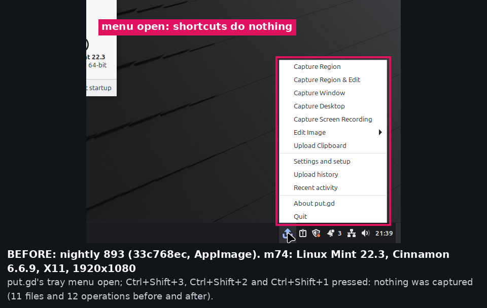
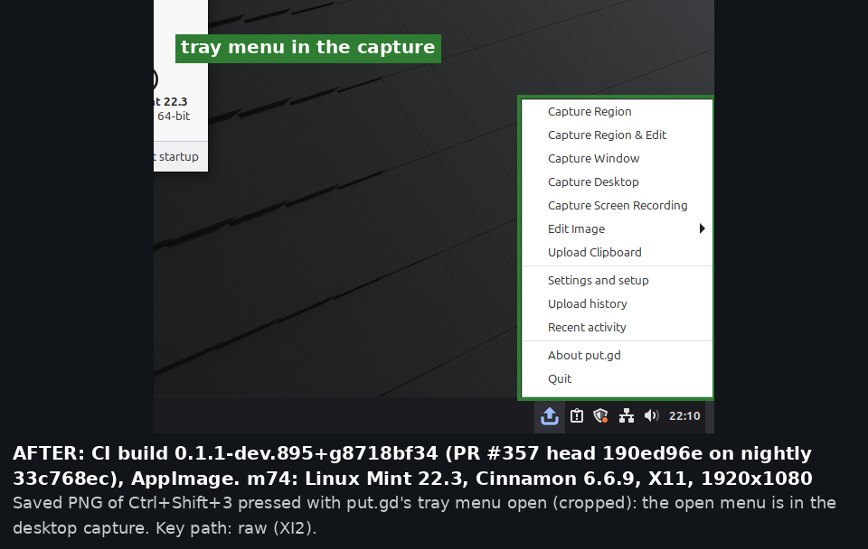
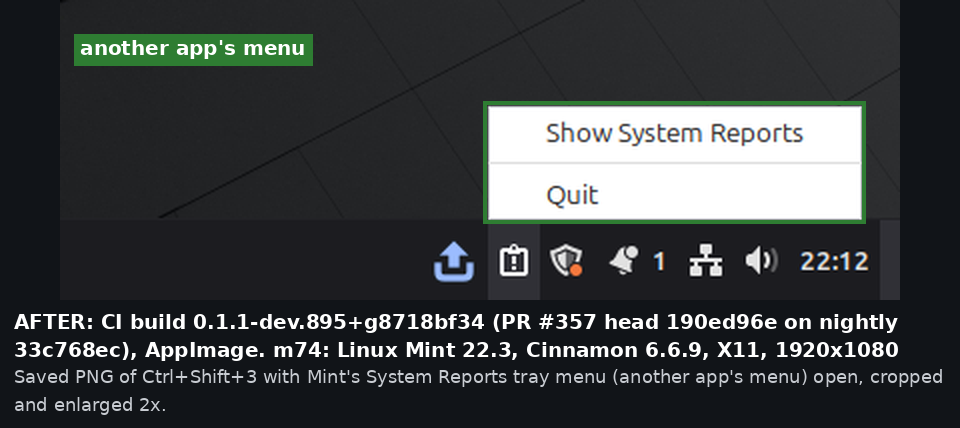
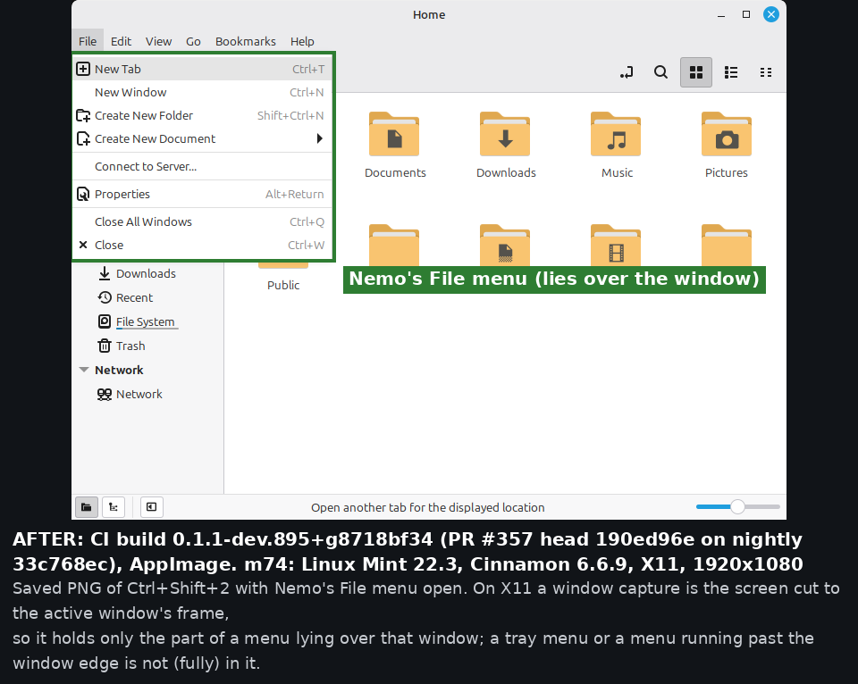
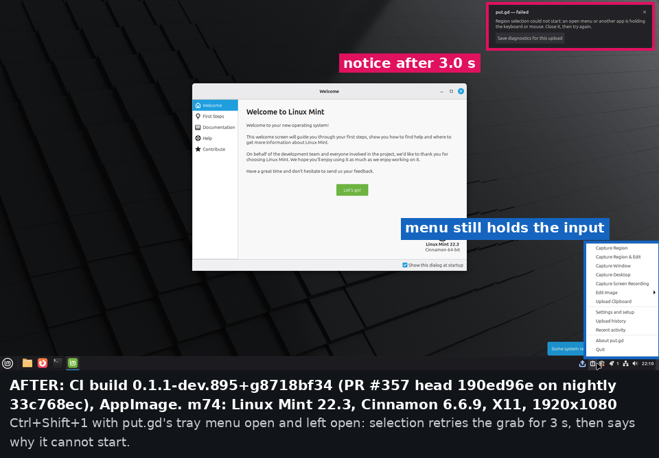
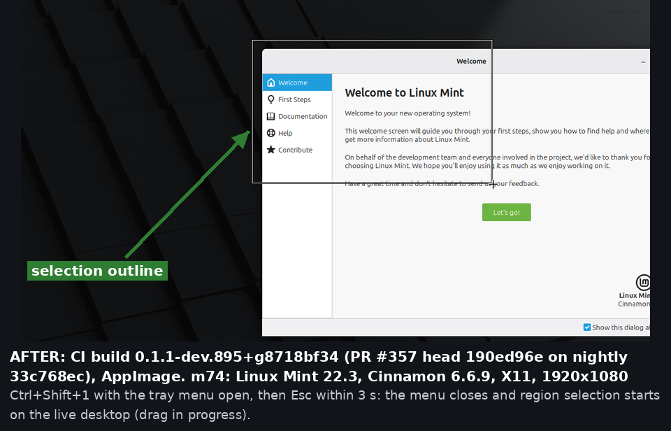

## f44: Fedora 44, GNOME Shell 50.0, Wayland (physical)

These runs used the CI RPM, with the put.gd extension loaded after a re-login.

- The extension now allows its keybindings in Shell `POPUP` mode too. All three shortcuts fired
  with put.gd's AppIndicator (Shell) tray menu open, and with Files' main menu (a GTK popover)
  open.
- The desktop capture contains the open menu.
- The region selector opens at once over the live, still-open menu, and the saved region contains
  it. This held for both the Shell tray menu and the popover. A press that started on "About Files"
  did not activate it.
- The window capture of Files does not include its popover: GNOME captures the window's own
  surface. This is unchanged and only observed.
- The GNOME "before" was not run, since it would need two more logouts for the old extension.
  Nightly's extension allowed its keybindings only in Shell `NORMAL` mode. GNOME Shell switches to
  `POPUP` mode while one of its menus is open, so we expect nightly to ignore the shortcuts then.

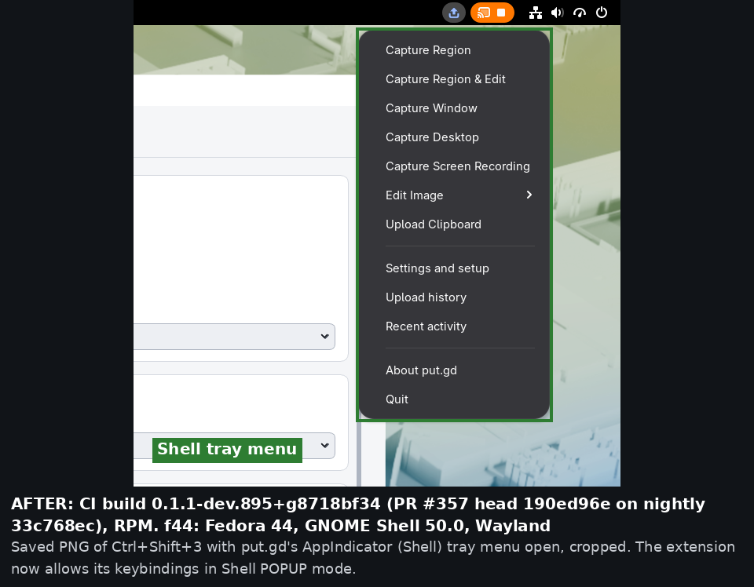
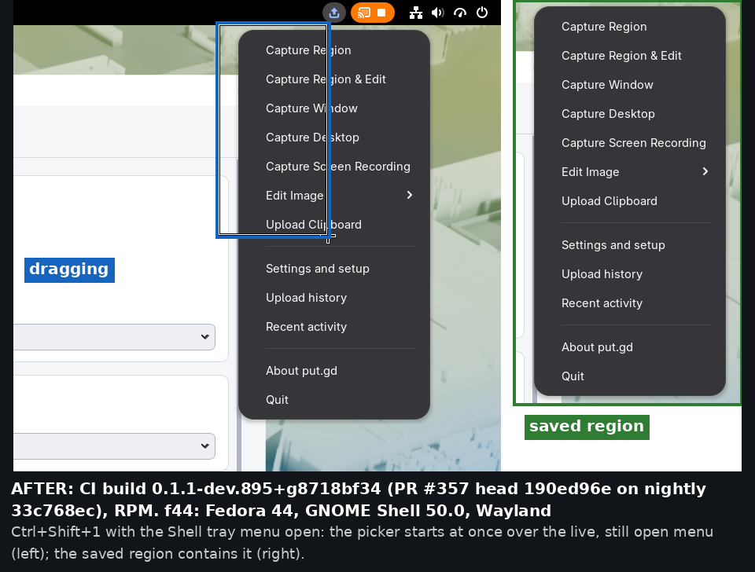
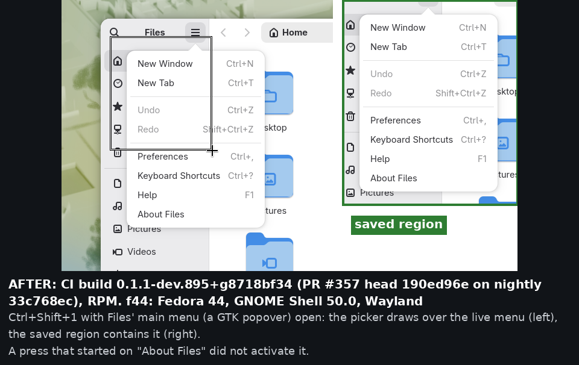
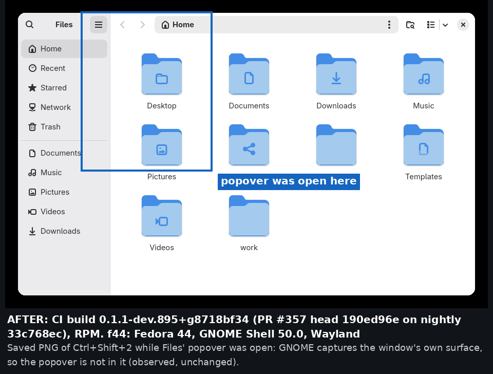

## d69: Debian 13, Plasma 6.3 (KWin 6.3.6), Wayland (physical)

These runs used the CI Debian 13 DEB.

- kglobalaccel delivers put.gd's shortcuts with put.gd's tray menu open and with Dolphin's
  hamburger menu open. This path is unchanged by #341.
- The desktop capture contains the open menu.
- Region: the selector starts, but Plasma closes the open menu when it appears, so a region cannot
  contain it. This is observed behaviour.
- The window capture of Dolphin does not include its menu, because KWin captures the window's own
  surface.
- Another person's browser window was open behind the test windows. It is cropped out or greyed
  out, and the full captures were deleted from the host.

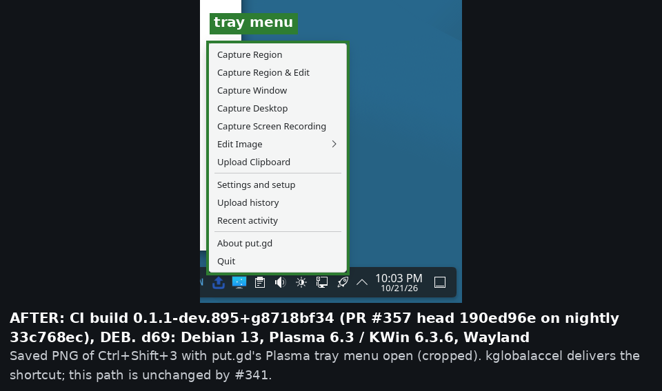
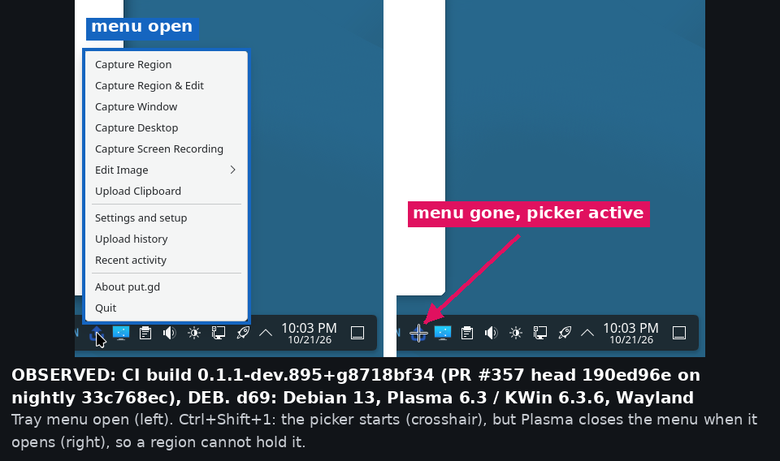
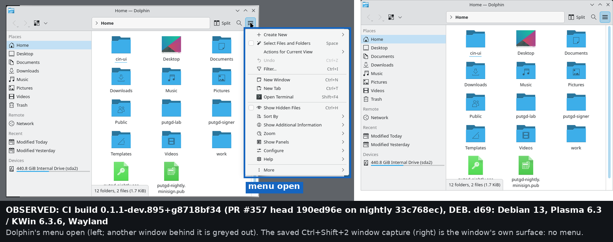

## Automated coverage (CI run 39711900450, all green)

- `x11_raw_key_matcher`: raw-key matching against the installed grabs:
  - held modifiers, either hand;
  - lock keys ignored;
  - autorepeat fires once;
  - keymap resync after a passive activation.
- `x11_isolated` (Xvfb):
  - With another client holding an active keyboard grab, each shortcut fires exactly once, on the
    passive path without the grab and on the raw path with it.
  - Repeats, unbound chords and shortcut recording never fire.
  - The menu client still receives the keys.
  - A fake locked `org.freedesktop.ScreenSaver` suppresses the raw path.
- `native_region_overlay`: while another client holds the grab, selection waits. It starts as soon as
  the grab ends, and fails after 3 s with the `input_grab` details. The other client's grab is
  preserved throughout.
- `native_shortcut_rejection_integration`: the real resident under Xvfb, with and without a
  menu-style grab. Through `putgd-cli ui.snapshot`, `keyPaths.lastActivation.path` is `passive` or
  `raw`.
