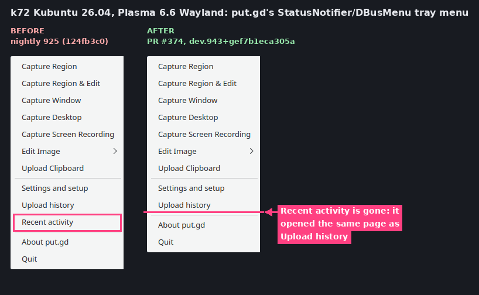
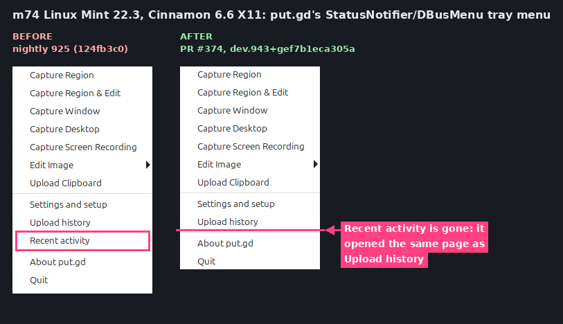
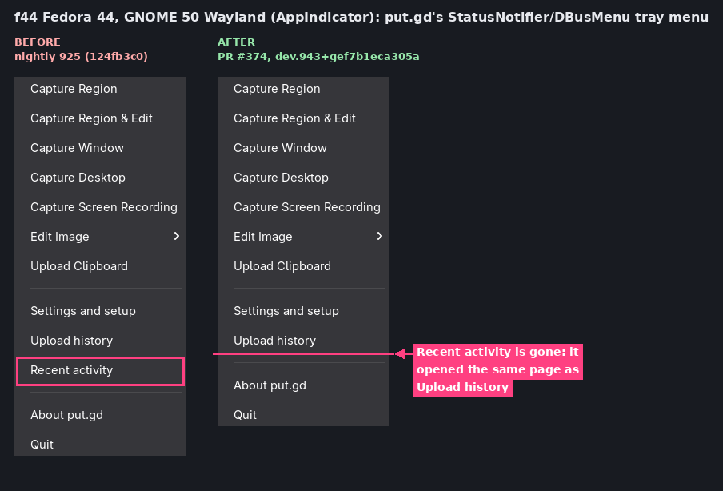
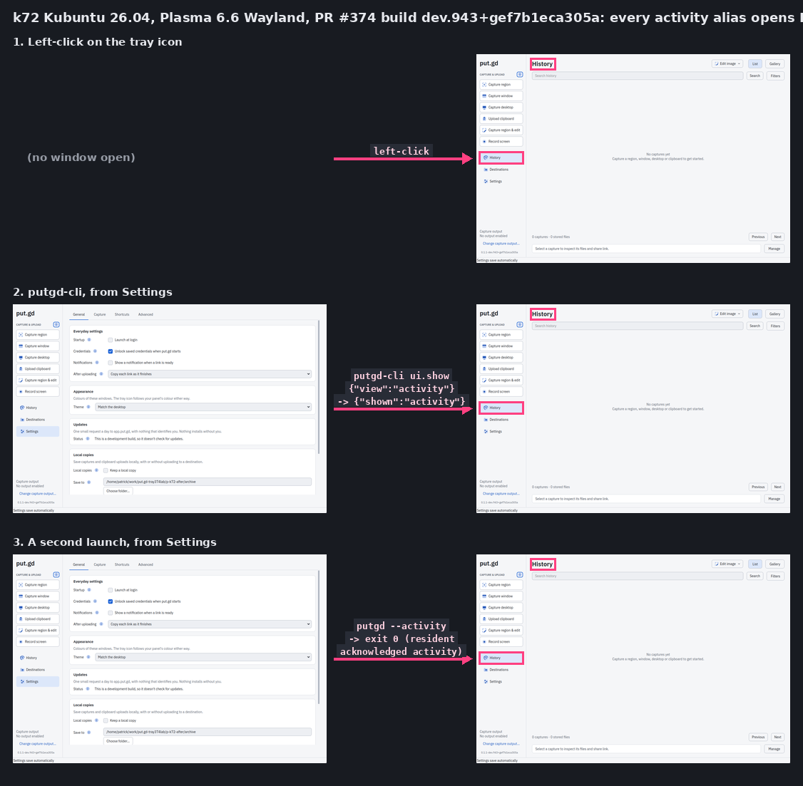
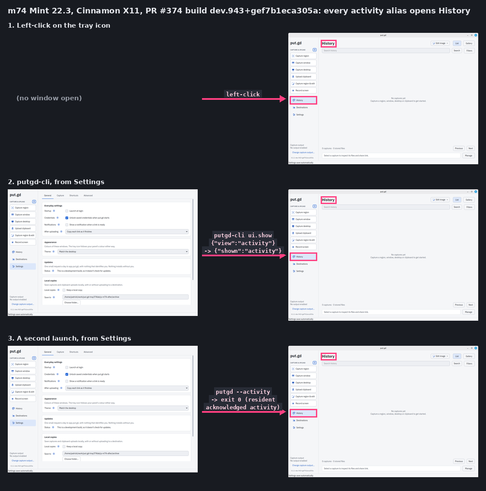
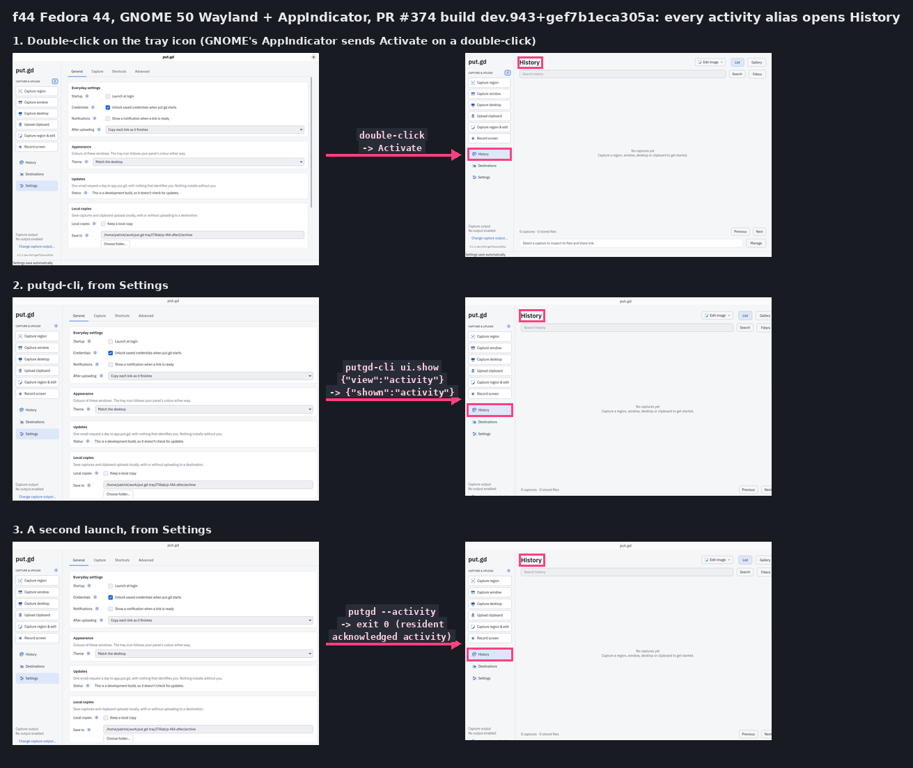

# Tray "Recent activity" removed; "activity" stays a History alias (#374)

Code: [#374](https://github.com/patrick-hudson/put.gd-desktop/pull/374) (head `ef7b1eca`).
Recorded 2026-10-22 by the tray-drop-recent-activity session, under desktop locks on k72, m74 and f44.

## Builds

| | Build | Source | AppImage SHA-256 |
| --- | --- | --- | --- |
| After | `0.1.1-dev.943+gef7b1eca305a` | #374 head `ef7b1eca`, CI run [39725705583](https://github.com/patrick-hudson/put.gd-desktop/actions/runs/39725705583) (manual, every job green, `release-appimage` artifact) | `25c70260183a40e693c1899320660473106155536b6c28f9d56bfcb43ba0f87a` |
| Before | `0.1.1-nightly.925` | tag `v0.1.1-nightly.925`, commit `124fb3c0`: 17 commits before #374's base `0435ed6a`, with no change to the tray, menu or view-alias code in between (only a login-script hookup in `main.cpp`) | `49c6dfaa61a561b955dc69c231d57887aef1b80ed9e0130e6c59025587eb3b81` (matches the release's `SHA256SUMS`) |

Each run used a private, local-only profile (its own `XDG_*` directories and runtime dir,
notifications off) and the AppImage itself as the resident. `putgd-cli` came from the same
AppImage's extracted AppDir. The driver is [lab/tray374.py](lab/tray374.py), adapted from the #303 driver.

## Results

| Desktop | Tray menu (live dbusmenu) | Click on the icon | `ui.show {"view":"activity"}` | `putgd --activity` | Idle RSS, before → after |
| --- | --- | --- | --- | --- | --- |
| k72 Kubuntu 26.04, Plasma 6.6 Wayland | before: ID 9 "Recent activity"; after: 14 entries, no ID 9 | left-click → History | `{"shown":"activity"}` → History | exit 0 → History | 31.67 → 31.39 MiB |
| m74 Mint 22.3, Cinnamon 6.6 X11 | same | left-click → History | `{"shown":"activity"}` → History | exit 0 → History | 29.08 → 29.06 MiB |
| f44 Fedora 44, GNOME 50 Wayland + AppIndicator 64 | same | double-click → `Activate` → History | `{"shown":"activity"}` → History | exit 0 → History | 32.63 → 32.44 MiB |

- **Menu:** the dbusmenu layout comes from `GetLayout` on put.gd's own item (`results/*-menu.json`).
  After the change the separators are unchanged, and Edit Image (13), Screen Recording (16)
  and Update available (17) keep their IDs.
- **Aliases:** each check starts on Settings (`ui.show {"view":"settings"}`), then takes the
  step. The `putgd --activity` launcher exits 0 only after the resident acknowledges
  `{"shown":"activity"}` (see [cli.md](../../cli.md)). `ui.viewState` doesn't report the main
  window's page, so a verified crop of put.gd's window shows the page.
- **GNOME click:** GNOME's AppIndicator extension (64) opens the menu on a single primary
  click and calls `Activate` on a double-click (`indicatorStatusIcon.js`). A bus monitor saw
  `ProvideXdgActivationToken` then `Activate` on a double-click for both builds
  (`results/f44-dclick-dbus.txt`, `results/f44-nightly-dclick-dbus.txt`), so this isn't new.
  A direct `busctl … Activate` call also opened History (`crops/f44-activate.png`).
- **Idle RSS:** the resident family (AppImage `AppRun` plus `putgd`), started fresh with the
  tray menu opened once, median of 20 one-second samples (`results/*-rss.json`).

## Pictures

All crops were taken from the host's loopback VNC. A menu crop is kept only if all four
edges are the menu's own colour, and a window crop only if over 90% of it is put.gd's
theme colours. f44's menu crops are inset 10 px so the rounded corners don't show
what's underneath. Full frames never left the hosts and were deleted there.

## Method notes

- **Closing put.gd's window between checks:** on Plasma, a temporary KWin script closes
  windows whose `resourceClass` is `putgd-ui` ([lab/kwin_close.sh](lab/kwin_close.sh)). On
  Cinnamon, `wmctrl -i -c` closes windows that have both WM_CLASS `putgd-ui` and the title
  `put.gd` ([lab/x11_close.sh](lab/x11_close.sh)). On GNOME the window stayed open, and the
  resident was stopped at the end. No input went to any other window.
- **Input:** xdotool on X11. On Wayland, the uinput agent `tools/lab/host_input.py`, started
  with `sudo -n` and stopped by exact PID. On f44 it crashed once when a client went away
  mid-reply, and was restarted
  ([#394](https://github.com/patrick-hudson/put.gd-desktop/issues/394)). The GNOME item
  that saw those broken clicks stopped activating. The double-click result above comes
  from a fresh resident.
- **Composites:** [lab/pair.py](lab/pair.py) for the before/after menus and
  [lab/alias.py](lab/alias.py) for the alias rows. The alias script finds the rail's
  selected row by its colour and boxes it, with the page title above it.

## Clean-up

On each host the residents were stopped, and the runtime dirs, frames, lab directory and
input agent (with its socket) were removed. The `pgrep` check showed nothing of this run,
and each lock was released `--verified-clean`: k72 06:03Z, m74 06:10Z, f44 06:22Z (host clocks).
