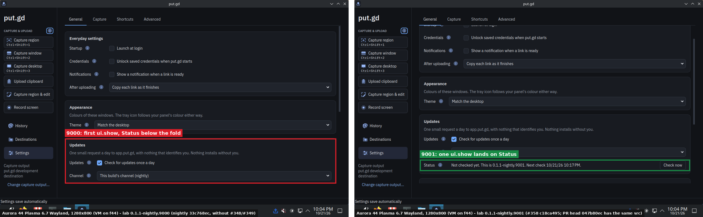
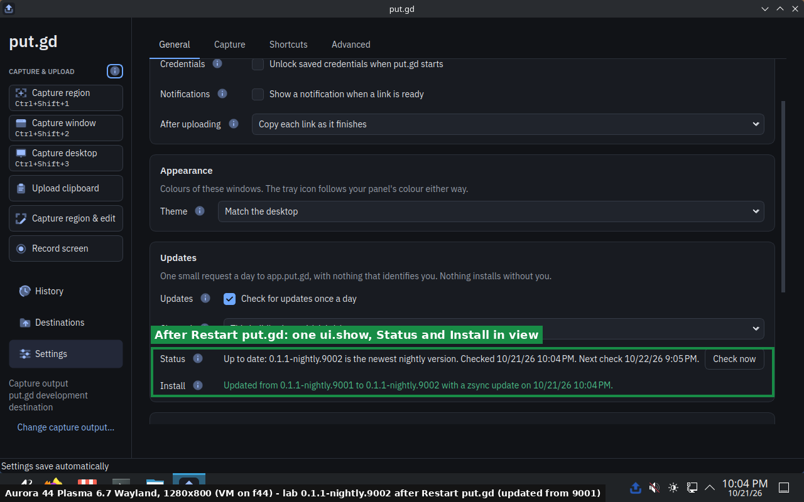
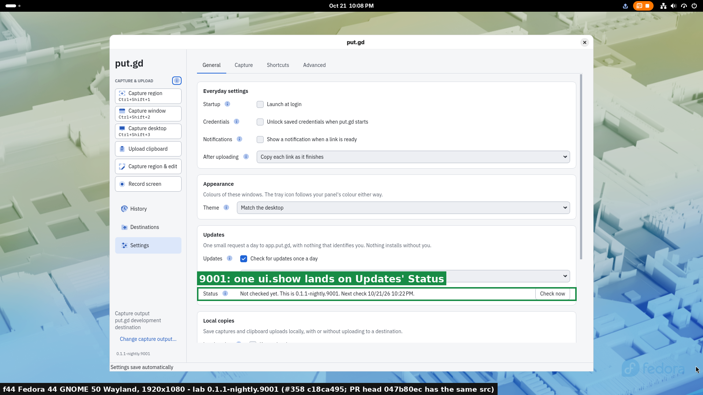
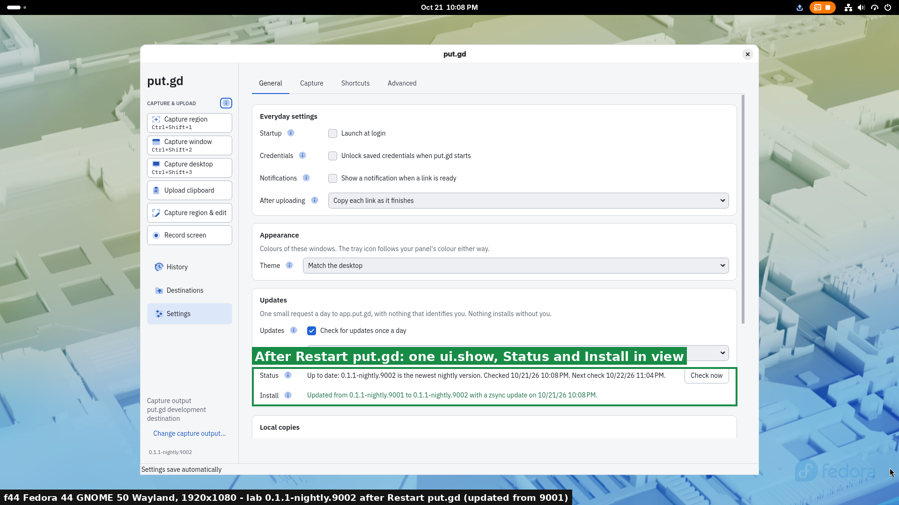
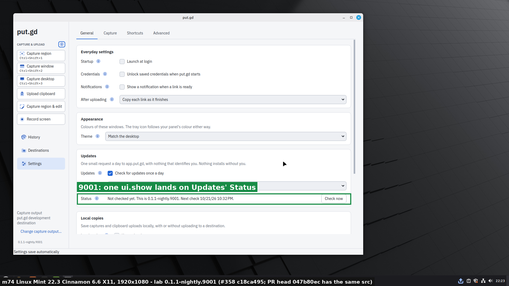
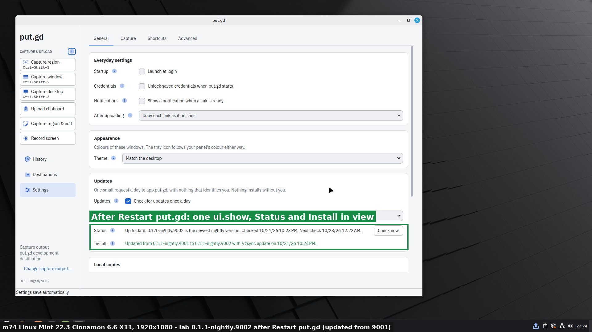
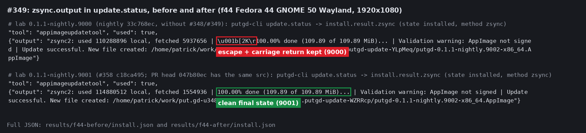
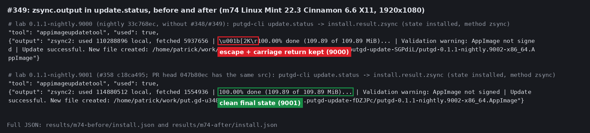
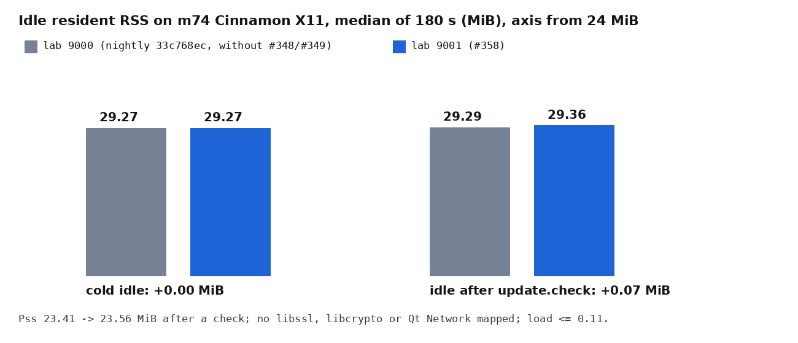

# AppImage updater polish: lab acceptance, 2026-10-22 (#348, #349)

This is the acceptance for [#358](https://github.com/patrick-hudson/put.gd-desktop/pull/358), which fixes:

- [#348](https://github.com/patrick-hudson/put.gd-desktop/issues/348): the first `ui.show {"view":"updates"}` in a freshly opened Settings window could leave Updates below the fold.
- [#349](https://github.com/patrick-hudson/put.gd-desktop/issues/349): `zsync.output` in `update.status` and the log kept appimageupdatetool's escape sequences and progress redraws.

Both follow from the in-app AppImage updater ([#343](../2026-10-21-appimage-updater-293/README.md)). Every picture and number below comes from lab AppImages updating by zsync to lab `0.1.1-nightly.9002`. The lab used the same layout as #343.

## Builds under test

| Lab build | Role | Source | Lab commit and tree | AppImage SHA-256 |
| --- | --- | --- | --- | --- |
| `0.1.1-nightly.9000` | before: no fixes | nightly `33c768ec` | `f384a705`, tree `1892c904` (= `33c768ec`) | `ac236a2ca470ad041d47060ea63d0dea8c52273d5f09277de8bbaa4031647b60` |
| `0.1.1-nightly.9001` | after: #358 | `c18ca495` | `adc5c70d`, tree `f630b60e` (= `c18ca495`) | `9e43b4a217556b90237588e961dfcf42bbcd63a3f9c92a8c6bbffd2b62afd85c` |
| `0.1.1-nightly.9002` | N+1, published | `c18ca495` + one empty commit | `e2a9b132`, tree `f630b60e` | `3e031f5bf35e79b0dabf7175f55e04a7eab2cf24a7c5dcd397b89fc232c8051e` |

**#358 head:** #358 was later rebased onto nightly `0071acaf` (#351), and its head became `047b80ec`. That head moves the new GUI test's waits into `tests/fixtures/Waits.h`. Its `src/` and `CMakeLists.txt` diff against nightly is byte-identical to `c18ca495`'s diff against `33c768ec`, so these builds are the product code of the head.

**How they were built:**

- [lab/appimage-lab-build.sh](lab/appimage-lab-build.sh) builds the way `package.yml`'s `appimage` job does, in one pinned `ubuntu:24.04` podman container on f44, as in #343.
- `PUTGD_APPIMAGE_UPDATE_BASE=https://pkg.put.gd/lab/` points the images at the signer's lab prefix.

**Tag numbers:**

- A nightly's number must equal its commit count.
- Lab numbers 9000+ never meet a real nightly's.
- So the script pads each source commit with empty commits that reuse the source's own tree, up to the tag's number.
- The padding commits and tags exist only in that container's clone. They were never pushed.
- The table's tree column shows that each image's source tree is exactly its source commit's.

**The lab release:**

- Only 9002 was published, by d69's deployed signer (`dc1ab32`) in `publish-local --scope lab` mode ([results/publish-9002.txt](results/publish-9002.txt)).
- After the runs, every lab object that publish created was deleted: 30 keys ([results/lab-keys-removed.txt](results/lab-keys-removed.txt)).
- `/lab/*` was invalidated, and the local lab workspace and publisher state were removed ([lab/clean_lab.py](lab/clean_lab.py), [results/clean.txt](results/clean.txt)).
- `https://pkg.put.gd/lab/update/v1/nightly.json` and every 9002 path return 404 again, as before the publish.

## How each run worked

**The scripts:**

- The driver is #343's [upd293.py](../2026-10-21-appimage-updater-293/lab/upd293.py). It now makes **one** `ui.show {"view":"updates"}` call per frame, where #343 needed two.
- [lab/u348.sh](lab/u348.sh) runs it twice on each desktop:
  - **before:** 9000 → 9002;
  - **after:** 9001 → 9002, then **Restart put.gd**.
- Both use scenario (a), the real appimageupdatetool (continuous build 254, `8d17a50e…`) on the run's private `PATH`, with private `XDG_*` folders and runtime directory.

**Each run:**

1. Started the resident with `--background`.
2. Opened Settings for the first time with one `ui.show updates` (frame `first-show`).
3. Ran `update.check`, then `update.install {"confirm": true}`.
4. In the after run only: `update.restart {"confirm": true}` and one `ui.show updates` in the new resident's fresh window (frame `restarted`).

All calls went through `putgd-cli`, the MCP path. Run details, timings, the full `update.status` install records and the resident's log lines are in [results/runs.json](results/runs.json).

| Desktop | Session | Lock |
| --- | --- | --- |
| Aurora 44.20260908.1, Plasma 6.7, 1280×800 | Wayland, VM overlay of the v3 golden on f44 | — (VM; run `aurora-u348d58992`) |
| f44 Fedora 44, GNOME 50, 1920×1080 | Wayland, stock CA layout | 03:07:50Z–03:09:25Z |
| m74 Linux Mint 22.3, Cinnamon 6.6, 1920×1080 | X11 | 03:23:22Z–03:38:53Z |

## #348: the first `ui.show updates` lands on Updates

| Desktop | 9000: first `ui.show` | 9001: first `ui.show` | 9001 → 9002: `ui.show` after **Restart put.gd** |
| --- | --- | --- | --- |
| Aurora (1280×800) | Updates' Status is below the fold | Status in view | Status and Install in view, "Updated from 0.1.1-nightly.9001 to 0.1.1-nightly.9002" |
| f44 (1920×1080) | Status in view (the page fits) | Status in view | Status and Install in view |
| m74 (1920×1080) | Status in view (the page fits) | Status in view | Status and Install in view |

The bug needs a screen where the window manager makes the fresh window smaller than it opened, or where the page doesn't fit. Aurora's 1280×800 shows it. On the 1080p desktops the whole General page fits without scrolling, so 9000 shows Status too.

The GUI test `gui_application` `showUpdatesLandsOnUpdatesInAFreshWindow` covers the same case. It fails on the old `showUpdates`.

Aurora, the same single call on 9000 and on 9001:

Aurora after **Restart put.gd** (9002):

f44 and m74 on 9001, and after the restart:

## #349: clean `zsync.output`

On all three desktops, 9000 stored appimageupdatetool's redraw as it came, `\u001b[2K\r100.00% done …`, in `update.status` (`install.result.zsync.output`) and in the resident's "Update installed" log line. 9001 stores `100.00% done (109.89 of 109.89 MiB)...`, with no control characters, in both places.

| Desktop | 9000 → 9002 | 9001 → 9002 |
| --- | --- | --- |
| Aurora | zsync, 9.6 s, `\u001b[2K\r` kept | zsync, 8.4 s, clean |
| f44 | zsync, 8.0 s, `\u001b[2K\r` kept | zsync, 7.9 s, clean |
| m74 | zsync, 9.3 s, `\u001b[2K\r` kept | zsync, 8.9 s, clean |

In every run the image ends as 9002 (`3e031f5b…`). 9000 reused 110.3 MB and fetched 5.9 MB. 9001 reused 114.9 MB and fetched 1.6 MB.

The unit test's fixture is a real raw capture of appimageupdatetool's output. It updated nightly 889 to 893 from `pkg.put.gd/releases` on m74, through a pipe as put.gd reads it. In that capture, several redraws share one line, for example `\x1b[2K\r12.975% …\x1b[2K\r43.51% …\x1b[2K\r74.00% …`. The cleaner keeps the last one.

## Idle memory (m74, quiet slot)

[lab/u348mem.sh](lab/u348mem.sh) used #343's `mem` windows. Each build ran in the same private profile shape, started `--background` as at login. Each window was a 30 s settle, then RSS sampled every second for 180 s, before and after an `update.check`. Full numbers are in [results/memory-m74.json](results/memory-m74.json).

| m74 Cinnamon X11 | 9000 | 9001 |
| --- | --- | --- |
| Cold idle, RSS median | 29.27 MiB | 29.27 MiB |
| Idle after `update.check`, RSS median | 29.29 MiB | 29.36 MiB |
| Pss after `update.check` | 23.41 MiB | 23.56 MiB |
| TLS or network libraries mapped | none | none |

Load was 0.11 or less during the windows. The resident gains no measurable memory. The output cleanup runs in the `putgd-cli` child, and the Settings change adds a flag, two pointers, two connections and two event filters.

## Clean-up

- **Aurora:**
  - Overlay `aurora-u348d58992` and an earlier launch attempt, `aurora-u348b15298`, were retired with `lab.py cleanup` and explicit evidence manifests ([lab/aurora_retire.py](lab/aurora_retire.py)). The attempt's guest answered SSH once, then the runner's next SSH call failed and it reset the VM.
  - The v3 golden still hashes `6a2fb407…`.
  - The wall tunnel and tile were removed.
- **f44 and m74:** each run's cleanup removed its resident, runtime directory and run folder. Both locks were released `--verified-clean`.
- **Lab feed:** the lab release is deleted, as above.

The pictures are made by [lab/pictures.py](lab/pictures.py) from the frames each run saved.
