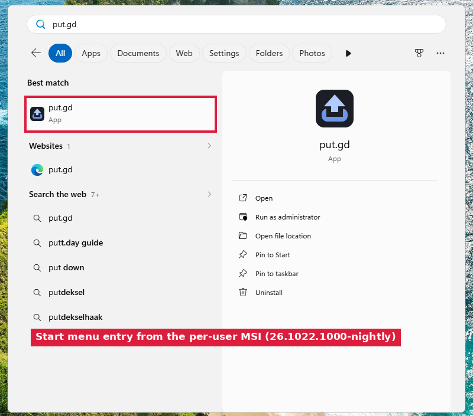
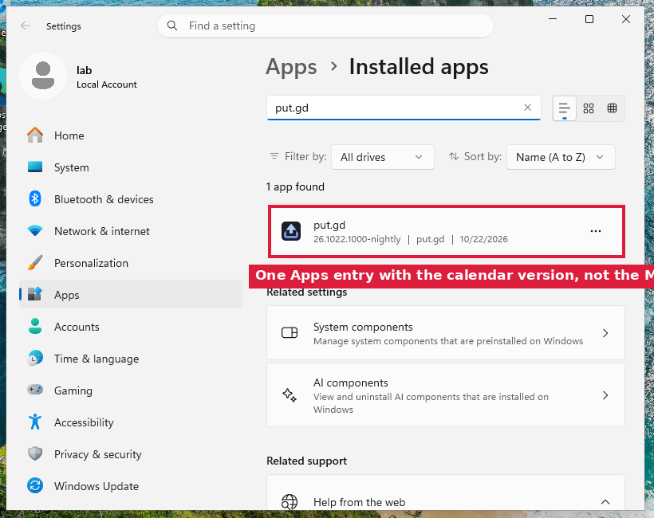
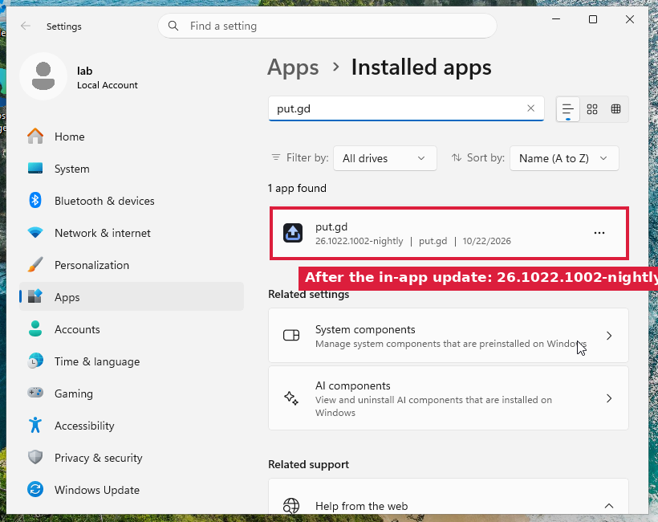
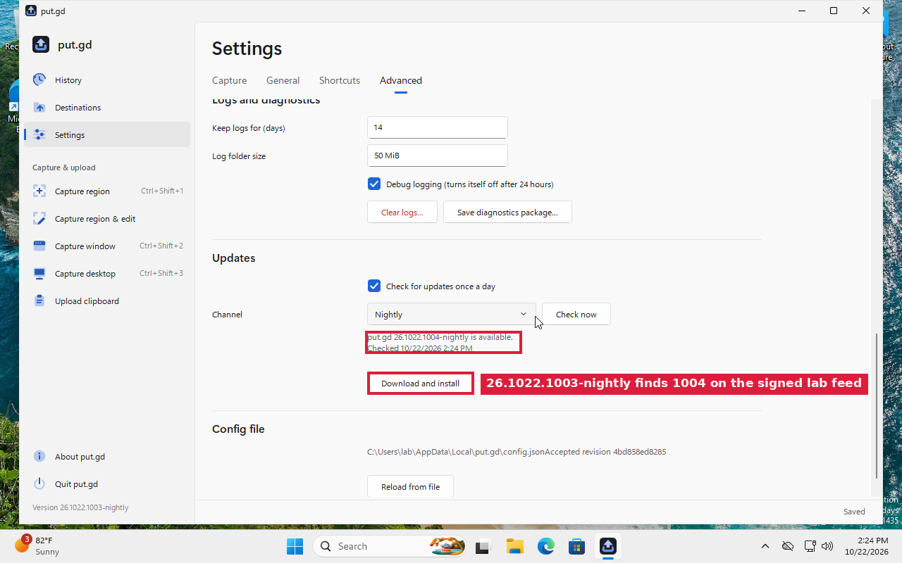
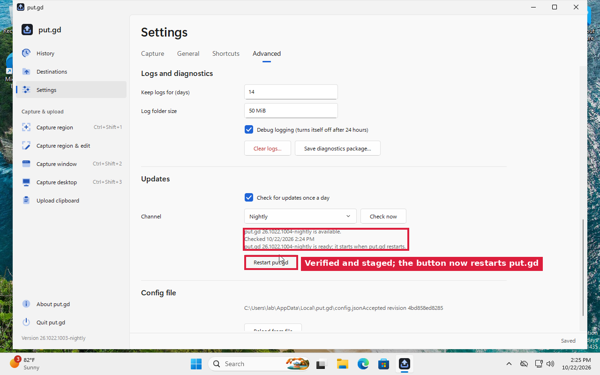
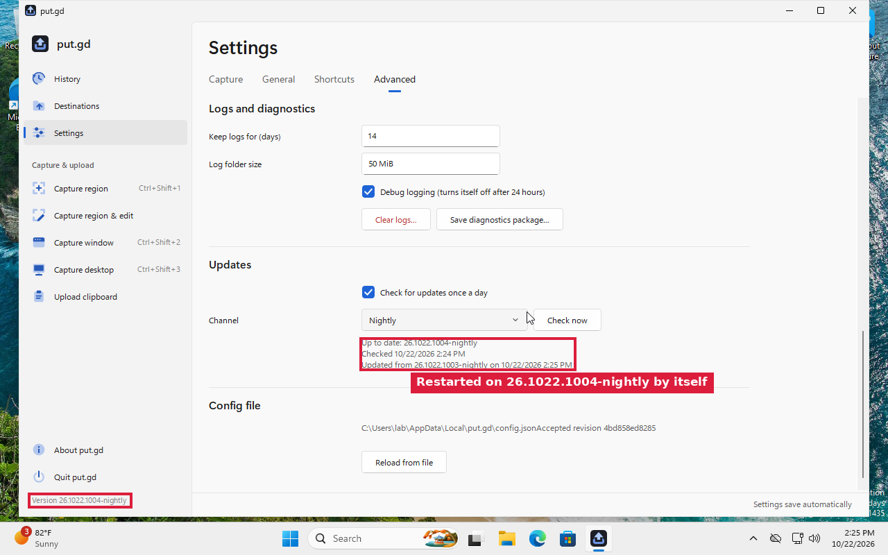

# Windows packaging, versions and in-app updates (#404, #396) — 2026-10-22

Code: [PR #433](https://github.com/patrick-hudson/put.gd-desktop/pull/433) (draft, into
`claude/native-windows-parity-app-a34127`). Raw guest logs, every screenshot and the lab
scripts are kept privately in `work/verification/2026-10-22-windows-packaging-404/` on d69.

## Setup

- **Guest:** `w11-e3ceec338284` on d69: Windows 11 Enterprise Evaluation 26H2, build 26300, account `lab`. Taken under `GUEST-LOCK.json` (21:06–21:21Z and 21:24–21:26Z). The parity resident was stopped and restarted from its own task. `config.json` and `update-check.json` were restored byte for byte (SHA-256 `D1D0F0F8…081D` and `76004934…BD8C` before and after).
- **Builds:** cross-built on d69 with mingw-w64 GCC 14 (posix) and packaged with `src/windows/packaging/package.py` (wixl 0.106). The tags were local-only lab tags on two commits. Under them, a local-only commit replaced the nightly minisign key with a throwaway lab key. That commit and the tags were never pushed.
- **Feed:** a lab feed and release tree on d69 (`http://127.0.0.1:8404`), reached through an SSH reverse tunnel. The guest's `PUTGD_UPDATE_FEED_URL`, `_RELEASE_URL` and `_MIRROR_URL` pointed at it for the run and were removed afterwards. `SHA256SUMS.minisig` was signed with the lab key and the trusted comment `put.gd TAG nightly`.

| Run | Build | Source commit (lab) | Code commit (PR) | MSI version | MSI SHA-256 |
| --- | --- | --- | --- | --- | --- |
| 1 | 26.1022.1000-nightly | `4adaef62` | `b4bf8f31` | 9.176.1000 | (pre-fix MSI, unversioned files) |
| 1 | 26.1022.1001-nightly | `4c006268` | `4216e3de` | 9.176.1001 | packaged with the `f06ce1cb` installer source |
| 1 | 26.1022.1002-nightly | `bad58d1f` | `4216e3de` | 9.176.1002 | packaged with the `f06ce1cb` installer source |
| 2 | 26.1022.1003-nightly | `b5385a3c` | `8bb70dcd` | 9.176.1003 | `9167fac20d55e1783edcbf601bafe875bd2da67771f7caa60fc0e48592348e42` |
| 2 | 26.1022.1004-nightly | `b4bed145` | `8bb70dcd` | 9.176.1004 | `2005effa89b9b9f09ea8e4f0292ff6a2e5a24f9678f8f33a8402f46998dd50c0` |

The run 2 zips: 1003 `3079ba75e439535fa98fb899aecaa54a02baa45b26ae9fc1e13696b62b5a9feb`,
1004 `8f5e7f5d28dab1c05ac486e30389a7f7b01305d45a18c4d376fda9c3ebbbfc88`.

## Results

| Check | Result |
| --- | --- |
| Per-user install, no elevation (`msiexec /i … /passive`) | exit 0; `%LOCALAPPDATA%\Programs\put.gd` holds `putgd.exe`, `putgd-cli.exe`, `build-info.json`, `LICENSE.txt` |
| Version resource | `FileVersion` 26.1022.0.1000, `ProductVersion` 26.1022.1000-nightly on both executables; `putgd-cli --version` agrees |
| Start menu entry | **put.gd** with the app icon (picture 1) |
| Apps entry | one entry, "put.gd 26.1022.1000-nightly, put.gd" (picture 2); Windows Installer's own entry hidden |
| Installed app runs | from the Start menu path through the desktop task; `update.status` → `build.kind: msi`, `packageTarget: windows-msi` |
| Login startup stays the app's | the MSI writes no Run value; enabling **Launch at login** made put.gd write `"…\Programs\put.gd\putgd.exe" --background` |
| Upgrade by MSI, 1000 → 1001 | exit 0; `WIX_UPGRADE_DETECTED`, `RemoveExistingProducts`, one product registered (9.176.1001) |
| **Found and fixed:** upgrade dropped the executables | wixl left `File.Version` empty, so the versioned `putgd.exe` on disk won (component action Null) and the early `RemoveExistingProducts` deleted it. The fix sets `DefaultVersion` (the FILEVERSION) and `REINSTALLMODE=amus`. A pre-fix 1000 then upgraded to the fixed 1001 with all four files |
| Same version, new product code (nightly/stable of one `YY.MDD.N`) | exit 0; `WIX_SAME_VERSION_UPGRADE_DETECTED`, components Local, all files present, one product registered |
| Older MSI over newer (1001 over 1002) | refused, exit 1603: "A newer put.gd is already installed. Uninstall it first to install this version." |
| In-app update, MSI, run 1 (CLI) 1001 → 1002 | `update.install {confirm}`: `starting > download > done`, staged MSI. `update.restart` (button): passive installer (picture 3), msiexec exit 0, put.gd 1002 running by itself about a second later. Apps shows 1002 (picture 4). Staged MSI and helper copy removed after 15 s |
| In-app update, MSI, run 2 (Settings buttons) 1003 → 1004 | **Download and install** (picture 5), then "ready; it starts when put.gd restarts" and **Restart put.gd** (picture 6), then "Updated from 26.1022.1003-nightly" on 1004 (picture 7) |
| Portable zip, 1001 → 1002 | `update.install`: files swapped, old ones in `.putgd-update-backup-26.1022.1001-nightly`. `update.restart`: new `putgd.exe --background --after-update PID` started, 1002 running, backup removed after 15 s |
| Portable beside an MSI install | **Found and fixed (run 1):** the MSI's install record blocked the portable copy with `update_restart_required`. The record is now scoped to its folder. Run 2: portable 1003 beside the MSI install reports no pending restart, and updates and restarts to 1004 |
| Refusals | `update_confirm_required` without confirm; `update_switch_confirm_required` for `channel: stable`; a tampered `SHA256SUMS` refused with `update_signature_invalid` (`check: signature`) and the folder unchanged |
| Uninstall (`QuietUninstallString`) | exit 0. Program folder, Start menu entry, Apps entry, `HKCU\Software\put.gd` and the then-empty `Programs` folder removed. `%LOCALAPPDATA%\put.gd` kept with `config.json` and `history.sqlite` byte-identical, and `artifacts`, `previews`, `logs` kept |
| Run value after uninstall | kept, pointing at the removed `putgd.exe` (#382's option 1); the restored parity resident (launch at login off) removed it at its start |

## Pictures

1. 
2. 
3. 
4. 
5. 
6. 
7. 

## Not verified

- **A real login with the dangling Run value:** that Explorer skips it silently wasn't observed. Signing out would end the shared guest's desktop session.
- **The production keys and URLs:** the stable channel, the real nightly key, and GitHub and pkg.put.gd. Releases don't publish Windows packages yet ([#446](https://github.com/patrick-hudson/put.gd-desktop/issues/446)).
- **SmartScreen:** an unsigned MSI opened from a browser download ([#447](https://github.com/patrick-hudson/put.gd-desktop/issues/447)).
- **Windows 10,** and an MSI update while a capture or upload runs (the refusal is only covered in code).
- **The first Download and install click in run 1:** the page had scrolled back to its top before the click, so it missed. The run 2 clicks worked.
