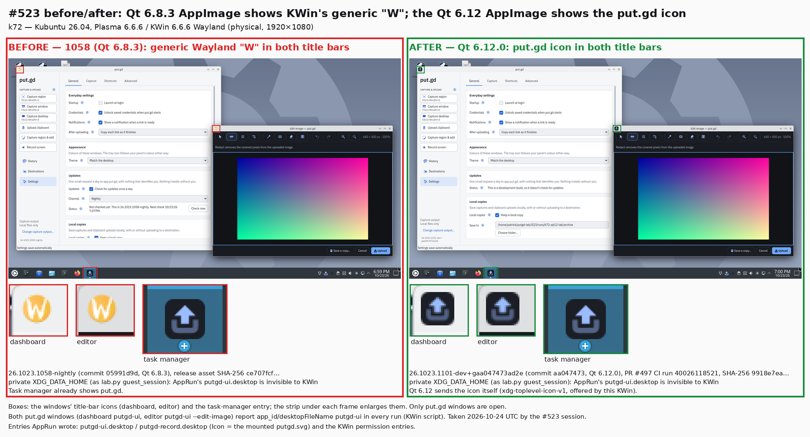
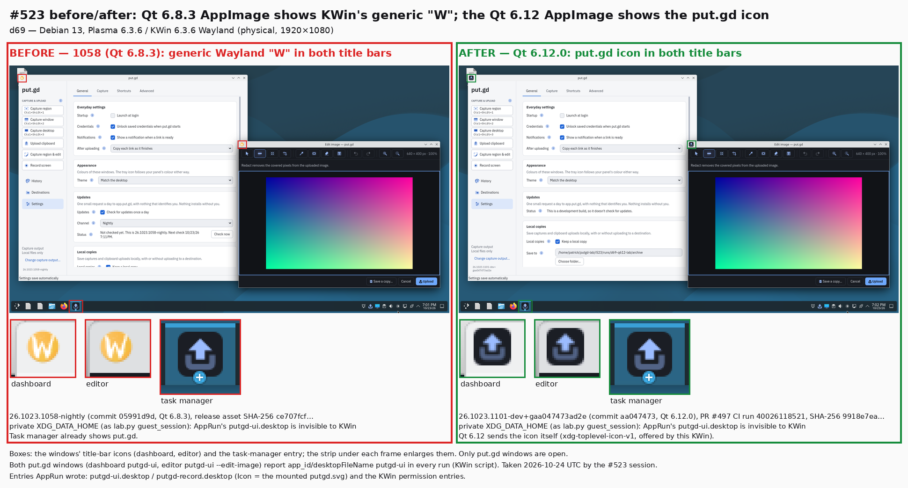
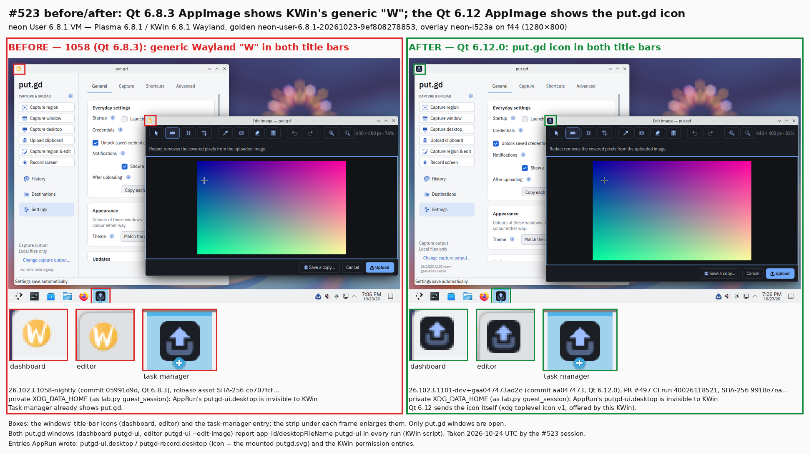
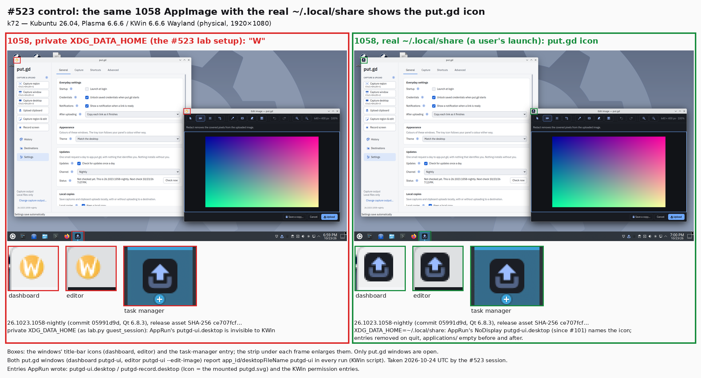
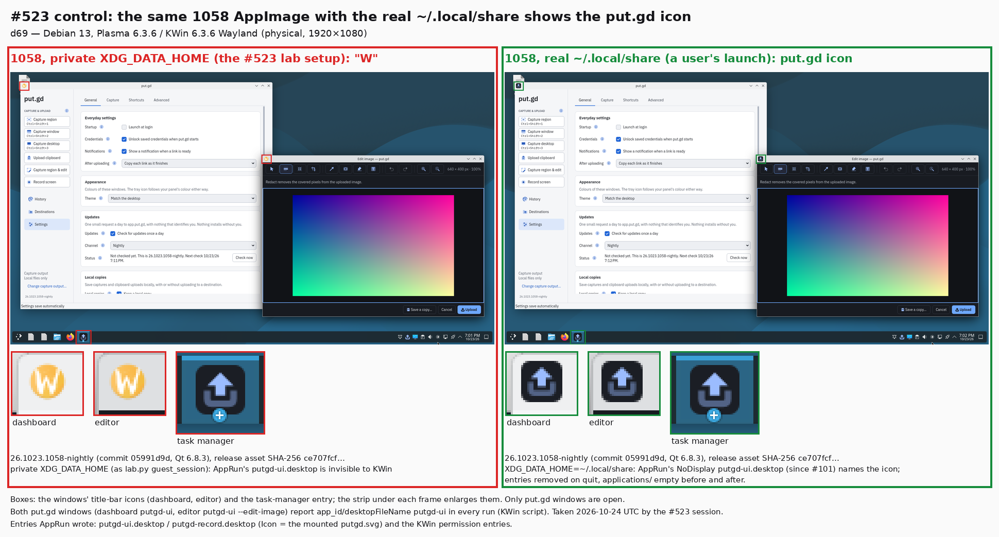
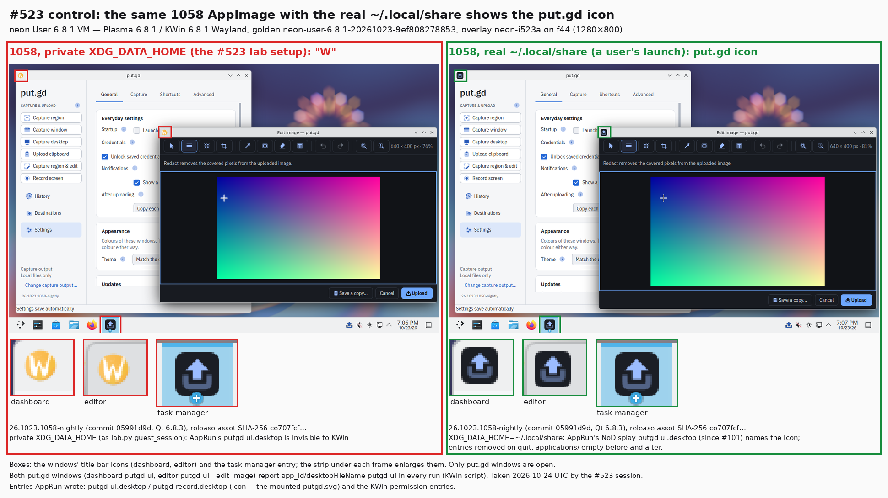
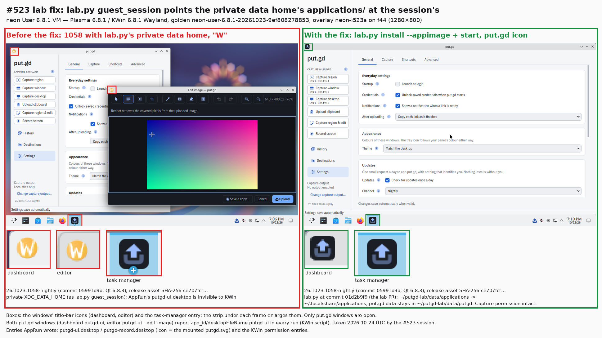
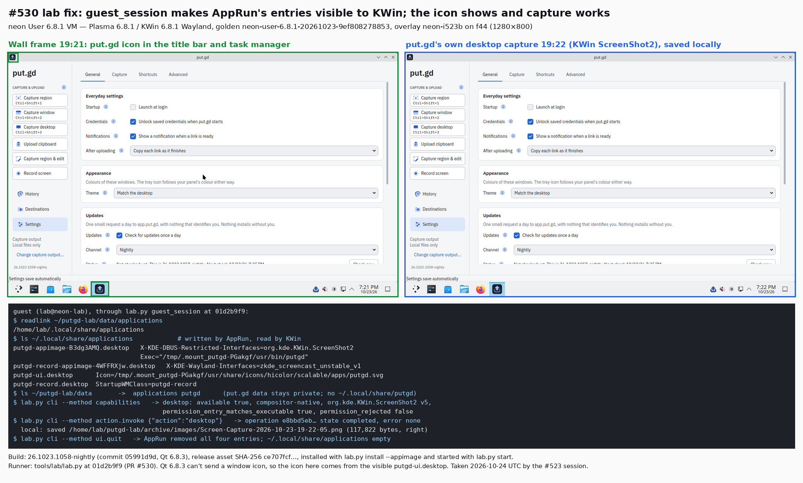

# AppImage window icon on Plasma (#523), 2026-10-23

[#523](https://github.com/patrick-hudson/put.gd-desktop/issues/523) reported
KWin's generic Wayland "W" icon in the title bar of the 1058 AppImage's windows
on KDE neon. It came from the
[neon smoke runs](../../neon-vm.md#smoke-round-trip-2026-10-23). The Ubuntu
24.04 DEB in the same guest showed the put.gd icon.

**Result:** the "W" was a lab artifact, and the Qt 6.12 AppImage doesn't show
it even in the lab setup. No app or packaging change is needed.
[#530](https://github.com/patrick-hudson/put.gd-desktop/pull/530) fixes the lab.

## Why the lab showed the "W"

- A Wayland compositor takes a window's icon from the desktop entry named by its
  app ID (`putgd-ui` for the dashboard and the editor), unless the client sends
  an icon itself over `xdg-toplevel-icon-v1`.
- Since #101, AppRun writes a NoDisplay `putgd-ui.desktop` and
  `putgd-record.desktop` while the image runs. Their `Icon=` names the mounted
  `putgd.svg`. AppRun writes them, with the KWin permission entries, under
  `XDG_DATA_HOME/applications`.
- `tools/lab/lab.py` `guest_session` runs put.gd with
  `XDG_DATA_HOME=~/putgd-lab/data`. KWin reads the session's own data home, so
  it never saw those entries.
- The 1058 AppImage bundles Qt 6.8.3, which can't send a window icon, so KWin
  fell back to "W".
- The Qt 6.12.0 AppImage (#497) sends the icon itself. Its
  `plugins/wayland-shell-integration/libxdg-shell.so` contains the
  `xdg_toplevel_icon` client code and 1058's doesn't. All three KWins below
  offer `xdg_toplevel_icon_manager_v1` (`wayland-info`).

## Builds

| Build | Qt | Source | SHA-256 |
| --- | --- | --- | --- |
| `26.1023.1058-nightly`, commit `05991d9d` | 6.8.3 | nightly release asset; matches its `SHA256SUMS` | `ce707fcf4e693b5ca9024da539e5510e149c5edf8a6a17bca28d815e0e20e6db` |
| `26.1023.1101-dev+gaa047473ad2e`, commit `aa047473` | 6.12.0 | #497's CI run 40026118521 (`release-appimage`, head `786ed9fc`) | `9918e7ea37126035fca7d957d8e8e174afb32261759597129c30abb7e2f8d9cb` |

No nightly with #497 (merge `16ed870b`) existed yet, so the after build is
#497's own CI AppImage.

## Desktops

| Desktop | Session | Slot |
| --- | --- | --- |
| k72 `.72`, Kubuntu 26.04, physical | Plasma 6.6.6 / KWin 6.6.6 Wayland, 1920×1080 | lock 23:54:49Z, released `--verified-clean` |
| d69 `.69`, Debian 13, physical | Plasma 6.3.6 / KWin 6.3.6 Wayland, 1920×1080 | lock 23:54:50Z, released `--verified-clean` |
| neon User 6.8.1 VM on f44 | Plasma 6.8.1 / KWin 6.8.1 Wayland, 1280×800; golden `neon-user-6.8.1-20261023-9ef808278853`, overlay `neon-i523a` (`neon-kde-wayland` profile, SSH 22469, VNC :69) | retired with a completion manifest |

## Method

[`lab/drive.sh`](lab/drive.sh) ran each case in the real Plasma session. The
session environment came from `plasmashell`.
- Each run had its own `XDG_CONFIG_HOME`, `XDG_CACHE_HOME` and `XDG_STATE_HOME`
  under `~/putgd-lab/i523/runs/<run>`.
- It launched the image itself with `IMAGE --background`, so AppRun did its
  normal host integration.
- The extracted image's `putgd-cli` did the rest:
  1. enabled local copies into the run folder;
  2. opened Settings (`ui.show`);
  3. opened the editor on a synthetic 640×400 gradient (`editor.open`).
- A temporary KWin script placed the two windows and printed `resourceClass`
  and `desktopFileName` for each.
- Frames came from the hosts' loopback VNC (the wall tiles).
- [`lab/compose.py`](lab/compose.py) drew the boxes and enlargements.

Two data-home modes:

- **private** (the #523 lab setup): `XDG_DATA_HOME=~/putgd-lab/i523/runs/<run>/data`,
  as `guest_session` sets it;
- **real**: `XDG_DATA_HOME=~/.local/share`, as a user's launch has it.
  `~/.local/share/applications` was listed before (empty on both physical
  hosts and in the guest) and after.

In every run, both windows reported app ID `putgd-ui` (`resourceClass` and
`desktopFileName` `putgd-ui`).

## Results

| Desktop | 1058, private | Qt 6.12, private | 1058, real |
| --- | --- | --- | --- |
| k72 Plasma 6.6.6 | "W" in both title bars; task manager shows put.gd | put.gd everywhere | put.gd everywhere |
| d69 Plasma 6.3.6 | "W" in both title bars; task manager shows put.gd | put.gd everywhere | put.gd everywhere |
| neon Plasma 6.8.1 | "W" in both title bars; task manager shows put.gd | put.gd everywhere | put.gd everywhere |

### Before and after: 1058 (Qt 6.8.3) vs Qt 6.12.0, both with the lab's private data home

### Control: 1058 with the real data home

These rule out a missing entry or icon in the image itself.

### The lab fix (#530)

For AppImage profiles, `guest_session` now links `~/putgd-lab/data/applications`
to the session's own applications directory. put.gd's data stays in
`~/putgd-lab/data/putgd`.

In `neon-i523a`, 1058 was run through `lab.py install --appimage`, `start` and
`cli --method ui.show`, using `lab.py` at `01d2b9f9` (same SHA-256 as the
pushed file):
- the dashboard's title bar showed the put.gd icon;
- `capabilities` reported `permission_entry_matches_executable: true` for
  desktop and region capture;
- after `ui.quit` AppRun removed every entry through the link, and
  `~/.local/share/applications` was empty.

A second fresh overlay, `neon-i523b`, ran the same flow with capture, all
through `lab.py` at `01d2b9f9` (`install --appimage` 1058, `start`, then `cli`):
- `~/putgd-lab/data/applications` linked to `/home/lab/.local/share/applications`;
- all four AppRun entries were there: the `org.kde.KWin.ScreenShot2`
  permission entry naming the mounted `putgd`, the screencast entry, and
  `putgd-ui`/`putgd-record` with the mounted icon;
- put.gd's data was only in `~/putgd-lab/data/putgd`;
- `capabilities`: desktop `available`, `permission_rejected: false`;
- `action.invoke desktop`: operation `e8bbd5eb…` completed and saved a
  117,822-byte PNG through KWin ScreenShot2;
- after `ui.quit`, `~/.local/share/applications` was empty and no put.gd
  process was left.

### The capture risk behind the follow-up

The hidden permission entry also matters for capture. On k72 (KWin 6.6.6), 1058
with the private data home failed a desktop capture:
- the operation failed with `capture_permission`, "KWin rejected screenshot
  permission";
- `capabilities` reported `permission_rejected: true` and
  `permission_entry_matches_executable: true`. put.gd found its own entry, but
  KWin didn't.

The same build with the real data home captured (`completed`, PNG saved). On
neon's KWin 6.8.1, a capture with the private data home still worked, so it
depends on the KWin version. Before #530, KDE capture in lab runs on KWin 6.6
needed the entry copied by hand (as the Aurora KWin 6.7 session did on
2026-10-22). Outside the lab, an AppImage started with an `XDG_DATA_HOME` other
than the session's hits the same refusal:
[#531](https://github.com/patrick-hudson/put.gd-desktop/issues/531).

## Lab state and cleanup

- **Physical hosts:**
  - Every run quit through `ui.quit`.
  - AppRun removed its entries and ran `kbuildsycoca6`.
  - `~/.local/share/applications` matched the empty before-listing on both
    hosts.
  - The real-mode runs created `~/.local/share/putgd` (checked absent before
    each start), and it was removed.
  - Final wall frames showed only the wallpaper and the panel.
  - Both locks were released `--verified-clean`. The gpg-agent of d69's package
    signer and the workstation's memory collectors were there before the slot
    and were left alone.
- **k72 capture reproduction:**
  - It had its own lock (00:19:33Z), released `--verified-clean`.
  - Both captures stayed in the run folder, which was deleted.
  - `applications/` was empty before and after, and `~/.local/share/putgd`
    was removed.
  - The real-data-home capture put an image of the clean desktop on k72's
    clipboard (put.gd's copy behaviour). Klipper's history was left alone.
- **neon (`neon-i523a`, `neon-i523b`):**
  - Both stopped with QMP `quit` (`lab.py reset`).
  - The guarded cleanup removed only each `disk.qcow2`. Evidence and manifests
    are in `work/lab-runs/neon-i523{a,b}/evidence-i523/` on f44.
  - After both, the golden `image.qcow2` still hashes to
    `191852a5b552492daa9eac1093acd7e15578b0cc5374f4c9a660037af5863238`, mode
    0444.
  - The wall tiles and tunnels were removed, and `remote-displays.json`
    matches its backup.

## Not covered

- **neon Unstable (KWin 6.8.80), which #523 also named:** not rerun. Released
  6.8.1 behaves like 6.3 and 6.6, and the cause is the lab's data home, not
  KWin.
- **f44 GNOME and m74 Cinnamon:** not rerun. Nothing in the app changed, and
  #497's acceptance covers the Qt 6.12 AppImage there.
- **DEB check:** not needed for the same reason; #523 already records the DEB's
  icon on neon.
- **Follow-up:** a user who starts the AppImage with an `XDG_DATA_HOME` that
  differs from the compositor's hits the same split. Qt 6.12 covers the icon,
  but KDE capture is refused on KWin 6.6:
  [#531](https://github.com/patrick-hudson/put.gd-desktop/issues/531).
