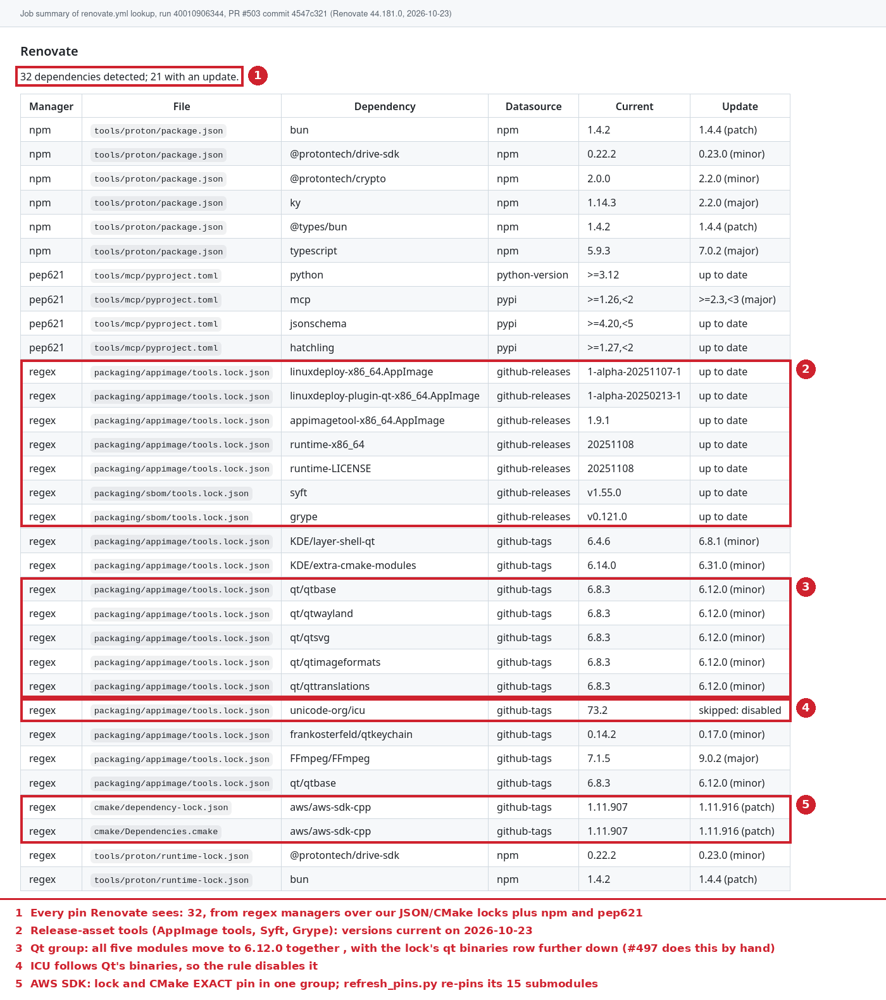
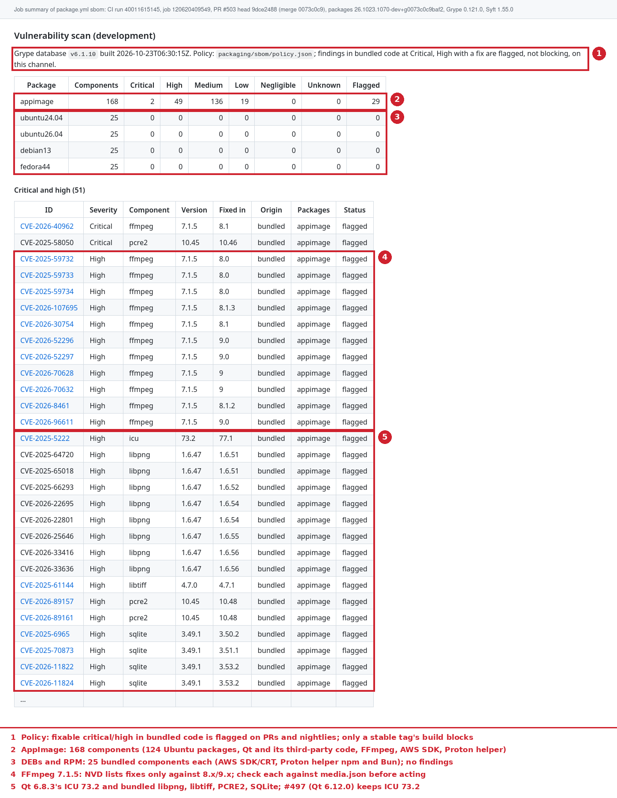

# Dependency automation and SBOM scans (#420): 2026-10-23

Evidence for [#503](https://github.com/patrick-hudson/put.gd-desktop/pull/503)
(Renovate, SBOMs and the Grype scan) and its documentation pull request. Nothing
here ran on the workstation; the local trials ran on k72 and d69.

## Renovate lookup

| | |
| --- | --- |
| Run | [renovate.yml run 40010906344](https://github.com/patrick-hudson/put.gd-desktop/actions/runs/40010906344), `lookup` job, `pull_request` on #503 |
| Source | `4547c321` (the pull request's configuration) |
| Renovate | 44.181.0, image `ghcr.io/renovatebot/renovate@sha256:1a06e15f…91b6d`, local platform, `dryRun=lookup`, read-only token |
| Result | config valid (`renovate-config-validator --strict`); 32 dependencies detected, 21 with an update |

`renovate-lookup-summary.md` is that job's summary, regenerated from the run's
`renovate-lookup` log artifact with `tools/maintenance/renovate_summary.py`.
`renovate-lookup-annotated.png` renders it with GitHub's markdown API and CSS
(the run page shows job summaries only when you are signed in) and marks:

An extract-only run of the same image on d69 (no token, `dryRun=extract`)
detected the same 32 dependencies.

## SBOMs and the Grype scan

| | |
| --- | --- |
| Run | [CI run 40011615145](https://github.com/patrick-hudson/put.gd-desktop/actions/runs/40011615145), job `packages / sbom` 120620409549, 19:44:14–19:46:47Z |
| Source | #503 head `9dce2488`, merge commit `0073c0c9` |
| Packages | that run's own builds, `26.1023.1070-dev+g0073c0c9baf2`: AppImage, ubuntu24.04, ubuntu26.04, debian13 DEBs, fedora44 RPM |
| Tools | Syft 1.55.0, Grype 0.121.0 (`packaging/sbom/tools.lock.json`), Grype DB v6.1.10 built 2026-10-23T06:30:15Z |
| Result | five CycloneDX SBOMs; AppImage 168 components, 206 findings, 29 flagged; each native package 25 components, no findings |

`sbom-receipts.json` binds each SBOM to its package's SHA-256, and
`sbom-vulnerability-summary.md` is the job summary. Both come from the run's
`release-sbom` and `vulnerability-report` artifacts.

The same tools on k72, run over the published `v26.1023.1058-nightly` assets
(SHA256SUMS verified), gave the same counts. The 29 flagged findings are in
FFmpeg 7.1.5 (12), and in Qt 6.8.3's ICU 73.2 (1) and bundled libpng (8),
SQLite (4), PCRE2 (3) and libtiff (1). The 124 Ubuntu packages have only
`not-fixed` or `wont-fix` findings (2 high, 106 medium, 15 low).
