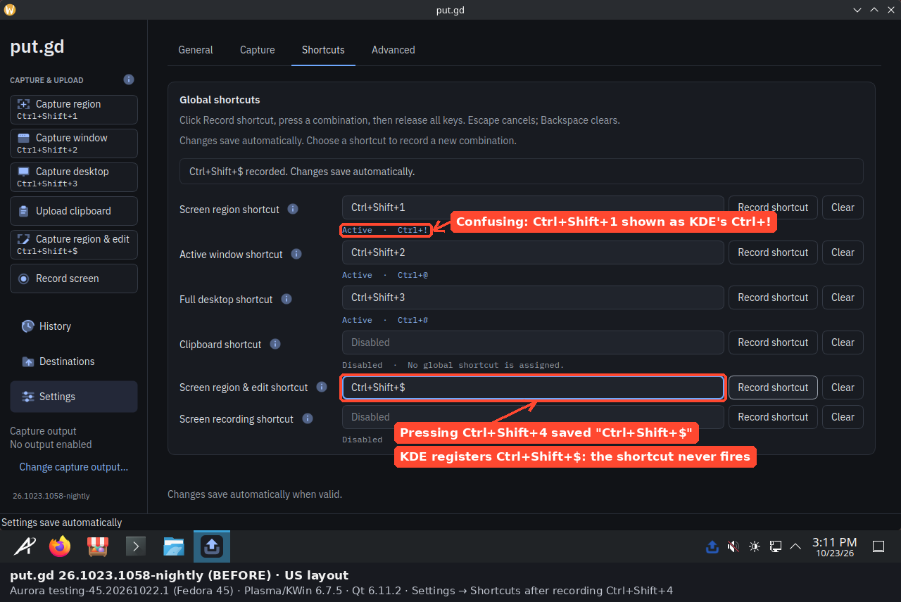
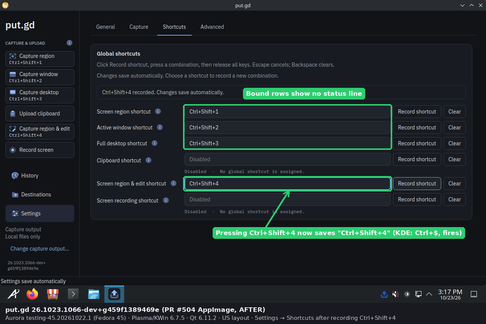
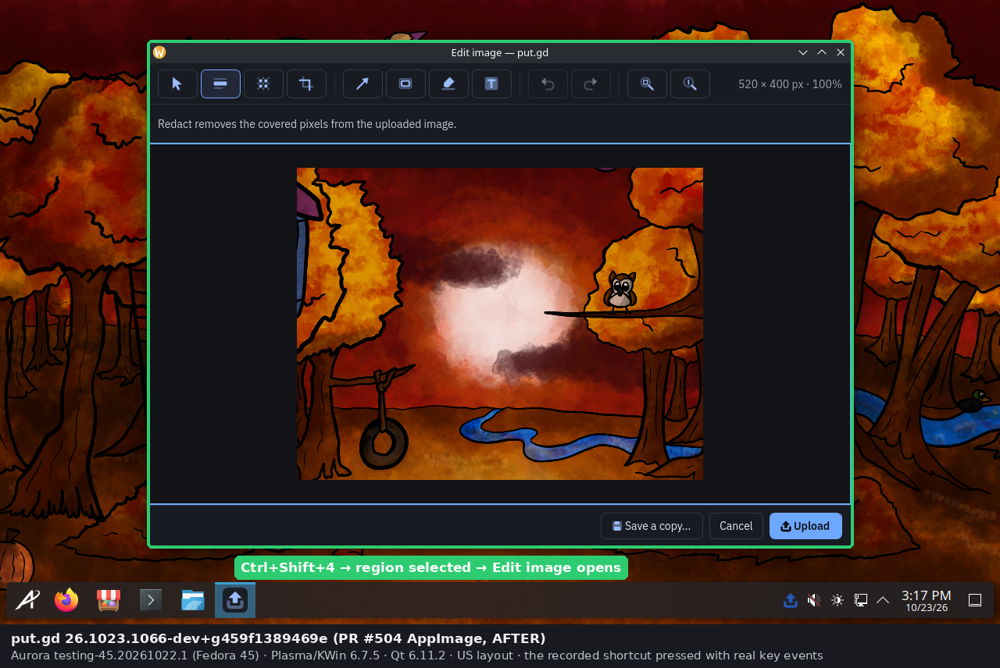
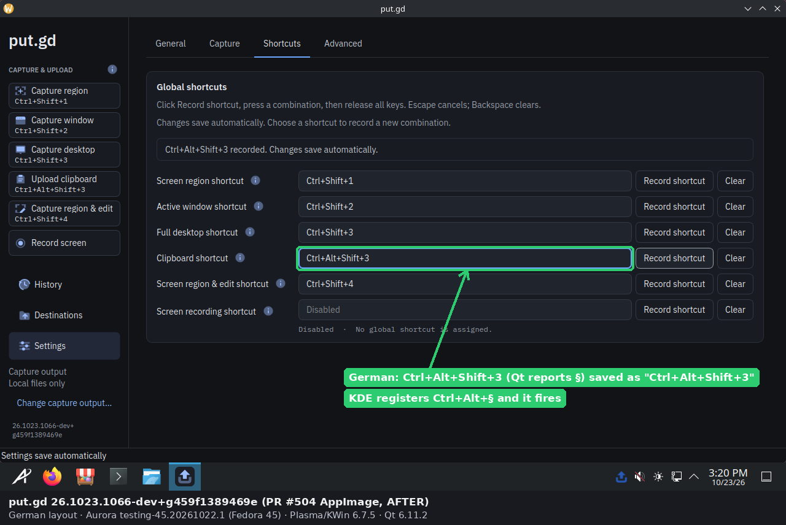

# KDE shortcut recorded as Ctrl+Shift+$ (PR #504), 2026-10-23

This is the desktop acceptance for [PR #504](https://github.com/patrick-hudson/put.gd-desktop/pull/504). A user on Aurora (Fedora 45, KDE Plasma Wayland, US layout) recorded Ctrl+Shift+4 for **Screen region & edit**, and the shortcut never fired.

**Cause:**
- **Recorder:** it saved Qt's Shift-level symbol, so the setting became `Ctrl+Shift+$`.
- **Normalizer:** the KDE normalizer then picked evdev's one-level `KEY_DOLLAR` key and registered `Ctrl+Shift+$` with KGlobalAccel. KWin sends `Ctrl+$` for that keypress, so nothing matched.

**Result:**
- **Aurora Fedora 45 VM (primary, US layout):**
  - nightly 1058 reproduces the report;
  - the PR build fires the old `Ctrl+Shift+$` setting without re-recording;
  - the PR build records Ctrl+Shift+4 as `Ctrl+Shift+4`, and the shortcut opens the editor.
- **German layout:** the same VM records and fires Ctrl+Shift+4, and Ctrl+Alt+Shift+3 (Shift+3 is `§`).
- **d69 (Debian 13 Plasma 6.3.6, physical, regression check):** both setting forms register `Ctrl+$` and fire, and the defaults still work.

## Builds

| Role | Version | SHA-256 | Source |
| --- | --- | --- | --- |
| Before | `26.1023.1058-nightly` AppImage | `ce707fcf4e693b5c…20e6db` | [release](https://github.com/patrick-hudson/put.gd-desktop/releases/tag/v26.1023.1058-nightly), matches its `SHA256SUMS` |
| After | `26.1023.1066-dev+g459f1389469e` AppImage | `ec47d02d69937168…7deb931` | PR #504's CI run [40012756708](https://github.com/patrick-hudson/put.gd-desktop/actions/runs/40012756708) (head `83b82b89`, merge with nightly `459f1389`) |

## Aurora Fedora 45 VM (f44)

- **Guest:** an overlay of the golden `aurora-testing-45.20261022.1-852d34e885c1` (SHA-256 `33fedf97…8556`, unchanged after the run). Aurora `testing-45.20261022.1`, `kwin-6.7.5-1.fc45`, `plasma-workspace-6.7.5-2.fc45`, `qt6-qtbase-6.11.2-3.fc45`, US layout (`pc105`).
- **Run:** `aurora-ksc-4bb603df` (id `2aebfc38-ac5e-4c42-afcc-5d67d0a38f11`), 4 GiB and 2 vCPUs.
- **Input:** keys went in through QMP `input-send-event`, so KWin saw a real keyboard.
- **Oracle:** each press was checked in the resident's `Operation accepted` log line, `operation.recent` and the KGlobalAccel config. On Plasma the region selector is a transparent overlay, so a screenshot alone doesn't show a delivered shortcut.
- **Retirement:** QMP quit, then the guarded cleanup with an explicit evidence manifest. It removed only `disk.qcow2`.

| Step | Settings text | KGlobalAccel (`kglobalshortcutsrc`) | Ctrl+Shift+4 pressed |
| --- | --- | --- | --- |
| 1058, record Ctrl+Shift+4 | `Ctrl+Shift+$` | `edit=Ctrl+Shift+$` | nothing (20:14:34Z); control Ctrl+Shift+1 accepted |
| PR build, unchanged setting | `Ctrl+Shift+$` | `edit=Ctrl+$` | `Operation accepted` `edit` (20:15:21Z) |
| PR build, record Ctrl+Shift+4 | `Ctrl+Shift+4` | `edit=Ctrl+$` | `edit` accepted, region dragged, the editor opens (20:17:25Z) |
| PR build, German, record Ctrl+Shift+4 | `Ctrl+Shift+4` | `edit=Ctrl+$` | `edit` accepted, the editor opens (20:20:57Z) |
| PR build, German, record Ctrl+Alt+Shift+3 | `Ctrl+Alt+Shift+3` | `clipboard=Ctrl+Alt+§` | `clipboard` accepted (20:21:21Z), then `source_unsupported` because the guest clipboard was empty |

After the switch to German, the resident re-registered `Ctrl+Shift+3` as `Ctrl+§` without a restart. Under 1058, the `Ctrl+Shift+$` binding reported `bound: true` with `effective` equal to `actual`, which is why its status line was hidden while it never fired. With the PR build, the status line compares against `effective`, so the working `Ctrl+Shift+1` row no longer shows `Active · Ctrl+!`.

Swapping AppImages inside one guest left KWin's screenshot permission entry under the lab's private `XDG_DATA_HOME`. The first edit capture after the swap therefore failed with `capture_permission` after the shortcut had been delivered. Mirroring the entry into `~/.local/share/applications` before the next start fixed it ([docs/aurora-vm.md](../../aurora-vm.md)). This is a lab artifact, not a product change.

### Pictures

Before, 1058: recording Ctrl+Shift+4 saves `Ctrl+Shift+$`, and the working Ctrl+Shift+1 row shows KDE's `Ctrl+!`.

After, `26.1023.1066-dev+g459f1389469e`: the recording is `Ctrl+Shift+4`, and bound rows show no status line.

After: pressing the recorded Ctrl+Shift+4 starts **Capture region & edit**, and the editor opens on the dragged region.

After, German layout: Ctrl+Alt+Shift+3 is recorded as `Ctrl+Alt+Shift+3`, registered as `Ctrl+Alt+§`, and fires.

## d69: Debian 13 Plasma Wayland (physical, regression)

- **Desktop:** `kwin-wayland 4:6.3.6-1`, `plasma-workspace 4:6.3.6-2`, US layout.
- **Lock:** `desktop_lock.py`, 20:26:37–20:30:04Z, released `--verified-clean`.
- **Profile:** the PR AppImage ran with private `XDG_CONFIG_HOME`, `XDG_DATA_HOME`, `XDG_STATE_HOME` and `XDG_CACHE_HOME`.
- **Input:** keys came from `tools/lab/host_input.py`, a uinput keyboard.
- **Pictures:** no frames were taken on this desktop. Every started operation was cancelled before capture.

| Setting | KGlobalAccel | Ctrl+Shift+4 |
| --- | --- | --- |
| defaults | `Ctrl+!`, `Ctrl+@`, `Ctrl+#` bound | (control Ctrl+Shift+1 starts `region`) |
| `Ctrl+Shift+$` (old recorder form) | `edit=Ctrl+$` | starts `edit` |
| `Ctrl+Shift+4` (new recorder form) | `edit=Ctrl+$` | starts `edit` |

`kglobalshortcutsrc` was restored through put.gd and is byte-for-byte identical to the pre-run backup (SHA-256 `4022f6ef…4880`).

## Results

- [`results/shortcut-bindings.json`](results/shortcut-bindings.json): the resident's `capabilities.source.shortcuts.bindings` at each step on both machines.
- [`results/before-1058-log-and-kglobalaccel.txt`](results/before-1058-log-and-kglobalaccel.txt), [`results/after-us-log-and-kglobalaccel.txt`](results/after-us-log-and-kglobalaccel.txt) and [`results/after-de-log-and-kglobalaccel.txt`](results/after-de-log-and-kglobalaccel.txt): the resident's operation log lines and the guest's `[putgd]` KGlobalAccel section. Long lines are trimmed.
