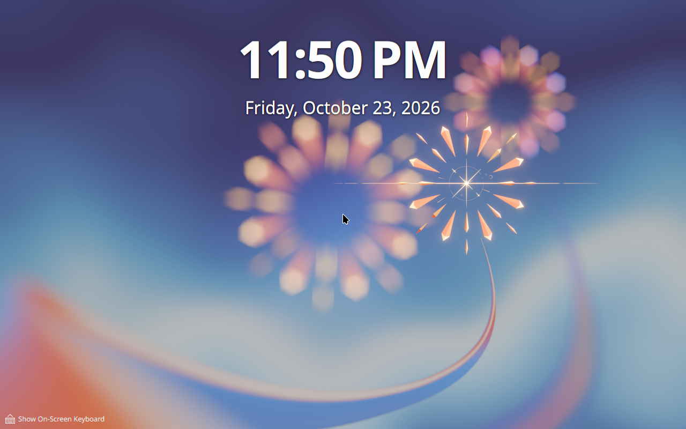
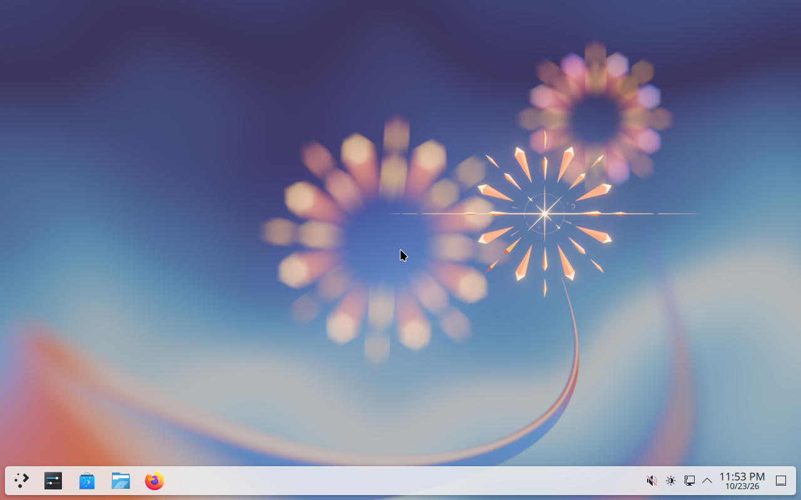

# neon autologin repair, 2026-10-23

The repair in [code PR #546](https://github.com/patrick-hudson/put.gd-desktop/pull/546)
restored autologin on both neon User and Unstable after reproducing
[#524](https://github.com/patrick-hudson/put.gd-desktop/issues/524). This checks the
lab bootstrap script; no application binary was changed, built or accepted in
this campaign. The upstream reporting decision remains open.

## Exact source and environments

- Clean `nightly` base: `35c98061a3dce84d0b161437219601ca4a3c1751`.
- Tested code commit: `2315d82fee91ff78194f8b21cb50813f36f1f739`;
  tree `6c4a62245ae7eae5b50b08cdb1cca69723e5235d`.
- `tools/lab/bootstrap-neon-guest.sh` SHA-256:
  `290147d2f61938b744202416df985cbb9181d4a1e53180e3ef7c185521b83d8f`.
  The exported source and each guest's copy matched this digest.
- Host: `d69`, Debian 13, `192.168.68.69`, kernel
  `6.12.107+deb13-amd64`, QEMU `10.0.13` (`1:10.0.13+ds-0+deb13u1`).
- Each guest: `neon-kde-wayland`, KVM, BIOS, 2 vCPUs, 6144 MiB,
  `virtio-vga`, one 1280×800 display, kernel `7.0.0-38-generic`, Wayland.

| Identity | User | Unstable |
| --- | --- | --- |
| Run directory under `work/lab-runs/` | `n524u` | `n524m` |
| Run UUID | `0cdb5af5-c5d5-4082-b559-83f72bb12495` | `df1684ed-12e4-47fa-a3d4-6885c13bdad1` |
| Golden | `neon-user-6.8.1-20261023-9ef808278853` | `neon-unstable-noble-20261023-d613510c07bd` |
| Golden SHA-256 | `191852a5b552492daa9eac1093acd7e15578b0cc5374f4c9a660037af5863238` | `9fef081035ca6691446672b2914c09ff4a7b4a4b359577a6087279b0d892e8f6` |
| plasmalogin | `6.8.1-0zneon+24.04+noble+release+build27` | `6.8.1+p24.04+vunstable+git20261020.1558-0` |
| kwin-wayland | `4:6.8.1-0zneon+24.04+noble+release+build114` | `4:6.8.1+p24.04+vunstable+git20261023.0434-0` |
| plasma-workspace | `4:6.8.1-0zneon+24.04+noble+release+build100` | `4:6.8.1+p24.04+vunstable+git20261020.1504-0` |
| SSH / remote VNC / workstation wall port | `22469` / `5969` / `5994` | `22468` / `5968` / `5995` |

Both were fresh overlays launched with the production `lab.py` lifecycle,
using the canonical root override described in [neon VMs](../../neon-vm.md).
The goldens remained read-only backing images. Each complete QMP socket path
was checked before launch: 54 UTF-8 bytes, within the 107-byte limit. Host KVM,
memory, disk space, free ports, display access and guest capacity were checked.
The workstation wall carried both loopback VNC tunnels throughout the campaign;
the physical desktop sessions were untouched.

## Procedure and results

1. Copy the exact tested bootstrap into each guest as `/home/lab/repair-524.sh`.
   Retain the initial package versions, boot identity and desktop witnesses.
2. In each disposable overlay, restore only the installer's bad main-config
   value: `[Autologin] Session=/usr/share/wayland-sessions/plasma.desktop`.
   Leave the existing `User=lab` lab drop-in intact, then reboot explicitly.
3. Both boots fell back to plasmalogin's greeter. Their journals reported
   `Unable to find autologin session entry` for the absolute path and user
   `lab`; no `lab` graphical session was active. Retain the journals and saved
   failed-boot visuals before recovery.
4. Recover through each visible tty2 console, then run the repair as root:

   ```sh
   sh /home/lab/repair-524.sh --fix-autologin
   ```

   Assert the complete config equals the original with only the affected
   session value replaced. Check the new backup against the original bytes,
   require backup mode 0600, and compare config owner, group and permissions.
   Repeat the same command and require unchanged inode, mtime and ctime.
   Compare boot ID, plasmalogin PID and the complete lab drop-in before and
   after repair: none changed. The repair itself did not restart a session.
5. Reboot explicitly from the test wrapper. Both guests entered active `lab`
   Wayland sessions with `Service=plasmalogin-autologin`, `Type=wayland` and
   `Active=yes`. Neither new boot logged the autologin-session lookup error.
   No manual login or input was sent after these reboots. Saved QMP and RFB
   frames showed the Plasma desktop and panel on each edition.

| Receipt | User | Unstable |
| --- | --- | --- |
| Failed boot ID | `f6645a42-46be-4054-92f4-45cafd72a48a` | `1a330e4b-0652-48c9-b1f7-7d9ea4aa80cf` |
| Repaired boot ID | `84211ba8-0f7b-4270-9b99-3b34470d8564` | `507444fa-9204-4015-8d6e-b3783c5b7c19` |
| Private backup basename | `plasmalogin.conf.putgd-524-43t7k96e.bak` | `plasmalogin.conf.putgd-524-lnztl0wx.bak` |
| Repaired desktop QMP PPM SHA-256 | `8c36eb64b729610a3716c2e0f52d6b0192e5c4d32b82d7619c9077ae9e48dd43` | `1a827b94a45e388cea6ab1aefca8c63effec66442d45bf8212a4f6070fe2da85` |

Both original bad configs hashed to
`1115b7fb86b5747f3e4db781cc0c3a0f2de94c5a8c612b5211894a3cfe2474b1`;
both repaired configs hashed to
`13e499bbff57dedb05ca6adfb5e208fea9f02c9da59f8f588b4b9c8a45822f7f`.

The executable fixture suite passed all eight tests, covering section and value
scope, whitespace/CRLF/no final newline, byte and metadata preservation, private
backups, repeated and later repairs, missing files, symlink/directory/FIFO
refusal, invalid argument count, and an injected replacement failure. On d69,
`python3 tools/ci/contracts.py lab --output work/contracts` passed all 17 suites.
`sh -n tools/lab/bootstrap-neon-guest.sh` also passed. No CMake build or application
acceptance matrix run was needed for these lab-only paths.

## Saved visuals

Unstable's failed boot remained at the greeter before console recovery:



User's failed-boot QMP frame captured the greeter backdrop during its transition;
the accompanying journal and seat-session receipt establish the fallback:


After repair and a new boot, User entered its desktop automatically:



Unstable also entered its desktop automatically, with the Plasma 6.9 Dev watermark:


## Retention and harness context

Private raw evidence is on d69 under
`~/work/put.gd/work/neon-lab/autologin-524-2315d82f/{n524u,n524m}/`, with a verified
workstation export under this task's `work/524/autologin-524-2315d82f/`.
Each directory retains source/host identity, launch commands, state and QMP
features, socket and capacity receipts, journals, root repair assertions,
QMP/RFB visuals and SHA-256 export indices. Completion manifests and guarded
cleanup receipts record retirement of each owned `disk.qcow2`; immutable
goldens and other runs were preserved. Owned wall entries and tunnels were
removed after evidence export and verification.

An initial capacity query ran before guest SSH was ready and failed; its
`preflight-user.json` is retained alongside the successful two-guest
`preflight-ready.json`. A failed-greeter RFB frame request timed out, so stable
full-frame QMP witnesses were used for console inspection. VNC typing dropped
Shift for a shell redirection; the pending sudo prompts were cancelled before
authentication, and log redirection was moved into the transferred test script.
The corrected console command was
`sudo -k sh /home/lab/repair-and-reboot-524.sh`. These harness attempts did not
change the tested repair implementation. Console authentication used protected
private input in memory and masked fields; no revealed login input is in the
saved visuals or receipts.
