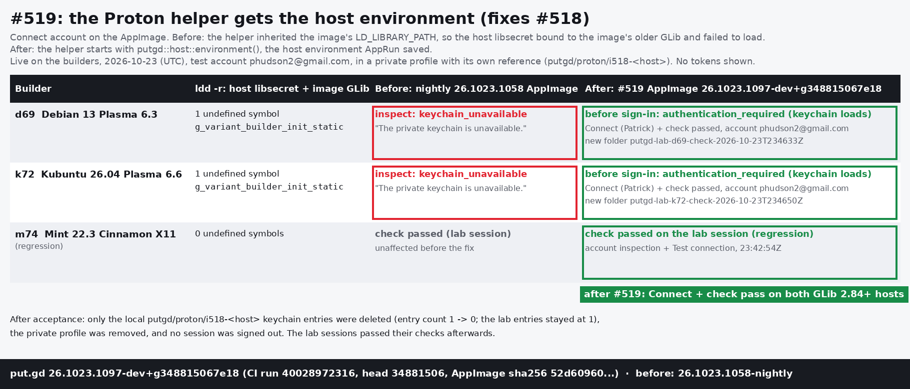

# The AppImage's Proton helper and the host keychain (#518, #519)

On the AppImage, **Connect account** for Proton Drive failed on Debian 13 and Kubuntu/Ubuntu
26.04 with "The private keychain is unavailable." (`keychain_unavailable`).
- **Cause:** the Bun helper inherited AppRun's `LD_LIBRARY_PATH`, so the host libsecret that
  `Bun.secrets` loads bound to the image's older GLib. The hosts' libsecret needs
  `g_variant_builder_init_static` (GLib 2.84), so it failed to load.
- **Fix:** [#519](https://github.com/patrick-hudson/put.gd-desktop/pull/519) starts the helper with
  `putgd::host::environment()`, the environment AppRun saved, as put.gd already does for host
  programs (#326).
- **Found by:** the Proton lab sign-ins (#517).

## Build under test

`26.1023.1097-dev+g348815067e18`: the AppImage from #519's full CI run 40028972316, head
`348815067e18`, sha256 `52d609607f25b66f…`. The before builds are nightly `26.1023.1058`.

## Results, 2026-10-23 (UTC)

| Builder | `ldd -r` of host libsecret with the image's library path | Nightly 1058 AppImage | #519 AppImage |
| --- | --- | --- | --- |
| d69 Debian 13 Plasma 6.3 | 1 undefined symbol, `g_variant_builder_init_static` | account inspection: `keychain_unavailable` | before sign-in: `authentication_required` (the keychain loads). Patrick's **Connect account**, then `check --new-folder` (account inspection plus Test connection): passed, folder `putgd-lab-d69-check-2026-10-23T234633Z` |
| k72 Kubuntu 26.04 Plasma 6.6 | 1 undefined symbol, `g_variant_builder_init_static` | account inspection: `keychain_unavailable` | before sign-in: `authentication_required`. Connect, then check: passed, folder `putgd-lab-k72-check-2026-10-23T234650Z` |
| m74 Mint 22.3 Cinnamon X11 (regression) | 0 undefined symbols | worked | check on m74's lab session: passed (23:42:54Z) |

- **How it ran:** the checks used `tools/lab/proton_lab.py` (#517) on the builders.
- **Test profiles:** d69 and k72 used a private profile (`~/putgd-lab/proton-519/`) with its own
  reference, `putgd/proton/i518-<host>`, so the builders' lab sessions stayed untouched.
  [registry-d69.json](registry-d69.json) and [registry-k72.json](registry-k72.json) are those
  profiles' nonsecret registries.
- **m74:** the regression check pointed m74's lab profile at the #519 AppImage for one check,
  then restored 1058.
- **Browser:** the https handler on d69 and k72 (the ChatGPT app) was pointed at Firefox for the
  sign-in, and `mimeapps.list` was restored byte for byte afterwards.

## Clean-up

- **Keychain:** only the local `putgd/proton/i518-d69` and `putgd/proton/i518-k72` entries were
  deleted. libsecret's attribute search counted 1 entry before and 0 after; each lab entry
  (`putgd/proton/lab-<host>`) stayed at 1.
- **No sign-out:** the two #519 test sessions remain on Proton's side until they expire.
- **Profiles:** `~/putgd-lab/proton-519/` was removed on d69, k72 and m74.
- **Lab sessions:** the lab sessions on d69 and k72 passed `check` afterwards.
