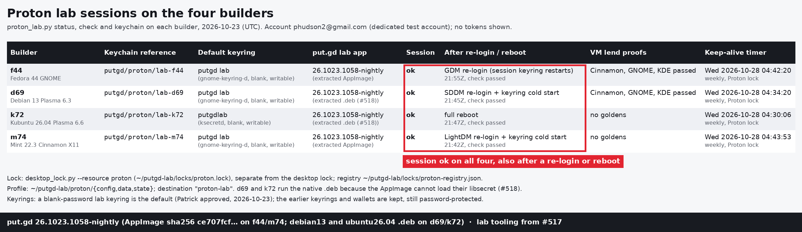
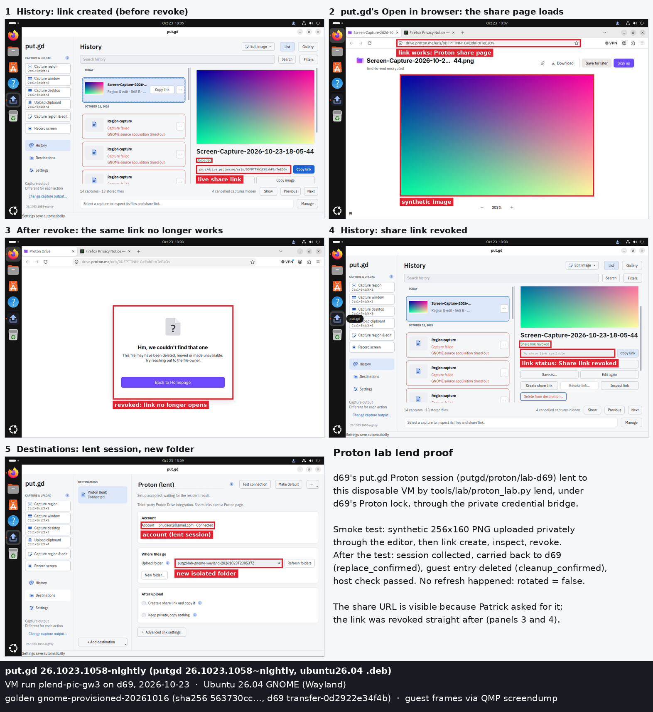
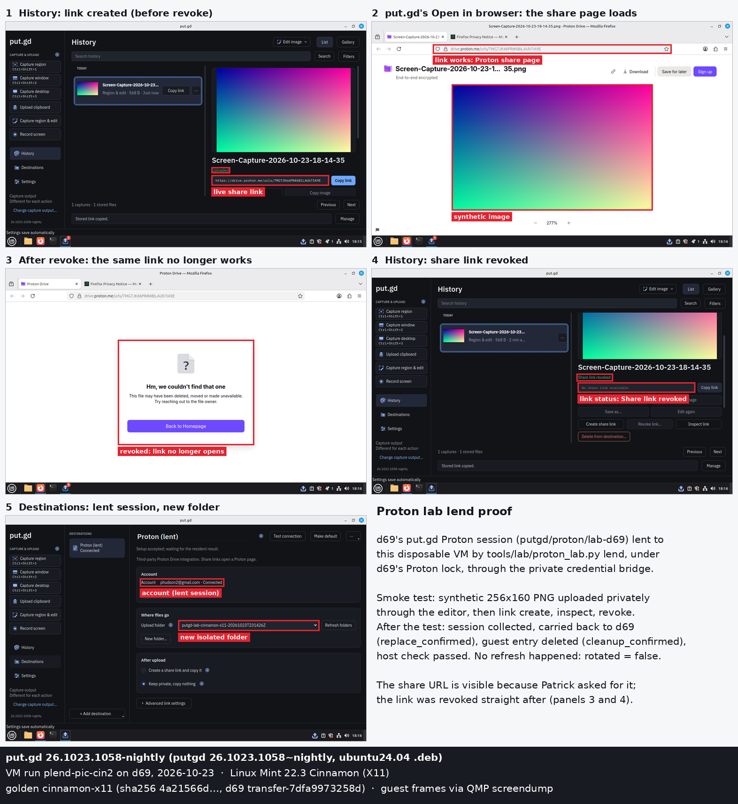
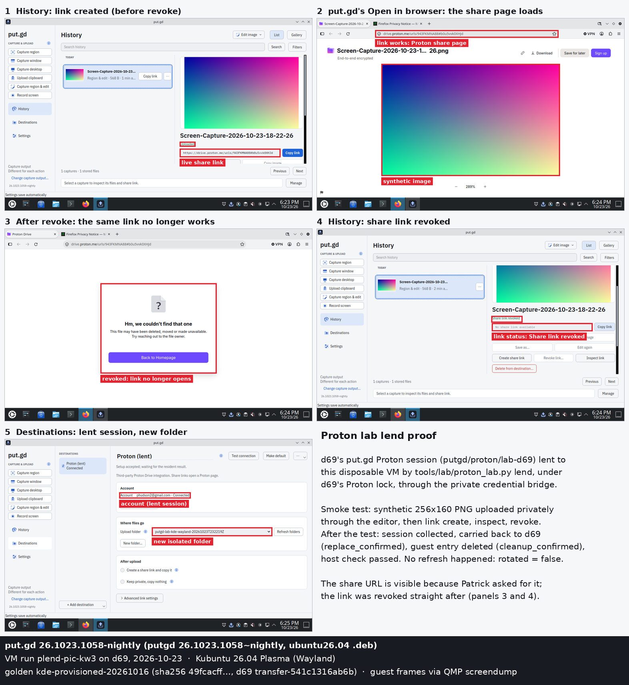

# Proton lab sessions: one sign-in per builder, lent to VMs (#517)

Patrick asked for a lab where later sessions can run live Proton Drive acceptance on the
builders and in their VMs without him signing in again for every test. On 2026-10-23 he
signed in once on each builder, using the dedicated test account phudson2@gmail.com.
Everything below ran against those four sessions with nightly **26.1023.1058**.
- **Lab tooling:** [#517](https://github.com/patrick-hudson/put.gd-desktop/pull/517).
- **How to use it:** the lab section of [Proton Drive](../../proton-drive.md#lab-sessions-on-the-builders)
  and [the builders' Proton sessions](../../remote-builders.md#proton-sessions-on-the-builders).

## The four builder sessions

| Builder | Keychain reference | Default keyring | Lab app | Persistence proof, then `check` |
| --- | --- | --- | --- | --- |
| f44 Fedora 44 GNOME | `putgd/proton/lab-f44` | gnome-keyring `putgd lab` (blank) | extracted AppImage | GDM restart (session 14814 → 14907); the session's keyring daemon restarted cold |
| d69 Debian 13 Plasma 6.3 | `putgd/proton/lab-d69` | gnome-keyring `putgd lab` (blank) | extracted debian13 .deb | SDDM restart and a cold gnome-keyring restart; no reboot, because Patrick's static smb demo would not come back |
| k72 Kubuntu 26.04 Plasma 6.6 | `putgd/proton/lab-k72` | KWallet `putgdlab` (blank) | extracted ubuntu26.04 .deb | full reboot (boot 16:47:12 local) |
| m74 Mint 22.3 Cinnamon X11 | `putgd/proton/lab-m74` | gnome-keyring `putgd lab` (blank) | extracted AppImage | LightDM restart and a cold gnome-keyring restart; no reboot, because the w11b guest stays up |

- **Checks:** every `check` (account inspection plus Test connection, scope `account-folder`)
  passed after the sign-in, after the re-login or reboot, and after each lend. The raw status
  is in [builders-status.jsonl](builders-status.jsonl).
- **Keyrings:** before the change, no builder had an unlocked default collection (f44 had none),
  so Connect would have failed with `keychain_unavailable`.
  - Patrick chose blank-password lab keyrings: "Yes: use a blank-password default keyring on all
    four builders so the Proton lab sessions survive reboots and re-logins unattended. It's a test
    account on lab machines; I accept the session being stored unencrypted on disk."
  - The new collections became the default alias. The earlier keyrings and wallets were kept,
    still password-protected.
- **d69 and k72 run the native .deb:** the AppImage's Proton helper inherits the image's library
  path. On GLib 2.84+ hosts, the host libsecret then cannot load (`g_variant_builder_init_static`),
  and Connect reports "The private keychain is unavailable".
  - Filed as [#518](https://github.com/patrick-hudson/put.gd-desktop/issues/518), P1;
    the fix is [#519](https://github.com/patrick-hudson/put.gd-desktop/pull/519).
  - `ldd -r` of the host libsecret with the image's path: 1 undefined symbol on d69 and k72,
    0 on f44 and m74.
- **Keep-alive:** `putgd-proton-keepalive.timer` runs each Wednesday at 04:30 local
  (Persistent, up to 15 minutes' random delay). A manual run on m74 passed.

## Lending to VMs: six proofs, then three picture runs

`proton_lab.py lend` ran each guest under the builder's Proton lock. Every run that passed took
the same path:
1. Prepare a blank keyring in the guest.
2. Provision the builder's session (`chain_guest import_confirmed`).
3. Run the smoke test: a synthetic 256×160 PNG uploaded privately through the editor into a new
   folder, then link create → inspect → revoke.
4. Quit the guest app, collect the session, carry it back (`source_replace replace_confirmed`)
   and clean up the guest entry (`cleanup_confirmed`).
5. Run a host `check` (passed).
6. Quit the VM via QMP.

| Builder | Cinnamon (Mint 22.3, ubuntu24.04 .deb) | GNOME (Ubuntu 26.04, ubuntu26.04 .deb) | KDE (Kubuntu 26.04, ubuntu26.04 .deb) |
| --- | --- | --- | --- |
| d69 | plend-cin-b3 | plend-gw | plend-kw |
| f44 | plend-f-cin | plend-f-gw3 | plend-f-kw |

Each picture run below lent d69's session to a fresh guest:
1. The run paused before revoke, with the session still lent. History showed the link, and put.gd's
   **Open in browser** opened it in a Firefox profile created for the run.
2. The run revoked the link and paused again. The reloaded page and History show the revoked state.
3. Destinations shows the lent session's account and the run's new folder.

The share URLs are visible because Patrick asked for proof that the links work: "make sure the
pictures have the links to proton showing they work". Each link was revoked a minute later.
No token, cookie or keyring content appears.

All 18 runs, 20 lends and their receipt states are in [lend-runs.json](lend-runs.json), with
names, IDs and states only.
- **Goldens:** every golden used was hashed again afterwards and matches the inventory
  (4a21566d…, 563730cc…, 49fcacff… on both f44 and d69).
- **Overlays:** all 18 were retired through the guarded cleanup with completion manifests.

## What went wrong and what it changed

- **Wrong pins and keys.** These failures are recorded as `failed` in lend-runs.json.
  - plend-cin-0bce5e2f and plend-cin-b2 timed out at boot: d69's Ubuntu-based goldens accept its
    `rec-ws` bootstrap key, not the plain one.
  - plend-f-gw and plend-f-gw2 timed out on f44: its shared `known_hosts` pins port 22220 to the
    Cinnamon golden's host key. The GNOME guest presented `SHA256:aAvwhCwH…`, the key d69 pins
    for the same golden, so f44 now has `lab-bootstrap-f44/known_hosts-gnome`.
- **KWallet's first revoke** (plend-kw, first lend): link create and inspect worked, then revoke
  failed with `keychain_unavailable`.
  - ksecretd keeps its `aliases/default` object on the old wallet until it restarts.
    `lab_keyring.py` now restarts it, by its exact D-Bus PID, when the alias is stale.
  - That link was revoked afterwards by re-lending under the same guest name
    (`lend --guest-reference`), because put.gd binds a history entry's link operations to its
    upload reference.
- **An interrupted lend** (plend-pic-kw): SSH dropped mid-share. The lend stopped with the copy
  outstanding and left the Proton lock held and blocked. Recovery took three steps:
  1. The overlay was booted again and `proton_lab.py recover` carried the guest copy back
     (`replace_confirmed`) and cleaned it up.
  2. The share was `unknown`, so a re-lend inspected it: `shared`.
  3. The re-lend revoked it: `revoked`.
- **Test bugs fixed in #517:** the smoke test now asserts every share status (one run exited 0
  after a failed revoke). The `lend` command line no longer swallows its options.

## Not proven here

- **A rotated session's carry-back was not exercised live.** No run refreshed the session: every
  lend reports `rotated: false`, because the access token stayed valid. The carry-back,
  reconciliation and receipts ran live with unchanged bytes. Carrying back a refreshed snapshot is
  covered only by the bridge's synthetic tests (`tests/desktop/test_live_credentials_lab.py`).
  The follow-up is [#527](https://github.com/patrick-hudson/put.gd-desktop/issues/527).
- **Idle expiry:** pinned SDK 0.22.2 (`ProtonDriveApps/sdk` 8ffae007,
  `incubating/account/js/src/apiClient.ts`) tracks no expiry. A 401 triggers one refresh, and a
  refused refresh only deletes the local keychain entry. The API types document access-token
  `ExpiresIn` as deprecated (example 360000 s) and a one-year lifetime for persistent-session
  cookies; no idle limit is documented. The weekly keep-alive is insurance, not a measured
  requirement.
- **Apt timers in the guests:** they couldn't be masked, because the guests' sudo rule allows only
  apt-get. They played no part in any failure.

## Proton folders left by the tests

These folders hold synthetic PNGs only, and every link was revoked. put.gd cannot delete Proton
files, so they stay as lab folders:
- `putgd-lab-<host>-check-<time>`, one per builder;
- `putgd-lab-cinnamon-x11-*`, `putgd-lab-gnome-wayland-*` and `putgd-lab-kde-wayland-*`, one per
  smoke run (listed in lend-runs.json);
- two folders whose smoke results the next run on the same VM overwrote:
  `putgd-lab-cinnamon-x11-20261023T220059Z` (plend-cin-b3's first lend, upload only, no link) and
  `putgd-lab-kde-wayland-20261023T221153Z` (plend-kw's first lend, link revoked later).
