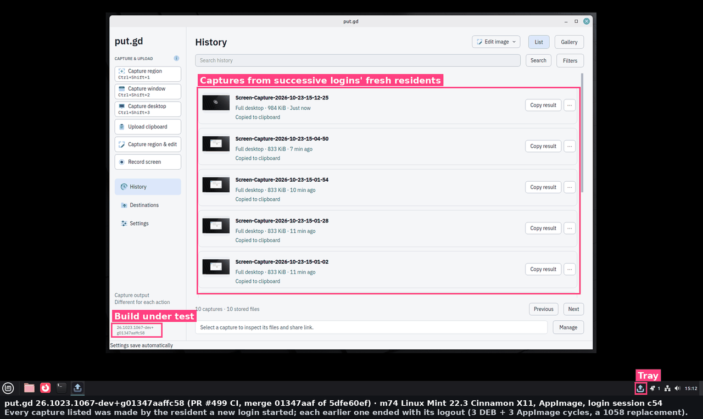
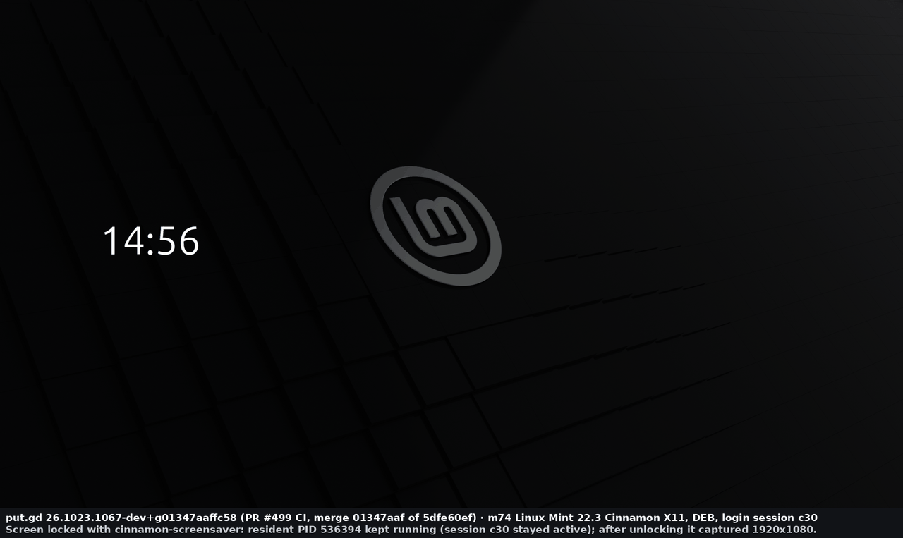
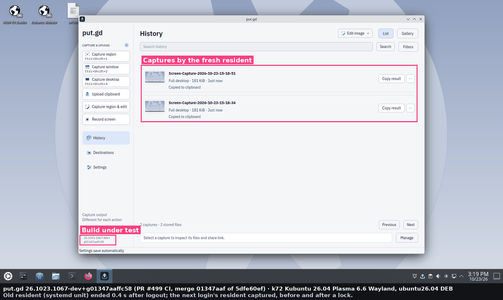

# Resident ends with its login session (#490), 2026-10-23

This is the desktop acceptance for [#490](https://github.com/patrick-hudson/put.gd-desktop/issues/490), fixed by [PR #499](https://github.com/patrick-hudson/put.gd-desktop/pull/499).

On Linux Mint Cinnamon X11, the resident that **Launch at login** started survived the logout. The next login handed off to it, and its captures failed with `capture_unavailable`.

**Result:**
- **m74 (Mint Cinnamon X11, physical):** 3 of 3 logout/login cycles pass on the DEB and 3 of 3 on the AppImage. Every old resident ended within about 3 s of the logout, and every next login's fresh resident captured.
- **Lock and unlock:** the resident survives a screen lock on both packages.
- **Pre-fix residents:** this build's login start replaces a resident left by `v26.1023.1058-nightly`.
- **Idle RSS:** unchanged against 1058.
- **Regression checks on k72 (Plasma Wayland) and f44 (GNOME Wayland):** both pass.

## Build

All packages come from PR #499's CI run [40010973810](https://github.com/patrick-hudson/put.gd-desktop/actions/runs/40010973810). Head is `5dfe60ef`; GitHub's merge with nightly is `01347aaf`.

| Asset | Version | SHA-256 |
| --- | --- | --- |
| AppImage | `26.1023.1067-dev+g01347aaffc58` | `22a6b8e51147daff…` |
| `ubuntu24.04` DEB (m74) | `26.1023.1067~dev+g01347aaffc58` | `83d86e17e0cb0770…` |
| `ubuntu26.04` DEB (k72) | same | `0546455ba1883315…` |
| `fedora44` RPM (f44) | `26.1023.1067~dev+g01347aaffc58-1.fc44` | `ba3ac6951b7790dd…` |

The comparison build is the release AppImage of [`v26.1023.1058-nightly`](https://github.com/patrick-hudson/put.gd-desktop/releases/tag/v26.1023.1058-nightly). It was checked against the release's `SHA256SUMS`.

## m74: Linux Mint 22.3 Cinnamon X11 (physical, LightDM autologin)

**Procedure:**
- **Logout:** each cycle logs out with `cinnamon-session-quit --logout --no-prompt`.
- **Login:** LightDM autologin, through `systemctl restart lightdm`.
- **Capture:** the desktop action, saved to a scratch local archive with no upload. Only metadata is kept.
- **Driver:** [`lab/cycle.sh`](lab/cycle.sh) and [`lab/r490.py`](lab/r490.py). They signal no process.
- **Timings:** "Gone" is the SSH poll's view, about 0.5 s coarse. The log times are the resident's own.

| Cycle | Old resident (session) | Gone after logout | Its log | Fresh resident (session) | Capture |
| --- | --- | --- | --- | --- | --- |
| DEB 1 | 536394 (`c30`, x11) | 3.0 s | `Resident session ended` `session_closing`, exit 0 | 537730 (`c32`) | completed, 1920×1080 PNG saved |
| DEB 2 | 537730 (`c32`) | 3.1 s | `X11 connection lost` `xcbError` 1, then `display_lost`, exit 0 | 538859 (`c34`) | completed |
| DEB 3 | 538859 (`c34`) | 2.9 s | `session_closing`, exit 0 | 539992 (`c36`) | completed |
| AppImage 1 | 541268 (`c38`) | 3.0 s | `display_lost`, exit 0 | 542563 (`c40`) | completed |
| AppImage 2 | 542563 (`c40`) | 3.0 s | `session_closing`, exit 0 | 543697 (`c42`) | completed |
| AppImage 3 | 543697 (`c42`) | 2.9 s | `display_lost`, exit 0 | 544877 (`c44`) | completed |

Both triggers ended residents in real logouts. Which one wins depends on whether LightDM stops Xorg before logind marks the session `closing`.

Every resident was in its session's scope (`session-cNN.scope`), so diagnostics showed `loginSession` = `{id, type: x11, watched: true}`. Before the cycles, a resident started over SSH reported `not_graphical` (`tty`), as designed ([deb-0-state.json](results/m74/deb-0-state.json), [app-0-state.json](results/m74/app-0-state.json)). The full timeline is [results/m74/timeline-m74.txt](results/m74/timeline-m74.txt).

**Screen lock:** `cinnamon-screensaver-command --lock`, then `--deactivate`.
- **DEB:** resident 536394 kept running in session `c30` and captured after unlocking ([deb-lock.txt](results/m74/deb-lock.txt)).
- **AppImage:** resident 541268 did the same in `c38` ([app-lock.txt](results/m74/app-lock.txt)).

**A pre-fix resident is replaced:**
1. A 1058 AppImage resident (546131) was started by **Launch at login** in session `c46`.
2. The autostart entry was pointed at this build's AppImage.
3. After a logout, the 1058 resident was still running 60 s later in the `closing` session. That is #490, reproduced on the same desktop.
4. At the next login, this build's launcher found it and asked it to quit. It stopped at 20:04:39.952Z.
5. The launcher started in its place (548461, `c48`) and logged:

```json
{"message": "Replaced a resident from an ended login session", "fields": {"pid": 546131, "session": "c46", "type": "x11", "state": "closing", "reason": "session_closing", "how": "quit"}}
```

The fresh resident captured ([replace-1058-check.txt](results/m74/replace-1058-check.txt), [replace-1058-record.jsonl](results/m74/replace-1058-record.jsonl)).

**Idle RSS:** a fresh login-started AppImage resident of each build in the same slot: no captures, 180 s idle, load about 1.0 to 1.2 from other sessions' SSH work.

| Build | RSS | PSS | Threads | libsystemd mapped |
| --- | --- | --- | --- | --- |
| 1058 | 29.97 MiB | 24.12 MiB | 4 | yes |
| This PR | 29.94 MiB | 24.11 MiB | 4 | yes |

libsystemd was already mapped in 1058 (through libdbus), so loading sd-login at run time costs nothing. The native acceptance's 1058 DEB figure on m74 was 28.44 / 18.08 MiB ([item C](../2026-10-23-native-full-acceptance/README.md)).





## k72: Kubuntu 26.04 Plasma 6.6 Wayland (physical, SDDM autologin), regression check

Plasma starts the entry as `app-putgd@autostart.service`, outside any session scope, so the resident reports `outside_session` and isn't watched. systemd owns its lifetime, as before.

- **Logout:** `org.kde.Shutdown.logout`. Resident 1546767 was gone within 0.4 s.
- **Login:** after `systemctl restart sddm`, the fresh resident 1548286 captured a 1920×1080 PNG.
- **Lock:** `loginctl lock-session` set `LockedHint=yes`. The resident kept its PID through lock and unlock, and captured again.

Results are in [results/k72/](results/k72/).



## f44: Fedora 44 GNOME 50 Wayland (physical, GDM autologin), regression check

GNOME starts the entry as `app-gnome-putgd-<pid>.scope`, outside any session scope, so the resident reports `outside_session`.

- **Logout:** `gnome-session-quit --logout --no-prompt`. Resident 3292289 was gone within 0.3 s.
- **Login:** after `systemctl restart gdm`, a fresh resident 3295217 started.
- **Lock:** `loginctl lock-session` and `unlock-session` kept the same PID. `ui.snapshot` answered with build `26.1023.1067-dev+g01347aaffc58`.

**Captures are not checked here.** They report `helper_unavailable` in this lab state, because the put.gd GNOME Shell extension (`putgd@put.gd`) isn't enabled for this user. That predates this change, which doesn't touch the GNOME capture path; it is neither a pass nor a regression. The f44 item is the logout lifecycle, and that passes.

There's no f44 picture. After the GDM restart, the wall's `w0vncserver` kept serving a stale frame. Results are in [results/f44/](results/f44/).

## Lab notes and cleanup

- **Locks:** taken through `tools/lab/desktop_lock.py`, each released `--verified-clean` after cleanup:
  - m74: 19:53–20:13Z;
  - k72: 20:13–20:20Z;
  - f44: 20:20–20:28Z.
- **Package state:**
  - m74 and k72: put.gd wasn't installed before the run and isn't installed after it (the DEB was removed or purged).
  - f44: put.gd wasn't installed before and the RPM was removed after.
- **Profiles:** `~/.config/putgd`, `~/.local/share/putgd`, `~/.cache/putgd` and the autostart entry didn't exist before and were removed. Only log files this run added under `~/.local/state/putgd/logs` were removed; each folder's listing matches its before-list. The scratch archives of captured pixels were deleted.
- **k72:** `systemctl --user daemon-reload` dropped the generated `app-putgd@autostart.service` once its entry was gone.
- **f44, offline update:** installing the RPM invalidated a GNOME Software offline update that `dnf5daemon-server` had prepared at 06:00Z. It wasn't scheduled (there was no `/system-update`), and GNOME Software prepares it again.
- **f44, VMs:** the KDE fix session's Aurora VM ran in an SSH session scope, outside the GNOME session. Its scope ended at 20:22:15Z, before the first GDM restart at 20:22:53Z. The Qt bump's VM and podman container were untouched.
- **f44, settings:** autologin and `org.gnome.shell enabled-extensions` are unchanged, and AppIndicator is ACTIVE.

## Lab files

- [`lab/r490.py`](lab/r490.py): the builder-side driver (stdlib, plus PIL for X11 frames).
- [`lab/cycle.sh`](lab/cycle.sh): one logout/login cycle from the workstation.
- [`lab/annotate.py`](lab/annotate.py): the native acceptance's annotator, naming this build.
