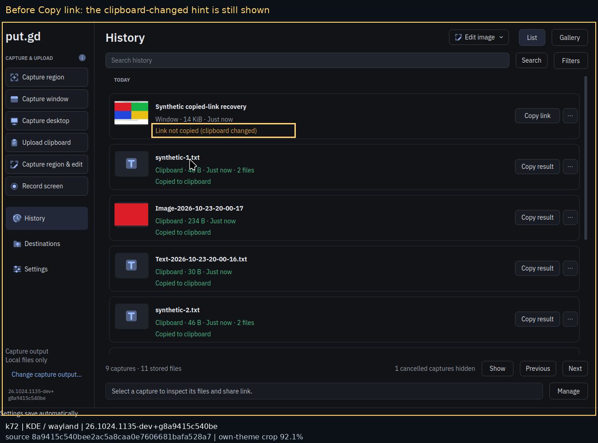
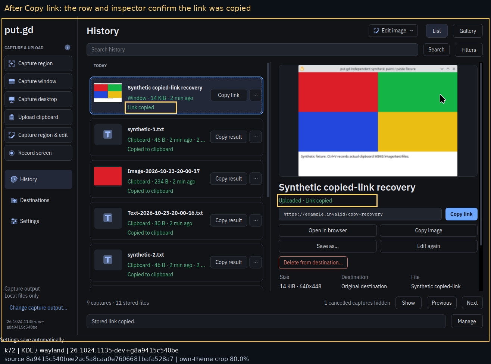
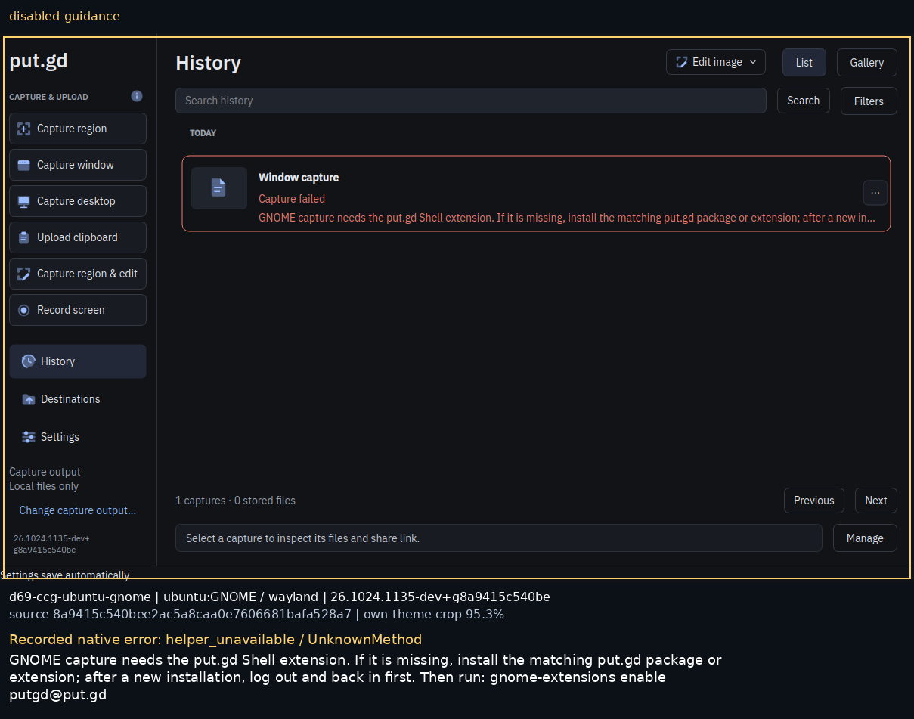
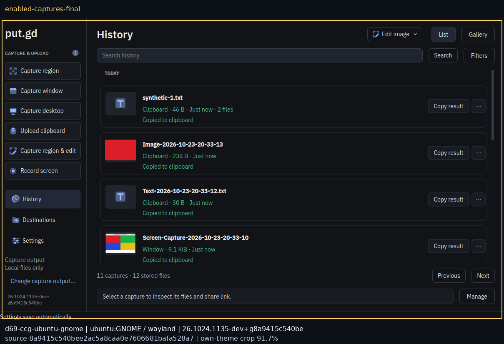
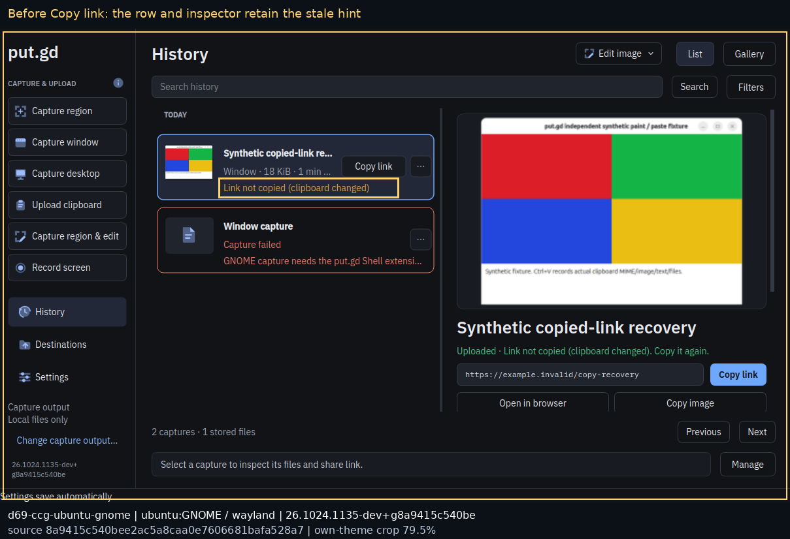
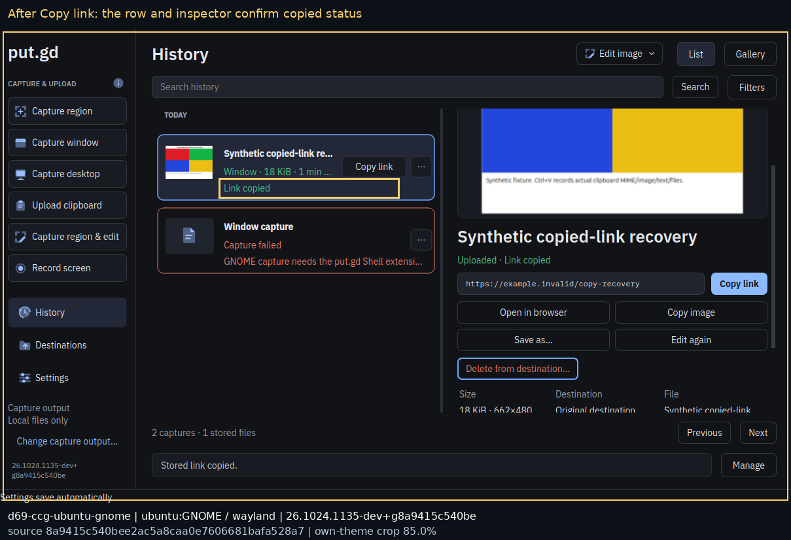
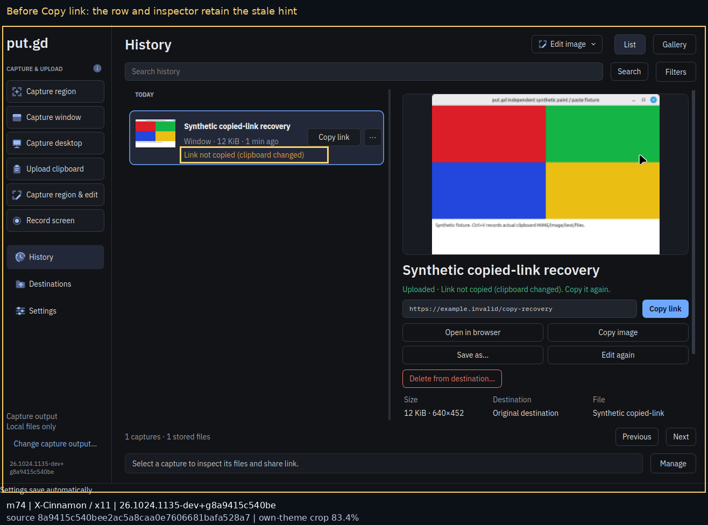
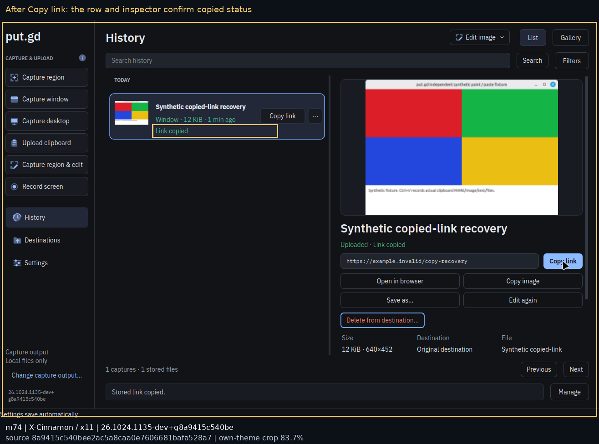
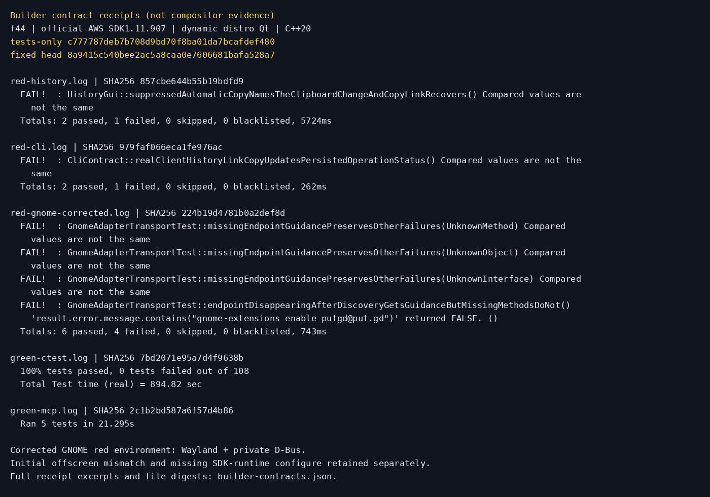

# Install, capture and copied-link recovery — work in progress

Companion code PR: [#534](https://github.com/patrick-hudson/put.gd-desktop/pull/534),
source `8a9415c540bee2ac5a8caa0e7606681bafa528a7` from nightly
`50053b01f1bbd7f3776a53513bb8c43151ce0de8`.
Tests-first source: `c777787deb7b708d9bd70f8ba01da7bcafdef480`.

## Published metadata check (#466)

On 2026-10-24, the README's previous `-nightly\.` filter selected
`v0.1.1-nightly.947`. The corrected `endswith("-nightly")` filter selected
`v26.1023.1058-nightly`, published 2026-10-23 at 04:10:17 UTC. The
[payload-free GitHub release listing](published-releases.json) records the input.
No package was downloaded or installed on the workstation. The README badge
now uses the same current tag suffix.

## Tests-first checkpoint

The tests-only commit was built on f44 with the normal Dev preset, official AWS
SDK 1.11.907 and dynamic distro Qt. The added History row test and production CLI
test reproduce the unchanged `suppressed` status after a successful link copy.
Two unit data rows reproduce `suppressed` and `failed` recovery; native-copy
refusal/suppression and batch-subset controls pass. The corrected private-bus
GNOME run has four expected failures: three absent endpoint errors and an endpoint
that disappears after discovery. Permission, malformed JSON and incompatible
protocol controls pass. These are contract results, not compositor evidence.

The first GNOME attempt incorrectly retained an `offscreen` override and reached
`session_unsupported`; it is preserved separately. Its corrected command uses
`QT_QPA_PLATFORM=wayland`, the synthetic GNOME Core session environment and a
private D-Bus session. No real Shell endpoint is replaced.

## Fixed-source builder checkpoint

On source `8a9415c540bee2ac5a8caa0e7606681bafa528a7`, f44's ordinary
`cmake --preset dev`, `cmake --build --preset dev` and `ctest --preset dev`
completed: **108/108 passed**, 894.82 seconds. This includes the operation data
matrix, production CLI recovery, GNOME transport classification and History
row/outcome assertions. The separate locked official-SDK MCP suite passed **5/5**, 21.295 seconds.
These contracts establish no compositor acceptance by themselves.

## Fedora native install blocker

f44 has a prepared DNF offline transaction (`download-complete`, no reboot
trigger). Its DNF 5.4.6 invalidates that queue after successful online installs.
The coordinator required preserving the queue and rejected both direct RPM
installation and backing up/restoring its state as bypasses. Scoped physical
checks may use a newly extracted, audited RPM with a temporary matching helper;
those are **extracted-RPM physical evidence**, never native installation proof.
Fedora's actual package-install/discovery gate remains blocked under #492.

## Pending gates

Fedora native package-install/discovery remains blocked. Current-head physical
Cinnamon and extracted-RPM Fedora GNOME functional/memory work is in progress;
KDE local native gates and Ubuntu GNOME install/capture/copy gates below passed.
This report and the companion PR remain draft while required gates are pending.
Offscreen and private-bus tests cannot establish compositor acceptance.

## Physical KDE local native gates

k72 runs Kubuntu 26.04, physical Plasma/KWin 6.6.6 on Wayland, distro Qt 6.10.2.
Its production DEB is `26.1024.1135~dev+g8a9415c540be`; the source is the code PR
head above. The production package audit passed. A first fixture-enabled lab
package was correctly rejected by the release audit and preserved separately;
the installed package has the fixture disabled and uses a separately built,
independent Qt witness.

The actual row **Copy link** action changed the persisted operation status to
`copied`. Both the row and inspector then show **Link copied**, and the synthetic
stored URL pasted into the independent native application. The same recovery
passed through the production CLI. The seeded link is deliberately
`https://example.invalid/copy-recovery`: these checks create no remote objects
and establish clipboard/history behavior, not upload or live-link availability.

The empty native resident's bounded cold observation passed 61 samples over
300.000 seconds: 31.617 MiB peak RSS, zero swap, maximum one-core CPU 0.199%,
maximum sample gap 5.028 seconds, one exact resident and no UI/escaped child.
The raw sampler's diagnostic limitations remain intact; the separate evaluator
checks only these sampled numeric gates. The complete Qt and GTK matrix passed: window, 80×60 region, covered-desktop,
text, image and ordered two-file clipboard acquisition, with independent native
pastes. Escape, right-click and zero-area selections cancel. Six Settings/History
opens closed normally with their helper processes absent. The
[functional manifest](k72/functional-manifest.json) records operation IDs and
pasted image hashes.

After that complete workload, the same resident PID/start identity passed two
separate 300-second windows, each 61 samples: **34.598 MiB** peak RSS, zero
swap, maximum one-core CPU **0.199%**, maximum sample gaps 5.045/5.053 seconds.
Raw samples, unchanged sampler results and separate numeric evaluations are under
[cold](k72/cold/), [postA](k72/postA/) and [postB](k72/postB/). Earlier prefix-only
observations remain in the private archive and are not substituted for this pair.
The package and owned test processes were removed; the verified-clean
[lock release](k72/lock-release.json) is dated 01:28:27 UTC.
These local/synthetic gates establish neither live S3 nor general release acceptance.

## Ubuntu GNOME clean installation and capture recovery

A new KVM overlay on d69 used the verified immutable Ubuntu golden
`563730cc1d929bd946d20cf30a9aecfe3c4ad40eb12ba7f9abcff1c461e342bb`.
Run ID `e5a56342-66b6-4936-bdb7-3de6425c858f`, GNOME Shell **50.1**, native
Wayland, distro Qt **6.10.2**. Its old development package was removed, helper
paths were absent, and a real logout/login made the extension genuinely
[unregistered](ugn/unregistered-after-login.txt). The current production DEB
SHA-256 `0cdbbf0f79ff17fdc647a04296209e34dea1a219ef29d39d0b179a8f10cad495`
was then installed through apt with no upgrades/removals. Enabling it before
another login still [failed](ugn/installed-before-login-enable.txt). After a
second real logout/login, enabling the package's extension version 2
[succeeded](ugn/enabled-after-login.txt), loaded from `/usr/share/gnome-shell/`.
This proves the corrected install → logout/login → enable sequence for this guest.

With that extension disabled, actual capture operation
`30dcf9ab-cbf8-4530-9ee2-a62dd7753afd` returned `helper_unavailable`, preserved
`org.freedesktop.DBus.Error.UnknownMethod`, and gave the install/login/enable
[recovery guidance](ugn/disabled-helper-result.json). Re-enabling it produced
successful window, region and covered-desktop captures, each with an exact
independent native image paste; Qt and GTK text/image/ordered-file clipboard
checks also passed. The saved UI is from the actual guest, visible on its wall
tile, with an annotation quoting the recorded full error beneath its elided row.

The real **Copy link** inspector action changed the synthetic stored-link row and
outcome to `copied`, and the stored URL independently pasted. Production CLI
copy and the official-SDK stdio MCP → unchanged helper → production CLI → native
resident [forwarding recovery](ugn/native-mcp-copy.json) agreed. This remains a
synthetic `example.invalid` receipt, not upload/live-link evidence.

Guest evidence was exported and hash-verified before guarded overlay
[retirement](ugn/cleanup.json) at 01:34:52 UTC. Only its overlay and owned tunnels
were retired; the golden, physical desktop, demos and Windows guests were preserved.

## Physical Cinnamon checkpoint (in progress)

The audited, recorder-enabled Ubuntu 24.04 production DEB was built from the same
frozen source in the repository's pinned Ubuntu container on f44. Its SHA-256 is
`313f2146a8ea44bc3d2f87a5b5100665f31a1002bb0b481fadf4aa0202ca97ec`.
On physical Mint 22.3, Cinnamon/X11 and dynamic Qt 6.4.2, apt installed only put.gd,
with no upgrades/removals. The separate independent fixture was not shipped in it.
The pre-existing Windows w11b guest stayed running (~111% CPU at baseline,
host load ~1/4); these are bounded per-process memory/functional observations,
not uncontended latency measurements. Cold 61-sample/300-second observation
passed at 28.746 MiB, zero product swap and 0.198% maximum one-core CPU.

The actual inspector Copy link action updated the persisted status, row and
outcome, then independently pasted the stored synthetic URL. The native Qt/GTK
matrix and six view reopens passed. Final same-resident post-use pair is running.
No recording feature test is claimed: the package is recorder-enabled, while
this campaign exercises capture/clipboard/history.

A missing GTK4 typelib first blocked the independent witness; the scoped
`gir1.2-gtk-4.0` install added only that package, no runtime upgrades. Driver-only
attempts are retained: a first row click selected/reflowed the inspector without
copying (persisted-status assertions failed); a Cinnamon animation made the
color-only crop guard refuse a frame; and hidden X11 windows initially made
window identity ambiguous. Stable visible inspector clicks and exact visible
UI-PID/window checks corrected those attempts. None changed production source,
clipboard safeguards, the frozen sampler or its limits.

## Builder log evidence

[Structured excerpts and full-log SHA-256 identities](builder-contracts.json)
retain the tests-first failures, SDK/environment corrections and green suite.
Private bulk archives remain on the builders and in the isolated task workspace;
their exact digests are retained alongside the compact public evidence.
