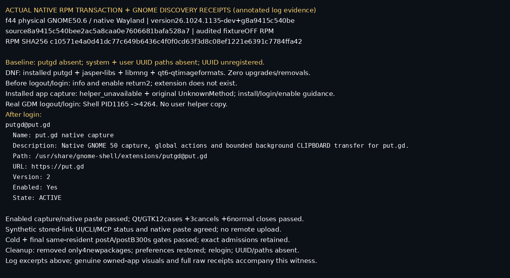
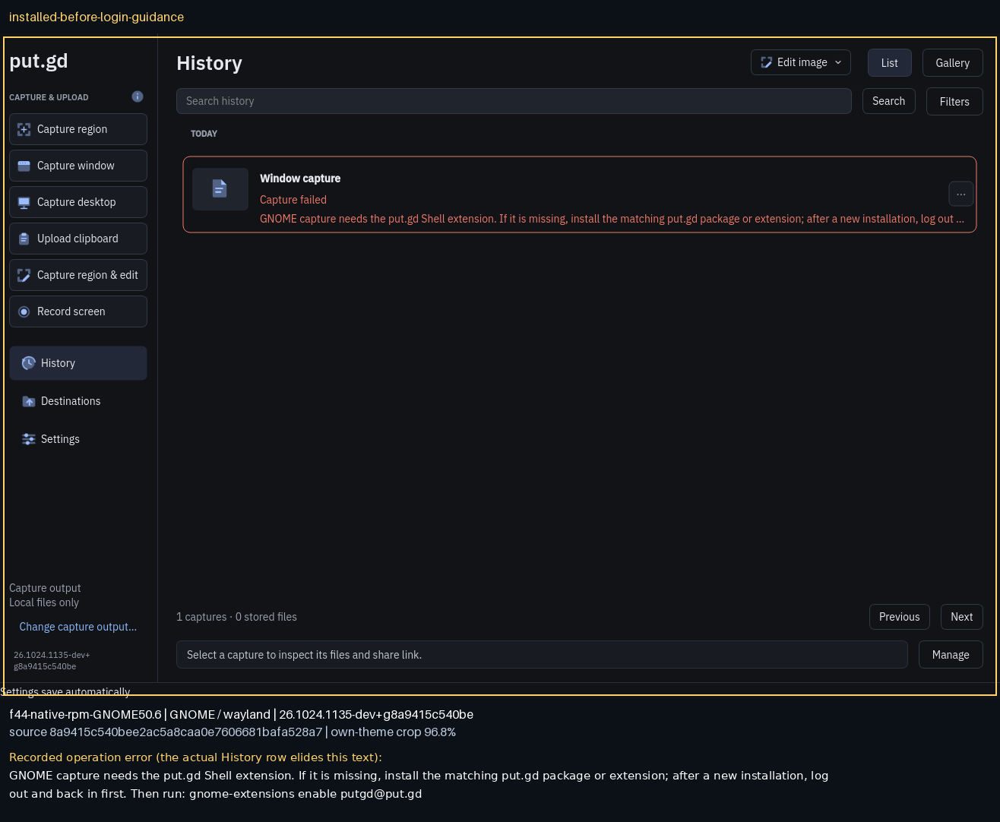
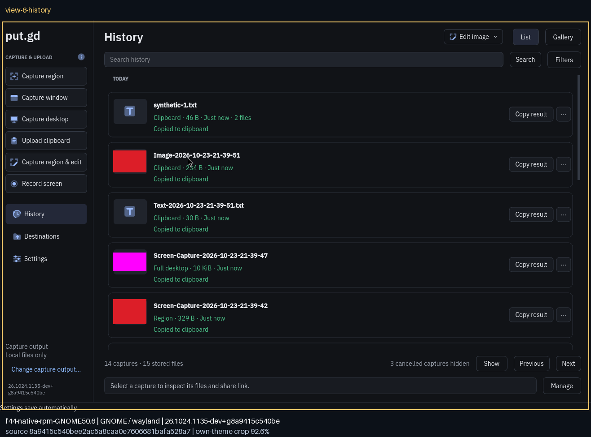
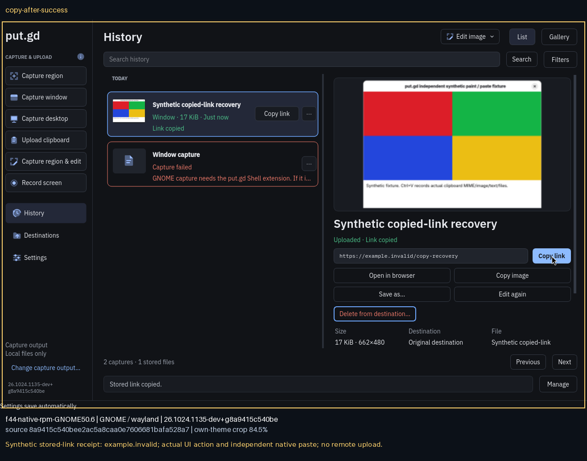

# Fedora GNOME 50.6 native RPM baseline — source 8a

This is the completed **pre-full-error-UI-fix baseline**, source
`8a9415c540bee2ac5a8caa0e7606681bafa528a7`, not acceptance for a later code head.
Patrick applied the previously protected queued OS update and rebooted before
this run. The earlier GNOME50.0 extracted-RPM evidence remains unchanged in
[../f44](../f44/). During this run, Patrick additionally required the complete
error to be readable **inside** History; these baseline rows still elide it.
The external full-message annotations below are baseline diagnostics, not proof
of that new UI requirement.

The [updated physical host](host-identity-before.json) has boot ID
`[REDACTED]`, kernel `7.2.11-200.fc44.x86_64`,
GNOME Shell/Mutter `50.6-1.fc44`, Qt `6.11.2-3.fc44`, DNF `5.4.6.0-1.fc44`.
Its real Wayland desktop was visibly live/unlocked on the wall. No Patrick
applications or guests were present before either scoped logout/login.

The retained fixtureOFF, recorder-enabled production RPM SHA256 is
`c10571e4a0d41dc77c649b6436c4f0f0cd63f3d8c08ef1221e6391c7784ffa42`.
The [original audit](native-audit.json) and [installed program/helper digests](installed-identity.json)
match its clean source/tree manifest. No rebuild was needed. [DNF simulation](install-simulation.log)
and [actual normal install](install-transaction.log) added only putgd and three
new image-format dependencies: jasper-libs, libmng, qt6-qtimageformats. There
were no upgrades/removals or compositor changes. The local development package's
normal OpenPGP warning is retained.

[Baseline](baseline.json): package absent, system/user UUID paths genuinely
absent and Shell UUID unregistered. Immediately after installation,
[info and enable still failed](installed-prelogin-discovery.json) with extension
not found. The installed application's actual request returned
[helper_unavailable and original UnknownMethod](installed-before-login-helper-result.json).
After a fresh visible/process check, a real GDM logout/login changed Shell PID
1165→4264 without reboot. [Discovery](postlogin-discovered.txt) then succeeded;
[enable](postlogin-enabled.txt) reported version2 ACTIVE from
`/usr/share/gnome-shell/extensions/putgd@put.gd`. No user extension copy was used.
This is actual native RPM fresh-discovery proof for the exact 8a package.

With the actual system helper disabled after login, captures gave the matching
[guide and preserved native error](disabled-helper-result.json). Re-enabling it
restored native capture/independent paste. The [functional manifest](functional-manifest.json)
records all12 Qt/GTK local capture/clipboard cases,3 cancellations and6 normal
Settings/History opens/closes. Independent native pasted PNGs and decoded RGBA
hashes are retained. All resolved socket paths were preflighted before app start.

The actual inspector Copy link action changed the single-item operation from
suppressed to persisted copied; row and inspector agreed, and the URL independently
pasted. [UI operation](ui-copy-operation.json), [native paste](ui-copy-native-paste.json),
[production CLI](copy-cli-operation.json), and [official-SDK MCP forwarding](native-mcp-copy.json)
retain those paths. Stored-link receipts are synthetic `example.invalid` values
in the stopped private resident's own database, not remote uploads.

The unchanged frozen sampler produced61 samples/300 seconds per window with
empty tracked Qt/GTK/cover admission and private-profile scans, one exact resident,
no UI/escaped family, zero swap, max sample gap<7.5s and max one-core CPU<0.5%.
Separate numeric gates passed: [cold](cold/)35.348MiB; final same-resident
[postA](postA/) and [postB](postB/)37.957/37.957MiB. Final PID6699/start84626;
cold PID5495/start40403. Raw sampler limitations are unchanged. These observations
are bounded per-process local-workflow measurements, not active-work ceilings,
leak proof, uncontended latency, live S3 or full-release acceptance.

[Scoped removal simulation](remove-simulation.log) and [normal DNF removal](remove-transaction.log)
removed exactly the four newly installed packages with autoremove disabled.
Exact owned resident/fixture identities were absent, both preference arrays were
restored, and a fresh no-apps/guests/visible check preceded final logout/login.
[Verification](cleanup-verification.json) shows both helper paths absent and UUID
unregistered, current boot/kernel/GNOME/Mutter/Qt unchanged, preferences restored,
no system-update trigger or new saved offline transaction. The empty GNOME
Activities overview was visibly verified. [Verified-clean release](lock-release.json)
completed02:52:11UTC. [Restore index](restore-index.json) binds the exported private
archive, verified on builder/workstation before the three owned temporary profiles
were retired. Earlier private failures and extraction/queue context remain intact.

This baseline does not claim the later full-error UI requirement, recording,
live remote storage, full release/U9 or publication. The coordinator owns current
candidate checks/review/readiness/merge.
