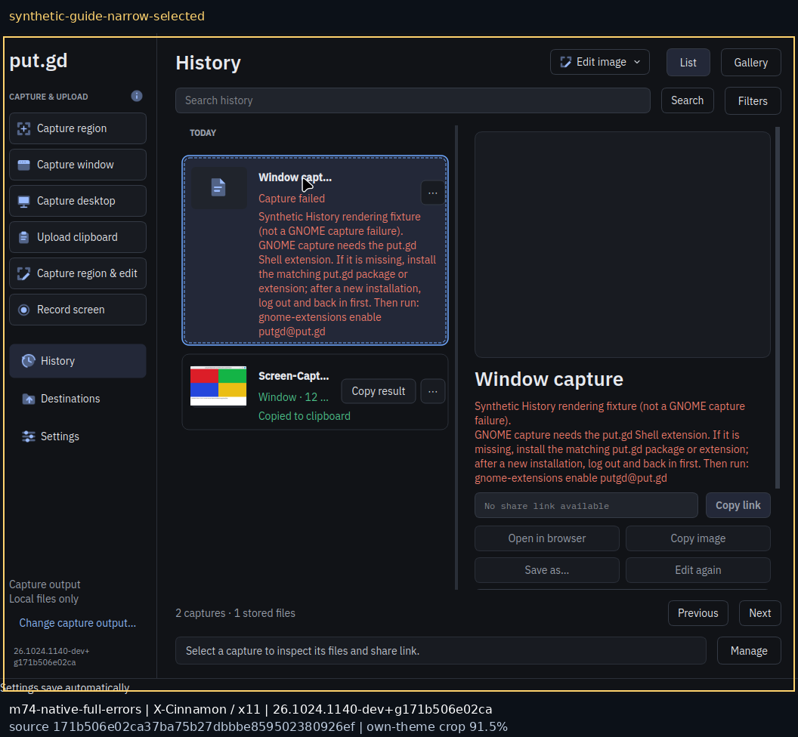
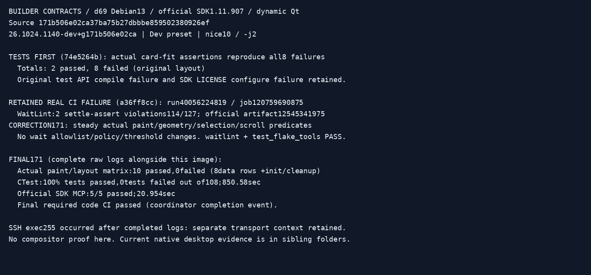

# Full in-app error acceptance — final source171

Code [#534](https://github.com/patrick-hudson/put.gd-desktop/pull/534), source **`171b506e02ca37ba75b27dbbbe859502380926ef`**, tree `2942cc06bd2361cf915e9d5ffbeeadd7eaa75368`, from original nightly base `50053b01f1bbd7f3776a53513bb8c43151ce0de8`. Documentation/evidence [#535](https://github.com/patrick-hudson/put.gd-desktop/pull/535) is separate. No source rebase, Windows edits, merge, publication or tag changes. Version **26.1024.1140-dev+g171b506e02ca**, clean production packages and installed binary/helper/module identities are in [artifact-identities.json](artifact-identities.json).

Patrick required the complete actual error directly readable in normal History, including the recovery command. Failed list/gallery cards now paint full wrapped **plain text** with the same layout used for height. Variable card heights, viewport-width relayout and correct scroll range preserve title/actions, selection, stored-nothing failures and following rows. Existing copied/suppressed states and clipboard/multi-item safeguards are unchanged. No tooltip, wider window or external error caption is used as acceptance.

## Current native results

All three exact-source native installed campaigns passed the shared History rendering + full local capture/clipboard/copy functional gates and unchanged memory gates. Physical sessions ran in parallel under separate quiet locks after heavy build jobs drained. No VM/XWayland/offscreen result substitutes for these physical gates.

| Native host | Cold peak MiB | Final postA MiB | Final postB MiB | Same final PID/start |
| --- | ---: | ---: | ---: | --- |
| [f44](f44/README.md) | 35.387 | 38.098 | 38.098 | 33325/337439 |
| [k72](k72/README.md) | 31.715 | 33.691 | 33.691 | 33233/1995606 |
| [m74](m74/README.md) | 28.621 | 31.930 | 31.930 | 575889/20989748 |

Each memory window61 samples/300s, zero product swap, max CPU<0.5%onecore, gap≤7.5s, RSS+swap≤40MiB, one exact resident/noUI/escaped family. Every sampler admission verifies all recorded independent Qt/GTK/cover PID/start identities absent and exact profile scan empty. [Replay](saved-evidence-replay.json) recomputes all9 raw windows and verifies all24 independent native pasted PNG pixel hashes against original captures. Mint keeps w11b running ~111%CPU and385MiB existing host swap; these are bounded per-process observations, not uncontended latency claims.

Each host records12 real Qt/GTK local capture/clipboard cases,3 native cancellation cases,6 normal view/helper closes, actual UI inspector Copy link plus fresh suppressed CLI and official-SDK MCP forwarding paths, persisted copied outcome and independent native text paste. Stored URL receipts are synthetic `example.invalid`; no live upload, bucket operation, recording, full-release/U9 or broader distro campaign is claimed.

### Fedora actual installation/discovery and real helper failure

[f44](f44/README.md) is actual normally installed current RPM on updated GNOME50.6, not payload extraction. System/user UUID paths genuinely absent and Shell unregistered → safe normal DNF install of4new/0upgrades → pre-login info/enable fail → real fresh no-app logout/login → packaged **version2 ACTIVE under `/usr/share`**. No temporary user helper. Disabled system helper then produces the actual recovery guide with native UnknownMethod retained; enabled capture/paste succeeds. This closes the former #492 native install/discovery gate with evidence, without waiver. The prior protected offline update was applied/rebooted by Patrick before this run; child made no OS upgrades.

### Shared History rendering on Cinnamon and KDE

[Mint](m74/README.md) and [KDE](k72/README.md) show **explicitly labelled synthetic** GNOME guide rows in list/gallery/selected/narrow native views. Their real native capture/copy workflows are separate. Native wheel scroll witnesses show the complete long-token tail and following rows. The exact images independently reviewed by the coordinator are preserved byte-for-byte.

## Builder regression and CI receipts

[d69 builder](builder/contracts.json): ordinary Dev configure/build/full CTest **108/108 passed,850.58s**; locked official-SDK MCP **5/5,20.954s**; final focused actual-paint/layout regression **10/10** including init/cleanup. Eight data rows cover list/gallery,600/1000 History widget widths, complete real GNOME guide and1800-character token, selected/unselected, resize and last-row reachability. Actual painted error rectangle is compared with full plain-text rendering; string-only or tooltip assertions do not satisfy it. Qt minimum6.4.2 is exercised natively on Mint. Current source171 required CI passed per coordinator completion event; child did not poll.

## Retained failures and controller context

- Tests-first `74e5264b` reproduces all8 fixed-height/elided layout failures. Earlier test API compile error (`index(0)` needed column0) and missing pinned SDK LICENSE configure attempt are retained separately, followed by corrected configuration/build.
- Intermediate wrapped-layout tests exposed two narrow-list long-token scroll-bottom failures after a scrollbar changes viewport width. Final viewport relayout fixes the actual layout; no test threshold was relaxed.
- Real a36 CI run40056224819/job120759690875/artifact12545341975 failed WaitLint on two new settle-assert violations114/127. [Official sanitized traceback](builder/a36-contracts-official.log), SHA256 `5ab2111fef402458adbb49721dabf2f59e90de306ad493c4d3ef2511a1a520ca`, is retained. Final171 changes only tests to meaningful scaled steady paint/geometry/selection/scroll readiness. No allowlist or lint policy changed. Production bytes match reviewed a36.
- f44 initial narrow keyboard input selected the wrong resize edge; strict owned-crop guard refused it. An early1280px correction is preview only. Canonical1060 proof uses the real right-edge keyboard resize. Fresh login Activities overview initially prevented full-window crop; exiting Overview restored normal app presentation before acceptance. Private failed frames and [context](f44/narrow-input-driver-context.json) are retained.
- k72 corner/AltF8 inputs did not enter resize; the normal-size frame was preserved and never called canonical. Native KWin `Window Resize` action then produced the exact narrow witness. m74 witness palette precondition initially ran before its fade finished; it refused before any product capture and then accepted the visibly settled independent fixture. Neither was a product capture retry.
- Completed d69 SSH observation returned255 after all test logs ended; independent [completion readback](builder/completion-readback.json) confirms clean171 identity, complete108/108 +5/5 summaries and no owned build/CTest processes. This is retained transport context, not a test exit0 claim.

## Cleanup, archives and boundaries

All owned residents, Qt/GTK/cover windows and private input processes stopped. k72 released **03:33:52Z**, m74 **03:33:53Z**, f44 **03:38:06Z**, all `--verified-clean`, confirmed free. New packages were removed normally; f44 original extension preferences restored and final actual login verifies paths/UUID absent. No Patrick application stopped, reboot, Windows/keyring/demo change, immutable golden modification or global wall configuration change. Mint w11b remains running; d69 Windows remains stopped.

Every host retains actual install/removal transactions, cleanup verification, release, current source/package/runtime/session identity, preflight and fixture admission. Verified native-root + receipt archives exist on builder and workstation with [digests/restore indices](artifact-identities.json); only explicit new `/tmp/hf*` owned test roots were retired after verified export. Source/build/earlier evidence remains intact.

The previous [8a updated Fedora native campaign](../f44-native-50.6/README.md), [8a GNOME50.0 extracted campaign](../f44/) and earlier [Ubuntu lifecycle overlay](../ugn/) remain immutable historical baselines. Old elided rows/external full-message annotations are not full-error UI acceptance for171. The wider release/U9/live-S3/recording gates remain outside this scoped change. Final docs-head CI/coordinator final review and merge are parent-owned; no child waiver or merge.
