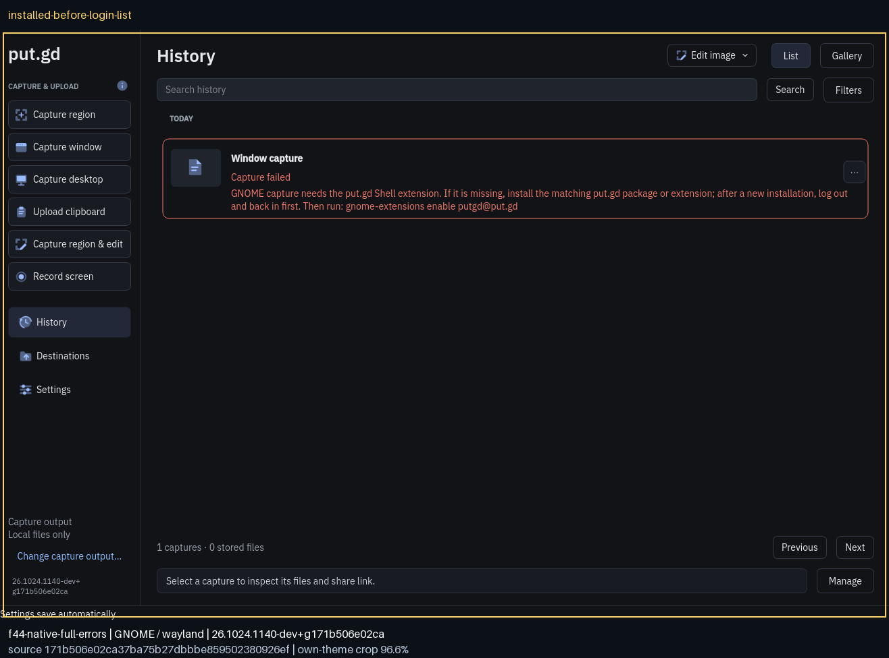
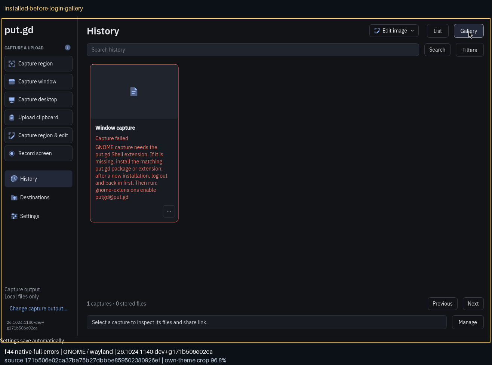
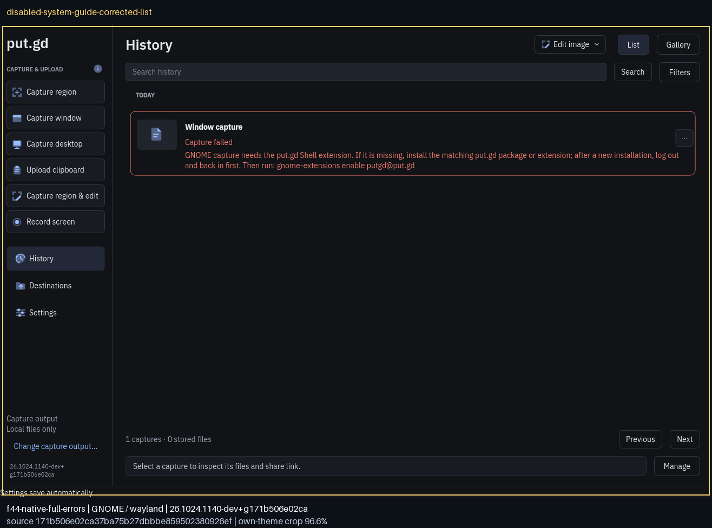
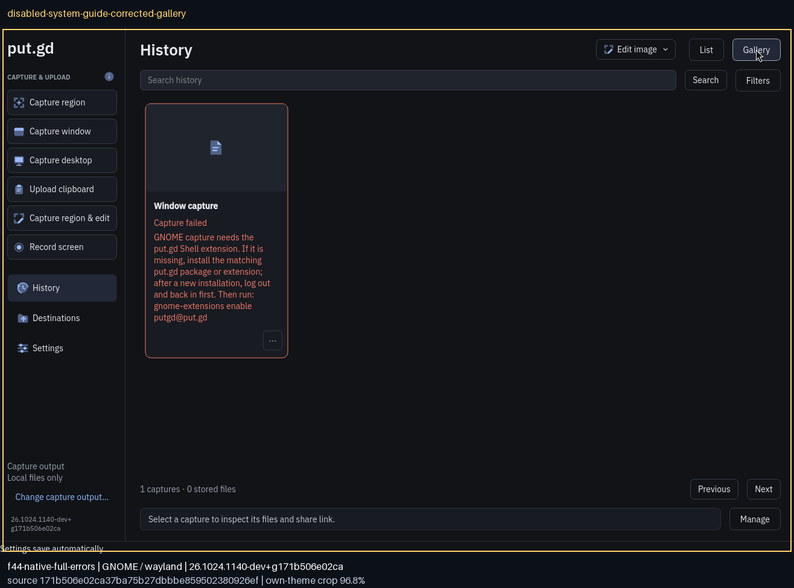
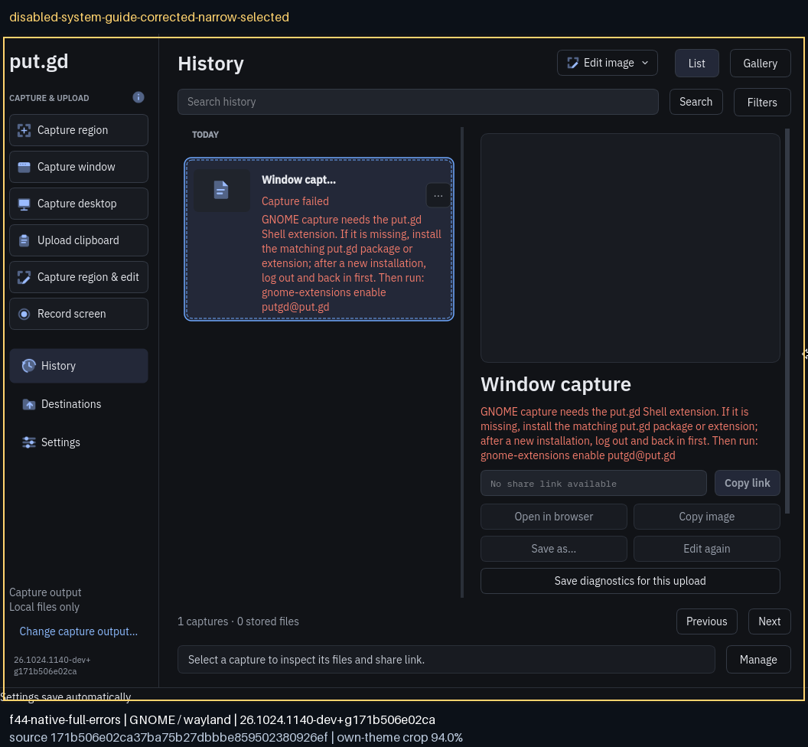
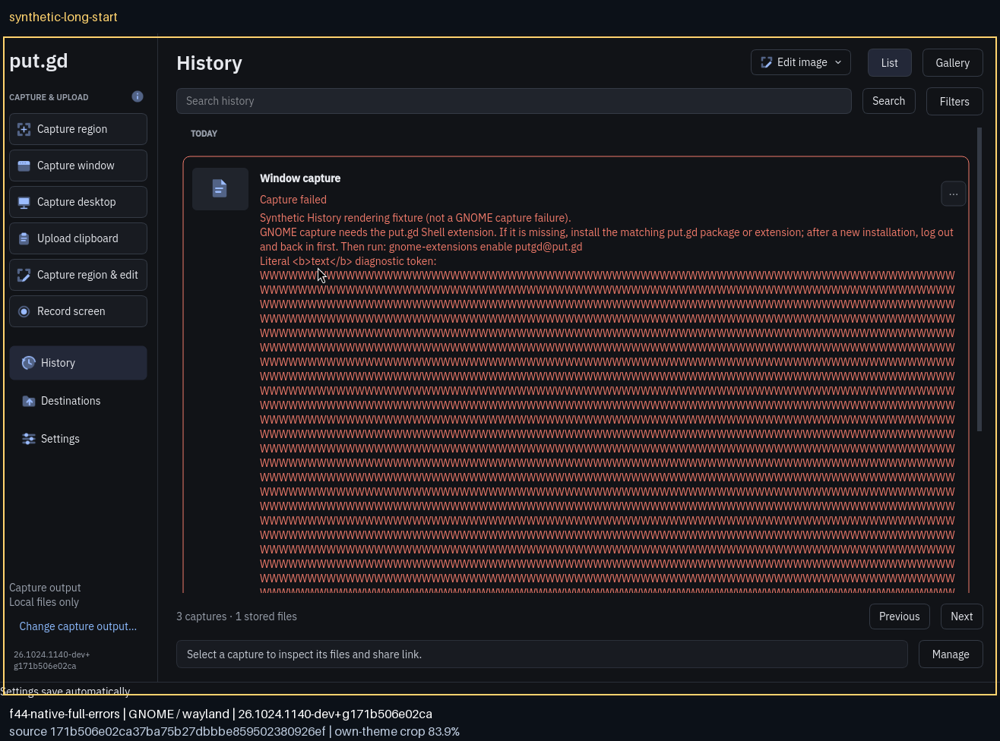
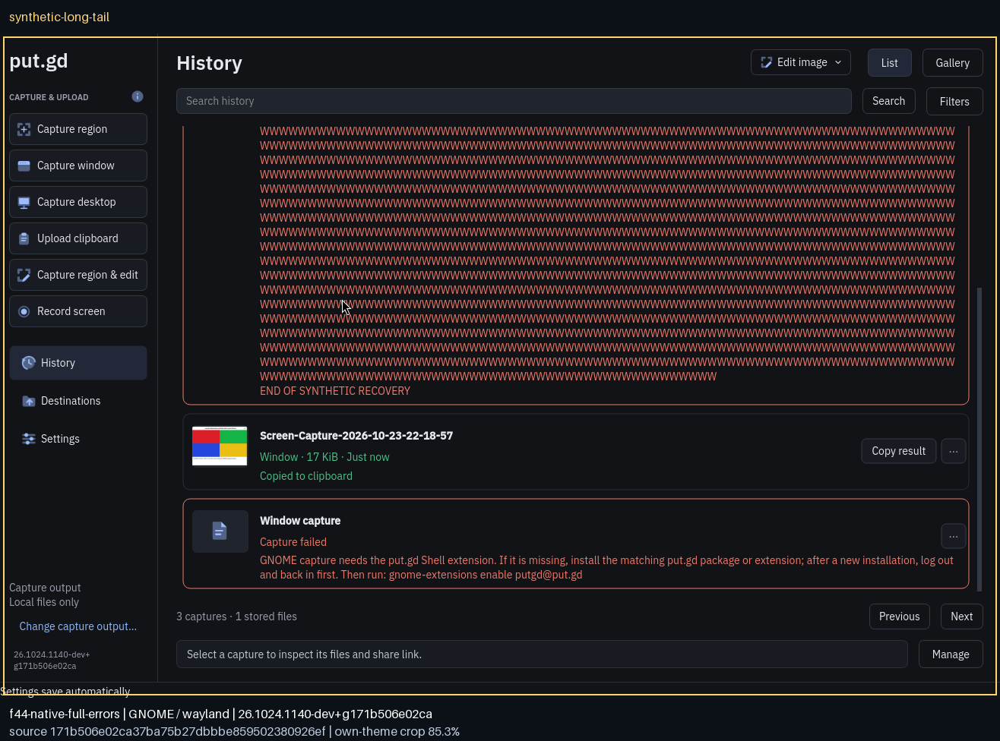
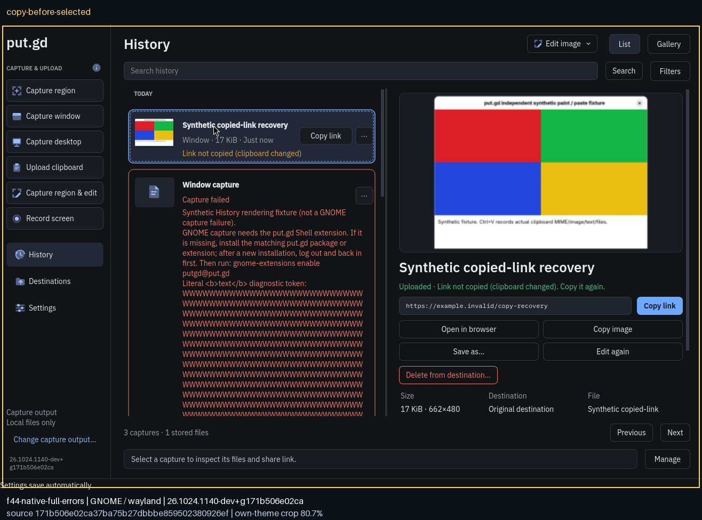
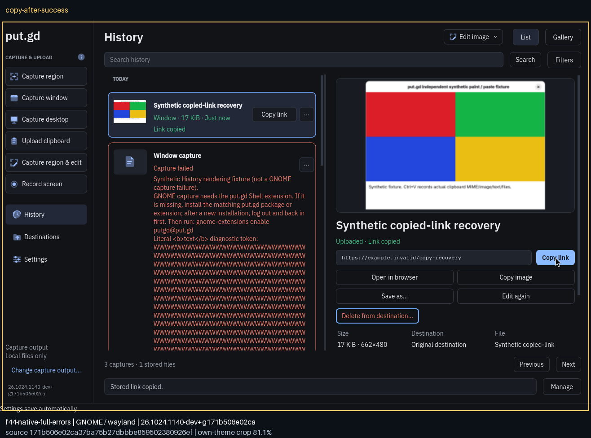
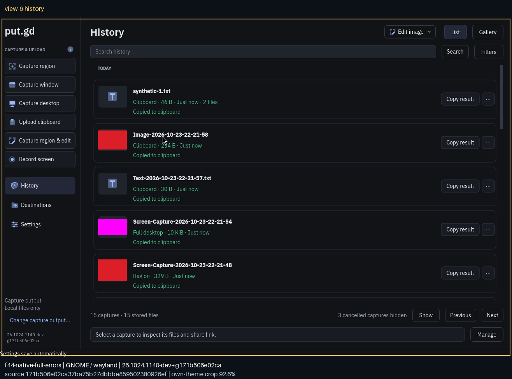

# f44 native full-error/capture/copy acceptance — source171

Source **`171b506e02ca37ba75b27dbbbe859502380926ef`**, tree `2942cc06bd2361cf915e9d5ffbeeadd7eaa75368`, clean build `26.1024.1140-dev+g171b506e02ca`. [Host baseline](host-identity-before.json): **Fedora44, GNOME Shell/Mutter50.6, native Wayland, Qt6.11.2**. The real unlocked session was visible on its physical wall tile throughout graphical tests. [Production audit](native-audit.json), [installed program/module/helper digests](installed-identity.json) and [package identity](../artifact-identities.json) agree. Package SHA256 **`c3ef09d8ebb770987ece4d515387190c10daa7d53b66fca80baffff7fd8ef551`**. Recorder-enabled, fixtureOFF production package; recording was not tested or claimed.

## Full error is in the application

Actual missing/disabled system helper capture failures. The saved PNGs are exact own-window crops with source/version/session footers, not full-message annotation substitutes. Canonical physical narrow views use the app's minimum1060px main window (1056px own-content crop); the separate actual-paint regression also tests600/1000px History widget layouts. List and gallery show wrapped plain text. Selection preserves the full row plus inspector; native resize and wheel scrolling leave the actions and subsequent rows reachable.

The package and both system/user helper paths were genuinely absent, with the UUID unregistered before installation. [Normal DNF simulation](install-simulation.log) and [installation](install-transaction.log) added only putgd, jasper-libs, libmng and qt6-qtimageformats: no upgrades, removals, compositor changes or offline queue. The retained unsigned local-development RPM warning is expected.

[Immediately after installation](installed-prelogin-discovery.json), info and enable failed because Shell had not discovered the new extension. The installed app gave the complete actionable missing-helper guide in its actual list/gallery/selected view. A fresh process and visible no-app/no-guest check preceded a real GDM logout/login, without reboot. [Discovery](postlogin-discovered.txt) and [enable](postlogin-enabled.txt) then reported **version2 ACTIVE from `/usr/share/gnome-shell/extensions/putgd@put.gd`**. No user extension was used. This proves install → logout/login → enable for this exact native RPM.

Disabling that packaged system helper produced the [actual helper_unavailable result](disabled-helper-result.json), preserving `org.freedesktop.DBus.Error.UnknownMethod` in details while explaining install/re-login/enable recovery. Re-enabling restored native capture. Unrelated method/permission/protocol classification remains covered by the ordinary regression suite.

The synthetic long token + multiline plain-text error is labelled in-app. The native wheel tail shows **END OF SYNTHETIC RECOVERY** and subsequent rows, proving the error body is not clipped beyond the scroll range. This fixture is rendering proof, not a compositor capture result.

## Native functional and copy paths

[Functional manifest](functional-manifest.json): **12 completed Qt/GTK cases** (window,80×60 region, covered desktop, clipboard text/image/ordered two files for each toolkit), **3 cancellations** (Escape/right-click/zero area), and **6 ordinary Settings/History opens and normal helper closes**. Eight independent native pasted PNGs are retained in [native-paste/](native-paste/), with decoded RGBA hashes matching retained original local captures. Every resolved test socket was preflighted; [cold](cold-socket-preflight.json) and [functional](functional-socket-preflight.json) receipts retain the actual paths/lengths.

The actual History inspector **Copy link** click changed the single-item stored operation from suppressed to persisted copied. Row and inspector show the updated outcome and the URL independently pasted. Fresh suppressed operations separately passed via [production CLI](copy-cli-operation.json) and [official-SDK MCP→production CLI](native-mcp-copy.json); native UI/CLI/MCP URL pastes each agree. The link `https://example.invalid/copy-recovery` is a synthetic receipt seeded only while the isolated resident was stopped. No remote upload/object/deletion was performed. Clipboard ownership/ticket and batch controls remain in the production tests.

## Cold and final same-resident memory

The unchanged frozen sampler SHA256 is `a28c94b075036ea65f8eca8e068d480cff46ee959d4680593f5c4d55cce3fc40`. Each window has61 samples over300 seconds. [cold](cold/), [postA](postA/) and [postB](postB/) include raw samples/results, separate numeric checks and admission receipts. Admission asserts every tracked independent Qt/GTK/cover PID/start is absent **and** exact private-profile process scan empty before every sampler. Each sample has one exact resident, no UI/escaped family, zero product swap, RSS+swap≤40MiB, max gap≤7.5s and max one-core interval CPU<0.5%. Sampler diagnostics/limitations and thresholds are unchanged.

Peak RSS: **35.387MiB cold; 38.098/38.098MiB final pair**. Both post windows use the exact same resident **PID33325/start337439**, after the complete workload and fixture drain. [Saved evidence replay](../saved-evidence-replay.json) independently recomputes raw metrics and native paste pixel comparisons.

After normal removal of exactly the four newly installed packages, original extension preferences were restored. A fresh empty-app check preceded a final actual logout/login: UUID unregistered, system/user helper paths absent, no saved offline queue/trigger, same boot/kernel/runtime packages. The unlocked idle desktop was visibly restored; private idle frames remain in the receipt archive.

## Cleanup and retained context

[Owned process cleanup](owned-process-cleanup.json), [normal removal simulation](remove-simulation.log), [actual removal](remove-transaction.log), [final verification](cleanup-verification.json), [release](lock-release.json) and [end conditions](measurement-conditions-end.txt) are retained. Verified-clean desktop release: **2026-10-24T03:38:06Z**. No Patrick application was stopped; no protected Windows/other-host work changed.

[Native-root archive](restore-index.json) and [receipt archive](receipt-archive.json) were verified on builder and workstation before [retiring only the explicit owned temporary roots](temporary-root-retirement.json). Reusable sources/packages, earlier campaigns, goldens and failure context remain intact. Native input/visibility driver corrections are retained separately: strict own-window/canonical-width preconditions refused invalid frames, without changing product code or weakening performance gates. See [campaign context](../README.md#retained-failures-and-controller-context) and the private archive scripts/logs for exact commands, PID identities, failed attempts and corrected inputs.
