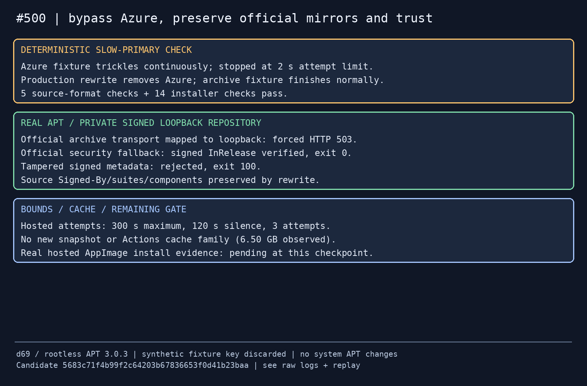
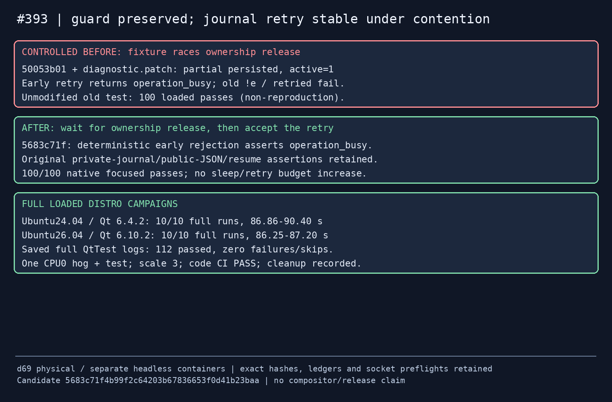

# CI mirror and journal retry contracts — 2026-10-24

Code: [PR #536](https://github.com/patrick-hudson/put.gd-desktop/pull/536),
`5683c71f4b99f2c64203b67836653f0d41b23baa` (tree
`c8f56b835770dd02d2b728828dba1f58c0d01586`). The final native build identifies as
`26.1024.1136-dev+g5683c71f4b99`, clean source. Both issue outcomes are tracked
separately below. This is headless contract evidence, not compositor, physical
memory, package lifecycle or release acceptance. No product retry, clipboard,
storage journal or security code changed.

## #500: slow hosted Azure package mirror

GitHub's [runner image configuration](https://github.com/actions/runner-images/blob/main/images/ubuntu/scripts/build/configure-apt-sources.sh)
puts Azure at priority 1, the official Ubuntu archive at 2 and security at 3.
The AppImage job now removes Azure from that list before installation. Legacy
direct source URIs are changed to the official archive as well. Existing
`Signed-By`, suites, components and unrelated repositories stay intact.
The archive/security mirror fallback stays available. Package installation keeps
the existing bounded retry/backoff/diagnostics machinery, with three 300-second
AppImage build-dependency attempts and a 120-second silence bound per attempt. A
failed canonical mirror can still consume those bounds; this does not promise universal mirror
availability. It specifically removes the reported slow Azure dependency.

No AppImage package snapshot, cache key or cache save is added. The observed
repository cache usage was 6,496,050,726 bytes in 144 entries
([receipt](cache-usage.json)); the shared 10 GB budget is unchanged. Native package
snapshots, SDK pins and all Windows jobs remain unchanged.

- [Five source-format/trust contracts](mirrors-tests-final.log): current runner
  mirror list, exact legacy/deb822 URL tokens, folded URIs, comments/idempotence,
  and fail-closed handling when the official fallback is missing.
- [Fourteen installer contracts](installer-tests-final.log), including bounded
  silence/trickle failures and the existing offline fallback rules.
- Deterministic slow-primary fixture: [before](azure-trickle-before.log) trickles
  until the unchanged installer stops it at two seconds (exit 1);
  [after](azure-bypassed-after.log) uses the rewritten archive and completes
  (exit 0). [Parameters/result](trickle-result.json). This models package-manager
  behavior; it is not an observed Azure outage.
- Real rootless APT 3.0.3, d69/Debian 13: an isolated synthetic signed repository
  maps the selected official URIs to loopback. The first mirror deliberately
  returns HTTP503; the secondary serves signed metadata. APT
  [verifies it](mirror-probe-v2/signed-fallback.log), exit 0. The same metadata
  after tampering is [rejected](mirror-probe-v2/tampered-signature.log), exit 100.
  [HTTP witnesses and outcomes](mirror-probe-v2/result.json) prove the fallback
  even though APT labels its output with the original primary URI.
- The first probe's tampered-metadata assertion expected `BADSIG`; Debian 13
  uses sqv and reports `Message has been manipulated`. The
  [original rejection log](mirror-probe/tampered-signature.log) is retained.
  Only the probe's diagnostic matcher was corrected; trust verification stayed
  enabled. [Replay](replay/mirror_probe.py) uses an ephemeral fixture signing key
  and no installed-package/system-APT state. No fixture private key is retained.

**Real hosted workflow passed:** [run 40046399060, AppImage job
120729064869](https://github.com/patrick-hudson/put.gd-desktop/actions/runs/40046399060/job/120729064869),
head `5683c71f4b99f2c64203b67836653f0d41b23baa`, base `50053b01`.
The mirror rewrite succeeded at 00:44:08Z, changing `apt-mirrors.txt`.
Standard build dependencies completed from 00:44:08 to 00:47:10Z: **182 seconds**,
with official archive downloads and no logged retry/stopped attempts. The whole
AppImage job succeeded from 00:43:59 to 00:55:54Z (11m55s), including restored
dependency verification and fresh notices. Required `CI` passed; Linux24/26,
sanitizer, native packages, SBOM and pipewire checks passed. `collect` and cache
pruning were intentionally skipped; this is not evidence for those jobs or a
release publication. [Bound head/job/timings](hosted-run-receipt.json),
[mirror/install log](hosted-mirror-and-install.log),
[restored dependency/notices log](hosted-restored-dependencies.log).
Only completed-job evidence was collected; the child did not poll/watch CI.
This healthy hosted run plus the deterministic slow-primary and signed fallback
controls establishes the scoped #500 change; a future official-mirror outage
remains bounded by the installer and is not promised impossible.

## #393: durable partial state precedes released operation ownership

The worker persists `partial` before the session thread completes `finish()` and
automatic clipboard bookkeeping. `retry()` correctly rejects that still-active
operation with `operation_busy`. The old fixture waited for persisted `partial`
and immediately expected a retry to succeed. Its nested asynchronous inspection
could land inside this interval under contention. A larger wait budget cannot
make that ordering safe.

The test now waits for `diagnostics().activeOperations == 0` before the accepted
retry. Its synchronous partial-result observer first forces an early retry and
asserts `operation_busy`, keeping the production guard protected by regression.
The existing assertions still verify private journal persistence, no journal in
public JSON, no journal on the first upload and the identical saved journal on
the resumed upload. There are no added sleeps, retries or weaker assertions.

| Run on d69, Debian 13 / Qt 6.8.2 | Result | Interpretation |
| --- | --- | --- |
| Unmodified original test, base `50053b01`, 100 repetitions | 100 pass / 28.86 s | Explicit non-reproduction; not proof of a fix |
| Controlled observer interleaving, base plus diagnostic patch | `!e` and `retried` fail; `operation_busy`, active=1 | Reproduces the ledger failure mechanism |
| Final test, clean `5683c71f`, 100 repetitions | 100 pass / 34.63 s | Deterministic early rejection plus accepted resume after owner release |

All three use one busy-loop process and the test pinned to CPU 0, nice 10,
`PUTGD_TEST_TIME_SCALE=3`, a private short TMPDIR and absent display/desktop DBus.
The failed scaled wait lasts 15.1 seconds. The diagnostic is an intentional
test-only scheduling control, not an unmodified production-source failure.
Its build manifest records dirty source; do not present it as a clean candidate.

Receipts: [original repetitions](baseline-loaded/result.json),
[original build identity](baseline-build-info.json),
[diagnostic patch](diagnostic.patch), [diagnostic failure](diagnostic.log),
[diagnostic identity](diagnostic-build-info.json),
[diagnostic binary hash](diagnostic-binary.sha256),
[final repetitions](fixed-loaded/result.json),
[final build identity](fixed-build-info.json). First/last run logs and conservative
socket preflights accompany each repetition receipt.

Replays: [original repetition driver](replay/baseline_repeat.py),
[fixed repetition driver](replay/fixed_repeat.py). Invoke on the matching source
checkout as `nice -n 10 python3 DRIVER SOURCE NEW_OUTPUT`; each driver starts and
stops only its own one-CPU hog and has a bounded run window. Source and test binary
hashes are in each result. The diagnostic uses the committed patch plus
`taskset -c 0 test_operations resumableUploadJournalSurvivesForRetry`, one hog on
CPU 0, scale 3 and a 40-second outer timeout. Its socket preflight is retained.

**Ubuntu24.04 completed:** distro Qt 6.4.2, clean final head; 10/10 full
`operations_contract` runs through the unmodified builder stress lane, all exit
codes zero, no failures or interruption. Runs take 86.86–90.40 seconds
(median 88.02). Full logs confirm 112 QtTest passes, including the resumable
journal case, with zero failures/skips. [Ledger](stress-u24/ledger.json),
[summary](stress-u24/summary.md), [final full log](stress-u24/iteration-010-full.log),
[OS/compiler/Qt/build/hash/environment](context-u24.json),
[socket preflight](stress-u24-preflight.json). Passing JUnit stdout is truncated
by CTest's default; the saved full logs supplement its per-iteration outcomes.

**Ubuntu26.04 completed:** distro Qt 6.10.2, the same clean final head; 10/10
full `operations_contract` iterations passed, all exit codes zero, no failures
or interruption. Runs take 86.25–87.20 seconds (median 86.55). Saved full logs
confirm 112 QtTest passes, including the journal case, with zero failures/skips.
[Ledger](stress-u26/ledger.json), [summary](stress-u26/summary.md),
[final full log](stress-u26/iteration-010-full.log),
[OS/compiler/Qt/build/hash/environment](context-u26.json),
[socket preflight](stress-u26-preflight.json). Its campaign ran after Ubuntu24,
keeping one stress suite per physical host. Both ledgers were checked for ten
actual independent successful iterations; the stress helper's exit code alone
was not treated as a pass.

Required code CI passed on this exact head. Final documentation-only CI and
parent review remain before merge. The first Ubuntu24 configure found a missing XTest development
package ([failure](configure-u24-failed-missing-xtest.log)); the correction installs
standard `libxcb-xtest0-dev xvfb xauth dbus-daemon` inside its disposable container.
No host desktop runtime changes were made. Both containers' exact
[identities](container-identities.txt), [CPU topology](host-cpu.txt),
[Ubuntu24 packages](packages-u24.txt) and [Ubuntu26 packages](packages-u26.txt)
are retained. The completed containers had only their idle `sleep` processes
([Ubuntu24](cleanup-u24-processes.txt), [Ubuntu26](cleanup-u26-processes.txt))
and were stopped by their exact task-owned names
([Ubuntu24](cleanup-u24-stop.txt), [Ubuntu26](cleanup-u26-stop.txt)).
[Final container states](cleanup-containers.txt) show both exited with no live
PID; [native executable cleanup](cleanup-native.json) finds no executable under
this task's host prefix. Files/source/evidence remain intact. The d69 heavy
window ended at 01:18:43Z, before its 01:20Z allocation ended; no desktop lock
was acquired or held.

## Retention and boundaries

Before the coordinator's d69-only allocation arrived, baseline preparation also
started in this task's dedicated checkouts on k72 and m74. The k72 build was
[interrupted after nine of 168 build steps](preparation-k72-build-base.log),
by terminating only the verified owned build process tree (root PID 14484;
descendants 14486, 14559, 14560, 14561, 14563, 14564, 14565). The m74 configure
[failed before any build](preparation-m74-configure-base.log) because the assumed
shared SDK prefix did not exist. Neither produced acceptance evidence. They
were stopped/left idle when allocation arrived; all subsequent build/test work
was confined to d69. Their dedicated source/evidence directories are retained;
no desktop or system package was changed.

The complete raw run logs, build logs, failed attempts, source bundles and
container workspaces remain under d69
`/home/patrick/work/putgd-ci393/`; the workstation private copy is under this
task's `work/ci393/collected/`. The small curated receipts here are supplemental,
not a deletion/retirement instruction. No VM, golden, Windows guest, desktop
session, credentials or demo service was used or changed. The two distro
campaigns, real hosted job and cleanup receipts above complete this task's
scoped verification. They do not close unrelated release or desktop gates.
