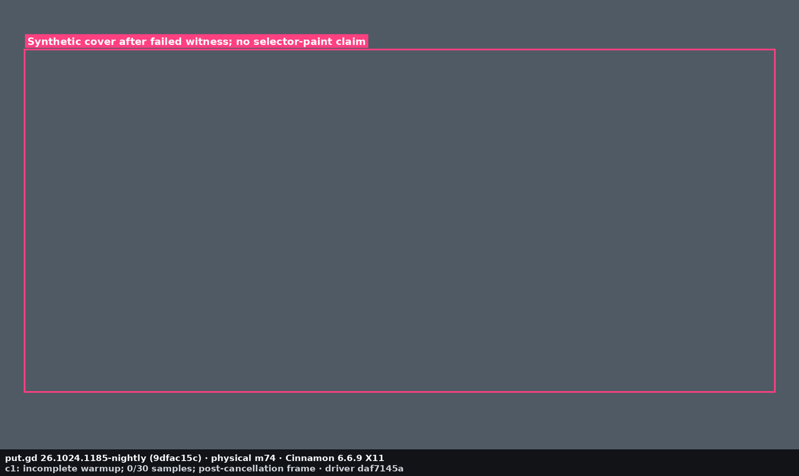
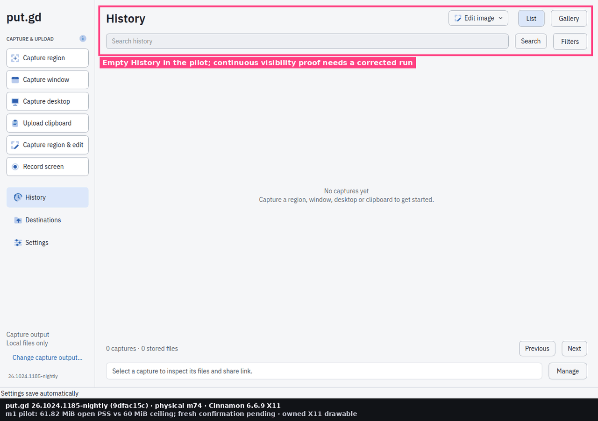
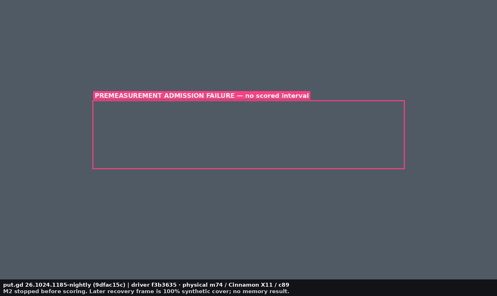
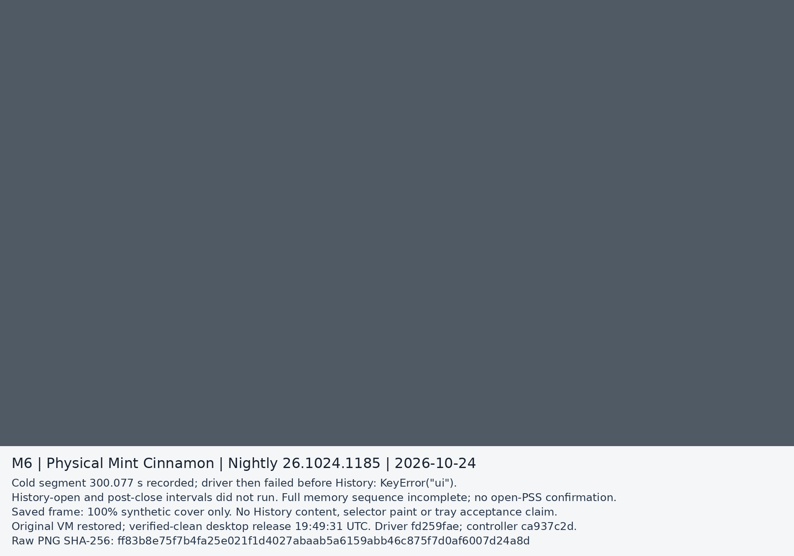
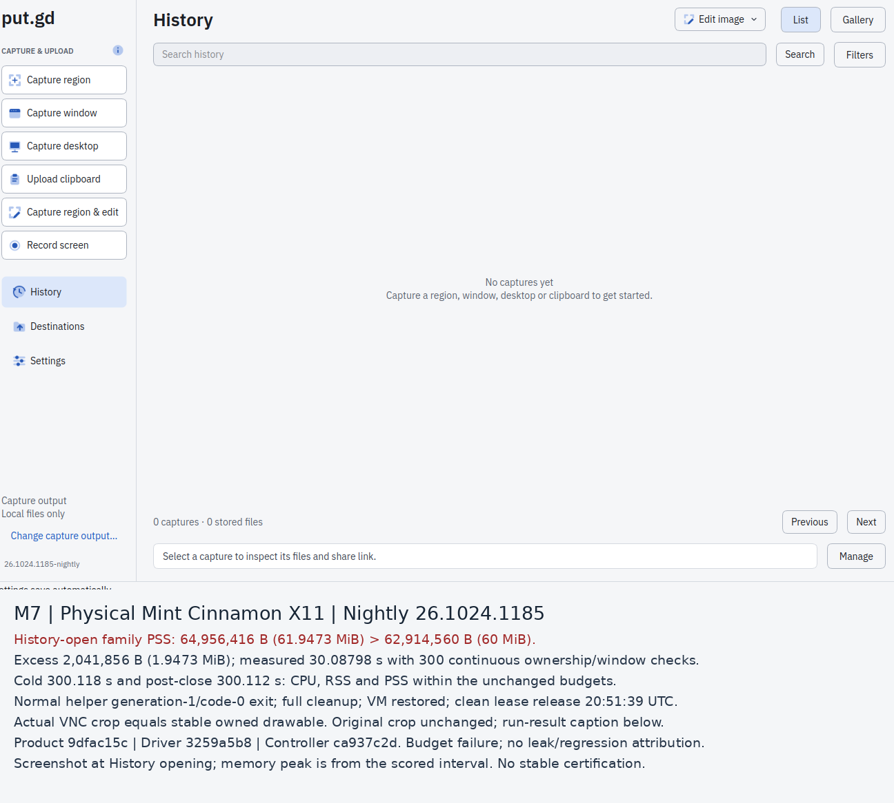

# Physical Cinnamon performance campaign (#379)

**Status: M7 completed the empty-History memory workflow and failed the 60 MiB open-PSS gate; the remaining campaign is pending.**
This is the newest-published-nightly rehearsal requested in
[#379](https://github.com/patrick-hudson/put.gd-desktop/issues/379).
[#384](https://github.com/patrick-hudson/put.gd-desktop/issues/384) must repeat
the driver on the exact stable assets. Nightly results cannot certify those bytes.

## Product and driver identities

The selected package is the published `ubuntu24.04` DEB from
[`v26.1024.1185-nightly`](https://github.com/patrick-hudson/put.gd-desktop/releases/tag/v26.1024.1185-nightly):

- Package: `putgd-26.1024.1185-nightly-ubuntu24.04-x86_64.deb`, 57,534,908 bytes.
- SHA-256: `2094fd4db8cd915b02f1cdd16eb5c99bb8191948931cd2f558a89c59be5b3f47`.
- Product source: `9dfac15c1ced201d13a2b70a8afb0c253213768b`;
  tree: `4e96912274d9220ba9476bd1b50333f6cf738f4f`.
- Package version: `26.1024.1185~nightly`.
- The download matches GitHub's asset digest and release `SHA256SUMS`.
  The mirror's checksum file is byte-identical to GitHub's, and its minisign
  signature verifies with nightly public key `71440FA5E439AEBB` and trusted
  comment `put.gd v26.1024.1185-nightly nightly`.

Installation at 15:10 UTC passed `dpkg --verify`; the embedded identity matches
the clean release commit above. Per-attempt running-process identities remain
in the raw receipts. The package must
remain the published bytes; the independently committed lab drivers are recorded
separately. Driver hardening is in [#554](https://github.com/patrick-hudson/put.gd-desktop/pull/554)
(#495); additional #379 performance drivers are in
[#555](https://github.com/patrick-hudson/put.gd-desktop/pull/555).
This documentation PR contains no driver code.
The recording contract fix (#410) has its own development-build evidence and is
not represented as part of this published package.

## Required workload and assessment

Run on physical m74, Linux Mint 22.3 / Cinnamon X11, with the real login session,
Qt platform, hardware, host load and process identities recorded. Measurements
require an exclusive desktop lock and no competing heavy SSH, VM or GUI work.
Keep the wall visible; use synthetic covering content, isolated private profiles
and the loopback S3 fixture. Preflight complete UTF-8 Unix socket paths before
each isolated launch. Retain failed attempts and corrected commands.

| Workload | Required assessment | Current result |
| --- | --- | --- |
| Region overlay, empty history | 5 warmups + 30 warm samples; p95 ≤150 ms | Pending |
| Region overlay, populated history | Same protocol with 10,000 independent image/video operation records | Pending |
| Cold/closed memory and idle CPU | RSS ≤40 MiB; CPU <0.5% of one core over 300 seconds | M7 cold and post-close pass at their empty-profile scope |
| Closed family / History-open family | Closed RSS ≤40 MiB; PSS ≤29 MiB / ≤60 MiB, with helpers attributed | M7 closed passes; History-open fails: 61.9473 MiB >60 MiB |
| 10,000-entry history | Open, whole-list scroll, search, image/video preview, Copy image, Delete from destination; response/frame timings, CPU and memory | Pending; unbudgeted response thresholds need Patrick's explicit approval |
| Upload burst | At least 50 queued captures/uploads, concurrent slots, correct tray/history/links, memory during and after settle | Pending |
| Slow/stalled S3 | 256 KiB/s proxy, a stalled connection, visible progress, responsive UI/tray, measured cancellation and successful retry | Pending |

The memory limits are the approved plan's [source53 checkpoint](../../plans/2026-10-07-1926-feat-qt-linux-share-plan.md#clean-source53-cinnamon-checkpoint-and-wayland-compatibility).
The frozen idle harness's older 100 MiB `budgetPassed` field cannot replace the
40 MiB assessment. Preserve the original capture/idle harnesses and socket
ownership checks. A CLI acknowledgement is not proof that a frame was painted;
record those timings and witness limitations separately.

The populated fixture must have independent operation/item/history identities,
consistent operation journals and item state, mixed image/video records and
reproducible media, timestamps and search parameters. It is a seeded workload,
not a claim that 10,000 real uploads ran during the campaign. Preparation and
fixture generation are excluded from quiet measurement intervals.

## Preserved attempts

The physical host is `mint-builder` (m74), Mint 22.3, kernel
`6.14.0-37-generic`, Intel i5-6500T (four cores), Cinnamon `6.6.9+zena`,
Muffin `6.6.3+zena`, distro Qt 6.4.2, native login session `c89` / X11 / `:0`.
The existing powersave governor was preserved. The desktop lock was acquired
at 15:10:13 UTC. After coordinated reversible quiescence of a pre-existing VM,
a 10-second activity check recorded zero VM CPU ticks and no build, test or
encoder process. Other low-activity desktop services and the wall stayed up.

- **c1, driver `daf7145a`: incomplete capture workload.** The first warmup
  created a distinct cancelled region operation, but the unchanged witness
  returned `Actual resident selector did not map/paint on every display`.
  There are **zero measured samples and no valid p95**; raw `-1` is a sentinel,
  not a latency measurement. [The sanitized attempt](attempt-c1.json) binds
  the exact raw hashes and normal resident exit events. Source inspection
  suggests the historical white-at-outer-edge probe conflicts with the current
  black outer / inset white outline. This attribution is provisional; the
  frozen witness and failed attempt are unchanged.
- **m1, driver `daf7145a`: completed bounded memory pilot.** Independent
  review identified insufficient continuous History-window checks and cleanup
  proof in the draft driver. Its summary cannot establish acceptance. Preserve
  its actual source and [135 sanitized numeric snapshots](attempt-m1.json);
  acceptance requires a fresh run with the corrected, reviewed driver. No extra
  UI activity was added during its scored intervals. Both resident launches
  exited normally with code 0 and absent session sockets.
- **s1 → s2, driver `daf7145a`: fresh fixture preparation.**
  [s1 failed before any product operation](attempt-s1.json): the independent
  clipboard child needed missing Gtk/Gdk 4 typelibs. The direct import failure
  was retained. Apt simulation and installation added only
  `gir1.2-gtk-4.0`, without changing GTK libraries or the desktop stack, and the
  corrected command was recorded before retrying in a new private output.
  [s2 produced six independent operation/item journals](seed-s2.json), three
  PNGs and three WebM files, through the production clipboard action and six
  signed loopback PUTs. Independent checks covered 1,698 persisted JSON nodes:
  all network state was the owned literal loopback destination, credentials
  were session references, no multipart/management journal remained, and the
  stopped DB had no open owner, WAL or session socket. This is six-operation
  preparation, not 10,000 uploads or performance acceptance. The fixture was
  stopped during cleanup; the final campaign needs a fresh live fixture/seed.
- **Populated gates: pending.** Earlier #495 grow revisions were staged but never
  executed. Root review cleared only producer revision
  `72afd00bf2dbdaaa7e4bd3f847dc54f1da715f0e`, with persisted-network-state,
  DB/runtime and complete helper ownership guards. Its handoff is staged and
  hash-verified; it has not yet been used for this campaign. All old revisions
  remain held. The final performance-driver review still blocks further
  physical workloads; the separately approved empty-memory attempt below
  reached no measurement interval.
- **m2, driver `f3b3635132f2d5b909935d8119f1f32908e38cec`: failed lab admission.**
  Root reviewed only the empty `memory` scenario's reached paths, with no
  fixture, endpoint, capture/native driver or accessibility override. The fresh
  exact-source export and installed/running 1185 binaries were checked.
  [The source, command, preflight, raw and cleanup hashes](attempt-m2.json)
  record a stop after 2.8705 seconds at `static_cover_not_visible_on_wall`,
  before any scored interval. Metrics are empty; this neither confirms the m1
  memory observation nor establishes a product performance failure. Independent
  readonly SQL found zero operations, history rows and item states. The one-shot
  initial VNC admission check did not retain a frame or numerical coverage;
  later full-cover visibility cannot establish the earlier check's result.
- **m3: coordinator refusal before driver launch.** The separately authorized
  immutable `02d85059` empty-memory source was staged and hash-checked, but
  [the private controller stopped before launching it](attempt-m3.json).
  Its zero-CPU-tick assertion for the paused VM failed before the numerical
  quiet receipt was saved. The failed delta is unavailable; do not infer its
  value, competing heavy work or product performance. No benchmark output,
  product GUI, cover, new frame or scored interval was created. This is a
  coordinator admission failure, not a failure of the unlaunched driver.
- **m4: retained host-admission refusal; no benchmark launch.**
  The private observation retains all 331 rows from its 10.033007-second,
  HZ=100 sample, saved before the refusal predicate;
  [the public summary](attempt-m4.json) indexes its identity and hash. A new
  `mintUpdate` process had no before CPU sample and 30 ticks in the after
  sample; its CPU percentage is unassessed. The unchanged controller refused
  `unknown_activity_unmeasured`. This does not establish heavy load or a
  product/driver failure. No benchmark profile, GUI, cover, image or scored
  interval was created. The service and admission criterion were unchanged.

- **m5: exited-process admission refusal; no benchmark launch.**
  The private observation retains all 332 rows from the 10.033983-second,
  HZ=100 sample, saved before predicates;
  [the public summary](attempt-m5.json) indexes its identity and hash. One exited
  kernel worker had a before value of zero ticks and no after sample. Its
  delta and percentage remain unavailable. The unchanged controller refused
  `unknown_activity_unmeasured`; no heavy-load or product conclusion follows.
  No benchmark profile, GUI, cover, frame or scored interval was created.

- **m6: cold segment completed; driver failed before History.**
  The [sanitized summary](attempt-m6.json) indexes the private raw observations,
  exact source/command and cleanup receipts. At driver `fd259fae`, the cold
  interval ran 300.077 seconds; its CPU, RSS and PSS values were within the
  unchanged cold budgets. The next diagnostics lookup raised `KeyError: 'ui'`
  before any History activation. Open and post-close intervals did not run;
  this does not confirm the m1 open-PSS observation or establish full-memory
  acceptance. The run and its failure retain their original source identity.

- **m7: complete memory workflow; valid product open-PSS failure.**
  At exact driver `3259a5b8`, [M7](attempt-m7.json) completed cold, History-open
  and post-close intervals, with continuous owned-helper/window checks and
  normal exit/complete cleanup. History-open family PSS peaked at **64,956,416
  bytes**, exceeding the unchanged **62,914,560-byte** ceiling by **2,041,856
  bytes (1.947265625 MiB)**. Cold/post-close CPU, RSS and PSS passed their fixed
  budgets. This is a product budget failure on exact 1185, not a driver failure;
  it does not establish a leak, regression cause or stable-asset acceptance.

This is an annotated recovery frame from the tested nightly after the failed
warmup and cancellation, not a picture proving that a selector was absent or
painted. The original reviewed frame contains only synthetic cover pixels;
its SHA-256 is retained in the attempt JSON.

### Memory pilot observations; no acceptance pass

| Stage | Duration | Peak resident RSS | Peak family PSS | Resident CPU, one core |
| --- | --- | --- | --- | --- |
| Cold/closed | 300.037 s | 28.82 MiB | 18.26 MiB | 0.00667% |
| History open, empty fixture | 30 s | See raw snapshots | **61.82 MiB** | See raw snapshots |
| After History closed | 300.054 s | 28.98 MiB | 18.40 MiB | 0.00333% |

The observed open PSS is **1,906,688 bytes (about 1.82 MiB) above** the approved
62,914,560-byte / 60 MiB ceiling. Do not round it into a pass or apply tolerance.
M1 remains an unaccepted pilot with its original limitations. The independent,
corrected M7 workflow below confirms an open-PSS budget failure on the same
exact product; it does not retroactively accept M1. #379 remains unaccepted.

This reviewed image is the native PID-owned X11 drawable saved by the pilot.
It is not a VNC compositor image or proof of continuous visibility. Corrected
acceptance must retain that distinction and supply the missing proof.

Every pixel of this attempt's saved recovery source is RGB `(80, 90, 100)`.
The annotation describes the admission failure; it is not evidence of a memory
interval or of visibility at the earlier failed precheck. A bounded readiness
fix remains driver work and must preserve the all-pixel saved-image checks.

### M6 cold segment; incomplete memory sequence

The new attempt used the exact installed/running 1185 binaries, a fresh empty
profile and the separately reviewed `ca937c2d` coordinator. Its 61 cold samples
span **300.076727 seconds**: CPU **0.006665%** of one core, peak resident/family
RSS **30,220,288 bytes**, peak family PSS **19,122,176 bytes**. The driver scored
its three cold gates within budget, then failed on its own diagnostics caller.
No History helper or window started and no 30-second open or 300-second
post-close result exists. The full campaign and memory sequence remain pending.
The bare diagnostics JSON response was not retained; the caller/production
contract analysis is explicitly source-derived, not a reconstructed response.

Host admission retained 332 rows over 10.033364 seconds, with no unexplained
unmeasured row and a maximum measured process value of 1.794015% of one core.
The separately computed aggregate upper bound was **11.905328%**, including
conservative uncertainty; it is **not** a sub-10% proof. No missing row needed
that bound, so the reviewed per-process path admitted the attempt. Its scope
is Linux-accounted operational CPU, not physical cycles or an instantaneous
utilization guarantee. The raw counters, brackets, bound and decision are private
and indexed by the summary; no historical M4/M5 bound is inferred.

Both saved source frames are independently verified as 100% RGB `(80, 90, 100)`.
This figure appends a caption below the byte-identical original frame. It shows
only the synthetic cover and makes no History-content or tray claim.

### M7 complete memory workflow; History-open PSS fails

| Stage | Measured duration | Peak family RSS | Peak family PSS | Resident CPU, one core |
| --- | --- | --- | --- | --- |
| Cold/closed | 300.118402 s | 30,507,008 B | 19,247,104 B | 0.003332% |
| History open | 30.087980 s | See private raw samples | **64,956,416 B — fail** | See private raw samples |
| After History closed | 300.112448 s | 30,679,040 B | 19,396,608 B | 0.006664% |

All 134 process samples are retained privately: 61 cold, 7 open, 61 closed and
5 mapping/identity/closing samples. The open interval had **300 continuous
checks** of the same PID, executable, parent and mapped X11 window. The helper
then exited normally with code 0 at generation 1. No process escaped the family;
all four package/running build identities matched exact 1185. The database
remained empty. The CPU/RSS/PSS totals were independently recomputed from raw
samples. History content/paint response remains unassessed.

The original 1296×856 physical VNC crop equals the stable PID-owned native
X11 drawable byte-for-byte. It was manually reviewed as empty History with no
credentials or private payload. The caption is appended below the unchanged
crop and reports the later scored interval; the image is not a memory meter
or proof of first-content response time.

M7 host admission retained 332 rows with no unexplained unmeasured row and
maximum measured process CPU 1.594624% of one core. The separate conservative
aggregate upper bound was **11.705048%**, not sub-10%. It was not used to fill
or discharge any missing row; the reviewed per-process admission path applied.
Its explicit Linux-accounted statistical scope remains unchanged.

## Evidence and cleanup

[The first-batch cleanup receipt](batch1-cleanup.json) binds verified per-file
raw exports for c1/m1/s1/s2, the original VM's pause and verified running-state
resume, stopped loopback fixture, and purge of only the campaign's put.gd and
added typelib packages. The desktop lock released verified-clean at
**15:30:32 UTC**; a follow-up host check was free/clean apart from pre-existing
shared collectors. No golden/base, browser handler or new tunnel was changed.
The work continues outside a desktop lock while corrected drivers are reviewed.

For m2, the lock ran **16:07:24–16:11:53 UTC**. The original VM's exact identity
was revalidated before the coordinated pause and its running state verified
after resume. The setup resident exited normally with code 0, without forced
termination; full-family and socket cleanup passed. All nine raw files were
copied privately and checksum-verified. Only `putgd` was installed and purged;
no dependency was added. A release precheck refused the still-installed package
while purge was completing; the subsequent check was clean before verified
release. No retry or other workload ran under that lock.

For m3, the lock ran **16:50:28–16:54:28 UTC**, after a fresh 17-minute notice.
The controller immediately resumed the same identity-checked VM on refusal and
verified it running. Only `putgd` had been installed; it was purged, no dependency
was added, and the cleanup check found no owned process or session socket.
The verified release and source/control/failure receipts are hashed in the
m3 summary. No retry ran under that lock. Receipt-before-assert handling and
the coordinator's quiet-host admission require review before a new allocation;
the frozen performance harness and approved product budgets are unchanged.

For m4, the lease ran **18:35:39–18:36:08 UTC**. The same original VM was
paused with identity-bound proof and verified running again at 18:36:01 UTC.
Only the run's installed `putgd` package was purged; owned-process inventory
was empty and the matching lease released verified-clean. All 12 original
remote files were exported privately and every SHA-256 verified; originals
remain on m74, with a restore index. No retry ran under that allocation.
No benchmark-resident cleanup receipt exists because the driver never started;
these resource-cleanup receipts cannot substitute for the required complete
inventory, verified absence, normal exit and full-interval performance proof.

For m5, the lease ran **19:03:07–19:03:35 UTC**. The same original VM was
verified running again at 19:03:28 UTC, only the run-owned package was purged,
and the matching lease released verified-clean. All 12 original files and
three local receipts are hash-verified, with a separate restore manifest and
private archive; originals remain in place. No benchmark cleanup flags are
invented for an unlaunched resident. This allocation is consumed. Further
work requires reviewed admission logic and a separate allocation; no process
or service was changed or whitelisted and no retry ran.

For m6, the lease ran **19:43:54–19:49:31 UTC**. The exact original VM was
verified running again at 19:49:23 UTC and rechecked at 19:49:28. Both resident
cleanup receipts show normal code-0 exits, no forced termination, complete
inventory, verified absence, no remaining family and no session socket. The
benchmark driver itself exited 1 on the retained `KeyError`. Only the run-owned
package was purged; the matching lease released verified-clean. All **29
original files plus a separate restore manifest** were exported privately and
every size/hash verified, including the 12-file raw run and its original/copy
comparison. The earlier one-line JSON transport correction preceded the single
controller attempt and is retained separately. No retry or new scenario ran.

For m7, the matching lease ran **20:40:29–20:51:39 UTC**. The original VM was
verified running again at 20:51:32 UTC and rechecked at 20:51:36. Both residents
exited normally with code 0, no force, complete inventory and verified absence;
family and session socket were gone. The driver completed scoring and returned
1 for the product PSS gate failure. Only the run-owned package was purged and
the lease released verified-clean. All **31 originals plus a separate restore
manifest** are privately exported and hash/size verified, including 14 raw run
files and their original/copy comparison. Two other saved frames are exact
synthetic fill. There was no retry, product change, waiver or new allocation.

### Actual-frame privacy audit

Review of the draft performance driver found that admitting whole frames after
only a 98% cover precheck could retain unrelated pixels. That code path is held;
the precheck alone is not proof that a saved image is safe.
[The independent source audit](batch1-frame-privacy-audit.json) checked every
retained first-batch whole-frame image on m74: all five are exactly one synthetic
RGB fill across 100% of their pixels. The public c1 annotation uses that reviewed
safe source. The public m1 annotation uses only the reviewed PID-owned History
drawable. No actual sensitive content was observed. Originals remain private;
The separately scoped m2 path uses the corrected exact-solid save check; its
saved source was independently verified as 100% synthetic fill too. The remaining
driver review findings still hold all further physical workloads.

[campaign.json](campaign.json) binds the selected package, budgets and current
gate status. Private raw samples, exact commands, failures, original visuals and
identity/cleanup receipts are retained under m74's private
`~/putgd-lab/p379/` and the per-attempt `/tmp/p379-*` roots; completed run roots
will be exported before cleanup. Further reviewed sanitized results and
annotated pictures will be indexed here when collected.

Before measurements, finish the arranged #495 functional window and establish a
quiet host. A pre-existing VM requires coordinated reversible quiescence; its
original state and verified resume must be retained. Do not touch immutable
bases. Stop only campaign-owned processes, restore temporary desktop state,
remove only campaign-installed package/profile changes and obtain a verified
desktop-lock release receipt. A failed measurement remains a failure until
fixed and rerun; missing evidence remains an open gate.
