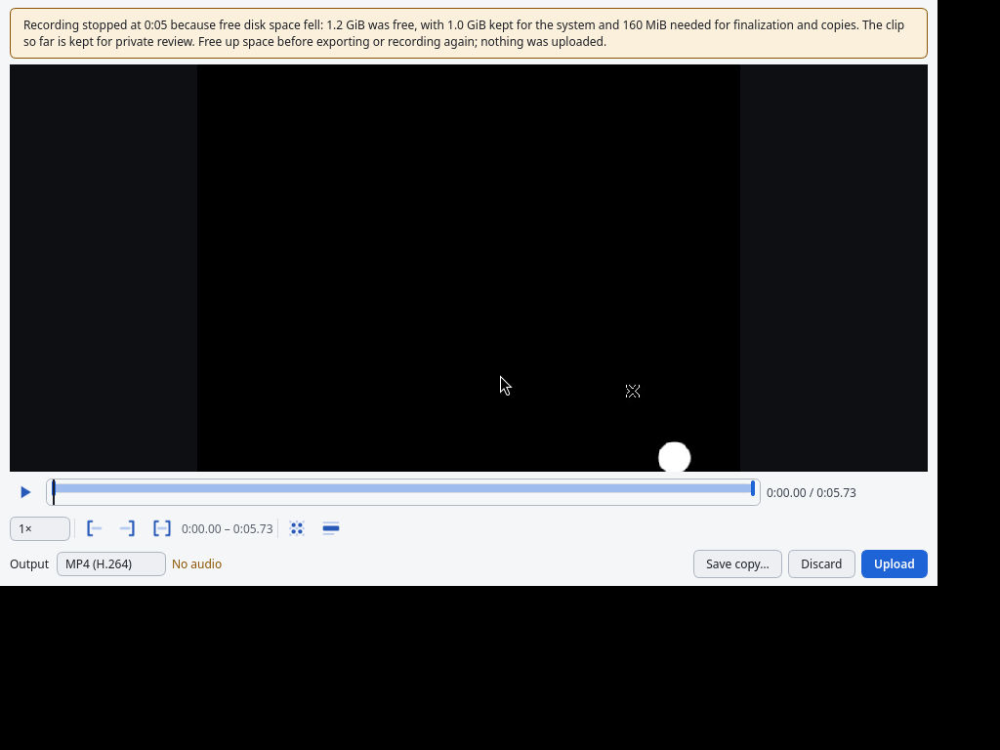
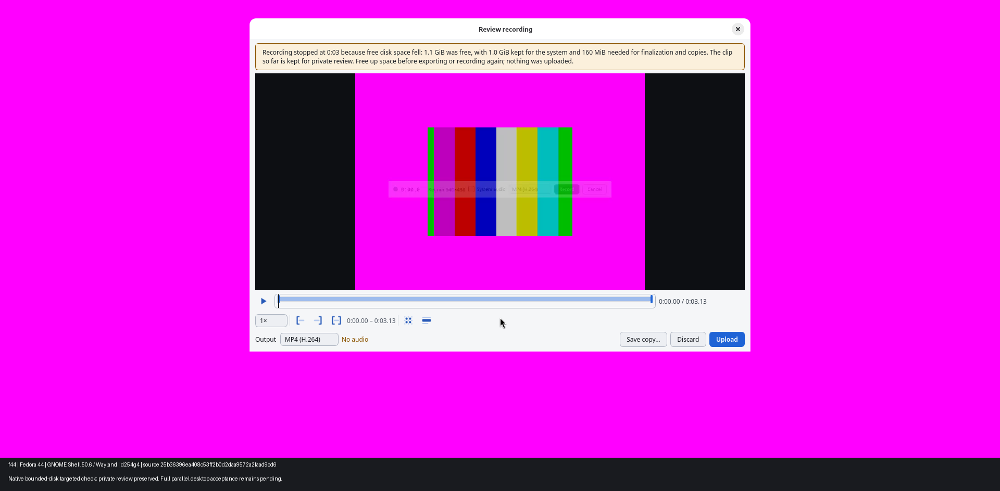

# Recording preservation under competing disk writes — #254

Historical tested code: [PR #572](https://github.com/patrick-hudson/put.gd-desktop/pull/572),
`25b36396ea408c53ff2b0d2daa9572a2faad9cd6`, based on nightly
`80ffa2e6c0d34223d2cc0f31254f2e60ac2bd247`.

**Bounded filesystem/Xvfb integration and targeted native f44 GNOME/Wayland
disk-preservation checks pass on `25b36396`; native clipboard copy failed.**
The review follow-up below uses a newer code head without native acceptance.
Full parallel current-source Cinnamon, GNOME and KDE
functional/memory gates and the remaining declared desktop matrix remain pending
with the parent lab coordinator. Windows is outside this task.
No issue closure or release acceptance is claimed.

## Review follow-up — exact source `4ee657db`

The code follow-up is `4ee657db2d7ee00b2e784a6d7b3f0e4e722f7dd6`.
It preserves GStreamer message/debug as structured `cause` when an explicit
no-space error becomes `recording_disk_full`. Generic write errors, including
ones observed while space is low, and unrelated stream/drain/preview failures
retain their original diagnosis. A prior disk stop adds `error.details.stopDetails`
and `error.details.finalized: false`; it does not establish the cause of a later
error. This documentation-only PR depends on companion [code PR #572](https://github.com/patrick-hudson/put.gd-desktop/pull/572),
which must merge first; its code is not in the docs branch. At the exact companion
head, [RecordingPipeline maps explicit no-space errors and preserves cause](https://github.com/patrick-hudson/put.gd-desktop/blob/4ee657db2d7ee00b2e784a6d7b3f0e4e722f7dd6/src/record/RecordingPipeline.cpp#L361),
[RecordSession attaches failure details](https://github.com/patrick-hudson/put.gd-desktop/blob/4ee657db2d7ee00b2e784a6d7b3f0e4e722f7dd6/src/record/RecordSession.cpp#L82),
and [RecordingService forwards the helper's details](https://github.com/patrick-hudson/put.gd-desktop/blob/4ee657db2d7ee00b2e784a6d7b3f0e4e722f7dd6/src/app/RecordingService.cpp#L274)
into `fail`, which [stores the same Error on the operation](https://github.com/patrick-hudson/put.gd-desktop/blob/4ee657db2d7ee00b2e784a6d7b3f0e4e722f7dd6/src/app/RecordingService.cpp#L207).

On f44, the exact clean source was rebuilt with the same distro Qt 6.11.2 and
official SDK. Four focused CTest suites pass in 22.60 seconds; see
[final test log](review-followup/i254-review-final-tests.log). The new
`recording_storage_integration` runs the production helper session and real
ximagesrc pipeline on a private Xvfb display. A private in-process storage probe
controls only samples; production start, QTimer polling, signal delivery, EOS
drain, preview decoding and review still run. Eight rows cover active/paused
pressure, space recovery, simultaneous byte/disk precedence, byte-only stopping,
explicit no-space after recovery, generic write failures at low/recovered space,
and an unrelated stream error during a disk stop. The existing recording
model/service/helper suites also pass. This is deterministic headless regression
coverage, not native desktop evidence.

The revised [reproducer](reproducer.py) records the CLI version manifest and
binary hashes before mounting; it does not enforce an expected source/version.
Those records support later identity comparisons. It covers every post-mount
operation with `finally` and verifies mount identity before writing or cleanup. Owned helper signaling verifies PID, start
time and executable, using a pidfd to avoid a PID-reuse race; ownership is first
established against the resident parent. A stopped helper is resumed before
normal resident quit, which now waits for exit. Cleanup records mount, helper
and socket outcomes even when setup fails.

The original committed script is preserved as
[reproducer-25b36396.py](reproducer-25b36396.py); original results and per-run
scripts were not relabeled. During follow-up collection, copying a stale private
socket from an intermediate harness attempt failed. That exposed its immediate
quit/terminate race. All attempts remain retained; the final `d254s-*` runs have
no remaining socket, helper or mount and needed no forced helper kill.

| Follow-up run | Result |
| --- | --- |
| `d254s-missing`, `d254s-version` | Expected setup failure; no mount acquired; cleanup receipt passes |
| `d254s-mounted` | Injected failure after verified mount; unmounted, no helpers/socket remain |
| `d254s-stopped` | Injected exception with owned helper SIGSTOPped; identity-guarded resume, normal quit and cleanup pass |
| `d254s-exhaust` | Exact candidate, abrupt exhaustion; `recording_disk_full` with structured original cause, `reason: disk_space`, `finalized: false`, failed operation, empty items/archive |
| `d254q-baseline` | Exact `80ffa2e6`, same paced bounded writer; generic `recording_failed` with no-space message, failed operation, empty items/archive |
| `d254q-pressure`, `d254q-paused`, `d254s-pressure` | Exact candidate, bounded writer; private review/export and strict FFmpeg decode pass; separate explicit local Upload saves and Xvfb clipboard reports `copied` |

The expected-failure assertion checks the session-unavailable response **and**
the operation's failed state, scenario-specific error code, empty items and empty
archive. Candidate exhaustion additionally requires `reason: disk_space` and
`finalized: false`; the baseline is not required to expose these new fields.
[Negative fixture checks](test_reproducer_checks.py) replay retained `d254b2`
and `d254e1`, then reject unrelated session/operation errors, completed states,
items/publication and incorrect candidate details; see
[checks.log](review-followup/checks.log). These harness tests ran on f44.

[Review summary](review-followup/review-summary.json) retains exact source/binary
identities, mount checks, original failure context, cleanup, per-run harness
hashes and strict decode results. Full private evidence is at
`/home/patrick/work/i254-review-evidence/` on f44, indexed by
[review-followup/SHA256.json](review-followup/SHA256.json), whose SHA-256 is
`9c968f87caeadf56b688621984897d7516d597480fdfe19fe7bf6de5b20b15a6`.
The index covers retained private files, not only the committed projections.
No physical lease was acquired for this follow-up, and no owned product/test
process remains. New-head native acceptance and the full parallel/matrix gates
are pending. The historical GNOME clipboard and ready-bar limitations below
remain unresolved; Xvfb clipboard success does not attribute or clear them.

## Harness-only review follow-up (after docs `38f62f04`)

Product code remains `4ee657db`; no product build or capture was repeated.
[reproducer-38f62f04.py](reproducer-38f62f04.py) preserves the previous script
byte for byte. The current runner copies both replay dependencies beside its
script before socket/version/hash setup. `--fail-at after-stop` without
`--exhaust` is rejected by argument parsing before a run directory is created.

The runner now handles SIGINT/SIGTERM/SIGHUP as unsuccessful runs with a failure
receipt. Signals are deferred until the bounded mount subprocess settles, and
repeat terminal signals are ignored during bounded cleanup and receipt writes.
Cleanup discovers an **exact mountpoint**, independently of the acquisition
success flag. [reproducer_mount.py](reproducer_mount.py) requires an acquisition
attempt plus matching target/source/tmpfs type, and the recorded device when
available, before unmounting. It never unlinks through the mountpoint and never
uses `findmnt --target`'s parent-filesystem fallback for cleanup.

[Builder checks](test_reproducer_mount.py) ran serially with `nice -n 10` on
f44 alongside #560's allocated build: five tests passed in 1.475 seconds. They
used empty disposable tmpfs mounts (16 MiB fixtures and the runner's empty
1536 MiB mount), with no filling, GUI, encoding or product builds:

- Missing-binary and failed-version bundles include byte-identical replay modules
  that import from the saved bundle.
- Invalid `after-stop` arguments exit 2 without creating the run directory.
- SIGINT immediately after successful mount, before flag assignment, exits 130;
  the receipt records `mountFlag: false`, exact owned mount discovery and
  successful unmount with no remaining mount/helper/socket.
- No-exact-mount cleanup leaves the parent filesystem alone. Foreign source,
  absent acquisition attempt, changed known device, wrong target and wrong type
  all refuse cleanup; foreign fixture content stays intact. The test controller
  retires only its own verified fixtures afterward.

Results, source hashes and failure receipts are in
[harness-safety/results.json](harness-safety/results.json) and
[test log](harness-safety/mount-tests.log). Full private bundles remain on f44 at
`/home/patrick/work/i254-docs-r2/`; the separate retained-file index is
[harness-safety/SHA256.json](harness-safety/SHA256.json), SHA-256
`56a25d3ce38cad36b29861e2ead8a61895bc1ee27280f57cfea7ca2ccff2c4ea`.
Historical result files,
source snapshots and earlier checksums remain unchanged. These checks add no
native or full desktop acceptance.

## Historical reproduction and result (`25b36396`)

The issue began as a code-inspection hypothesis. On Fedora 44 (`f44`,
`192.168.68.70`), the baseline production resident/CLI/recording helper captured
a synthetic moving ball on an independent Xvfb display. A separate Python
writer filled a disposable 1536 MiB tmpfs mounted **only** over this resident's
private recording staging. The journal, logs, configuration and host filesystem
remained outside that mount. Baseline run `d254b1` ended with generic
`recording_failed`, “No space left on the resource”, an unavailable recording
session and a failed operation with no items. No review opened.

On the candidate, the same production path samples free space and stops to
private review before the paced writer finishes. The writer continues to zero
free bytes on that disposable filesystem. After removing only its filler,
preview, local MP4 export and full FFmpeg decode succeed. The local archive
stays empty until a separate explicit Upload call. That Upload is local-only
and completes without a network destination.

| Historical `25b36396` run | Scenario | Result |
| --- | --- | --- |
| `d254f2` | Separate paced writer fills 1536 MiB mount to zero | `budget` / `disk_space`; review, preview, export/decode and explicit local Upload pass |
| `d254p1` | Same pressure while paused | Same preserved review and local output |
| `d254m1` | Exactly 1216 MiB volume: 1 GiB system reserve plus minimum 192 MiB admission | Stays recording; explicit user stop, review and export pass |
| `d254n1` | Normal pause/resume and explicit stop | `stopReason: user`; export/decode and local Upload pass |
| `d254r1` | Writer reduces free space to 1200 MiB, above the 1184 MiB threshold, then releases it | No automatic stop; explicit user stop and export pass |
| `d254c1` | 2 MiB max-file setting, 1 MiB working budget, synthetic snow | `budget` / `max_file_bytes`; review and export pass |
| `d254e1` | Freeze only this helper, rapidly fill its mount to zero, resume it | `recording_disk_full`, `reason: disk_space`, `finalized: false`; failed operation, no review claim or uploaded items |
| `d254f3` | Repeat disk pressure with official-SDK MCP inspection | MCP `get_recording` agrees with CLI stop reason and all stop figures; preview/export/decode and explicit local Upload pass |

All eight historical `25b36396` runs report successful unmount cleanup. All seven
successful exported clips also pass strict FFmpeg decoding with `-xerror
-err_detect explode`; receipts are in `summary.json` under `strictDecodes`. Their manifests,
binary SHA-256 values, stop/operation results and MCP receipts are in
[summary.json](summary.json). Earlier `d254f1` is explicitly identified as an
intermediate `f4565f22` run; it is not substituted for the final source.

The initial baseline used a rapid writer; the final positive pressure protocol
paces 8 MiB writes by 50 ms. The abrupt-race case deliberately removes that
spacing and freezes only its own recording helper. A separately rebuilt baseline
run, `d254b2`, repeats the **same paced writer to zero** as the final candidate.
It also fails with generic ENOSPC and no review, with the exact baseline binary
hashes now retained alongside its source identity. These are different cases,
not a claim that periodic sampling prevents an arbitrary zero-space race.

## Safety and identities

Each run creates a new mode-0700 directory under `/tmp/d254*`. Before launching
the resident it runs `tools/diagnostics/check_socket_paths.py --ui-output RUN`;
all resolved runtime/session socket paths fit Linux's 107-byte limit. Before any
fill, the runner verifies the exact mountpoint, `tmpfs` type, disposable source
name, device ID and capacity. The writer independently verifies its open file's
device ID and filesystem capacity. It never follows a host free-space target.
Only its filler is removed; the mount is unmounted after owned processes exit.
The Xvfb runs use no golden images, VM overlays or physical desktop sessions.
The separately allocated native runs below use the physical f44 session.

The host uses dynamically linked distro Qt 6.11.2, GStreamer 1.28.8, FFmpeg 8.0
libraries, C++20 and the existing official pinned AWS SDK. Preset configuration
uses the Fedora SDK's `lib64` runtime location and its existing SDK source for
the required license. Configure attempts and logs are retained, including the
initial missing runtime/license path failures; no substitute toolchain was made.

The saved visuals below were inspected: they contain only the independent
synthetic Xvfb display and recording UI, with no physical desktop or user data.




## Targeted native GNOME/Wayland evidence

Session `t3-i254-native1` held the f44 desktop lease from 17:19:59 to
17:30:00 UTC on 2026-10-25, within its 17:39:59 expiry. The coordinator parked
family heavy builds first. Admission verified the unlocked GNOME Shell 50.6
Wayland desktop, the visible VNC 5901 wall connection and a 0.00666 CPU busy
fraction over three seconds. All runs use exact source `25b36396`, distro
Qt 6.11.2 and the same binary hashes recorded in
[native-results.json](native/native-results.json). Socket preflight and bounded
mount identity checks ran before the app and competing writer respectively.

`d254g1` and `d254g2` failed **before capture**: global synthetic cover was
95.93%, below the unchanged 98% threshold. Their failure metadata and successful
unmount receipts are retained. Full-desktop failure frames remain on f44 only;
they are not in this export. The documented f44 fallback in
[remote-builders.md](../../remote-builders.md) permits capture strictly inside an
owned window. The coordinator approved that fallback; `d254g3` and `d254g4`
verified the exact `[640,300,640,480]` capture rectangle was 100% task-owned
before showing the synthetic pattern and starting recording.

| Native run | Scenario | Result |
| --- | --- | --- |
| `d254g3` | Competing writer during recording | `disk_space` stop; private review, preview, local export, strict full FFmpeg decode, CLI/MCP figure parity pass; explicit Upload saves locally but clipboard copy fails |
| `d254g4` | Competing writer while paused | Same preserved review/output and privacy checks pass; explicit Upload saves locally but clipboard copy fails |

Both mounts were independently identified as disposable 1536 MiB tmpfs before
writing, and both unmounted successfully. The local archive was empty before
explicit Upload, including after local export. In both `g3` and `g4`, Upload
saved the local artifact (`items[0].local.status: saved`,
`remoteStatus: not_requested`) but **clipboard copy failed**:
`copyStatus: failed`, `error.code: clipboard_unavailable`, message
“GNOME helper cannot own CLIPBOARD”. The raw `state: completed` therefore
establishes local-save success, not clipboard or full Upload-path acceptance.
The earlier pass summary omitted this error; this correction preserves the raw
evidence. Attribution and retesting remain required in the final campaign; no
baseline attribution is claimed. No cloud destination or user objects were involved.

The preview's four edges and exported review crop's four edges all match the
synthetic background token at 100%. The review screenshots below are cropped
from `[0,200,1920,880]`, excluding the Shell overlay, then annotated with run,
host, source and acceptance scope. Original full frames and unannotated safe
crops remain retained on f44. Privacy check sidecars and image hashes are in
[native/SHA256.json](native/SHA256.json).




**Observed limitation:** the first preview in `g3` includes the app's own ready
control bar. `g4` requests `recording.overlay(false)` before starting, but a faint
ready-bar fade is still visible in its first preview. These are task-owned pixels,
not user content. No clean-content or overlay-exclusion acceptance is claimed,
and this observation has not been established to predate the candidate. It is
retained separately from #254's disk-preservation result; #516 UI work is outside
this change. The native runs do not replace the full parallel desktop/memory
gates, declared distro matrix, clipboard/complete Upload-path, or audio/overlay
capture acceptance.

[Release receipt](native/native-release.json) records verified-clean release at
17:30:00 UTC with all four cleanup arrays empty. Only the same three pre-existing
shared SSH processes remained. The coordinator independently confirmed
`free/present=[]` at 17:30:34 UTC, inspected the safe visuals, and resumed #558.
No lease or owned graphical process is retained.

The safe archive at
`work/i254/evidence/native-safe.tar` in the implementation worktree has SHA-256
`c86e2f96366984d70c3e1f4e2c7041efb339c8f7b56ceaef14e1938341d50d0e`.
It contains only the ten committed `native/` members, including their checksum
index. The complete private f44 retention index after native collection has
SHA-256 `8667f4ee1293571cd559d602fdb81f4304a3c6f2247f901d4fb321d9ed66cf25`.
Per-run reproducer snapshots remain with the private evidence.

## Threshold and tests

The [shared reserve](https://github.com/patrick-hudson/put.gd-desktop/blob/25b36396ea408c53ff2b0d2daa9572a2faad9cd6/src/core/DiskSpace.h) keeps the existing 1–4 GiB,
5%-of-capacity rule. The [live threshold](https://github.com/patrick-hudson/put.gd-desktop/blob/25b36396ea408c53ff2b0d2daa9572a2faad9cd6/src/record/RecordingStorage.h)
uses `2 * max(clipBytes, 64 MiB) + 32 MiB` above that reserve. The working clip
already consumed its portion of free bytes; only the two future copies are
counted here. The additional 32 MiB is conservative drain headroom for encoded
queues and Matroska finalization, not an export-size promise or a reservation
against other writers. It stays below the third 64 MiB admission budget, leaving
32 MiB of usable space at the minimum admission boundary. The 1 GiB minimum
system reserve remains separate and is counted once.

`recording_model_contract`, `recording_service_integration` and
`recording_helper_integration` pass 3/3 on historical source `25b36396`; see
[i254-focused-final.log](i254-focused-final.log). Coverage includes threshold
boundaries, minimum admission, recovery before threshold, unknown free space,
overflow-safe estimates, preserving the triggering sample after space recovers,
private review/export behavior, failure journal details, existing stop races and
helper shutdown/cancellation. The first service run failed because its assertion
expected exact details while the journal adds `step: null`; the assertion now
checks the meaningful fields and the whole suite passes. The failure log remains
in the private retention directory.

The additional payload, pause-timeline, A/V export-sync and review-window suites
pass 4/4; see [i254-extra-tests.log](i254-extra-tests.log). These checks protect the
shared reserve formula and existing recording/edit/export behavior.

The parent coordinator verified required CI success on exact code head
`25b36396` and earlier documentation head `e553c347`; the child did not poll
CI. The review follow-up requires fresh code and docs CI results; the parent
coordinator watches them.

No idle-resident timer or media dependency was added. Sampling belongs only to
the active transient recording pipeline and stops with it. The native functional
and memory gates are still required to measure the deployed behavior.

## Reproduction and retention

The exact evolving lab harness is retained privately on f44 at
`/home/patrick/work/i254-evidence/`, including source snapshots per later run,
logs, clips, synthetic screenshots, parameters, identities and cleanup results.
[SHA256.json](SHA256.json) indexes the pre-native private directory snapshot;
the post-native index digest is recorded above. Neither index is a claim that
all indexed files are committed here. Nothing was deleted or compressed.

[reproducer-25b36396.py](reproducer-25b36396.py) preserves the originally
committed lab recipe; per-run snapshots remain authoritative for historical
runs. [reproducer.py](reproducer.py), [reproducer_checks.py](reproducer_checks.py),
[reproducer_mount.py](reproducer_mount.py) and [mcp_inspect.py](mcp_inspect.py) are the revised follow-up recipe. They are builder-specific evidence scripts, not a release gate
or an installer. They require a fresh private run path, distro Xvfb/GStreamer/
FFmpeg, authorized `sudo -n mount`, and the locked MCP environment. The captured
paths are the real paths used on f44. For example:

```sh
nice -n 10 python3 /home/patrick/work/i254-pressure.py \
  --build /home/patrick/work/i254/build/dev --run /tmp/d254f3
# Other independent runs use --paused, --scenario minimum|normal|recovery|budget,
# or --exhaust. Never reuse an existing run directory.
```

The parent thread `3939c6ca-6ea9-488c-aa60-ef4898cfcb50` owns native lab allocation,
quiet-host admission and the required parallel current-build desktop gates.
