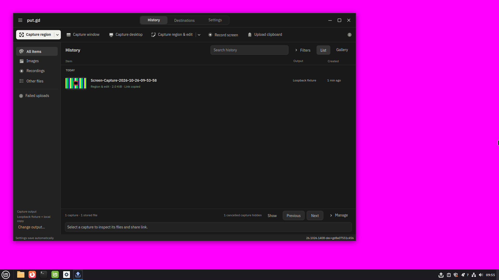
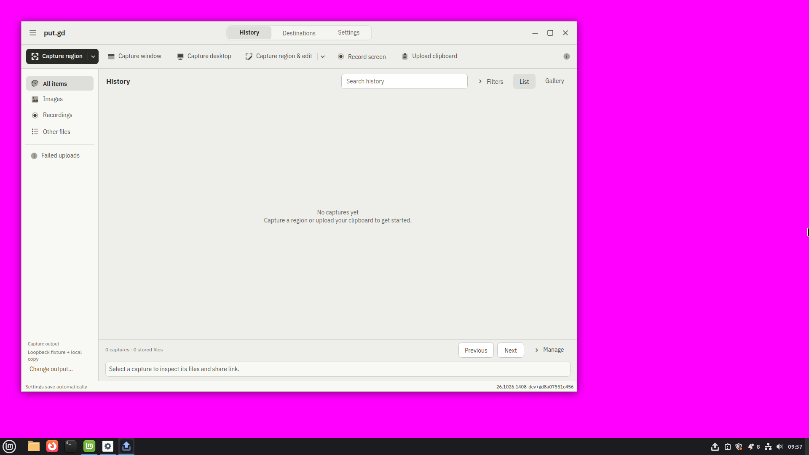
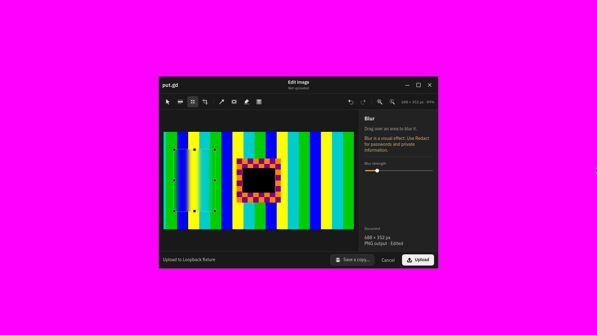
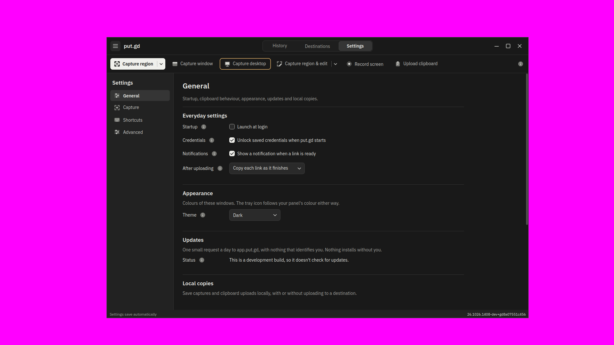
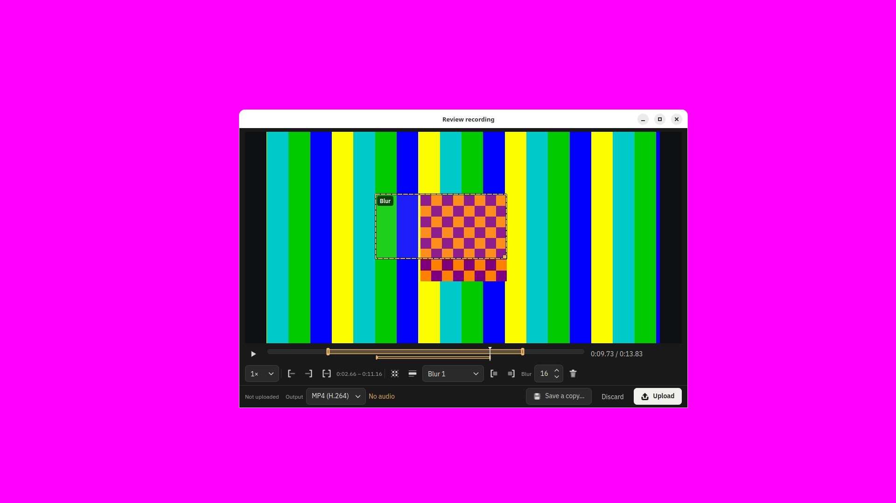
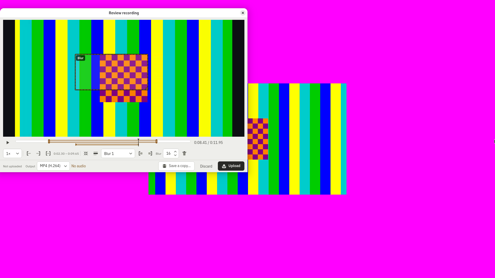
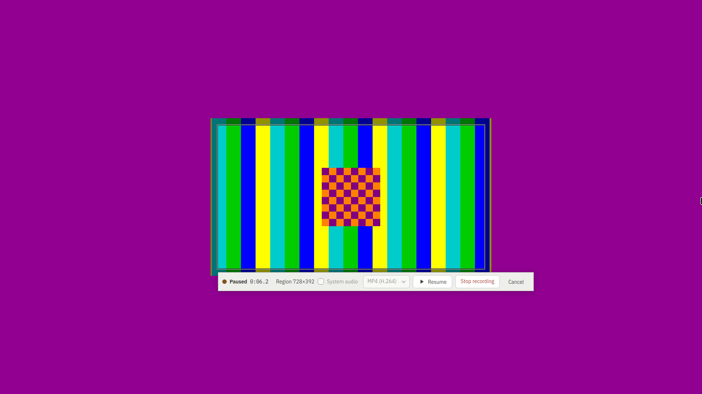
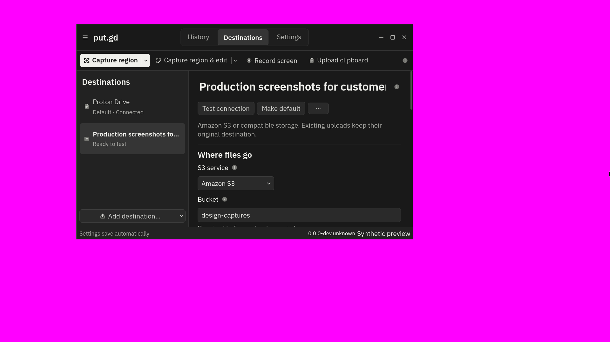

# Graphite production review — 2026-10-26

The [Graphite visual language](../../visual-language.md) is implemented in
[code PR #596](https://github.com/patrick-hudson/put.gd-desktop/pull/596).
[Documentation PR #595](https://github.com/patrick-hudson/put.gd-desktop/pull/595)
contains the contract and this review packet and must merge after the code.
Both remain unmerged for Patrick's review.

This is an issue-level desktop redesign campaign, not full release acceptance.
It uses the real resident and helpers with synthetic capture content and an
isolated loopback S3 destination. The earlier
[standalone prototype](../2026-10-26-graphite-design-feasibility.md) is separate.

## Screens to review

These are saved compositor screenshots, copied without pixel changes. Magenta
is the lab backdrop, not an application color. The capture pattern is synthetic;
no user content or revealed credentials are present. The
[screenshot manifest](screenshots.json) records each original path, source,
package and SHA-256. Click an image to inspect its full resolution.

### History: dark and light

Dark History after an explicit upload, Mint/Cinnamon X11, final Ubuntu 24.04 DEB:

Light History, Mint/Cinnamon X11, final AppImage:

### Editor and settings

The dark editor after real redaction and blur drags, Fedora/GNOME Wayland,
final AppImage. The canvas keeps its space while properties change; local export
and Upload remain separate actions.

General settings and keyboard focus, Ubuntu/GNOME Wayland VM, final DEB:

### Recording and private review

Dark review with trim and a timed blur, Ubuntu/GNOME Wayland VM, final AppImage:

Light review, Debian/GNOME Xorg, final DEB. Review uses the desktop title bar to
preserve space for the frame at large text sizes.

Paused recording, Mint/Cinnamon X11, final DEB:

### Compact destinations at 150% text

This last image is a **production preview with synthetic destination data** on
Fedora/GNOME Wayland at source `d392f547`, preceding the final History wording
commit. It establishes this layout's appearance, not installed-package workflow
acceptance. The name remains shrinkable, help/actions remain reachable, and
fields stack when the text needs more room.

## Exact source and packages

| Identity | Value |
| --- | --- |
| Code PR head | `b367fe86d848ce2c74e77157e03386e5dee15187` |
| Nightly base | `d7e806fd1849157eed4b1d53b7dc698ed4522bac` |
| Tested CI merge | `d8a07551c45695d2bcbd197705ecfcbdb119432a` |
| Tested source tree | `02ee4f1abd3b693e92049997cc776dd2c5b84809` |
| Package version | `26.1026.1408~dev+gd8a07551c456` |
| Hosted CI | [run 40316856840](https://github.com/patrick-hudson/put.gd-desktop/actions/runs/40316856840), required `CI` passed |

| Package | SHA-256 |
| --- | --- |
| AppImage, unchanged across all desktop rows | `2c9ddca813d0bd5b744a52a92a38ac2407e5890d63092b75d638994b16d4af04` |
| Ubuntu 24.04 DEB | `4153262b7b80f847c99ff54b9077778eeab7cabba40a979f775597f5b625f37a` |
| Ubuntu 26.04 DEB | `8eacd950a1cf06a8779bcc07db6d84bf4cecbcadf3ead9d8ecf180231a9ac2b0` |
| Debian 13 DEB | `8343c7bbdbce9b3c2551b97aaff87eed63cf3524b21ac53ede4ef8c9b0f96bf6` |
| Fedora 44 RPM | `d143daa5a6bd1a305fb1f4fde227645e7cf8a62e0e4094893fd175dd6b07614e` |

Private raw evidence is retained under
`work/graphite-production-20261026/`, principally `functional/`, `memory/`,
`native/`, `packages-b367fe86/`, `nightly-1388/` and `stall-k72x11/`.
Each functional row keeps `log.json`, input steps, build/package identity,
compositor frames, exported synthetic files and cleanup results.

## Functional scope and results

Each 19-step row covers identity; light/dark main window; menu; keyboard focus;
switcher icon; window-button close; capture region and edit; redact and blur;
named cancellation; editor Save a copy through the desktop chooser; explicit
editor Upload; a cancelled capture and History Show/Hide; recording
ready/start/pause/resume/stop; Review trim and timed blur; Review Save a copy;
explicit Review Upload; a static recording control; and process/socket cleanup.

The upload fixture remains empty before the explicit action, including after
local export. Uploaded redactions contain one solid color. The MP4/H.264 motion
samples are compared with a static control from the same desktop. This does not
claim all recording formats or system-audio acceptance.

| Desktop/session | Native package | AppImage | Receipt directories under `functional/` |
| --- | --- | --- | --- |
| Mint 22.3, Cinnamon 6.6.9, X11, physical m74 | 19/19 | 19/19 | `m74-native-d8a07551-a4`, `m74-appimage-d8a07551-a2` |
| Fedora 44, GNOME 50.6, Wayland, physical f44 | 19/19 | 19/19 | `f44-native-d8a07551-a3`, `f44-appimage-d8a07551-a1` |
| Kubuntu 26.04.1, Plasma 6.6.6, Wayland, physical k72 | 19/19 | 19/19 | `k72-native-d8a07551-a5`, `k72-appimage-d8a07551-a1` |
| Debian 13, Plasma, Wayland, physical d69 | 19/19 | 19/19 | `d69-native-d8a07551-a1`, `d69-appimage-d8a07551-a1` |
| Kubuntu 26.04.1, Plasma, X11, physical k72 | 19/19 | Completed with first-upload stall, #597 | `k72x11-native-d8a07551-a3`, `k72x11-appimage-d8a07551-a3` |
| Debian 13, GNOME 48.7, Xorg, physical d69 | 19/19 steps; bar contrast finding below | 19/19 steps; bar contrast finding below | `d69gx11-native-d8a07551-a2`, `d69gx11-appimage-d8a07551-a1` |
| Ubuntu 26.04.1, GNOME 50.1, Wayland, VM on d69 | 19/19 | 19/19 | `u26vm-native-d8a07551-a2`, `u26vm-appimage-d8a07551-a1` |

The final Mint repeats identify active, unlocked session `c89` and its Cinnamon
process. Earlier Mint rows incorrectly selected an inactive login session; those
receipts remain unchanged and are superseded. The corrected harness derives
identity from the compositor PID, using a recorded unique active-seat0/display
fallback for GNOME processes managed by the systemd user manager.

The Ubuntu VM uses a fresh overlay of `gnome-provisioned-20261016`. GNOME
AppImage rows use the matching extension as a user copy; f44's nightly copy was
verified byte-identical to the tested source's `integrations/gnome`.

## Memory and comparison

Native packages ran the 300 s idle / 30 s History open / 300 s closed protocol on
the four physical desktops. Cinnamon uses frozen physical sampler `00ab777f`;
the Wayland port retains the same measured gates, records the selected display,
uses a private runtime and retains its harness identity. Every measured memory,
CPU and cleanup gate passes on these four final-package runs. **History paint
response is unassessed**, not passed.

| Desktop | Cold RSS (MiB) | Cold family PSS (MiB) | History peak family PSS (MiB) | Private receipt under `memory/` |
| --- | --- | --- | --- | --- |
| m74 Cinnamon X11 | 28.81 | 18.18 | 41.33 | `m74-300-30-300-d8a07551/results.json` |
| f44 GNOME Wayland | 35.43 | 21.65 | 54.56 | `f44-wl-300-30-300-d8a07551/results.json` |
| k72 Plasma Wayland | 31.46 | 8.42 | 38.91 | `k72-wl-300-30-300-d8a07551/results.json` |
| d69 Plasma Wayland | 30.71 | 9.35 | 55.41 | `d69-wl-300-30-300-d8a07551/results.json` |

The controlled f44 comparison fixes the same verified absolute
`WAYLAND_DISPLAY` and changes only the runtime directory. Both builds idle at
35.2–35.5 MiB RSS with either directory. Nightly's History peak is 70.61–70.68
MiB; the PR's is 53.44–53.60 MiB. These are observed samples, not a universal
performance promise. The four receipts are `memory/f44-ctl-*-wd/results.json`.

## Findings and limits

- [#597](https://github.com/patrick-hudson/put.gd-desktop/issues/597): the first
  AppImage upload on Plasma X11 leaves the resident unresponsive for about
  15.6 s before completion. Unchanged nightly reproduces it. That row is
  qualified, not a clean functional pass; GNOME Xorg did not reproduce the stall.
- [#598](https://github.com/patrick-hudson/put.gd-desktop/issues/598): starting
  GNOME's resident without `WAYLAND_DISPLAY` selects the heavier `QApplication`
  fallback and exceeds the 40 MiB idle RSS budget on both builds. Earlier
  comparisons also changed the runtime directory and could not identify the
  cause. The controlled rerun rules out that directory as the explanation.
- Final visual review found the recording control bar dimmed beneath the region
  overlay on Debian/GNOME Xorg, in both package formats. Buttons completed their
  functional steps, but the contrast discrepancy remains under investigation.
  The original `record-paused.png` frames are retained in both row directories.
- Paint response, Windows desktop acceptance, fractional-DPR native coverage,
  full recording format/audio coverage, release update/feed/stable/login and
  notification-click workflows, Aurora and neon are not established here.

The exact archive-tree suites at `29a17178` passed 98/98 on Qt 6.4.2, 110/110 on
Qt 6.11.2 and 109/109 on Qt 6.10.2. Later commits changed the preview driver and
History wording; the final head's hosted CI also passes. Those test identities
remain separate from package workflow evidence.

The synthetic production preview at `d392f547` has dark, light and 150% text
captures on Cinnamon, GNOME and Plasma, with real pointer move, maximize,
restore, minimize/reshow, eight resize edges and close checks. Its per-file
source manifest was independently reconstructed from the archive plus
`.source-commit`. The original `36511572…` digest uses `en_US.UTF-8` sorting;
the same rows in C order hash to `b8e8a25f…`. Future runs retain the C sort rule.
These preview checks are not silently relabeled as final-package measurements.

## Cleanup and retention

The implementation campaign reports all four physical locks released after
verified-clean checks at 15:51 UTC, k72 and d69 restored to Plasma Wayland with
their VNC servers, temporary GNOME extension/SDDM changes removed, and the
Ubuntu overlays retired through guarded `lab.py cleanup`. Two failed wrong-key
VM launches are recorded as failures. Original failed attempts and superseded
receipts remain private and unchanged. Final cleanup and additional chrome
receipt locations are being reconciled into the parent review index.

Keep the raw evidence and failure context under the
[retention policy](../../evidence-retention.md). This packet does not waive the
[acceptance matrix](../../acceptance-matrix.md) or authorize a release.
