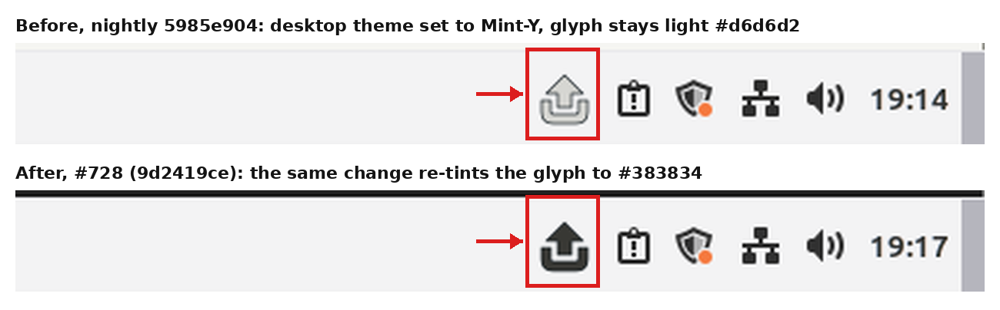

# Cinnamon desktop theme and the tray tint (#702)

Fresh Mint 22 Cinnamon/X11 guests (golden `cinnamon-x11`) on boat sandbox
`bx_pqwhcvw4`, 1280x800 QMP frames. The theme was changed in the real session
the way Cinnamon's Themes module writes it.

- **Before**: nightly `5985e904`. Setting only the desktop theme (`org.cinnamon.theme name`
  to `Mint-Y`) turns the panel light, but the resident never hears of it: Cinnamon's
  portal does not serve that schema. The glyph stays `#d6d6d2` (dark-panel tint).
  This frame is the `failure-before-cleanup` frame of `events.panel_theme_changed`.
- **After**: [#728](https://github.com/patrick-hudson/put.gd-desktop/pull/728) (`9d2419ce`). The
  resident follows dconf's change notice and re-tints to `#383834` (light-panel tint).
  This frame is the `after` frame of the passing `events.panel_theme_changed` run
  (driver `fcd33188` on `feat/surface-recipes-events`).

Three ways of running the resident, each with a desktop-theme-only change and a
Mixed/Light mode switch (seconds until `trayTint.panel` changed; 12 s means missed):

| Resident's profile | nightly: theme only | nightly: mode | #728: theme only | #728: mode |
| --- | --- | --- | --- | --- |
| private `XDG_*` (as lab runs) | missed | missed | missed | missed |
| private, `dconf` shared with the session | missed | 0.43 | 0.60 | 1.19 |
| no private profile (as users run it) | missed | 0.46 | 0.58 | 1.20 |

The first row is a lab artifact: the resident's `gsettings` reads the private
configuration home's empty dconf database. The events recipe now shares only the
session's dconf directory for this event.
