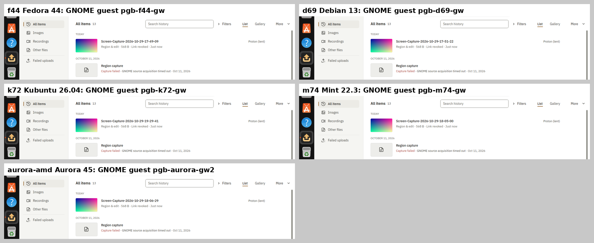
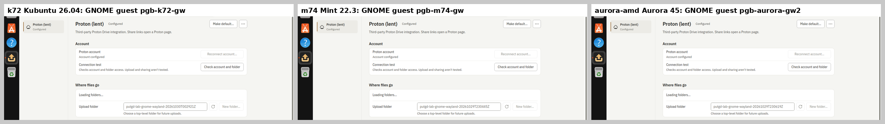

# Proton session lending on every builder, 2026-10-29 and 2026-10-30

Each builder holds its own put.gd Proton session for the test account
([lab sessions](../../proton-drive.md#lab-sessions-on-the-builders)). Until this run,
only f44 and d69 could lend theirs to a VM. Now all five can:
- **2026-10-29:** m74 and aurora-amd were set up to lend, and f44, d69, m74 and
  aurora-amd each proved a lend into a fresh overlay. k72 couldn't host a VM,
  because its firmware had VT-x turned off
  ([#659](https://github.com/patrick-hudson/put.gd-desktop/issues/659)).
- **2026-10-30:** another session enabled VT-x on k72 (00:13Z reboot). k72 was then
  set up the same way and proved its lends.

The tools came from [#660](https://github.com/patrick-hudson/put.gd-desktop/pull/660):
- `register-guests` records the guest bridge and the lendable goldens in the registry;
- `lend` records `lastLend`;
- the smoke test runs Check account and folder.

## Results

| Builder | Guest bridge | Lendable goldens (registry `guests`) | Lend proof | Session rotated in the guest | Host `check` after |
| --- | --- | --- | --- | --- | --- |
| f44 Fedora 44 | `~/putgd-lab/proton/guest-bridge/` (since 2026-10-23) | Cinnamon, GNOME, KDE | `pgb-f44-gw` (GNOME) passed | no | passed |
| d69 Debian 13 | `~/putgd-lab/proton/guest-bridge/` (since 2026-10-23) | Cinnamon, GNOME, KDE | `pgb-d69-gw` (GNOME) passed | **yes** | passed |
| m74 Mint 22.3 | `~/putgd-lab/proton/guest-bridge/` (since 2026-10-23) | Cinnamon, GNOME (copied today) | `pgb-m74-gw` (GNOME) and `pgb-m74-cin` (Cinnamon) passed | **yes** (GNOME), no (Cinnamon) | passed both times |
| aurora-amd Aurora 45 | `/var/home/patrick/putgd-lab/proton/guest-bridge/` (installed today) | Cinnamon, GNOME (copied today) | `pgb-aurora-gw2` (GNOME) and `pgb-aurora-cin` (Cinnamon) passed; `pgb-aurora-gw` failed at install, below | no | passed both times |
| k72 Kubuntu 26.04 | `~/putgd-lab/proton/guest-bridge/` (since 2026-10-23) | Cinnamon, GNOME (copied 2026-10-30) | `pgb-k72-gw` (GNOME) and `pgb-k72-cin2` (Cinnamon) passed; `pgb-k72-cin` failed in the smoke test, below | no | passed every time |

The guest bridge is one build, byte-identical on all five builders:
- relay `putgd-lab-secret-bridge`, built against Qt 6.4.2 on m74, SHA-256 `12b70c49c80fbace…`;
- broker `putgd-lab-proton-secrets`, Bun 1.4.2, SHA-256 `31a76c8dbe0adae7…`.

Aurora's copy was streamed from m74 and hash-checked before it was moved into place.

## Every passing lend did the same thing

Each ran under that builder's Proton lock, taken from the workstation with
`desktop_lock.py acquire HOST --resource proton` and checked before use. Each used a
fresh overlay launched by `lab.py` on the builder: KVM, 2 vCPUs, 6 GiB, with the host
and guest capacity preflights passing first. One guest at a time ran on each 4-core host.
1. `lab.py install` installed nightly **26.1029.2229** in the guest: the ubuntu26.04
   .deb for GNOME, the ubuntu24.04 .deb for Cinnamon, both checked against the
   release's `SHA256SUMS`.
2. `proton_lab.py lend RUN -- python3 tools/lab/proton_lend_smoke.py --pictures`
   gave the guest a blank lab keyring and imported the builder's session under a
   new `putgd-lab-UUID` name (`cleanup_confirmed` at the end).
3. put.gd in the guest ran the smoke test:
   - inspected the account (`phudson2@gmail.com`);
   - created a new folder and passed **Check account and folder** (`account-folder`);
   - uploaded a synthetic PNG privately;
   - shared, inspected and revoked its link (`shared`, `shared`, `revoked`).
4. The guest's put.gd quit. Its copy of the session was carried back to the builder's
   entry (`replace_confirmed`), and the guest entry was deleted.
5. The builder's own `proton_lab.py check` passed (`account-folder`).
6. The VM stopped through QMP. The golden's SHA-256 was unchanged afterwards. The
   overlay was retired through guarded cleanup with a completion manifest.

The f44 and d69 runs ran before the smoke test framed Destinations. Their Settings
picture shows General, so it is not included. Their History pictures and receipts
are.

## A refreshed session came back

d69's and m74's GNOME lends reported `rotated: true`. The guest refreshed the
session, the refreshed copy replaced the builder's entry under the production
account lock (`replace_confirmed`), and the builder's `check` passed with it
afterwards. This is the first live proof of
[#527](https://github.com/patrick-hudson/put.gd-desktop/issues/527)'s acceptance.
The other lends left the token unchanged, and their carry-back confirmed identical
bytes.

## What changed on the builders

- **k72:**
  - The same two goldens: `transfer-eff2bd963713` (GNOME) and
    `transfer-4ecf0e847901` (Cinnamon).
  - New `lab-bootstrap-k72/`.
  - Its QEMU 10.2.1 was already installed.

- **m74:**
  - Two goldens copied from f44 into new directories:
    - `gnome-provisioned-20261016` to `transfer-659d95302859`;
    - `cinnamon-x11` to `transfer-1e7496436875`.
  - New `lab-bootstrap-m74/` for the guest keys and pins.
- **aurora-amd:**
  - The guest bridge.
  - The same two goldens: `transfer-000d35aedb8b` and `transfer-69d4d8858821`.
  - New `lab-bootstrap-aurora-amd/`.
  - Two reviewed `rpm-ostree install --apply-live` transactions. The first added
    `qemu-system-x86-core`, `qemu-img` and `qemu-device-display-virtio-vga` with
    their dependencies. The second added `dpkg`.
  - 24 packages in all: no compositor, desktop, Mesa, GPU, PipeWire or portal
    package, and the base image is unchanged
    (`testing-45.20261029.1`, digest `f0af5d87…`).
- **Golden copies:**
  - **How:** each image was streamed once from f44, through a pipe on the workstation
    that wrote to no disk, and teed to both builders.
  - **Checks:** each copy matched the inventory SHA-256 (`563730cc…`, `4a21566d…`)
    and passed `qemu-img info` and `qemu-img check` before promotion.
  - **Receipts:** under the workstation's `work/verification/golden-transfer-<id>/`.
- **Registries:** every builder now has `guests` and `lastLend` entries.
  [registries.jsonl](registries.jsonl) is the five registries as they were afterwards.
  It holds paths, hashes, states and the test account's address only. f44's
  `lastCheck` there is a later check by another session (`live-recipes`, 23:19Z).

## Failures and fixes

- **`pgb-k72-cin`:** the lend itself worked: the session was carried back with
  `replace_confirmed`, and the host `check` passed. The smoke test failed, though.
  It treated the upload's `acquiring` state as final and reported a still-running
  upload as failed, `testExit 1`. Its wait list predates the app's current active
  states (`Operation::activeState`). The fix in #660 waits through every active state,
  and a test now ties that list to the source. `pgb-k72-cin2` passed with it in a
  new overlay. The failed overlay was retired as `failed`.

- **`pgb-aurora-gw`:** `lab.py install` failed, because aurora-amd had no `dpkg-deb`,
  which install uses to hash the package's binaries. The guest had booted under KVM,
  so the lend never started. The fix was to layer `dpkg`. The failed overlay was
  retired with a `failed` completion manifest, and `pgb-aurora-gw2` passed in a new
  overlay.
- **Guarded cleanup on Aurora** refused a manifest path through `/home/patrick`,
  because `/home` there is a symlink to `/var/home`. Using the canonical paths fixed it.
- **The builders' own checkouts:** m74's has no `tools/lab/lab.py`, and f44's predates
  `lab.py cleanup`. Their overlays were retired with a copy of this branch's tools
  placed in a temporary directory under `~/work/put.gd/`, so cleanup's canonical
  paths matched. That directory was removed afterwards.

## Proton folders left by the tests

put.gd cannot delete Proton files, so these folders stay as lab folders. Each holds
one synthetic 256×160 PNG with a revoked link:
- `putgd-lab-gnome-wayland-20261029T224855Z` (f44)
- `putgd-lab-gnome-wayland-20261029T225110Z` (d69)
- `putgd-lab-gnome-wayland-20261029T230445Z` (m74)
- `putgd-lab-cinnamon-x11-20261029T232600Z` (m74)
- `putgd-lab-gnome-wayland-20261029T230619Z` (aurora-amd)
- `putgd-lab-cinnamon-x11-20261029T232449Z` (aurora-amd)
- `putgd-lab-gnome-wayland-20261030T002921Z` (k72)
- `putgd-lab-cinnamon-x11-20261030T004433Z` (k72)
- `putgd-lab-cinnamon-x11-20261030T003943Z` (k72, `pgb-k72-cin`): the guest app quit
  while the upload was still acquiring, so this folder may be empty; no link was created

## Records

- [lend-runs.json](lend-runs.json): every run's host and guest preflight outcome,
  golden hashes before and after, package, receipt states, smoke steps, host check
  and retirement. It holds names, IDs and states only.
- **Private records** are on the workstation under
  `work/remote-builders/<host>/proton-guest-bridge-20261029/`. They hold the raw
  receipts, logs and full-size frames, and Aurora's `rpm-ostree` transaction output.
- **Builder copies:** each builder keeps its receipts under
  `~/work/pgb-20261029/receipts/` and `~/putgd-lab/proton/receipts/`.
