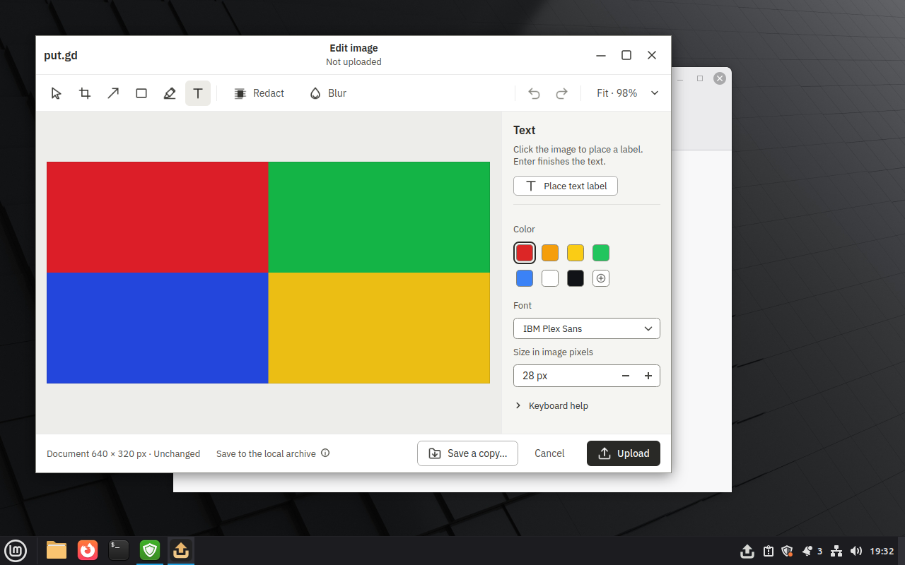
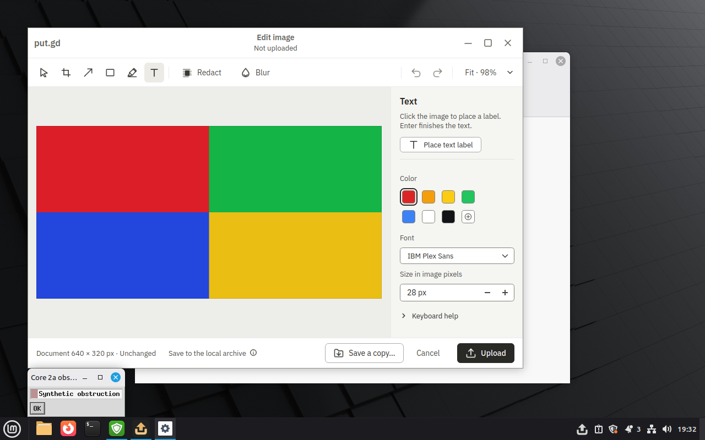
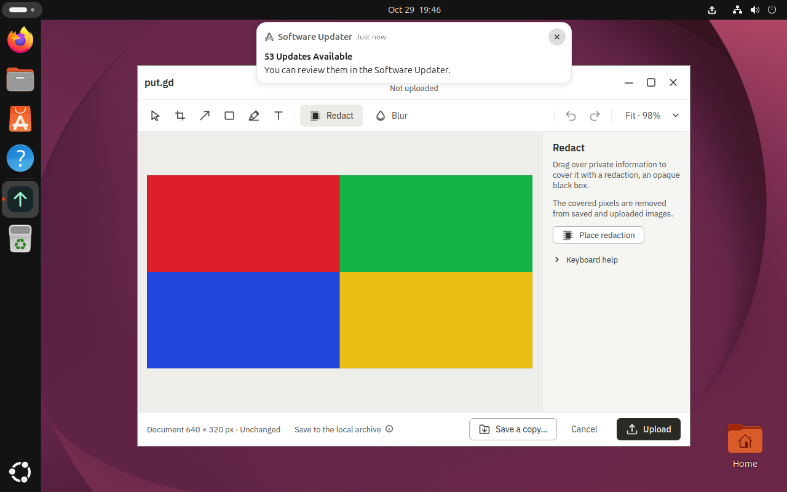
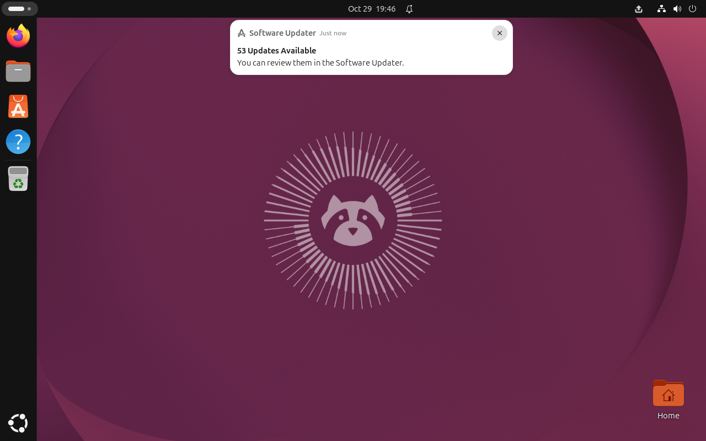

# Surface driver core 2a: partial boat acceptance

Input-foundation implementation: [PR #733](https://github.com/patrick-hudson/put.gd-desktop/pull/733).
These checks do **not** establish complete recipe or desktop acceptance. Menu and
notification gates remain open. Both desktops reached the campaign's two-attempt
limit for their failed AT-SPI paths; no third attempt was made.

## Exact identities

Both guests used synthetic four-quadrant PNGs, private XDG profiles and local-only
output. No physical desktop, Proton session, live provider or S3 was used. The
workstation performed editing, Git/GitHub work and seconds-long Python tests only.

| Guest | Placement | Application build | Driver source witness |
| --- | --- | --- | --- |
| Mint 22.3 Cinnamon/X11 | boat `bx_29s65222`, KVM; snapshot `putgd-lab-cinnamon`; run `ecc29df1-09f4-49a1-96bf-f4dd17eb67e4`; wall 6094 | clean `315b99de57089a64b194191e0adbe9b9e2bf1f72`, `26.1030.2317-dev+g315b99de5708`, distro Qt 6.4.2 | archived `driver2.tar` SHA-256 in [summary](cinnamon-summary.json) |
| Ubuntu 26.04 GNOME/Wayland | boat `bx_xyskun3a`, KVM; snapshot `putgd-lab-ubuntu-gnome`; wall 6095 | same commit, native Release build with archive provenance, distro Qt 6.10.2 and GNOME 50.1; recording helper unavailable | commit `bf2a6fe5` / archived `driver-gnome2.tar` SHA-256 in [summary](gnome-summary.json) |

The Cinnamon application was built with `cmake --preset dev`,
`cmake --build --preset dev -j2`, and the verified official SDK 1.11.907, then
packaged as a DEB. Its catalog was rendered separately offscreen; those catalog
images are reference material, not desktop proof. GNOME's bundled Ubuntu 24.04
DEB could not install on Ubuntu 26.04. Its native build reused the existing verified
SDK 1.11.907 and used `cmake --preset dev -DCMAKE_BUILD_TYPE=Release
-DBUILD_TESTING=OFF` plus the exact source commit/tree/count/time archive overrides,
then `cmake --build --preset dev -j2`. The build archive omitted only `docs/evidence/`; source commit/tree/count/time were supplied explicitly and the manifest reports `sourceProvenance: supplied` (`dirty: null`). No substitute toolchain or desktop/compositor
upgrade was used. Capacity, KVM, hydration and socket-length checks preceded runs;
GNOME's final capacity gate passed. Goldens were not booted or modified.

## Observed results

| Gate | Result |
| --- | --- |
| Fresh private Cinnamon profile, editor foreground, real Text key | Passed; resident state reported Text and the saved frame shows the editor in front. |
| Foreground stolen by a named foreign window | Passed: input was withheld with `Core 2a obstruction` in the failure. The saved foreign window is outside the canvas; overlapping-window stacking is unit-tested, not separately proved by this guest frame. |
| Accessible `name`, `role`, `text`, `states`, `rect` | Passed on both guests; original samples and live canvas geometry are in the summaries. Qt top-level `filler` nodes were accounted for. Debian Qt 6.4 Wayland remains explicitly unavailable in its profile. |
| Notification default/button input | Blocked on both desktops. Cinnamon's reported rectangle hit `put.gd`, and button correlation failed. GNOME did not expose the requested toast; its saved frame shows a pre-existing Software Updater banner. Cinnamon actions are explicitly blocked; GNOME notification action verification is marked false. No GNOME product/AT-SPI bug is established. |
| Runtime context/row menus | Blocked: zero matching live controls in Cinnamon. The resolver's positive unit cases are not desktop proof. |
| General Wayland foreground verification | Blocked until a compositor witness is configured. Resident view-state has no public focus/occlusion field. |
| Unit suites | 53 driver tests and 23 surface-map tests passed; logs below. |
| Three `core_demo` recipes on the boat guest | Not rerun after the two-attempt stop. The custom Text-key check is not the complete demo gate. |

## Reproducible parameters and retention

The custom host-side harness used production `DriverContext`, the existing
`lab.py` QMP/SSH/VNC transport and the installed/source application. Its invocation
was `PYTHONPATH=$PWD python3 accept-input.py work/lab-runs/2a-c
mint-cinnamon-x11 OUT` on Cinnamon; GNOME used `2a-g`,
`ubuntu-gnome-wayland` and `SURFACE_APP_BIN=/home/lab/2a-source/build/dev`.
The harness, exact tested driver archives, both successful and failed frames,
product identities, binary/package hashes, build logs and capacity receipts remain
in the private evidence exports. Summaries retain their verified export checksums.
No session authentication data, credentials or working share URL is published here.

Cinnamon's overlay was retired through guarded cleanup with a completion manifest
recording outcome `failed`; its receipt is retained. GNOME's noncanonical golden
path triggers the existing [#721](https://github.com/patrick-hudson/put.gd-desktop/issues/721)
guard refusal. Its guest was stopped and the refusal retained before the expressly
required whole-sandbox deletion. No base path was rewritten to bypass the guard.
Both forks, owned wall entries, tunnels and the forwarded bootstrap agent are
removed before handback; persistent named snapshots and other sessions are preserved.

The final input code also addresses seven CodeRabbit findings: stale popup state,
X11 destruction races, application scoping, update checks in the offline seed,
unsupported VNC AltGr, physical held-key cleanup and uncertain key-down delivery.
Physical held keys and VNC-only AltGr fail closed pending their backend support.
Worker 2b owns fixtures/lifecycle; worker 2c owns secret-safe frames and receipts.
These custom partial checks are not imported as completed recipe coverage.

- [Driver unit log](unit-driver.log)
- [Surface-map unit log](unit-map.log)
