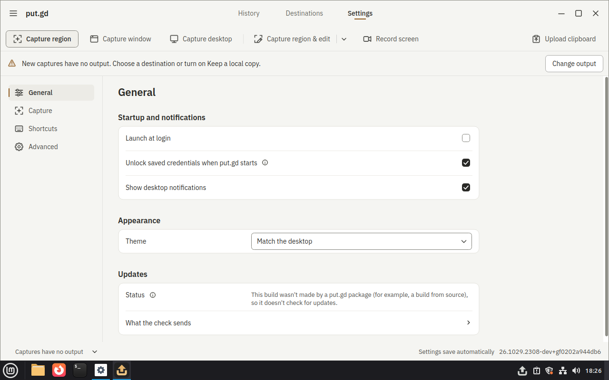

# Recording review recipe lane — blocked graphical acceptance

Code: [PR #676](https://github.com/patrick-hudson/put.gd-desktop/pull/676).
Core dependencies: [issue #672](https://github.com/patrick-hudson/put.gd-desktop/issues/672).
This records unsuccessful functional attempts. It establishes no review input,
recording motion, decoded export, desktop acceptance, A/V or performance pass.

## Identities and setup

- Placement: **boat**, named snapshot `putgd-lab-cinnamon`, disposable sandbox
  `bx_p86f7dwj`, bare-metal provider, KVM API 12, QEMU 8.2.2.
- Guest: fresh `cinnamon-x11` overlay `rv1`, run ID
  `5a4b045f-11df-4d6f-8d48-88df89a4e5c7`; Linux Mint 22.3,
  Cinnamon 6.6.4, native X11. Its unlocked desktop was visually checked.
- Golden SHA-256: `4a21566d5b741e55f349f4f07e1c687c99d1c99b5394ff0d18ed5c9e685693da`.
- Installed application source: `f0202a944db6ebd0f3522e8e374a588f10aac109`,
  `26.1029.2308-dev+gf0202a944db6`, clean Git provenance verified by the runner.
- DEB SHA-256: `c35cc096ec7d6166dd02f5bd53c4c947394ab8aa78ebcd60bdd824626d17e174`.
  Installed product binary hashes matched the package.
- Recipe source: run 1 `be5fd8e8`; run 2
  `93c74c1b5db17859b13f8e3f94f3f742cf1bdbfb`. Product source under `src/`,
  `cmake/`, `CMakeLists.txt` and `packaging/` did not differ from the installed
  application commit. The recipe and application identities are separate.
- Only an isolated local destination was requested. No S3 credentials or Proton
  session entered the sandbox. All five physical desktops were untouched.
- The guest remained on the workstation wall through loopback VNC and pinned
  SSH, tile `Review lane boat Cinnamon rv1`, local port 5988 to guest-host 5920.

The sandbox used the existing SDK and distro Qt. It needed the standard
`libxcb-xinput-dev` development package. A stale cached Proton bundle was
excluded with `PUTGD_BUNDLE_PROTON=OFF` for this local-only lane. The product,
helpers, desktop fixture and synthetic UI catalog were built with the `dev`
preset at `nice -n 10`, `-j 2`; no full C++ CTest suite was claimed. An initial
host-only storage command was rejected because `--run` is mandatory; a new
host `statvfs` receipt passed before continuing. The default build was stopped
by its exact owned Ninja PID and scoped to product/catalog targets. Failures,
corrected parameters and build logs remain in the private evidence archive.

## Results

The implementation registers exactly all **31** review-owned IDs, once each,
as checked against `ownership.json`. There are 16 recipe functions. The final
lightweight suite passed **29 tests** on the workstation and boat. The decoder
unit tests use a bounded fake decoder and are not real media evidence.

Both full shared-runner invocations selected `--recipes review`,
`--desktop mint-cinnamon-x11 --host boat --placement boat --guest cinnamon-x11`,
`--package deb --destination local`, the existing `rv1` run and the exact
application commit above. Both exited 1 and preserved before/after PNG frames
for every recipe. These frames are desktop witnesses with no catalog comparison;
execution stopped at fixture setup before recipe-level reference frames.

| Run | Result | Boundary |
| --- | --- | --- |
| 1 | 31 blocked; 0 passed | The base profile has no `recording_fixture_target`. |
| 2 | 29 failed, 2 blocked; 0 passed | A visible moving GTK pattern and a temporary `mint-cinnamon-x11.d/review.json` region target reached `recording.prepare`, which correctly refused with `output_required`. The budget-stop and decoder-fault fixtures are unknown to the core. |

The runner sets `archive.root` but does not enable `archive.keepUploads` or
configure local recording output. This is a core fixture setup gap, not an
application recording defect. No working recording was created, no real review
input ran, and no output-file assertion executed. No further graphical attempt
was made. The next fixture boundary also requires replacing the cached one-second
`SimpleNamespace` with a fresh 4+ second moving recording, matching captured
frozen control and private working/output paths. These requests are tracked in
#672; the recipes explicitly block incompatible fixtures.

[Run 1 receipts](run1-receipt.json) and [run 2 receipts](run2-receipt.json)
retain every interaction verdict, recipe identity and source/build identity.
[Evidence hash index](evidence-sha256.json) and [unit test log](unit-tests.txt).
The full PNG sets and build/preflight records remain privately at
`work/review-20261029/boat/` in the recipe worktree; the retained hash index
records their exact bytes. Representative saved witnesses are included here:

## Acceptance status

| Requirement | Evidence / status |
| --- | --- |
| Every owned ID has recipe or explicit blocked reason | Pass for registration; ownership unit test and the code PR table. Missing capabilities are blocked, not assigned a human-review verdict. |
| Real input, inspect and decoded-file assertions; referenced frames | Implemented in recipe code. **Not established live** because fixture setup stopped execution. |
| Unit tests pass | 29/29, including rejected duration/codec, frozen output, leaking mask, black source, stale saved record, named fixtures and input effects. |
| Full boat Cinnamon lane with receipts | Two full invocations retained. **Acceptance blocked**; 0 interactions passed. Saved visuals and exact identities above. |
| Desktop differences only in profile fragments | No desktop branching in recipe code; temporary region-target configuration was a profile fragment outside source. |

The shared runner core suite also passed 15 lightweight tests locally after
rebasing onto `06e380d0`. This proves contracts only. No package, compositor,
A/V, memory or native builder acceptance is implied.

## Retirement

All 115 exported evidence members matched the host SHA-256 index before
retirement. The pattern's saved QMP witness also matched its recorded digest.
The owned pattern process was stopped, the guest synced and the owned QEMU
process stopped through `lab.py reset`. Guarded overlay cleanup passed its dry
run and completed with the explicit failed-campaign completion manifest; see
[retirement receipt](overlay-cleanup.json). Only the disposable overlay was
retired. Named snapshots and immutable sources were preserved.

The workstation tunnel and only this run's wall tile were removed, and the
workstation lab-key SSH agent was stopped. The created boat sandbox was deleted
at the end of the campaign; its deletion receipt is retained with the private
archive. No sandbox from this lane remains running.
