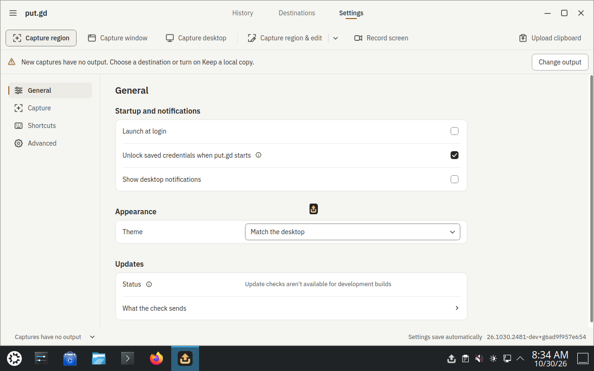
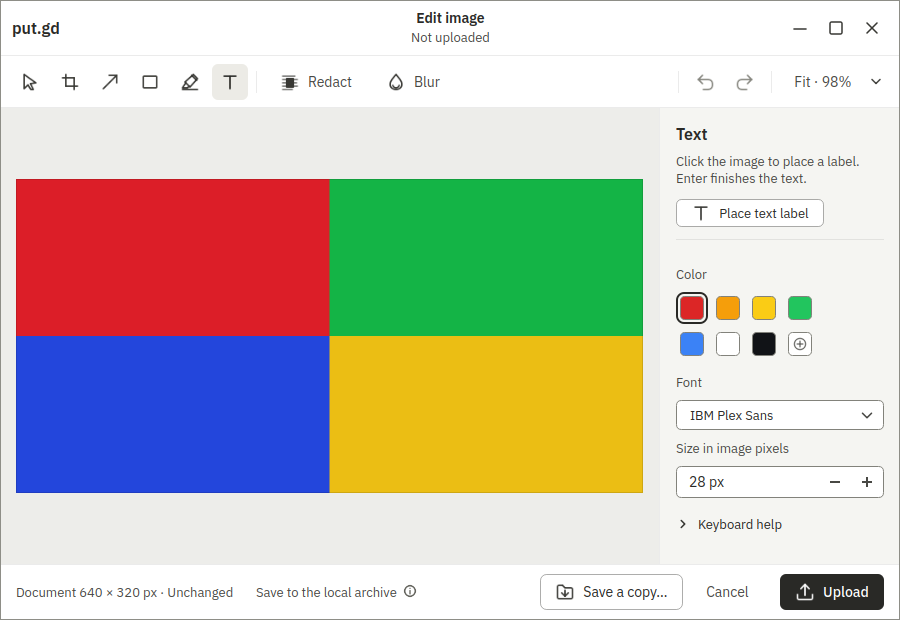
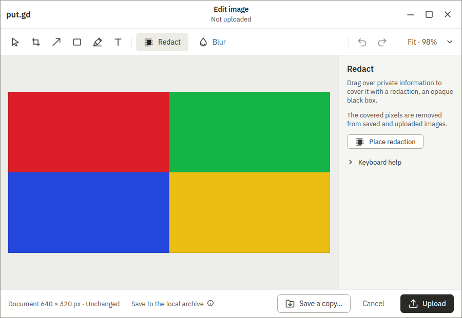
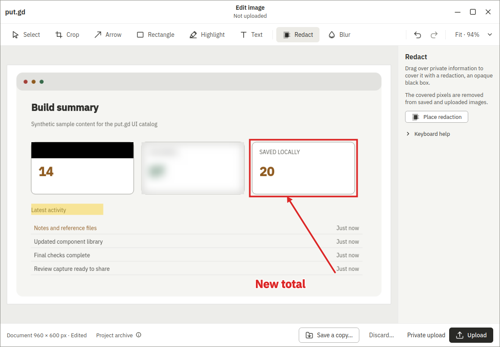

# Kubuntu KDE Boat snapshot, 2026-10-30

This is development-cache evidence for `putgd-lab-kubuntu-kde-v1`, not physical-desktop, compositor release, GPU, performance, memory or full release acceptance. The cache supports Plasma Wayland. The source golden has no installed X11 session; follow-up [#883](https://github.com/patrick-hudson/put.gd-desktop/issues/883) covers a separate X11-capable golden. No XWayland result is counted as native X11.

The source is the existing `kde-provisioned-20261016` golden, SHA-256 `49fcacff969b81ac38e36fefdf21407d20c82187e1725c58f128a3b76065a81c`. Its original f44 copy is `transfer-459d0181e995`. A read-only f44 hash matched the inventory. Patrick then refreshed workstation AWS authentication, and the coordinator directed S3 before the queued f44 stream began. No golden bytes were copied from f44.

The S3 object `linux/kde-provisioned-20261016/kde-provisioned-20261016.qcow2.zst` was read once using a 900-second presign and a mode-0600 curl config, never a URL argument. Eight curl workers fetched 24 disjoint ranges. The compressed SHA-256 matched `348b772303bd51af7d7aa811a31b3fcadd53932ed6ee2f098ca4fd4b3c7bfbde`; decompression matched the golden hash and `qemu-img check` passed. The config was removed after GETs, and redundant transfer chunks/archive were retired after checks. No AWS credentials went to Boat, and there were no S3 writes.

The first worker, `bx_e53gcugq` from GNOME v4, was retired before any transfer or VM launch: hydration left only 24,861,048,832 available bytes, insufficient for the KDE source, sealed copy and 10 GiB reserve. Its audited Ubuntu 26.04 package was exported and checksum-verified, then the worker was deleted. The replacement `bx_t6yqdzj3` came from `putgd-build-base-v3`, with 83 GiB free after hydration. Every worker had a 14,400-second TTL, bare-metal placement, authenticated SSH host pin and KVM check. Peak concurrency was two; total starts are recorded in the deletion audit.

The host's unchanged clean built source and inherited host-test ledger are `6ad9f957e6544f30c5e45c08af2306db77a9ff64`. The matching native Ubuntu 26.04 DEB is SHA-256 `969c6899a1297b056ef45b2eb3c69150af7fbd554db8fcde5959172dc8a998cd`, with audited version `26.1030.2481-dev+g6ad9f957e654`. Preparation reused those unchanged artifacts. The fresh fork then ran the inherited host configure/incremental build script and full CTest once: 114/114 passed in 160.35 seconds, no retries ([ledger](host-tests.json)). The local lightweight suites passed: lab 66, snapshot 37, candidate 48.

The exact driver/controller is `origin/feat/surface-driver-core` at `dd24a3e30c7b7a11e46d7f805373383b08902115`. Guest bootstrap used the workstation-only lab key through an isolated forwarded agent, with the existing f44 KDE guest host pin remapped to 22220. The repository manifest binds the public key and pin hashes. No private workstation key was copied into a worker or guest.

Provisioning used only a fresh overlay, production `lab.py launch`/preflight/install/start/reset/cleanup, and the snapshot recipe. The guest reported Ubuntu/Kubuntu 26.04 (`resolute`) and distro Qt 6.10.2. Probe dependencies match the pinned `provision-probes.sh` contract plus the existing snapshot recipe's Tesseract package; this adds no application OCR feature. Plasma's production preflight applied and read back lock, idle, display and suspend policy. Discover's already-running owned notifier was stopped by exact PID/start identity, and the supported lab-user autostart override disables it on future logins. The lab user's KWallet config disables wallet use and first-use prompts. Fresh verification reads these policies without writing or killing processes.

`/usr/share/wayland-sessions` contains `plasma.desktop`; `/usr/share/xsessions` contains no `.desktop` files. No compositor, portal or desktop packages were installed to add X11. The source's cloud credential paths and small product-state files had no credential matches or Proton session files; no Proton lend or sign-in occurred. Values were never logged.

The KDE compositor witness is not installed in the golden. The driver loads its existing one-shot read-only KWin script per observation in the fresh overlay. Canonical images live under `/home/user/work/put.gd/work/lab-images/`; run directories are short direct children of `/home/user/kde-driver/work/lab-runs/`. Socket lengths are checked before launches, including the fixed-length surface-driver runtime path. Loopback VNC 5920 is forwarded to a dedicated workstation wall tile during every graphical run. Saved console, desktop and app frames supplement exact host/run/build receipts.

Published snapshot: `putgd-lab-kubuntu-kde-v1`, ID `06aeb588-fae4-4b84-bfc6-b13ab955c361`, source worker `bx_t6yqdzj3`. Final golden: `/home/user/work/put.gd/work/lab-images/kde-wayland-probes-v1-no-updates/image.qcow2`, SHA-256 `78a96764e919ec740b61c5abd9615a7500730efd3c8d4c4233fa5c6697554070`. Embedded preparation manifest SHA-256: `81187b93fdf06c8a00e5b842c091f66df547b288c3015f40a1667947c6fed06d`. Fresh verification is on `bx_3gf9zr9k`.

## Automatic-update steering and preserved failure

Before publication, the coordinator added #885's requirement: disable automatic apt/unattended/Discover updates so OpenSSH cannot be replaced mid-lane. The first successfully sealed image (`f046a194e71d3e7f18bdfb264c2f1648b9c217b1a0c55ec79773b4dcc122fd64`) remains immutable and was never published. The final image comes from a new overlay of that image; all original builder/S3 objects remain untouched.

The first update-policy attempt (`kp2`) was refused: masking loaded timers left them in `ActiveState=failed`. No permissive check was substituted. The recipe now clears failure state only for the named update units, and the fresh `kp3` attempt passed before and after app startup. The failed attempt, its preflight frames, script identity and guarded retirement remain in the evidence.

The final guest has persistent masks and inactive readbacks for `apt-daily.timer`, `apt-daily-upgrade.timer`, `apt-daily.service`, `apt-daily-upgrade.service`, and `unattended-upgrades.service`. Root-owned `/etc/apt/apt.conf.d/zz-putgd-lab-no-auto-upgrades` sets `APT::Periodic::Enable`, `Update-Package-Lists`, `Unattended-Upgrade`, and `Download-Upgradeable-Packages` to `0`, verified through `apt-config`.

Provisioning uses the production lab's existing no-sources apt pre-invoke path and adds no sudo rule or privileged helper. The lab user's `PlasmaDiscoverUpdates` has `Global/UseUnattendedUpdates=false`, read back through `kreadconfig6`. Discover's notifier autostart override remains disabled. Fresh-fork checks are read-only and reject policy drift.

## Fresh-fork proof and limits

[Summary](verification-summary.json), [identity](fresh/identity.json), and the
[original driver receipt](fresh/receipt.json) bind this native Wayland run to
`bx_3gf9zr9k`, run `40af54e3-3230-44cd-9a76-3a5c645cd2c1`, exact application
`6ad9f957e6544f30c5e45c08af2306db77a9ff64` and controller
`dd24a3e30c7b7a11e46d7f805373383b08902115`. This is the required development
lane proof, not current-nightly application acceptance.

| Proof | Result | Evidence |
| --- | --- | --- |
| Native Plasma Wayland preflight | Passed, active/unlocked KDE, Qt platform Wayland | [before](fresh/preflight-before.json), [after](fresh/preflight-after.json) |
| Matching DEB installation and startup | Passed, clean expected build | [install](fresh/install.json), [version](fresh/installed-version.json), screenshot below |
| `core_demo` | 3 recipes, 4 interactions passed, 0 blocked/failed | [command](fresh/recipe-command.json), [receipt](fresh/receipt.json), [coverage](fresh/coverage.json) |
| Per-overlay KWin witness | Existing read-only witness supplied live geometry/focus required by input guards | Receipt and native frames below |
| Update policy | Five units masked/inactive and four effective periodic values zero, before/after | [before](fresh/automatic-updates.json), [after](fresh/automatic-updates-after.json), [Discover/KWallet](fresh/policy.json) |
| System package stability | Selected apt/OpenSSH/Plasma package versions byte-identical before/after | [before](fresh/desktop-packages.log), [after](fresh/system-packages-after.log) |
| Socket lengths | Checked before launch and actual runtime | [planned](fresh/socket-preflight.json), [actual](fresh/app-socket.json) |
| Held overlay | Refused with held device/inode; disk preserved | [refusal](fresh/held-overlay-refusal.json) |
| Guarded cleanup | Completed after holder release | [preview](fresh/cleanup-preview.json), [retirement](fresh/cleanup.json) |
| Immutable golden | Final hash unchanged after cleanup | [result](fresh/result.json), [identity](fresh/identity.json) |
| Sanitization | No known cloud credentials or Proton session files; no private host-run keys retained | [audit](credential-audit.json), [prepublication](prepublication-sanitization-final.json), [fresh](fresh-sanitization.json) |
| Worker deletion | All 3 owned workers absent; peak 2; wall tunnels/tiles and isolated agent retired | [audit](deletion-audit.json) |
| X11 | Not available in original golden; no XWayland substitution | [#883](https://github.com/patrick-hudson/put.gd-desktop/issues/883) |

The four interactions are `editor.tool-text`, `editor.tool-redact`,
`editor.undo` and `editor.redo`. The redact row retains its visual review flag:
distance `0.21311013423290465`, tolerance `0.025`. Manual comparison shows the
live four-color 640×320 fixture in a 900×620 editor, versus the synthetic
960×600 annotated reference in a 1180×820 editor. Selection/guidance are visible;
there is no clipping. This is a functional pass with a fixture/reference
alignment follow-up, **not an exact pixel-baseline pass**. No tolerance changed.
See [review](fresh/visual-review.json) and
[#889](https://github.com/patrick-hudson/put.gd-desktop/issues/889).

### Saved native visuals

These are unchanged QMP captures from the actual Wayland guest. Settings was
losslessly converted from retained PPM to PNG with identical RGB pixels. No app
UI implementation changed in this task.

The following is a synthetic offscreen reference, not desktop proof:

### Failed setup and corrected reproduction

The first fresh overlay (`kw1`) passed native preflight, install, startup and
policy checks, then stopped before running any recipe: the copied Noble
**test catalog helper** exited 127 because its FFmpeg 6 SONAMEs are absent on
26.04. Its temporary stderr did not survive a diagnostic reboot. The host
[failure](failures/catalog-failure.json), original native frame below, run
metadata and [review](failures/catalog-review.json) are retained. The corrected
run reproduced the exact linkage error and saved it directly to the host
([diagnostic](fresh/foreign-helper-diagnostic.json)). No guest libraries changed.
The failed overlay was [guardedly retired](failures/catalog-cleanup.json).

The corrected overlay (`kw2`) used a matching-source synthetic catalog rendered
on its Ubuntu 24.04 host with distro Qt 6.4.2/light theme. Its controls/reference
are input to existing live guards; all desktop proof comes from the Wayland
process and real QMP input. [Catalog identity](fresh/catalog-source.json) records
the source and manifest hash. This cross-distro reference explains the retained
visual flag; it is not claimed as a native 26.04 pixel baseline.

The exact successful [proof script](scripts/proof.py),
[host catalog command](scripts/render-host-catalog.sh) and
[host validation command](scripts/fresh-host.sh) are preserved here. The recipe
script baked into the snapshot is `/home/user/kde_recipe.py`, SHA-256
`3633ac5dcc1a99015e7ac96a8bd2d872709a9d27ab631ee6e973e98bb6d695e7`.
The snapshot predates the corrected proof helper, so copy this reviewed proof
script into a new fork as `/home/user/kde-proof-fresh.py`, run the host catalog
command once, then invoke the proof with the new `--boat-id`. Forward only the
existing lab key through an isolated agent, verify hydration/KVM/host pins,
reserve the loopback display tile, and use new short output/run directories.
The recorded directories already contain immutable evidence; never overwrite
them. The original preparation manifest is [retained](preparation-manifest.json).

The earlier update-policy refusal (`kp2`) and its saved native frame/logs remain
in the private archive, with [review](failures/update-review.json) and
[retirement](failures/update-cleanup.json) committed here. Corrected `kp3`
passed before publication. Every failed disk was retired only after review and
receipt export.

### Private retention

Verified archives reside in the campaign's private `kde-snapshot-612b4ad1`
directory outside release exports; [restore index](private-restore-index.json)
records hashes, sizes and safe restoration. Parent archive contains 145 indexed
files; fresh archive contains 252. Both archives and each indexed file were
verified before worker deletion. Raw PPMs, full logs, manifests, failed contexts,
all recipe frames and cleanup receipts remain available. Private keys, disks and
credential values are excluded. The committed [file index](file-index.json)
binds this selected review packet. Companion implementation:
[PR #890](https://github.com/patrick-hudson/put.gd-desktop/pull/890).
