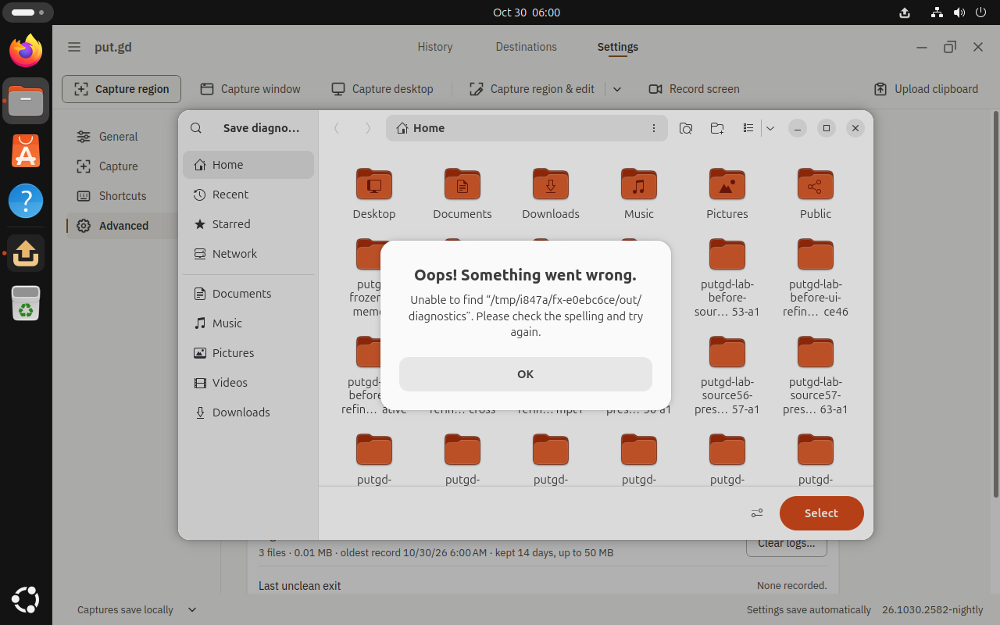
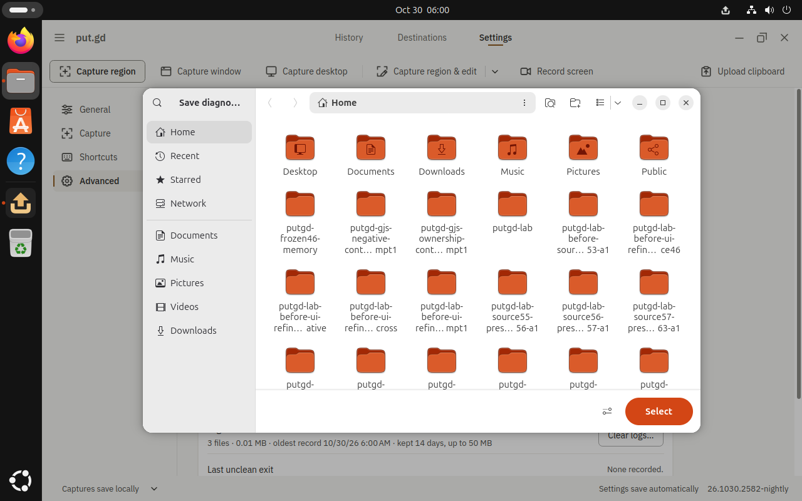
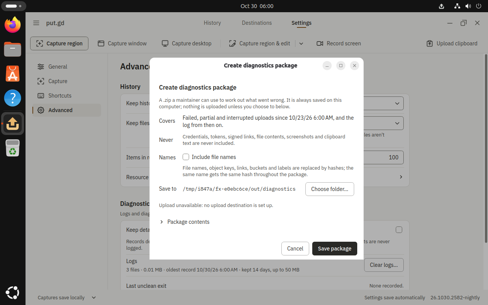
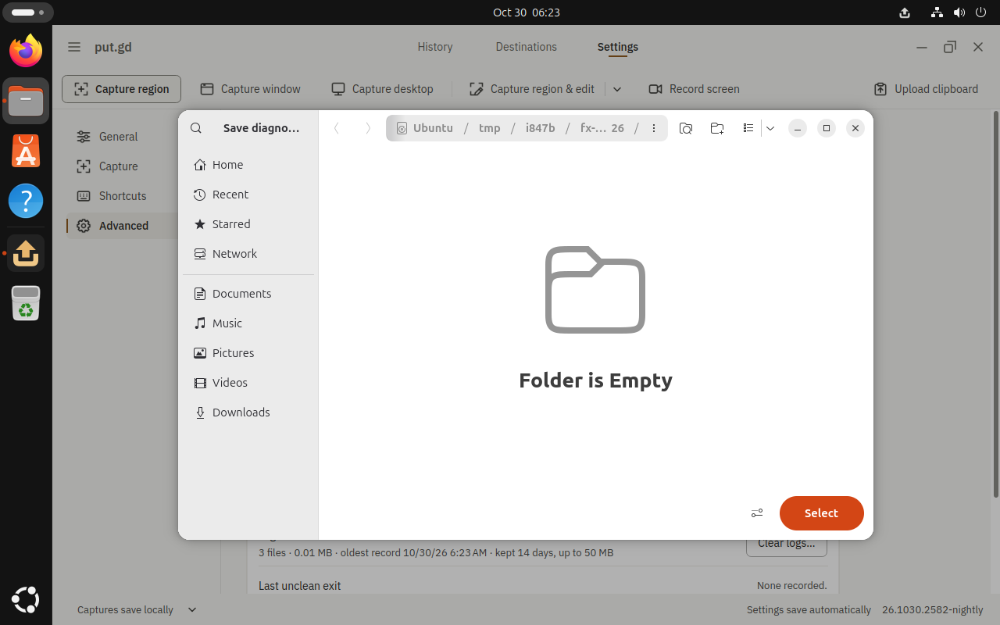
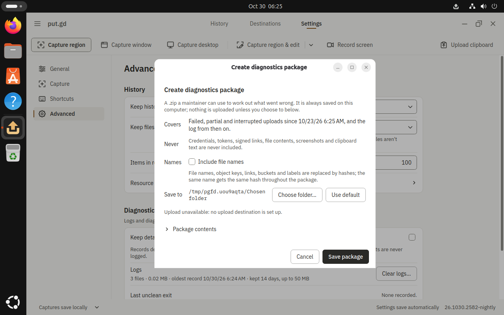

# Diagnostics folder Escape (#847)

The defect was a surface-driver fixture precondition, category **(a)** in
[#847](https://github.com/patrick-hudson/put.gd-desktop/issues/847).
Nautilus's inner missing-folder alert consumed the first Escape. The compositor
focus witness was truthful; the portal did not lose a cancellation response, and
put.gd handled Response 1 correctly. The fixture correction is
[#864](https://github.com/patrick-hudson/put.gd-desktop/pull/864), head
`6708c65c597026133820624e81e75cb22cc19df3`. No app, portal, recipe, focus guard or
cancellation deadline changed.

## Exact identities

| Item | Tested identity |
| --- | --- |
| Placement | Boat `bx_n3uk8bvu`, `large`, bare metal, 8 host vCPU / 16 GiB; functional development evidence, not physical release acceptance |
| Snapshot / immutable golden | `putgd-lab-ubuntu-gnome-v4`; `gnome-wayland-probes-v4/image.qcow2`, SHA256 `8666b7dd8b98932e2fa794ec7bb4ccf0e82a8195e97a8580997ad70ed593a6c4` |
| Fresh overlay | `cac969c6-b780-4d9e-8182-49be623fa6a6`, `/home/user/i847/work/lab-runs/g1`; KVM, 2 vCPU / 6144 MiB, one 1280×800 output |
| Desktop | Ubuntu 26.04, GNOME Shell `50.1-0ubuntu1.2`, native Wayland; Nautilus `1:50.2.2-0ubuntu0.1`; xdg-desktop-portal `1.21.1+ds-1ubuntu3.1`, portal-gnome `50.0-0ubuntu1` |
| Extensions | Installed put.gd v15 and overlay-only lab witness v2, both ACTIVE; native desktop visibly unlocked before each phase |
| App | Clean CI run `41029113472`, Ubuntu 26.04 DEB, `26.1030.2582-nightly`; commit `88928c0b59f3938098067e88913bc077b1e46d89`, tree `59017513d373a0053268a5c13dc020ec6a53eecc`, dirty=false |
| Package SHA256 | `1ba588003d2576a6e80a389f5fbef3f7e6f7447f52811e31c8364c4af080b015`; published checksum and installed/running binary hashes verified |
| Baseline controller | Core `97d335ec9f2bb6a9fb74fb81f3bf121ddb082760` plus dialogs `8702e57b63c18119aaf31e1b55b22605615626b7`, merged locally only; export tree `d25b8afd70138d7fa96b9048d861d40a19bbceef` |
| Fixed controller | Same export plus only #864's fixture/test patch; same app package and guest overlay, with a native guest reboot between phases |
| Display / inputs | Loopback VM VNC `5920`, workstation wall tunnel `6067` (“Issue 847 GNOME live”); real QMP key-down/up input and compositor foreground guards |
| Sockets / capacity | Private `/tmp/i847a` and `/tmp/i847b` families; session socket paths 37 UTF-8 bytes; QMP and generated driver paths also preflighted below 107 bytes; host/guest capacity receipts retained |

The package simulation upgraded only put.gd. No compositor, portal or desktop
packages were upgraded. The workstation did no builds, VM hosting or GUI driving;
it held the SSH key, tunneled the display, viewed saved visuals and edited source.
No credentials, S3 destination, provider session or user objects were used.

## Before: Escape dismisses the alert

The core fixture created its output root, but not the default diagnostics child.
`OpenFile(directory=true)` passed absent
`/tmp/i847a/fx-e0ebc6ce/out/diagnostics`. AT-SPI reported an alert named
“Oops! Something went wrong.” and its **OK** button focused. Mutter reported
Nautilus PID 6266 / window `2529608899` focused both before and after the first
Escape. The alert is inside that same top-level window.



After one native Escape, the alert is gone but the chooser remains. Over 10 s of
resident polling stays `open=true, backend=portal, last=null`; no matching
Response or Close occurs.



The original request remains valid. A second Escape cancels it:

```text
1793358030.456225  putgd-ui :1.130 → frontend       FileChooser.OpenFile, serial 24
1793358030.460608  frontend :1.70 → GNOME :1.74     impl.FileChooser.OpenFile, serial 290
1793358030.460630  frontend → putgd-ui              accepted …/request/1_130/putgd7ac0468d5c2947a3
1793358030.460632  GNOME :1.74 → Nautilus            impl.FileChooser.OpenFile, serial 174
first Escape     alert dismissed; >10 s pending; no matching Response/Close
1793358057.487025  Nautilus :1.134 → GNOME           reply_serial 174, uint32 1
1793358057.487108  GNOME → frontend                 reply_serial 290, uint32 1
1793358057.489490  frontend → putgd-ui              Request.Response 1, original handle
```

Put.gd then reports cancelled on portal, with no path, fallback or error. Its
diagnostics folder, full accepted settings and operation list are unchanged.
There are no Request.Close calls in the direct baseline trace.



## After: one Escape cancels

The fixture creates the empty private diagnostics folder before asking for the
chooser. The native chooser is drawn in that existing directory with no alert:



One native Escape cancels on the original handle:

```text
1793359412.577661  putgd-ui :1.127 → frontend  OpenFile(directory=true), serial 24
1793359412.580569  frontend → putgd-ui         accepted …/request/1_127/putgd02c5b19ea42c4bf1
1793359420.247225  frontend → putgd-ui         Request.Response 1, same handle
```

The first poll reports `open=false`, `last.status=cancelled`,
`last.backend=portal`, and null path/fallback/error. The diagnostics folder,
accepted settings and operation list are unchanged. No second Escape is sent.


Edit-image and output-folder controls cancel on one native Escape and Response 1
on this guest, both before and after. All direct trace monitors were stopped by
verified PID/start identity: before PID 3530, after PID 3283. The full lane has
separate monitor identities and exit receipts.

## Recipe and unit results

The actual unchanged `dialogs.diagnostics_folder_portal` recipe:

| Controller | Result |
| --- | --- |
| Before | Failed at the condition-based `chooser cancelled` wait; saved native alert/chooser frames |
| After | Passed end to end: real Escape/no consumer change, reopen, native exact-path acceptance and diagnostics consumer update |

The new fixture regression fails on the base because its diagnostics start
directory is absent. After patching the controller, **55 fixture tests pass**
(9.594 s), including private/empty directory, owned removal and settings
restoration; **25 dialog-recipe tests pass**. No wait or assertion was weakened.

## Full GNOME dialogs replay (22 rows per phase)

| Phase | Passed | Failed | Blocked |
| --- | ---: | ---: | ---: |
| Before | 2 | 3 | 17 |
| After | 2 | 2 | 18 |

These are **raw** driver verdicts; no failure or blocked row is counted as a
pass. The full-run Diagnostics row blocks on #805 before Escape in both phases.
The focused row above supplies the completed fail-to-pass cancellation proof;
the full lane is not acceptance-complete.

| Recipe (dialogs.) | Before raw | After raw | Remaining limitation |
| --- | --- | --- | --- |
| edit_image_portal | passed | passed | Passed both phases |
| edit_image_fallback | blocked | blocked | #842 — Fallback accessible proxy has no matching Mutter placement |
| history_save_as_portal | passed | passed | Passed both phases |
| history_save_as_fallback | blocked | blocked | #842 — Fallback accessible proxy has no matching Mutter placement |
| output_folder_portal | failed | blocked | #805 — Before: Desktop Icons 1 takes foreground; after: observation timeout |
| output_folder_fallback | blocked | blocked | #805 — Fresh accessibility probe timeout |
| diagnostics_folder_portal | blocked | blocked | #805 — Fresh accessibility probe timeout |
| diagnostics_folder_fallback | blocked | blocked | #805 — Fresh accessibility probe timeout |
| editor_save_copy_portal | blocked | blocked | #805 — Fresh accessibility probe timeout |
| editor_save_copy_fallback | blocked | blocked | #805 — Fresh accessibility probe timeout |
| review_save_copy_portal | failed | failed | #672 — Moving-pattern fixture times out before chooser |
| review_save_copy_fallback | failed | failed | #672 — Moving-pattern fixture times out before chooser |
| portal_portal | blocked | blocked | #805 — Fresh accessibility probe timeout |
| portal_fallback | blocked | blocked | #671 — Backend mismatch or unavailable deterministic failure fixture |
| fallback_portal | blocked | blocked | #671 — Backend mismatch or unavailable deterministic failure fixture |
| fallback_fallback | blocked | blocked | #805 — Fresh accessibility probe timeout |
| cancel_portal | blocked | blocked | #805 — Fresh accessibility probe timeout |
| cancel_fallback | blocked | blocked | #805 — Fresh accessibility probe timeout |
| failure_strip_portal | blocked | blocked | #671 — Backend mismatch or unavailable deterministic failure fixture |
| failure_strip_fallback | blocked | blocked | #671 — Backend mismatch or unavailable deterministic failure fixture |
| mcp_file_dialogs_portal | blocked | blocked | #672 — Official MCP client/helper not provisioned |
| mcp_file_dialogs_fallback | blocked | blocked | #672 — Official MCP client/helper not provisioned |

The baseline output-folder row was refused when Desktop Icons 1 took foreground;
later observation queries timed out. The after output-folder row blocks on the
observation timeout. The two review rows time out in the synthetic moving-pattern
fixture before a chooser is opened. MCP rows have no provisioned official
client/helper. Backend mismatch and failure-injection variants retain their
existing #671 blocks. These limitations predate the fixture correction.

The unchanged controller predates the separate #841 observation fix for #805;
that fix was not added to either phase. The same app and controller
baseline were used to isolate #864. No further desktop workaround or replay was
attempted after these paired runs.

Raw receipts: [before](lane-before.json), [after](lane-after.json),
[focused before](focused-before.json), [focused after](focused-after.json).
[Results and image/receipt checksums](results.json) keep raw verdicts separate
from the issue mapping above. The images are saved native output, not mocks.

The passing focused recipe's final consumer state is also retained:




## Failure context and retention

The first focused baseline startup stopped before opening a chooser, with a
transport error; the owned resident answered capabilities later. Its failed
receipt/frame and verified recovery cleanup are retained under
[#873](https://github.com/patrick-hudson/put.gd-desktop/issues/873). A fresh retry
reached the chooser and reproduced #847. This setup failure is separate from
the completed focused and full-lane runs.

The earlier session's unused sandbox was removed by the coordinator after the
Boat HTTP 525 outage (#865). This resumed campaign used one new sandbox. No
golden was booted or modified; tests used the independent overlay. Capacity,
identity, package, trace, raw receipt, screenshots, exact commands and checksums
remain in the private verified evidence export.

The verified private archive is
`/home/patrick/.t3/worktrees/put.gd/t3-789e7726/work/847/issue847-live-evidence.tar.gz`
(156,402,665 bytes; 599 members), SHA256
`6182ff1ee4dc6360d9ca7e6d65ccf857e399872647c5e2c587e6245f0ee9f064`.
Every member was checked against its SHA256 on the source host, then the
workstation copy matched the archive hash and size. The archive includes the
restore index, source/parameter records, raw traces, receipts and PPM/PNG frames;
it excludes VM disks and private SSH identities. Extract into a new private
directory and verify `evidence/cleanup-manifest.json` before using restored files.

The completion manifest retains `outcome=failed` for the full-lane failures;
it does not turn those rows into passes. Its SHA256 is
`7a632ad52129d9a040d857a7ac0c0849a1837442a2ca1b5709fcc3bc46ddc710`.
After verified export, guarded cleanup with the explicit golden-images root
passed its dry-run and retired only this stopped overlay at 11:44:45Z. The
[durable receipt](overlay-cleanup.json) has SHA256
`deb05f29a73141967658ec394fcfbb254b8dc8d39a046b016064299629a98c5e`.
The overlay is absent, the immutable source was preserved, and no QEMU remained.

The bootstrap agent was stopped after bootstrap. Only this run's wall entry and
SSH tunnel were removed, preserving the other current entries. Boat deletion
operation `bdop_e30c453b46084bdc8eaaf950e1943079` completed at
2026-10-30 11:47:14.736Z; a subsequent `boat info` returned 404. No sandbox created
by this resumed run remains. [Retention and deletion metadata](retention.json)
records the exact identities and hashes. No issue was closed by this worker.
