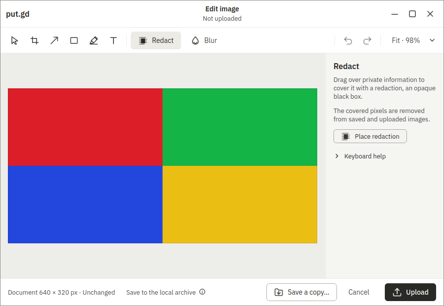
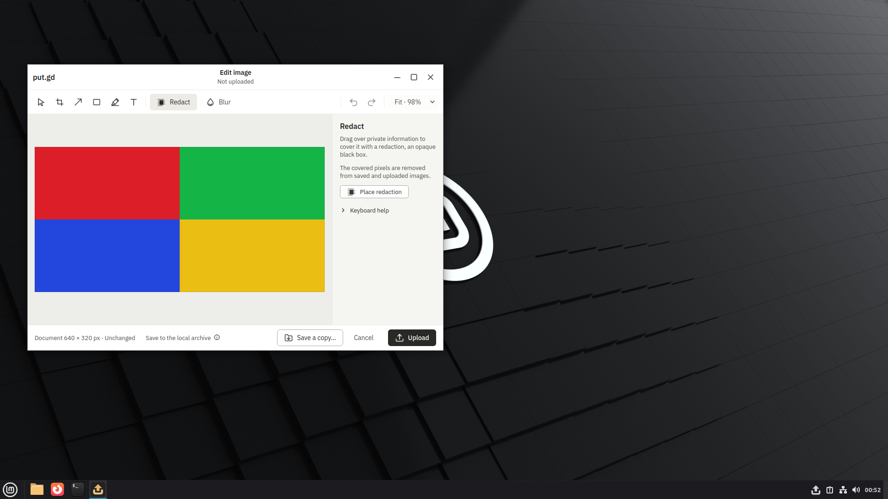

# Editor Ctrl+1 after the Zoom menu — Boat development reproduction

Tracked by [#806](https://github.com/patrick-hudson/put.gd-desktop/issues/806), with implementation replay in [#677](https://github.com/patrick-hudson/put.gd-desktop/pull/677).

This is a synthetic development bug reproduction, not native hardware or release acceptance. On an unobstructed Cinnamon/X11 editor, click Zoom, press Escape, verify native foreground focus, then press Ctrl+1. The editor remains fitted at 98%; a ten-second actual-size readback wait fails. Sending Select (`V`) before Ctrl+1 passed in an earlier run and would mask this case.

App: clean `e003bc7983e0a567611121cda65fc1670395bebf`, `26.1030.2461-dev+ge003bc7983e0`. DEB SHA-256: `af961793cb4aab248820eb9a5230c7c4250abf46c062e6ec3c2da21e48512f60`. Recipe: `40d659207e3ef77e886cf88ea0f91aafb16717d5`; core: `7bc0ed71f1b907232509fba1e6248be14fcd783b`. Boat sandbox `bx_wj5ckzft`, guest run `0ed53e7d-23ea-4c4f-a194-72127dfde611`, Mint 22.3 Cinnamon/X11 at 1920×1080. Mint Update Manager was stopped by its exact PID. No cloud destination or credentials were used.

The images are original saved frames. `receipt.json` contains the original run environment and unmodified `editor.zoom` row extracted from the full raw receipt. The complete raw run, source inputs and cleanup evidence remain in the lane's private evidence packet.

Before menu input:

Zoom menu, before Escape/Ctrl+1:

After the actual-size wait failed, before cleanup:

