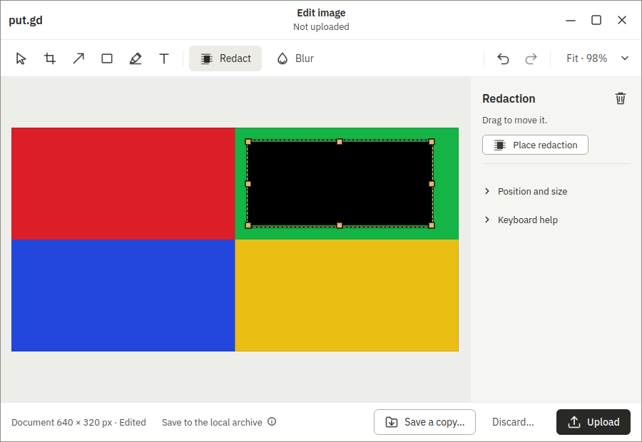

# Editor surface recipes, round 4

This is Boat development evidence from disposable native desktop guests. It does not establish physical desktop, performance, memory or release acceptance.

The runtime recipe source is `017c1717fd10994c8333067702501cac08ee4e45`, on core `86d1bb2591001835b70067bbe8a21ae31166235a`. The implementation uses the actual Place button and selected shape ID, preventing the Insert/canvas-focus assumption exposed after #810. Save-copy adopts the existing file-dialog fallback fixture and input helpers; maximize/restore and discard confirmation use live owned controls. The independent export oracle reuses `editor_pixels.redactions_black` on the saved PNG decoded by Pillow. CLI/MCP operations retain the shared acceptance driver's contracts.

All three guests use the matched artifacts from [Actions run 41061083477](https://github.com/patrick-hudson/put.gd-desktop/actions/runs/41061083477), PR #726 head `5b2a5fb18eea60cbb8124bc8a9a2f85ced0ab16f`. Both installed app and CLI report the compiled merge identity `8d06f9947ea05ed183ca2c0689785cbcd0c10c9e`, clean, version `26.1030.3075-dev+g8d06f9947ea0`. The catalog is from the same build. Each downloaded ZIP matches GitHub's artifact digest; each DEB matches `native-audit.json/package/sha256`. There is no SHA256SUMS in these artifacts. See package-provenance.json and the installed CLI logs.

The ubuntu24.04 DEB is used on Mint 22.3/Cinnamon v3. Ubuntu26.04 is used on Kubuntu KDE Wayland v1 and Ubuntu GNOME Wayland v4. Each has a fresh overlay, verified 1920×1080 output, private resident directories and socket paths under 107 UTF-8 bytes, real QMP input, saved native frames and a visible VNC wall tile. The GNOME witness is staged/authenticated per overlay; product and witness extensions report ACTIVE.

The initial KDE attempt used published nightly 3d23ddf3 whose CLI lacks --params-stdin, so all 51 rows were blocked before recipe input (#896). Its receipt and frames remain separate. A fresh overlay was used after the CI pair became available; native CLI capability readiness was proven before consuming the final full run. No packages were built by this lane.

GNOME's unattended-upgrades process briefly held the dpkg frontend lock (#885). Both failed staging results were retained and their exact jobs recovered; the process was allowed to finish naturally. No unrelated PID was killed. The corrected setup succeeded with the same CI package.

Functional verdicts and visual review are separate: catalog mismatch flags remain in the receipts. Frames from synthetic guest content support development replay; they do not assert pixel-identical catalog or physical compositor acceptance. Every failure and partial attempt is preserved in private checksum-verified archives. The replacement coverage retains round-3 GNOME rows in addition to current round-4 rows.

## Saved native frames

Each unaltered frame shows the synthetic image and the real mouse-drawn redaction. The guard metadata in the final receipts records visible pixels and `ocr-checked`; visual catalog differences remain flagged for review.

| Cinnamon X11 | GNOME Wayland | KDE Wayland |
| --- | --- | --- |
|  |  |  |

Final all-51 receipts, classifications and cleanup records will be added after the foreground campaign completes. Related code: #893.
