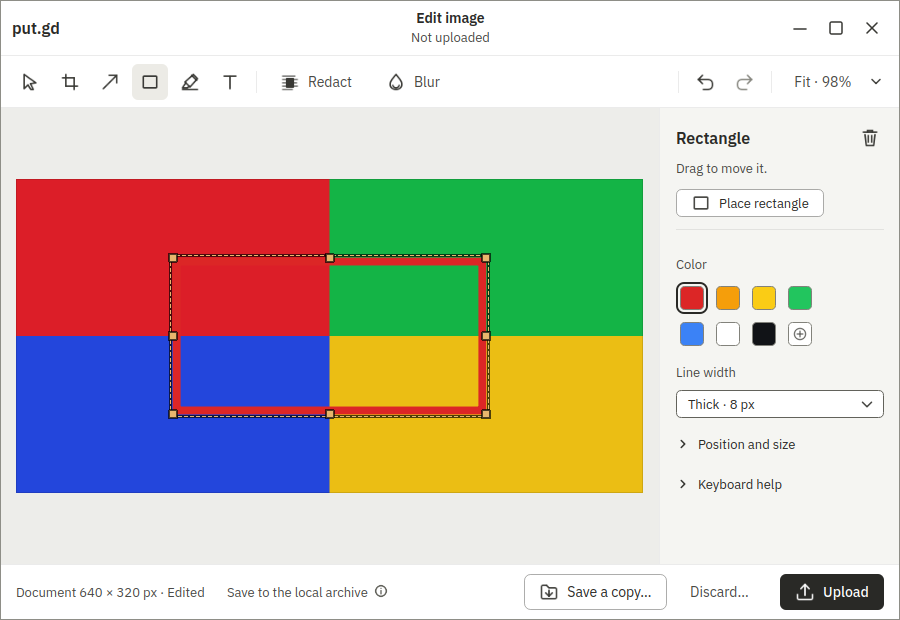

# Editor surface recipes, round 4

This is **Boat development evidence**, not physical desktop or release acceptance. Current classified coverage has 153 round-4 rows, plus 51 preserved historical GNOME round-3 rows. Raw receipts and invalid attempts remain separate; no evidence-audit failure is promoted to a pass.

| Desktop | R3 passed / failed / blocked | R4 passed / failed / blocked |
| --- | --- | --- |
| Mint Cinnamon X11 |39 /1 /11|44 /0 /7|
| Ubuntu GNOME Wayland |22 /0 /29|44 /1 /6|
| Kubuntu KDE Wayland |new|5 /0 /46|

[Classified receipt index](classified-summary.json) records the exact source and raw verdict for every selected run. The coverage committed with code PR #893 contains204 rows. Native app source is clean `8d06f9947ea05ed183ca2c0689785cbcd0c10c9e`, version `26.1030.3075-dev+g8d06f9947ea0`. The app, CLI and catalog all come from [CI 41061083477](https://github.com/patrick-hudson/put.gd-desktop/actions/runs/41061083477), PR #726 head 5b2a5fb1 built on merge with core. These are distinct PR-head and compiled identities. All three artifact ZIPs match GitHub's digests; both DEBs match `native-audit.json/package/sha256`. [Package provenance](package-provenance.json), [installed identities](installed-identities.json), [ZIP/DEB cross-check](ci-zip-deb-crosscheck.json), [catalog identity](catalog-identity.json).

The ubuntu24.04 package runs on Cinnamon v3; ubuntu26.04 runs on KDE v1 and GNOME v4. Each has a fresh immutable-base overlay, verified 1920×1080 native session, real QMP input and visible VNC wall tile. GNOME's witness is staged per overlay; product and witness report ACTIVE. Host evidence dependencies were staged without changing core guard code. Socket paths are checked against 107 UTF-8 bytes before isolated starts. No workstation build, physical desktop, app build or core-source edit was used.

The recipe fixes use the actual Place button and selected mark ID, avoiding the Insert/canvas-focus assumption exposed after #810. Save-copy adopts the existing fallback chooser fixture and dialogs input helpers. Discard input waits for the owned mapped confirmation. Destination input accepts both native button roles. Line-width input keeps focus on the combo; Qt 6.4 scalar fields use typed live selectors. The independent saved-PNG oracle reuses `editor_pixels.redactions_black` with Pillow. SDK editor readiness follows `mcp_editor_e2e.py` before editor evidence. [116 tests and 335 subtests pass](unit-final-coverage.txt).

## Remaining failures and blocks

- **#911 app defect:** GNOME `editor.raise` reports success after Minimize, but no native editor returns during the bounded wait; GNOME displays a ready notification. [Receipt](gno/window-replay-receipt.json), [failure frame](gno/raise-failure.png). This is the single classified app failure.
- **#913 recipe/compositor gap:** KDE compact resize remains 1060×823 for a 1060×820 target after the bounded corrective gesture. [Audited targeted receipt](kde/corrections-receipt.json), [frame](kde/compact-exact-bounds-failure.png). Exact bounds remain required; no third attempt on this gap.
- **#910 core evidence gap:** opaque MCP observations cause end-audit registered-secret findings in earlier graphical frames. Both isolated MCP rechecks also fail their audit. These rows stay blocked; quarantined pixels remain private. [Invalid mixed receipt](cin/mixed-audit-invalid-receipt.json), [Cinnamon isolated MCP](cin/o4cm-receipt.json), [GNOME isolated MCP](gno/o4gm-receipt.json).
- **#663:** deterministic preparation-failure fixture, complete custom-colour selection, cursor-glyph witness and Cinnamon font-family selector remain unproved. The Cinnamon style row checks widths 2/4/8, blur 24 and text size 32 before its unresolved font-family lookup; no partial row pass is claimed.
- **#671:** saved-feedback recovery chooser control/window is unresolved; Show in folder also lacks the bounded fixture requested in #663.

## KDE full attempts

| Attempt | Outcome |
| --- | --- |
|K1|Invalid #896: published CLI lacks `--params-stdin`;51 startup blocks.|
|K2|Invalid #902: early frames fully masked without host Tesseract;34 rows attempted before normal signal-safe stop.|
|K3|Invalid #910: all 51 rows reached; observed 46 passed /1 resize failure /4 blocked before the final audit invalidated the run. No pass comes from it.|

[Full attempt records](kde-full-attempts.json). Patrick approved K3 as the final extra full replay on the existing sandbox, with no new Boat start. There was no fourth full replay. KDE's 5 passes come solely from the separate 6-row graphical correction replay; the compact row is blocked on #913. The other 45 KDE rows remain blocked on the invalid full evidence audit.

## Saved visuals and retention

| Cinnamon X11 | GNOME Wayland | KDE Wayland |
| --- | --- | --- |
|  |  |  |

The unaltered frames above were captured by the existing guard when visible pixels were allowed. The KDE gallery frame comes from the independent audited graphical correction replay. Catalog differences and visual-review flags remain in the receipts; no pixel-identical visual approval is claimed. This PR changes test recipes and evidence, with no application UI change.

[Archive restore index](archive-index.json): all 410 Cinnamon, 388 GNOME and 351 KDE files were checksum-verified after export. Complete raw frames, setup failures, manifests and quarantined pixels are retained privately. Public documentation contains only bounded redacted receipts and permitted representative frames. The earlier package-mismatch and dependency-invalid attempts are also retained.

## Cleanup and budget

All 3 sandbox deletions are confirmed complete; temporary agent, tunnels and wall entries are removed, preserving the other 16 wall rows. [Cleanup summary](cleanup-summary.json), [budget](budget.json).

Cinnamon and KDE guarded retirement completed. GNOME's [dry run passed](gno/retirement-dry-run.json), but its [apply timed out](gno/retirement-apply-failed.json) under #844. I then deleted the stopped disposable sandbox before noticing the failed apply. This sequencing mistake is recorded; GNOME guarded retirement is **not** reported as completed. Its complete export was verified beforehand. Named snapshots and authoritative golden copies were preserved.
