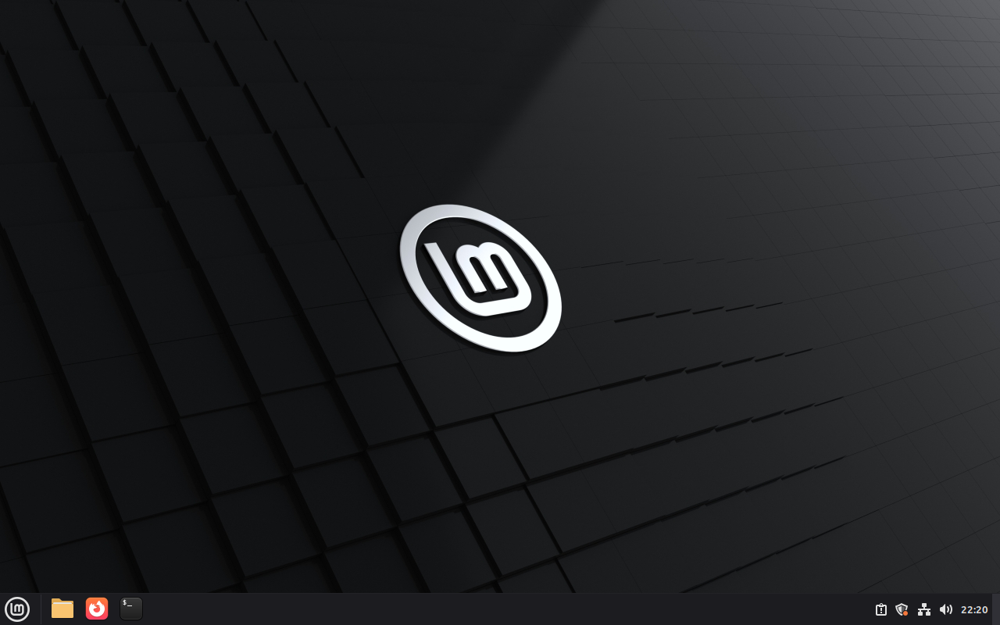

# Guest helper staging lifetime, issue #748

Code PR: [#755](https://github.com/patrick-hudson/put.gd-desktop/pull/755).
Tested implementation: `5fd31c196dee3e2e18e1bd8b7e0427ab320fa574`, based on
nightly containing #747. [Exact Python hashes](source-identity.json) match the
committed files. This is installer/process-lifecycle evidence; no new product
build, desktop release acceptance, physical performance, S3 or Proton use is claimed.
The unchanged snapshot Debug DEB is historical (`0071acafc975`); its package and
installed binary hashes are in the [live receipt](receipt.json).

## Acceptance

| Gate | Result and evidence |
| --- | --- |
| Finished staging | Real-process unit case verifies matching PID/start identity and terminal exit receipt. |
| Alive, then exits | Real-process unit case observes the live pidfd identity, releases a controlled gate, and waits for completion. |
| Alive, then stopped | Unit case sends SIGTERM only to its exact synthetic shell PID; the staging subreaper waits for its exit before writing completion. |
| Descendant ownership | Additional unit case waits for an adopted child after its original shell exits. A missing terminal receipt remains uncertain even if the wrapper PID is dead. |
| Unreachable guest | Timeout, KeyboardInterrupt and SystemExit cleanup cases retain the job and report recovery when reconciliation raises an SSH/IO error. |
| Refused overlap | Unit case runs a real staging process and verifies the retry leaves the token unchanged and creates no host attempt. Live proof repeats the refusal both immediately and after the full bounded wait. |
| Requested suites | On the exact exported implementation in Boat: [lab 58/58](test-lab.log), [package supervisor 7/7](test-package-install.log), [overlay cleanup 20/20](test-overlay-cleanup.log). All three also passed on the workstation as permitted light Python unit tests. |
| Live Cinnamon | One `putgd-lab-cinnamon` fork, `bx_2y86c4ne`; bare-metal KVM on `box-node-fb12a54264e2c15a`; Mint 22.3, Cinnamon 6.6.4, X11 session `c1`, unlocked and wall-visible through workstation port 5987. Run `bd952ef9-bee3-492d-9892-904ce3cfbd02` used one fresh overlay. |
| SSH cancellation | Driver held the real apt Pre-Invoke hook at a controlled file gate. It killed only its controller SSH PID **44922**, start ticks **402713**, with SIGTERM. Guest staging PID **1998**, start ticks **7124**, stayed alive. |
| Lock lifetime | Retry was refused at +0.64 s; at +31.90 s the controller reported `staging-running`, `exactProcessAlive: true`, and retained `install-active`. A second retry was refused. Releasing the hook gate let the same guest identity finish; guarded recovery confirmed exit code 0 and released the token at +36.55 s. |
| Later retry | A new complete install succeeded, clean dpkg audit, no install timeout, and all installed binaries matched the requested DEB. The lock was absent afterward. |
| Golden unchanged | Before, after live proof, and after overlay retirement: `4a21566d5b741e55f349f4f07e1c687c99d1c99b5394ff0d18ed5c9e685693da`. Guest authorized-keys hashes also match before/after. |
| Retirement | [Guarded overlay cleanup](overlay-cleanup.json) completed after export verification; [final golden check](golden-final.json) passed. [Sandbox deletion](sandbox-deletion-final.json) completed and [local tunnel/tile/agent cleanup](local-cleanup.json) completed. |
| CI | Required [CI and contracts](https://github.com/patrick-hudson/put.gd-desktop/actions/runs/40996477252) passed at the tested code head; path selection required contracts only. |

[Reproducible live driver](live.py), [interrupted job terminal receipt](interrupted-staging-result.json),
[host identity](host.txt), [socket preflight](socket-preflight.json) and
[host/guest capacity preflight](storage-preflight.json) retain the exact parameters.
The socket paths were checked before allocation. Failed preparation commands and
their corrections are retained in [preparation context](preparation-context.txt).
The rejected `boat fork <snapshot-name>` command created no sandbox; exactly one
`boat new --from putgd-lab-cinnamon --ttl 7200` succeeded, and it was reused throughout.

## Saved visual and retention

This is a QMP desktop/session witness while the hook was alive and a retry had
been refused; the process/lock assertions are in the receipt, rather than text
rendered in this image. A best-effort `xmessage` used by the driver did not appear;
it is not used as a functional oracle. The wall tile was separately observed
with `VNC connected`. The image is a lossless PNG conversion of the saved PPM,
with identical decoded pixel bytes. Before/after QMP frames and launch witnesses
remain in the private archive.

The private archive is retained under `work/issue748/evidence.tar.gz` in the owning
worktree. SHA-256: `93fbf1b807637cb4ce58256246eadc988a597547443d214216df389c98d0e01e`.
All **41** members were restored and independently hashed on the workstation before
retirement; see [export verification](export-verified.json). The archive contains
source identities, driver, original cancellation/held result, logs, install
reports and saved frames; no private SSH key or VM disk was exported. Cleanup
and completed sandbox deletion receipts are retained alongside the archive and curated here.
No golden, named snapshot or unrelated display tile was removed. The issue is
left open for the coordinator; neither PR was merged or watched.
