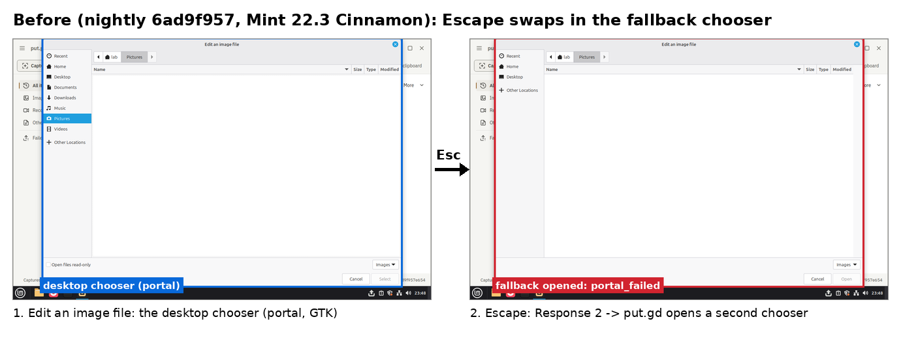
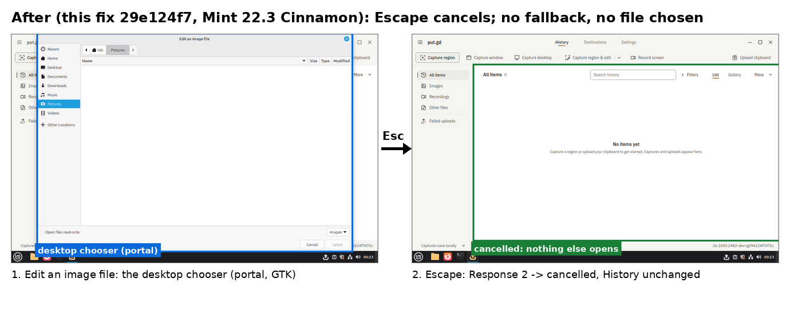

# Escape on the portal chooser cancels (#781)

Code: [PR #803](https://github.com/patrick-hudson/put.gd-desktop/pull/803) (`29e124f7`). Placement: boat sandboxes
`bx_373rft79` (fork of `putgd-lab-cinnamon`) and `bx_68ucwea7` (fork of `putgd-lab-ubuntu-gnome-v2`), both deleted
afterwards. Development evidence from cloud VM guests; not a physical-desktop acceptance row.

## Cinnamon (Mint 22.3, X11)

Guest: fresh overlays of the immutable `cinnamon-x11` golden (SHA-256 `4a21566d…`). Its FileChooser runs in
xdg-desktop-portal-gtk 1.15.1, behind xdg-desktop-portal 1.20.0. Packages are `ubuntu24.04` dev DEBs built on the
sandbox from the dev preset with `PUTGD_LAB_FIXTURE=ON`:

| Build | Package | SHA-256 |
| --- | --- | --- |
| nightly `6ad9f957` | `putgd_26.1030.2481~dev+g6ad9f957e654_amd64.deb` | `26af7d42309e09dbaa503b171fb0294ac6b36af841eca318d52996062487f7b8` |
| fix `29e124f7` | `putgd_26.1030.2482~dev+g29e124f7d71c_amd64.deb` | `631794d832cd6c4db14f610d6ab6ceef5e41c6465e19d0851c430547f9e5b705` |



Nightly: `ui.fileDialog editImage open` sent one `OpenFile`. A real QMP Escape followed. Session bus (`dbus-monitor --session`):

```
685.502777  putgd-ui -> portal        org.freedesktop.portal.FileChooser.OpenFile  serial=11
685.503295  portal   -> gtk backend   org.freedesktop.impl.portal.FileChooser.OpenFile  serial=151
685.504387  portal   -> putgd-ui      return reply_serial=11  …/request/1_108/putgd56b6c9caaf8e4f40
687.529     QMP Escape
687.544797  gtk backend -> portal     return reply_serial=151  uint32 2, uris []
687.545735  portal   -> putgd-ui      Request.Response uint32 2 (same handle)
```

The resident then reported `backend: fallback, fallbackReason: portal_failed`, and put.gd's second chooser was open.
The output-folder chooser showed the same pattern.



The fix: the same Response 2 now finishes as `last.status: cancelled, backend: portal`, with no fallback reason, and
nothing else opens. That held for edit image (Response after 2.2 s) and output folder (after 0.75 s). The after
picture comes from the dialogs lane recipe `dialogs.edit_image_portal` at `71841ca8`, frames `02-dialog-ready` and
`03-after-cancel`. Recipe results and the remaining recipe-side blockers are on #803 and #797.

## GNOME (Ubuntu 26.04.1, Wayland)

Guest: fresh overlay of `gnome-provisioned-20261016` (`563730cc…`), gnome-shell 50.1, xdg-desktop-portal 1.21.1,
xdg-desktop-portal-gnome 50.0, Nautilus 50.2.2. A long-lived Gio caller made each request and a QMP Escape followed
once the Nautilus chooser was drawn and focused:

| Request | Response |
| --- | --- |
| `OpenFile` | 1 |
| `OpenFile` with `directory` | 1 |
| `SaveFile` | 1 |

GNOME 50 delegates the chooser to Nautilus, which answers a window close with 1. It was never affected, and its
behaviour is the same before and after the fix. xdg-desktop-portal-gnome 46 (Ubuntu 24.04) answers Escape with 2, as
xdg-desktop-portal-gtk does, and is covered by the fix. xdg-desktop-portal-kde answers any rejected dialog with 1.
