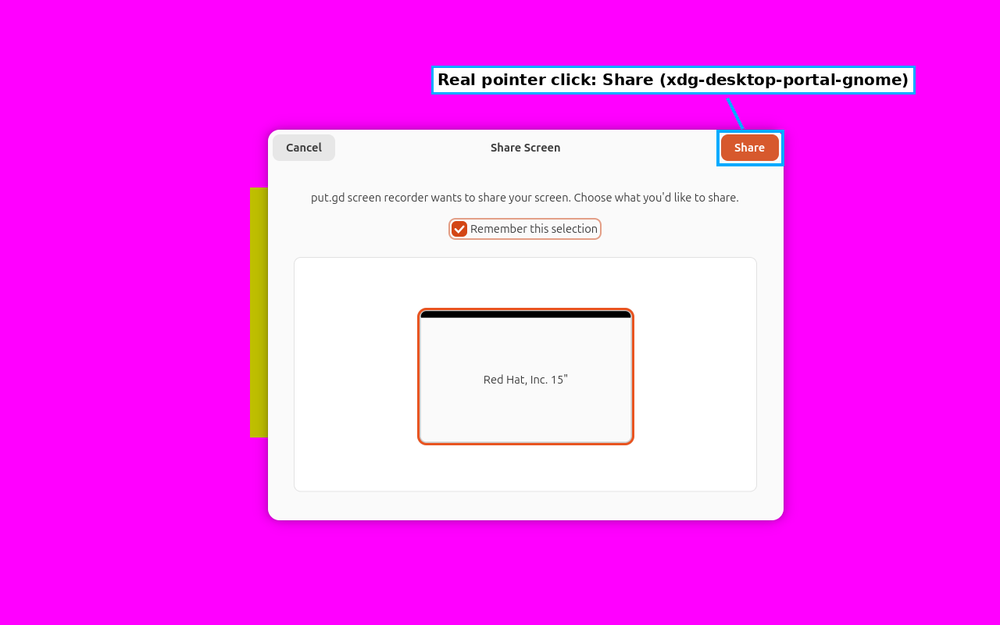
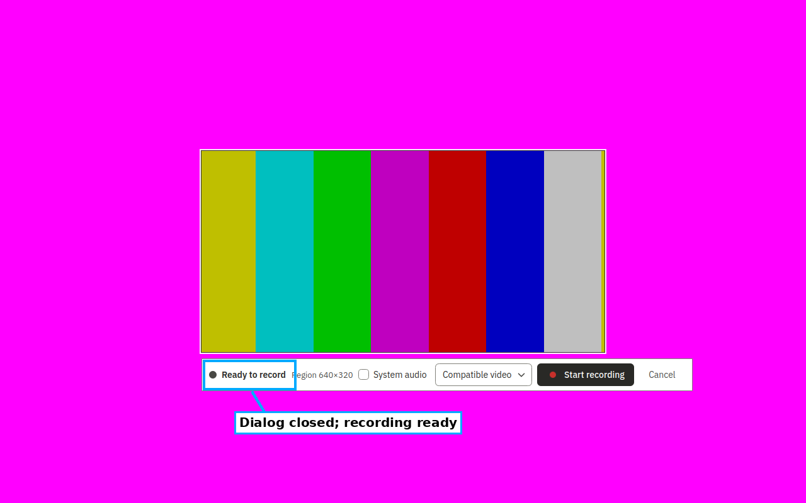

# Recording fixture: ScreenCast consent (#791), retained media (#796), GTK sink (#784)

Development evidence for code PR [#817](https://github.com/patrick-hudson/put.gd-desktop/pull/817). These boat guests show functional fixture behaviour. They do not establish desktop, A/V, latency or memory acceptance.

## Identities

- **Driver source:** branch `fix/recording-consent-fixture` at `00ac5624`, merged locally with the review lane `feat/surface-recipes-review` at `32d673ed` (#676) into tree `be339072`. The merge was not pushed. Core includes #767 and #785.
- **Application:** CI run `41010196960` (nightly `8164f173`, success), artifacts verified by GitHub digest:
  - GNOME: `release-native-ubuntu26.04` DEB `26.1030.2533~dev+g8164f173cb58`, artifact `sha256:ea6e4b41…`.
  - Cinnamon: `release-native-ubuntu24.04` DEB `26.1030.2533~dev+g8164f173cb58`, artifact `sha256:dfcef3f1…`.
  - Both used the matching `ui-catalog` artifact (`sha256:d7541fe1…`).
  - Installed `putgd-record --version-json` reports `8164f173`, clean.
- **Placement `boat`:**
  - GNOME: sandbox `bx_2nuqsfvk` from `putgd-lab-ubuntu-gnome-v3`. Ubuntu 26.04, GNOME Shell 50.1, native Wayland. Fresh overlay `g1` of `gnome-wayland-probes-v2`.
  - Cinnamon: sandbox `bx_vep5k7yk` from `putgd-lab-cinnamon-v2`. Mint Cinnamon X11, fresh overlay `c1` of `cinnamon-x11-probes-v2`.
  - Both sandboxes were deleted after export.
- **Overlay-only staging:**
  - `profiles/provision-probes.sh --recording-overlay` (gstreamer1.0-gtk3; gtksink checked).
  - ffmpeg for the review lane's decoded checks.
  - A private `tools/mcp` venv (mcp 1.30.0) with a run-local profile fragment.
  - GNOME only: the lab witness, staged by `stage-gnome-witness.sh` and a guest reboot.
  - Cinnamon only: `mintUpdate` stopped by exact PID.
  - No golden or named snapshot was changed.

## Consent (#791)

On GNOME, every recipe's first capture reached `ready` through one real pointer click on Share in xdg-desktop-portal-gnome's dialog. Each click was made only after the fixture proved:
- the pending impl `Start` used this resident's `putgd_record_*` request handle;
- the backend process was `/usr/libexec/xdg-desktop-portal-gnome`;
- the window was new since prepare;
- the compositor witness picked the dialog at the point.

The portal answered `Response 0` for that handle, and no pre-input refusal was needed in the final run. On Cinnamon (`consent: none`) no portal request or consent step occurred.

Raw frames: [before](gnome/consent-before-raw.png), [after](gnome/consent-after-raw.png).

## Review lane runs (31 interactions each)

| Guest | Passed | Failed | Blocked |
| --- | ---: | ---: | ---: |
| Ubuntu GNOME Wayland ([receipt](gnome/receipt.json)) | 2 | 0 | 29 |
| Mint Cinnamon X11 ([receipt](cinnamon/receipt.json)) | 2 | 1 | 28 |

- **Passing rows.** `review.preview-error` and `mcp.recording-review` pass on both guests. In round 2 they passed only on Cinnamon and were blocked by #791 on GNOME.
- **Blocked rows.** These are the review lane's existing control/window resolution and capture-lifecycle blocks (#672), reached after the recording fixture is ready.
- **Cinnamon failure.** `review.window-close` fails because the foreground guard refused input under a Cinnamon notification banner.
- **Fixture success.** Every recipe's fixture reached review with motion. GNOME capture motion was 46.8–47.4 against a frozen control of 0–0.002; Cinnamon 47.3–47.7 against 0–0.00005.

## Retained media (#796)

Each scope's working/frozen clips and recipe exports were copied before cleanup to the run's `private-media/` (manifests: [GNOME](gnome/media-manifest-preview-error.json), [Cinnamon](cinnamon/media-manifest-preview-error.json)).

Re-decoding from the copies alone ([GNOME](gnome/redecode.json), [Cinnamon](cinnamon/redecode.json)) gives, per guest:
- 17 scopes and 56 files; all 56 match their SHA-256 and decode with ffprobe;
- the moving clip of every scope re-checks against its frozen control: GNOME 49.6–50.3 against 0.0, Cinnamon 47.3–47.7 against 0.0.

The media is synthetic but stays private: #726 has not merged. It is kept in the campaign's git-ignored work directory, not in this repository.

## Attempts and cleanup

Earlier GNOME attempts are preserved privately; none was a third attempt at the same quirk:
1. The monitor did not attach: a `gdbus emit` marker exits before its pid can be read.
2. Pre-input refusal: GTK4 reports `sensitive`, not `enabled`.
3. A diagnostic found GTK4 screen extents at (0,0) and window extents 7,6 px short of the pixels.
4. The first click succeeded. The guest lacked ffmpeg, then the nightly 26.1029 build lacked the review controls, so the matching CI build was installed.

Overlays were retired through guarded `lab.py cleanup` with hashed evidence manifests ([GNOME](gnome/retire-cleanup.json), [Cinnamon](cinnamon/retire-cleanup.json)). The first invocation's `outcome` label was refused by the guard and is kept privately.
