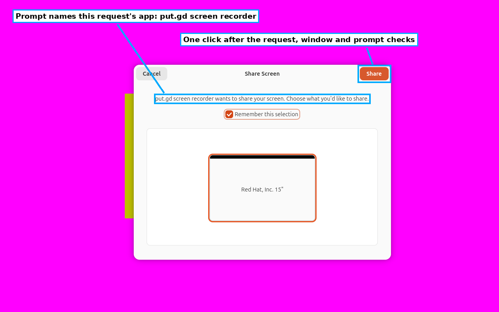
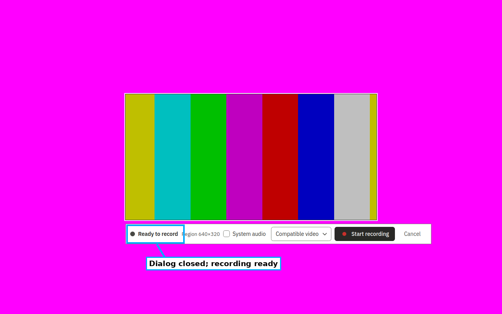
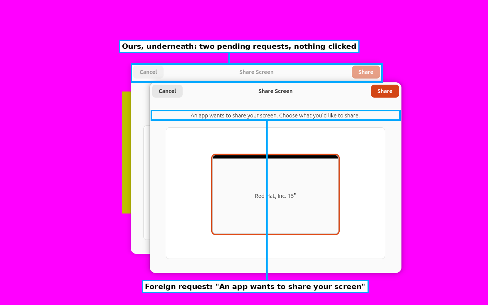
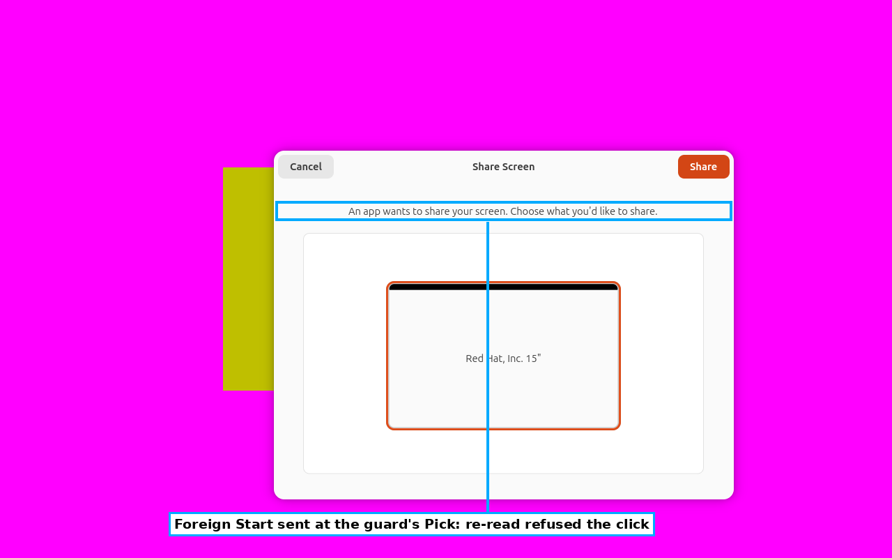
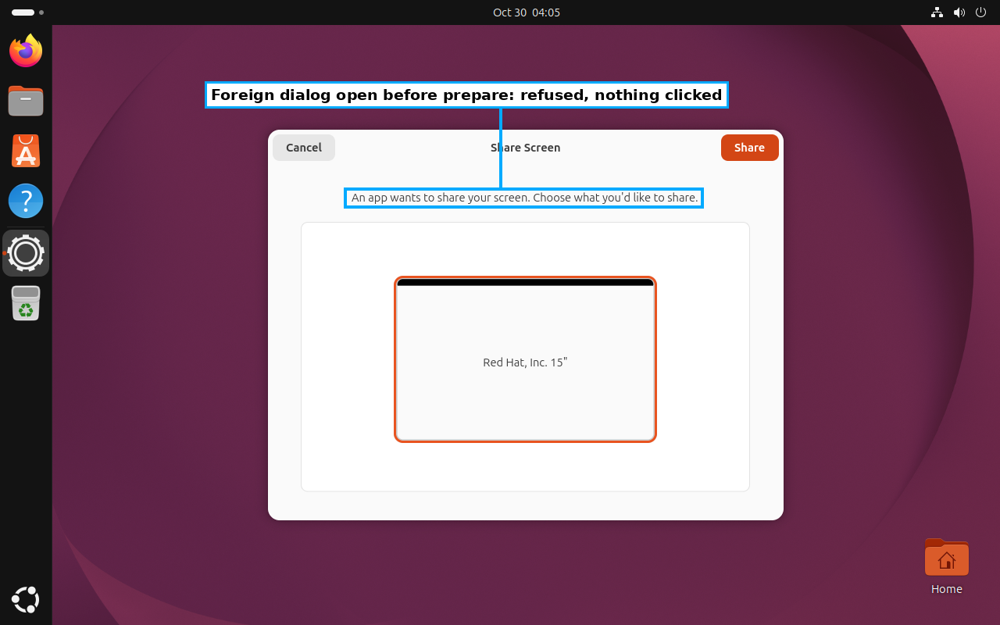

# Recording consent: validation fixes for PR #817 (round 2)

Development evidence for the fixes to the #817 validation findings: the consent dialog is now tied to its request and races are refused. Placement is boat. These guests do not establish desktop, A/V, latency or memory acceptance. The first round's evidence is in [2026-10-30-recording-consent-791](../2026-10-30-recording-consent-791/README.md).

## Identities

- **Driver:** branch `fix/recording-consent-fixture` at `6745525c` (core includes #680), merged locally with the review lane `feat/surface-recipes-review` at `32d673ed` into tree `0ad4f348`. The merge was not pushed.
- **Application:** CI run `41025541710` (nightly `f7a6dd50`, success), `26.1030.2572~dev+gf7a6dd503ced`. Artifacts were verified by GitHub digest:
  - native ubuntu26.04 DEB `sha256:ce511388…`;
  - native ubuntu24.04 DEB `sha256:f2b6563b…`;
  - matching `ui-catalog` `sha256:e6e3d091…`.
- **GNOME:** sandbox `bx_ghkyz7d2` from `putgd-lab-ubuntu-gnome-v4` (Ubuntu 26.04, GNOME 50, native Wayland). Overlays:
  - `g1`: adversarial runs and diagnostics;
  - `g2`: fresh, for the final lane.
- **Cinnamon:** sandbox `bx_htkexbg9` from `putgd-lab-cinnamon-v3`. Overlays:
  - `c1`: its launch preflight saw a blank visible-output witness 14 times and was retired;
  - `c2`: the final lane.
- **Overlay-only staging:** `provision-probes.sh --recording-overlay` (gtksink); ffmpeg; a private `tools/mcp` venv (mcp 1.30.0); on GNOME, the lab witness plus a guest reboot. No golden or named snapshot was changed.

## Final review lanes (31 interactions each)

| Guest | Passed | Failed | Blocked | Consent |
| --- | ---: | ---: | ---: | --- |
| Ubuntu GNOME Wayland, overlay `g2` ([receipt](gnome/receipt.json)) | 2 | 0 | 29 | 17/17 recipes: one guarded Share click, `app id 'putgd-record'` |
| Mint Cinnamon X11, overlay `c2` ([receipt](cinnamon/receipt.json)) | 2 | 0 | 29 | none (`consent: none`) |

- **Ready with motion.** Every recipe's fixture reached `ready` and review with motion:
  - GNOME: 47.0–47.4 against a frozen control of 0–0.002;
  - Cinnamon: 47.2–47.9 against a frozen control of about 0.
- **Passing rows.** `review.preview-error` and `mcp.recording-review` pass on both guests.
- **Blocked rows.** These are the review lane's #672 control, window and capture-lifecycle gaps, reached after the fixture is ready.
- **Retained media.** Re-decoding from the copies alone ([GNOME](gnome/redecode.json), [Cinnamon](cinnamon/redecode.json)):
  - 17 scopes and 56 files per guest; all match SHA-256 and decode with ffprobe;
  - every file is 0600 and every directory level 0700;
  - each scope's moving clip re-checks against its frozen control: GNOME 49.9–50.3 against ≤0.00002, Cinnamon 47.2–47.9 against ≤0.00004.

## Adversarial runs (GNOME, overlay `g1`, `review.preview-error`)

A second, unrelated client in the guest's real session (the validator's `foreign_screencast.py`, plus a `pick` trigger mode) raised its own ScreenCast request, with no app id. It held the request for 60 s and recorded its `Start` result.

| Variant | Timing | Fixture outcome | Foreign `Start` |
| --- | --- | --- | --- |
| `now` ([receipt](adversarial/now-receipt.json), [client log](adversarial/now-foreign.jsonl)) | pending before prepare | blocked: "the portal backend already shows a window before prepare"; no input | not consented |
| `trigger` ([receipt](adversarial/trigger-receipt.json), [client log](adversarial/trigger-foreign.jsonl)) | sent when our `putgd_record_*` `Start` appeared | blocked: "a ScreenCast/RemoteDesktop dialog for a different request is pending"; no click | not consented |
| `pick` ([receipt](adversarial/pick-receipt.json), [client log](adversarial/pick-foreign.jsonl)) | sent when the guard's compositor `Pick` appeared, 3 ms after it | blocked: "the portal request state changed before the click"; no click | not consented |

In the `pick` variant, the foreign `Start` landed between the guard's `Pick` and the press, and the re-read caught it. Our own request was closed by cleanup without a `Response`.

## Monitors on channel loss (GNOME, overlay `g2`)

I started `review.preview-error` and waited until the portal monitor ran in the guest. Then I SIGKILLed the runner and its persistent-probe SSH client by exact PID, which drops the guest channel with no cleanup:

- Before: the probe server (122131), the notification monitor (122204) and the portal monitor (124076) were running.
- 8 s later all three were gone.
- The private root `/tmp/sd-6644b7e2`, the resident and the pattern player remained; retiring the overlay removed them with its disk.

## Unresolved: portal failures after an accepted Share

On the long-lived overlay `g1`, some captures failed after an accepted Share. The resident logged `recording_portal_failed` ("The portal gave no PipeWire connection: Did not receive a reply"), about 20 s after prepare. The next recipe's pattern player then stalled. Counts:

| Code | Run | Failures |
| --- | --- | --- |
| this fixture | first lane | 2 of 16 consents |
| this fixture | three-recipe rerun | 1 of 3 |
| this fixture | four-recipe run | 1 of 4 |
| this fixture | four capture rounds in one resident | 0 |
| this fixture | three recipes with a bus log | 0 |
| previous fixture `00ac5624` | the same three recipes, same overlay | 0 of 3 |
| this fixture | fresh overlay `g2`, final lane | 0 of 17 |

The fresh overlay `g2` also had a bus log running for the whole lane. On `g1`, the desktop-icons extension (`gjs`) crashed at 04:47:58 guest time; Ubuntu's crash dialog appeared, and later AT-SPI walks timed out. The cause is not established; it is tracked in [#866](https://github.com/patrick-hudson/put.gd-desktop/issues/866). The click itself was proven each time: the portal answered `Response 0` for our handle.

## Cleanup

Overlays `g1`, `g2`, `c1` and `c2` were retired through guarded `lab.py cleanup` with hashed manifests ([GNOME g2](gnome/retire-cleanup.json), [Cinnamon c2](cinnamon/retire-cleanup.json)). Full run directories, including private media, were exported and hash-verified to the campaign's git-ignored work directory.
