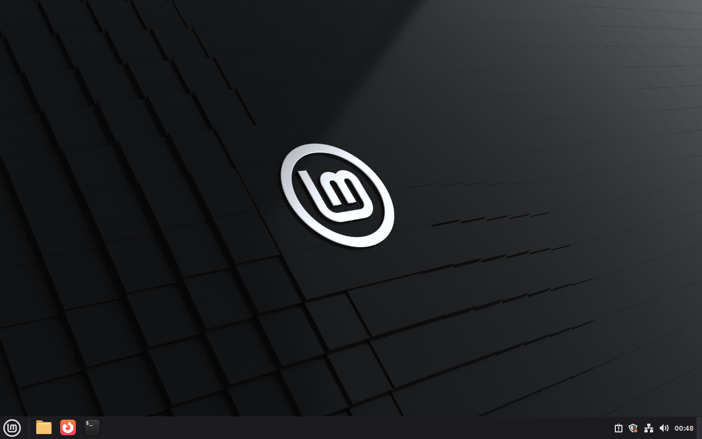
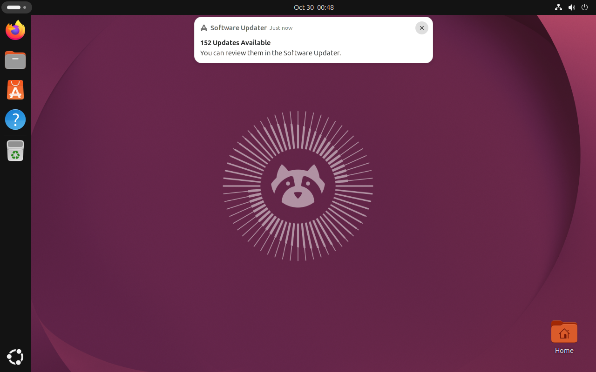

# Cgroup staging recovery, issue #780

Code PR: [#798](https://github.com/patrick-hudson/put.gd-desktop/pull/798).
Final implementation: `5ac286f6b6538a312389d696f90be937778af228`.
The initial Cinnamon checkpoint at `3e21fbf10db71bd4ed5b1f81acb224c53f962bfd`
is retained separately; both guests repeat the proof on the final implementation.
This is Python installer/process-lifecycle testing, with synthetic APT hooks in
disposable overlays. No product binary was rebuilt, no product/release desktop
acceptance is claimed, and no physical desktop, S3 credentials or Proton session
was used. The issue stays open for the coordinator.

## Mechanism

Each staging job enters a dedicated delegated transient systemd **user scope**,
not the SSH connection's scope. The separately started root package supervisor
also enters its own user scope, before sudo, and the exact root helper checks
its inherited scope before its unchanged `install-guard` admission. Scoped
launches explicitly require the identity with `--require-scope`; missing or
session-only metadata refuses admission. This avoids
a new root cgroup-creation entrypoint. Noninteractive SSH availability is probed
at runtime with an explicit user runtime directory and bus; no lingering setting
is changed. Scope failure after selection never retries unscoped. Unsupported
runtime prerequisites retain the legacy session scan, recorded fallback reason
and `limit` warnings.

Recovery reads `cgroup.events populated`, including delegated descendants,
rather than enumerating `cgroup.procs`. An existing scope must report zero;
a removed scope requires the same boot and cgroup mount plus every prior
leader/session identity check. Unreadable/missing events, changed identity or
uncertain inspection retain `install-active`. Host flock, cancellation fence,
N1 admission, guarded token checks and receipt-after-release remain in force.
See the [kernel cgroup v2 contract](https://docs.kernel.org/admin-guide/cgroup-v2.html)
and [systemd-run scope semantics](https://www.freedesktop.org/software/systemd/man/latest/systemd-run.html).

## Acceptance

| Item | Evidence |
| --- | --- |
| Light contracts | Final local [65 lab](test-lab-final.log), [31 staging](test-staging-final.log), [8 root supervisor](test-package-install-final.log), plus the unchanged [29 cleanup](test-overlay-cleanup.log); no real workstation apt. Both Boat hosts repeat all **133** tests on the final source ([Cinnamon](cinnamon-final-test-staging-recovery.log), [Ubuntu](ubuntu-test-staging-recovery.log)). New fake cases cover hierarchical populated state, missing/unreadable/malformed events, replaced/symlinked directories, changed boot and cgroup identities, legacy fallback and scope-launch failure. |
| Final Cinnamon real guest | `putgd-lab-cinnamon-v2`, sandbox `bx_kt4t3rgm`, bare-metal KVM, fresh overlay `c2`; Mint 22.3, systemd 255, native Cinnamon/X11 with saved QMP visuals. [Final results](cinnamon-final-results.json); [initial checkpoint](cinnamon-results.json). |
| Root setsid survivor | Real `sudo -n apt-get` with empty sources runs a synthetic Pre-Invoke hook. Its root grandchild calls `setsid()`. Exact controller and wrapper PIDs/start identities are retained; both are SIGKILLed. With the original session empty, `populated 1` still refuses recovery and preserves the token. |
| Atomic empty and release | An external observer captures actual `populated 1` then `populated 0`. The child exits naturally through a file gate; systemd removes the empty scope. Production recovery verifies the gone scope and existing identities, releases, then writes its receipt. No recovery signal is sent. |
| Production staging and supervisor | The unchanged helper-staging hook succeeds. A root fixture invokes the exact installed helper's `main()`, scope verification and real admission, replacing only package work with a synthetic recorder. Root remains in the recorded supervisor scope with `requiredScope: true`; recovery refuses after admission. Both guests report `Linger=no` and an available user bus over noninteractive SSH. |
| Ubuntu 26.04 GNOME | `putgd-lab-ubuntu-gnome-v3`, sandbox `bx_9mptfeqh`, fresh `c1` overlay; Ubuntu 26.04.1, GNOME Shell 50.1 / Wayland, systemd 259. [Final results](ubuntu-results.json). Same three cases pass, including actual `populated 1 → 0` and root `requiredScope: true`. |
| Other distro prerequisites | [Read-only SSH capability probes](distro-ssh-probes-corrected.json) show cgroup2fs on Kubuntu 26.04, Fedora 44, Debian 13 and Aurora 45/rpm-ostree. These are host kernel prerequisites, not additional guest/desktop acceptance. Initial `systemd --version` PATH failures are preserved [separately](distro-ssh-probes.json); the correction uses `systemctl --version`. Every actual job still checks its own guest at runtime. Aurora's AppImage path does not invoke APT staging. |
| Evidence export | Final [Cinnamon 35/35](cinnamon-final-export-verified.json) and [Ubuntu 41/41](ubuntu-export-verified.json) files, full archive digests and all three helper hashes independently verified after restoration. [Cinnamon golden SHA](cinnamon-final-golden-before-retirement.json) is unchanged; [Ubuntu](ubuntu-golden-before-retirement.json) explicitly uses the fully verified launch digest plus post-test identity, without claiming its optional repeated post-test hash completed. |
| Overlay retirement | Both Cinnamon overlays ([initial](cinnamon-initial-cleanup.json), [final](cinnamon-final-cleanup.json)) and [Ubuntu](ubuntu-cleanup.json) retired through the unmodified guarded cleanup after export verification. Post-cleanup checks confirm no QEMU and free controller flocks ([Cinnamon](cinnamon-post-cleanup.json), [Ubuntu](ubuntu-post-cleanup.json)). |
| Sandbox/local cleanup | Both sandbox deletion operations completed ([Cinnamon](cinnamon-deletion-final.json), [Ubuntu](ubuntu-deletion-final.json)). [Owned tunnels, wall tiles and forwarded agent removed](local-cleanup.json); all other tiles preserved. [Both named source snapshots retained](snapshots-retained.json). Exactly two sandboxes created, no physical/Proton locks taken. |

The [live driver](live_guest.py) runs only on the QEMU host against an owned
disposable overlay. Its root APT fixture uses empty source lists, no list cleanup
and no package installation. The root-supervisor fixture installs a temporary
fixture/rule only inside that overlay. Existing bases and user objects are not
modified. The first Cinnamon observation saw `populated 1` followed by scope
removal; a repeated run with a bounded tight observer captured zero too. Both
attempts remain in the private raw evidence.





The image witnesses the unlocked guest session; JSON records the process/lock
assertions. The guest stayed on its loopback VNC listener and workstation wall
tile throughout. No visible product UI change required annotation.


## Review correction

[CodeRabbit finding](https://github.com/patrick-hudson/put.gd-desktop/pull/798#discussion_r4420785417):
a scoped supervisor could lose its identity file and take the legacy path.
`5ac286f6` adds the explicit required-scope flag only on scoped supervisor
launches. Missing/downgraded identity now fails before admission. Fakes also
verify the flag is appended to the script, leaves the unit argument intact and
is absent from the unavailable-manager fallback. The finding is fixed, answered
and resolved. Both final guest proofs exercise the flag through the exact
root helper's real admission. The initial checkpoint is not relabeled as the fix.

Final code [contracts and required CI](https://github.com/patrick-hudson/put.gd-desktop/actions/runs/41010113987)
pass. Neither PR is merged or watched.


The linked driver discovers the checkout root before importing the lab, so it
can run from this evidence directory. This small reproduction adapter was
checked without contacting a guest; the exact drivers executed in the campaign
remain in the private hashed archives. Case bodies are unchanged. On the actual
QEMU host, use the final implementation checkout, an authenticated running lab
VM and a fresh output directory, for example:

```sh
PUTGD_780_RUN=c1 PUTGD_780_OUTPUT=e780-repro \
  python3 docs/evidence/2026-10-30-staging-cgroup-780/live_guest.py
```

Never run this installer fixture against a physical desktop. The driver calls
the production owned-overlay verification and refuses such a target.


## Private raw retention

Raw archives remain under `work/issue780/` in the owning worktree, outside source
exports: `cinnamon-evidence.tar.gz` (initial checkpoint),
`cinnamon-final-evidence.tar.gz` and `ubuntu-evidence.tar.gz`. Their SHA-256,
source commit and verified member counts are in the corresponding export receipts.
Restore into a new private directory with `tar -xzf ARCHIVE -C EMPTY_DIRECTORY`;
`work/e780/cleanup-evidence.json` (Ubuntu/initial Cinnamon) or
`work/e780-final/cleanup-evidence.json` (final Cinnamon) maps every evidence member
to its original SHA-256. Full QMP frames, original attempts and source drivers
are retained; no VM disk, private key, cloud credential or session is exported.
Deletion and overlay retirement receipts are retained separately and committed here.
