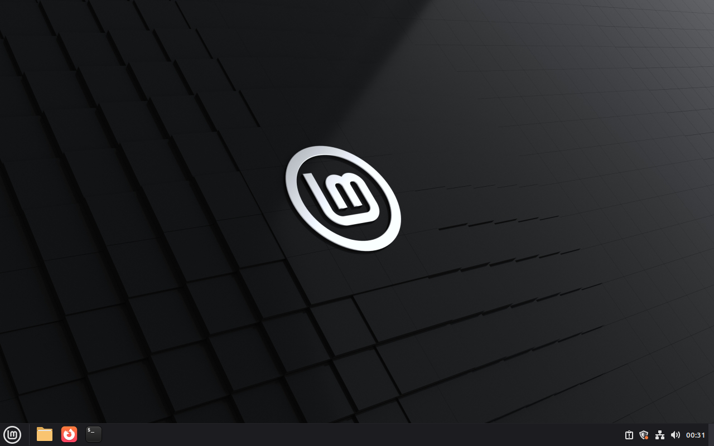

# Cgroup staging recovery, issue #780

Code PR: [#798](https://github.com/patrick-hudson/put.gd-desktop/pull/798).
Exact implementation: `3e21fbf10db71bd4ed5b1f81acb224c53f962bfd`.
This is Python installer/process-lifecycle testing, with synthetic APT hooks in
disposable overlays. No product binary was rebuilt, no product/release desktop
acceptance is claimed, and no physical desktop, S3 credentials or Proton session
was used. The issue stays open for the coordinator.

## Mechanism

Each staging job enters a dedicated delegated transient systemd **user scope**,
not the SSH connection's scope. The separately started root package supervisor
also enters its own user scope, before sudo, and the exact root helper checks
its inherited scope before its unchanged `install-guard` admission. This avoids
a new root cgroup-creation entrypoint. Noninteractive SSH availability is probed
at runtime with an explicit user runtime directory and bus; no lingering setting
is changed. Scope failure after selection never retries unscoped. Unsupported
runtime prerequisites retain the legacy session scan, recorded fallback reason
and `limit` warnings.

Recovery reads `cgroup.events populated`, including delegated descendants,
rather than enumerating `cgroup.procs`. An existing scope must report zero;
a removed scope requires the same boot and cgroup mount plus every prior
leader/session identity check. Unreadable/missing events, changed identity or
uncertain inspection retain `install-active`. Host flock, cancellation fence,
N1 admission, guarded token checks and receipt-after-release remain in force.
See the [kernel cgroup v2 contract](https://docs.kernel.org/admin-guide/cgroup-v2.html)
and [systemd-run scope semantics](https://www.freedesktop.org/software/systemd/man/latest/systemd-run.html).

## Acceptance

| Item | Evidence |
| --- | --- |
| Local light contracts | [65 lab](test-lab.log), [31 staging](test-staging.log), [8 root supervisor](test-package-install.log), [29 cleanup](test-overlay-cleanup.log); no real workstation apt. New fake cases cover hierarchical populated state, missing/unreadable/malformed events, replaced/symlinked directories, changed boot/mount identities, legacy fallback and scope-launch failure. |
| Cinnamon real guest | `putgd-lab-cinnamon-v2`, sandbox `bx_kt4t3rgm`, bare-metal KVM, fresh overlay `c1`; Mint 22.3, systemd 255, native Cinnamon/X11 with saved QMP visuals. [Results](cinnamon-results.json). |
| Root setsid survivor | Real `sudo -n apt-get` with empty sources runs a synthetic Pre-Invoke hook. Its root grandchild calls `setsid()`. Exact controller and wrapper PIDs/start identities are retained; both are SIGKILLed. With the original session empty, `populated 1` still refuses recovery and preserves the token. |
| Atomic empty and release | An external observer captures actual `populated 1` then `populated 0`. The child exits naturally through a file gate; systemd removes the empty scope. Production recovery verifies the gone scope and existing identities, releases, then writes its receipt. No recovery signal is sent. |
| Production staging and supervisor | The unchanged helper-staging hook succeeds. A root fixture invokes the exact installed helper's `main()`, scope verification and real admission, replacing only package work with a synthetic recorder. Root remains in the recorded supervisor scope; recovery refuses after admission. |
| Ubuntu 26.04 GNOME | The only second sandbox is `putgd-lab-ubuntu-gnome-v3` fork `bx_9mptfeqh`; hydration and guest proof are pending. |
| Other distro prerequisites | [Read-only SSH capability probes](distro-ssh-probes-corrected.json) show cgroup2fs on Kubuntu 26.04, Fedora 44, Debian 13 and Aurora 45/rpm-ostree. These are host kernel prerequisites, not additional guest/desktop acceptance. Initial `systemd --version` PATH failures are preserved [separately](distro-ssh-probes.json); the correction uses `systemctl --version`. Every actual job still checks its own guest at runtime. Aurora's AppImage path does not invoke APT staging. |
| Cleanup | Pending export verification, guarded overlay retirement, sandbox deletion and local tunnel/tile/agent cleanup. Exactly two sandboxes were created; neither source snapshot is modified. |

The [live driver](live_guest.py) runs only on the QEMU host against an owned
disposable overlay. Its root APT fixture uses empty source lists, no list cleanup
and no package installation. The root-supervisor fixture installs a temporary
fixture/rule only inside that overlay. Existing bases and user objects are not
modified. The first Cinnamon observation saw `populated 1` followed by scope
removal; a repeated run with a bounded tight observer captured zero too. Both
attempts remain in the private raw evidence.

The image witnesses the unlocked guest session; JSON records the process/lock
assertions. The guest stayed on its loopback VNC listener and workstation wall
tile throughout. No visible product UI change required annotation.
