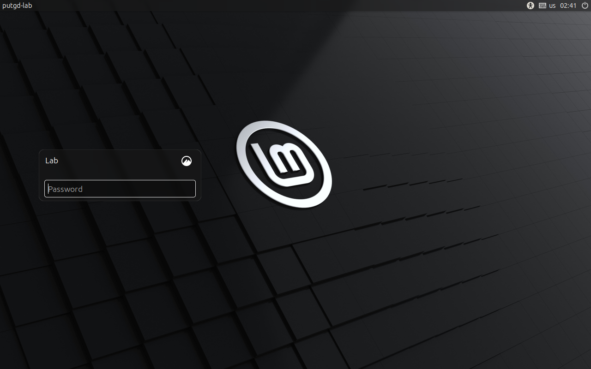
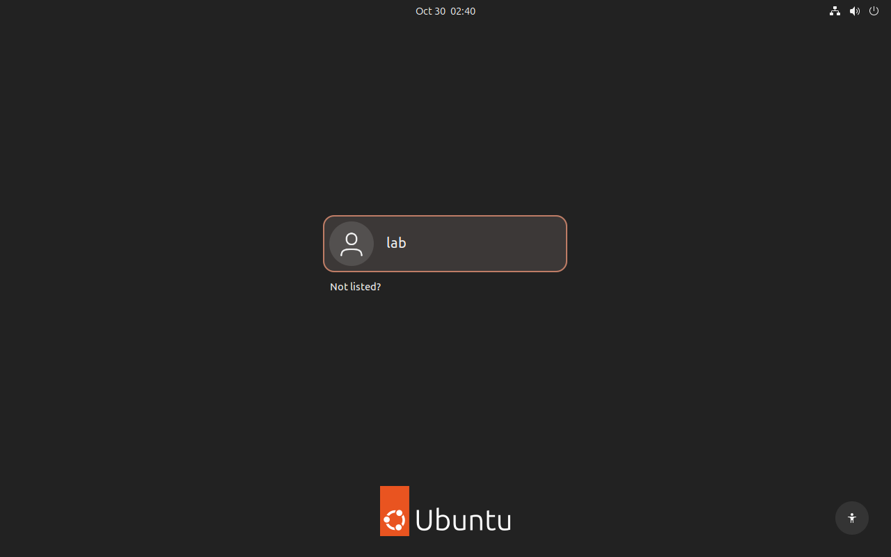

# System-manager staging scopes: #780 B1 correction

[Code PR #798](https://github.com/patrick-hudson/put.gd-desktop/pull/798) and
[docs PR #801](https://github.com/patrick-hudson/put.gd-desktop/pull/801) remain
unmerged. Issue #780 stays open. The earlier
[user-manager checkpoint](../2026-10-30-staging-cgroup-780/README.md) is
superseded: it passed ordinary liveness cases but independent validation proved
that ending the last login with `Linger=no` killed its watchdog.

Final code: `ef64bfa5d37c17e9be7e5bcd5bfc1a880817e3d7`.
Both live runs used `ac6e9bb2d15a9c60dbb9cac39a3a3236f8c0d7d6` plus the
recorded closing-login adapter. All four production files are byte-identical
between these revisions ([identity](source-identity.json)). Subsequent changes
integrate that adapter into the maintained driver and fix a test-only procfs
exit race. The driver moved out of the docs PR into
[`tools/lab/staging_acceptance.py`](https://github.com/patrick-hudson/put.gd-desktop/blob/ef64bfa5d37c17e9be7e5bcd5bfc1a880817e3d7/tools/lab/staging_acceptance.py).
Executed drivers and the adapter remain in the private hashed archives; there
is no executable Python driver in this docs change.

## Mechanism and prerequisites

New staging and supervisor jobs use delegated transient **system-manager
scopes** under `/system.slice`. Passwordless sudo creates the scope;
`setpriv --reuid=1000 --regid=1000 --init-groups` drops the wrapper back to
`lab` before running staging. The subsequent root helper inherits and verifies
the exact scope before its unchanged admission. PID 1 owns this scope, outside
`user@1000.service`. No user bus, PAM-created user manager or lingering is
required. Both tested guests retained `Linger=no`.

The snapshots grant passwordless apt, but initially did **not** grant
passwordless systemd-run. The first permission probe exposed that sudo's policy
listing was insufficient. The corrected launcher actually executes
`sudo -n -- systemd-run --version`. The existing apt Pre-Invoke authority
installed `/etc/sudoers.d/putgd-780-system-scopes` only inside each disposable
overlay, then execution and visudo were verified
([Mint](cinnamon-scope-authority-setup.json),
[Ubuntu](ubuntu-scope-authority-setup.json)). No packages were fetched by that
setup. New bootstrap grants `/usr/bin/systemd-run` and installs `util-linux`;
older images without authority keep the explicit session fallback.

Runtime checks cover the cgroup v2 mount, binaries, system bus, systemd version
and no-prompt sudo execution. **systemd 254+** is required for
`--expand-environment=no`; old, unreadable or failed prerequisites produce a
specific `fallbackReason`, a guest marker and an install-time controller
warning. Scope failure after selection never retries outside the scope.
Mint 22.3/systemd 255 and Ubuntu 26.04.1/systemd 259 both proved unified cgroup
v2 here. The earlier [read-only host probes](../2026-10-30-staging-cgroup-780/distro-ssh-probes-corrected.json)
show cgroup2fs and sufficiently new systemd on Kubuntu 26.04, Fedora 44,
Debian 13 and Aurora 45/rpm-ostree; these are host prerequisite observations,
not additional guest acceptance. Every actual guest probes its own prerequisites.
Aurora's AppImage path does not run the APT staging route.

Atomic hierarchical `cgroup.events populated` remains additional to the
mandatory session scan. Missing/unreadable events, changed boot/mount/inode,
uncertain identity or a populated group retain the token. Gone-group recovery
still requires every prior identity/session guard. The host controller flock,
`install-guard`, separate fail-closed shell checks, delayed-start cancellation,
N1 progress/result fence and receipt-after-release all remain.

A deliberately privileged hook can migrate through `cgroup.procs`,
`systemd-run` or `systemctl start`. The session scan catches out-of-scope work
that retains the recorded session. Changing both cgroup and session escapes
both fences. Only session-mode reports retain the ordinary setsid/non-atomic
scan `limit`; cgroup mode is not a security boundary against root migration.

## Repeated acceptance

Exactly two Boat forks were used, with one fresh owned KVM overlay in each:
`putgd-lab-cinnamon-v3` / `bx_4ed6k7h2` and
`putgd-lab-ubuntu-gnome-v4` / `bx_gc3kvcd7`.
[Campaign metadata](campaign.json) retains snapshot IDs, run IDs, source hashes,
failed attempts and placement. These are installer-lifetime tests, not product
binary or release desktop acceptance. No physical desktop, S3 credential,
Proton session or workstation apt was used. Neither apt-daily nor unattended
upgrade timers needed stopping; the campaign changed no such timers.

| Acceptance | Evidence |
| --- | --- |
| Light unit contracts | Final local **137**: [66 lab](local-unit-lab-final.log), [34 staging](local-unit-staging-ci-fix.log), [8 supervisor](local-unit-install-final.log), [29 cleanup](local-unit-cleanup-final.log). Fakes cover system ownership after logout, uid/gid drop, failed prerequisite reasons, systemd 253 fallback/254 support, real sudo execution probe, warning output, required scope and legacy metadata. Both Boat hosts passed **136** before the additional test-fixture regression: [Mint: 66 lab](cinnamon-unit-lab.log), [33 staging](cinnamon-unit-staging.log), [8 supervisor](cinnamon-unit-install.log), [29 cleanup](cinnamon-unit-cleanup.log); [Ubuntu: 66 lab](ubuntu-unit-lab.log), [33 staging](ubuntu-unit-staging.log), [8 supervisor](ubuntu-unit-install.log), [29 cleanup](ubuntu-unit-cleanup.log). |
| Production staging | Unmodified helper staging enters `/system.slice`, finishes and recovers normally. All five cases pass on both guests: [Mint results](cinnamon-results.json), [Ubuntu results](ubuntu-results.json). |
| Root setsid grandchild | A real sudo apt Pre-Invoke hook with empty sources spawns a root setsid child. Exact controller and wrapper identities are SIGKILLed. The original session is empty, but `populated 1` holds recovery and preserves `install-active`; the wrapper is UID 1000. |
| Atomic empty and release | Both observers record actual `populated 1` then `populated 0`. The child exits through a file gate. Recovery verifies gone-scope/identity/session conditions, releases, then records the receipt. Recovery sends no signals. |
| Root supervisor and N1 | The exact installed helper verifies its inherited system scope and performs real admission; only package work in this case is synthetic. `requiredScope=true`; staging recovery refuses after progress exists. |
| Name collision | An independently held scope with the exact requested name is neither adopted nor replaced. Launch fails, the staged marker never runs, the original holder survives, and ordinary recovery safely fences the unstarted job. |
| B1: last login ends, controller SIGKILL | The real production supervisor installs a tiny synthetic `putgd` DEB under a controlled postinst gate. After native desktop logout and exact controller SIGKILL, the remaining exact owned login scopes are ended. Root-only SSH observes PID 1 stopping the lab user manager naturally. Mint's helper remains alive with it inactive at **14.0–26.4 s** after the kill; Ubuntu's at **68.7–81.5 s**. Both then finish with `ok=true`, `aborted=false`, `remainingPids=[]`, wrapper exit 0, and the manager still inactive. |

The outer sudo launch client can remain in a **closing SSH login** after its
connection/controller exits. It is outside the dedicated job scope. A separate
root observer ended that exact login as part of ending the last lab login:
[Mint](cinnamon-last-login-ended.json), [Ubuntu](ubuntu-last-login-ended.json).
It did not stop `user@1000.service` directly or enable linger. Full state
samples, root PID/start/cgroup identities, terminal results and user-manager
journals are retained ([Mint journal](cinnamon-user-manager-journal.txt),
[Ubuntu journal](ubuntu-user-manager-journal.txt)). The maintained driver now
performs this closing-login step itself.

The post-admission fixture token was acknowledged under the existing guard
only after both the successful install result and terminal wrapper proof.
This does not claim that `recover-staging` releases jobs with progress: its N1
refusal remains unchanged. Empty-source APT configuration, root public-key
observer access, synthetic fixture privilege and autologin changes existed only
in the disposable overlays. Per-run private keys never left their QEMU hosts.

These are native QMP frames; both guests stayed visible on the workstation's
wall through their loopback VNC listeners throughout the runs. Earlier native
session/survivor frames and every failed attempt are retained too. There is no
product UI change requiring annotation.

## Failure context and retirement

Failed probes remain failures in [campaign.json](campaign.json) and the raw
archives. Mint's initial missing-sudo launch was fenced and recovered before
admission. Its first real package attempt exceeded a 30-second readiness budget
while removing the old package; the root helper subsequently finished after
82.6 seconds, and readiness was raised to a bounded 90 seconds. Earlier logout
fixtures either did not end closing login scopes, or treated an already-removed
login as an error. The autologin fixture also had an escaped-backreference bug;
only its two overlay configuration lines were repaired, with hash receipts.
Final source fixes those fixture errors. Failed native frames and logs are
preserved; none were relabeled as successful proof.

[CI failure](ci-contracts-lab-failure.log) on `8fa6856b` exposed a test-only
`ProcessLookupError` while a synthetic orphan exited during `/proc` reading.
`ef64bfa5` handles ESRCH alongside ENOENT in the test helper and adds a fake
regression. Production recovery already handled both. The final 34 staging
contracts pass locally; required CI is reported on the PR.

Both raw archives were restored and independently checked before any disk
retirement: [Mint 189/189](cinnamon-export-verified.json) and
[Ubuntu 147/147](ubuntu-export-verified.json) evidence files, archive digests
and all five exported source hashes. [Archive index](archive-index.json) gives
private paths and restore checksums. `work/eb4/cleanup-evidence.json` (Mint)
and `work/eb3/cleanup-evidence.json` (Ubuntu) map the evidence members; extract
into a new private directory and verify those hashes. No disk, private key,
cloud credential or authentication session is exported. Golden digests were
fully verified at launch and matched the immutable snapshot manifests;
post-test identity is retained without claiming a repeated full hash.

The unmodified guarded cleanup retired each overlay only after verified
export. Receipts match the restored manifest digests:
[Mint cleanup](cinnamon-cleanup.json), [Ubuntu cleanup](ubuntu-cleanup.json).
The Mint pre-cleanup dry-run receipt was not retained; its
[preview file](cinnamon-cleanup-preview.json) records why. The Ubuntu
[preview](ubuntu-cleanup-preview.json) is the original dry run.
Both [Mint](cinnamon-post-cleanup.json) and [Ubuntu](ubuntu-post-cleanup.json)
postchecks show no QEMU, no overlay and a free host controller flock. Both
sandbox deletion operations completed:
[Mint](cinnamon-deletion-final.json), [Ubuntu](ubuntu-deletion-final.json).
The named source snapshots remain. [Local cleanup](local-cleanup.json) stopped
only the two owned tunnels, removed their two wall tiles while preserving the
other 11, and stopped the forwarded-key agent. No physical/Proton lock was taken.
