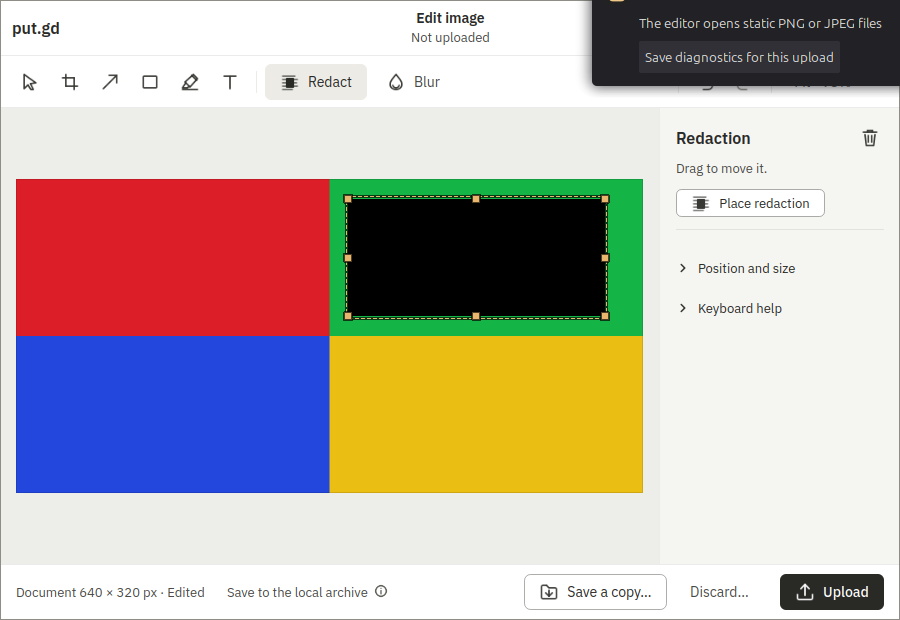
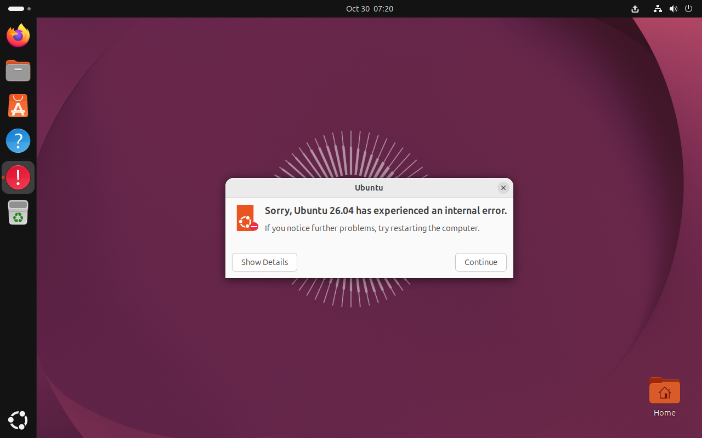
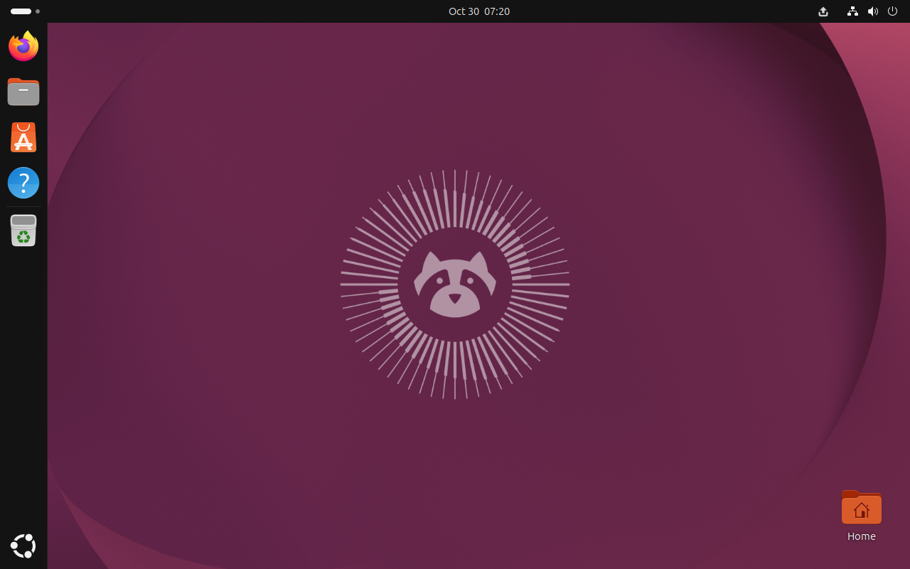

# Clipboard keeper lifecycle and GNOME MIME limits, 2026-10-30

Code: [PR #882](https://github.com/patrick-hudson/put.gd-desktop/pull/882),
`32892d2d2e4378cd035e19b2e83e0b5af314c621`.
The lifecycle/persistence changes are implemented and tested. The reported
72% keeper condition and sustained GTK-service spin were **not reproduced**;
their causal attribution remains blocked, and the code PR remains draft.
Neither #860 nor #874 is closed by this evidence.

## Identities and scope

These are Boat development VM runs, not physical-desktop performance, memory,
or release acceptance. Both guests had two vCPUs. Each ran in a fresh KVM overlay,
visible on the workstation wall through localhost VNC/SSH forwards, with saved
QMP frames. The GNOME witness was staged in the overlay, the guest rebooted, and
its ACTIVE state checked. No clipboard Shell extension was added.

| Guest | Worker / run ID | Native session | Immutable golden SHA-256 |
| --- | --- | --- | --- |
| `putgd-lab-ubuntu-gnome-v4` | `bx_28gwqyx4` / `3d8b48d4-c388-45db-85b1-6f163e295ae4` | Ubuntu 26.04, GNOME 50.1 Wayland, kernel 7.0.0-38 | `8666b7dd8b98932e2fa794ec7bb4ccf0e82a8195e97a8580997ad70ed593a6c4` |
| `putgd-lab-cinnamon-v3` | `bx_ntujnxhw` / `ea31c76f-a444-4f6a-9413-76dbe0f4680e` | Mint 22.3 Cinnamon X11, kernel 6.14.0-37 | `23b3e37571bdc7b452fdc30d53e70386423d75cb377e59653eed8a652c8bfab7` |

The app was the snapshot's clean, audited native package from
`6ad9f957e6544f30c5e45c08af2306db77a9ff64`, version
`26.1030.2481-dev+g6ad9f957e654`. No C++ application change or rebuild is claimed.
The driver head above was checked out cleanly on both workers. Its clipboard
helper SHA-256 is
`e8b5419d777fe9896f3fde7d2f1f566747bba84e2046f13d718eb719968c7b87`.

The early GNOME baseline used core `7d231e90` plus the locally merged editor
lane. The later Cinnamon baseline used unmodified core `6a652a54`, which already
contained the editor lane and #857. Final-head validation incorporates that core
and #871's shared critical sections. The GNOME before/after comparison therefore
also crosses the #857 integration; it cannot isolate a high-CPU cause.

## What was established

Core's helper starts under `nohup`, polls a 50 ms timer, and deliberately remains
alive while owning the restored selection. Successful cleanup can delete its
private root while it is still running. This is a definite lifetime defect.
There is no `wl-paste --watch` loop in this implementation, and the helper does
not repeatedly re-own the selection. These observations do **not** explain a
72% Qt/backend spin by themselves.

Three behavioral tests fail on core: three periodic wakeups in 160 ms, a keeper
that survives runner-pipe EOF, and SIGTERM without restoration. See
[the original failures](baseline-unit.log). The final single-pass surface suite
passed **655 tests**; its [JUnit](cinnamon/final-v2-tests.xml) includes ten new
clipboard contracts. The required `CI` summary also passed.

Live CPU was calculated from PID/start-time keyed `/proc` CPU ticks divided by
monotonic elapsed time; 100% means one guest vCPU. Continuous samples were two
seconds apart. Startup is included, so maxima are not idle-only measurements.

| Lane sample | Mean / max keeper CPU | Zero-CPU samples | Max / final guest load-1 | Keeper alive after run |
| --- | --- | --- | --- | --- |
| Cinnamon core baseline, two editor recipes | 0.407% / 2.479% | 18 / 42 | 0.217 / 0.071 | **Yes**, PID 73909 |
| Cinnamon final head, same two recipes | 0.020% / 0.983% | 47 / 48 | 0.934 / 0.871 | No |
| GNOME early core baseline, same two recipes | 0.672% / 1.488% | 2 / 59 | 1.132 / 0.954 | No; it had saved an empty clipboard |
| GNOME final head, corrected idle-desktop run | 0.028% / 0.498% | 50 / 53 | 0.664 / 0.611 | No |

Both `editor.redact` and `editor.cli_editor` passed in those final-head samples.
The final end-of-campaign process sweeps found no live keeper on either guest.
Complete samples, desktop identities, operation IDs and failed lane verdicts are
in the [Cinnamon](cinnamon/summary.json) and [GNOME](gnome/summary.json) summaries.
The large CPU/load condition from #860 was not present in these baselines.

## Restoration, runner death and stale owners

The final head restored the supported clipboard bytes after normal lane exit,
a SIGALRM delivered during real restoration, SIGTERM in an active controller, and
runner SIGKILL in an active controller. Both death paths left no keeper. The death harness requested an unsupported PPM
source and checked only RPC acceptance, so its editor operation was subsequently
rejected. These tests establish active-controller lifetime/clipboard cleanup;
they do **not** establish editor-open cancellation. Cinnamon's
text, HTML and custom binary MIME bytes all matched. GNOME's primary text bytes
matched, with the approved persistence-limit review notes.

- [Cinnamon runner-death results](cinnamon/final-v2-kill-results.json)
- [GNOME runner-death results](gnome/final-v2-kill-results.json)
- [Cinnamon deadline during restoration](cinnamon/deadline-v2-result.json)
- [GNOME deadline during restoration](gnome/deadline-v2-result.json)

The deadline proof deliberately replaced the clipboard, armed SIGALRM for 20 ms,
then entered the real `Target.restore_clipboard()` under `armed()`. The deferred
exception arrived after restoration and exact-PID cleanup completed.

The GNOME stale-owner test used core's exact helper source over the existing X11
selection bridge, restored its selection, and removed its private root as core
cleanup does. A native-policy run then blocked on text/HTML/custom MIME **without
changing the clipboard or stopping that owner**. A disposable run captured its
text, reaped exact PID/start identity 44154/138448, restored text and exited.
See [the guard/recovery result](gnome/gnome-stale-result.json). This is a native
policy exercise in a disposable VM, not physical GNOME acceptance.

The GNOME policy/migration exercise preceded the final native-X11 guard; it is
supplementary to the final-head tests. The real Cinnamon baseline orphan, PID/start 73909/342283, was subsequently found
and stopped by the final driver. [The independent post-check](cinnamon/baseline-recovery-post.json)
proves both old/new PIDs exited and all three payloads matched. The earlier
`baseline-recovery.json` copied its report before `close()`; its restoration flag
is not a final verdict.

The Cinnamon crop retains an error toast from the PPM fixture. These are
functional recipe passes with `frames`/review verdicts, not clean visual acceptance.

The retained [GNOME](gnome/v2-head-kill-SIGKILL.png) and
[Cinnamon](cinnamon/v2-head-kill-SIGKILL.png) termination frames show the rejected
fixture/crash-dialog context, not an open editor.

## Placement policy and privacy

A headless Wayland client cannot read GNOME's unfocused selection. The helper
uses the existing X11 selection bridge, recovering DISPLAY/XAUTHORITY references
from the native session manager before substituting private homes. The app and
its window/input witnesses remain native Wayland.

[Mutter's native manager](https://github.com/GNOME/mutter/blob/main/src/core/meta-clipboard-manager.c)
keeps one preferred supported format after owner exit, with a 4 MiB text limit.
The GNOME overlay had no X11 `CLIPBOARD_MANAGER`. The coordinator chose:

- Disposable placements restore the supported primary type and record omitted
  MIME types as review notes. Equivalent text aliases can be regenerated by the
  bridge; general multi-MIME persistence is not promised.
- Native placements refuse unrestorable formats before ownership changes or
  resident launch. Native X11 also requires a persistence manager (confirmed
  present in the Cinnamon guest). Other native Wayland persistence remains
  unverified and blocks nonempty clipboards. Empty clipboards are safe.

[Follow-up #879](https://github.com/patrick-hudson/put.gd-desktop/issues/879) tracks
full native GNOME MIME handoff. No extension was added to hide this limit.
Preserved clipboard payloads stayed in keeper memory. Public byte hashes describe explicitly
synthetic fixtures only. No credentials, user clipboard contents, live share
URLs or private SSH identities are in this packet.

## GTK triage and failure context

The GTK services named in #874 were sampled before keeper startup, with only the
keeper active, with the AT-SPI observer registered, during editor traffic, and
after cleanup. They did not enter sustained spin in these fresh guests. GNOME's
GTK portal was PID 2550, ibus GTK3 PID 2130 and evolution notification PID 1987.
The extended pre-integration lane also kept those sampled services below 1%.

This negative result does not establish driver-versus-image causality for the
reported two-hour session. #874 remains unresolved. The image's apt-daily timer,
apt-daily-upgrade timer and unattended-upgrades service were all enabled. A
proposed disposable-snapshot change is to disable that update noise and retain
boot/PID-start keyed CPU baselines before/after each lane, without disabling
AT-SPI or altering GTK/portal packages. That proposal does not claim to fix the
unreproduced GTK spin.

Failed attempts are retained, including extended editor deadlines/probe failures
and an SSH failure after a lane. A failed X11 diagnostic initially omitted native
DISPLAY/XAUTHORITY references and opened an Ubuntu crash-report dialog. It was
missed during a later attempt, then captured and closed through the visible
console before the successful idle-desktop final rerun. Neither that attempt nor
the interrupted full lanes is counted as full editor acceptance.

The first collector's `qemu-img info` was correctly refused while QEMU held the
image lock. Its failure is retained; collection switched to read-only QMP
`query-block`. No image lock or cleanup guard was weakened.

## Retention and retirement

[Retention index](retention.json) identifies the private compressed archives and
SHA-256 checksums. Every archived member was checked against its completion
manifest: **183 GNOME files and 260 Cinnamon files**. Thin Git bundles retain
unpublished local validation merge identities; their public parents remain in
Git. Exact campaign harnesses are retained privately beside those archives.

Both goldens matched their original SHA-256 after testing. Each overlay was reset
and retired through guarded cleanup after verified export:
[Cinnamon receipt](cinnamon/retirement.json), [GNOME receipt](gnome/retirement.json).
Completion manifests deliberately retain `outcome: failed` because high-CPU
attribution and full-lane acceptance were not achieved. Retirement does not turn
those results into passes. Worker deletion and local tunnel/agent cleanup are
recorded in [cleanup.json](cleanup.json); named snapshots remain intact.
