# Surface driver 2a: desktop integration acceptance

Code: [PR 767](https://github.com/patrick-hudson/put.gd-desktop/pull/767). Placement
was boat KVM guests and one builder VM guest, all synthetic local or loopback
content, private XDG profiles, and fresh overlays of the named goldens. No
physical desktop, S3 credential or Proton session was used. Raw verdicts are in
[acceptance.json](acceptance.json).

| Desktop | Guest | Application |
| --- | --- | --- |
| Linux Mint 22.3, Cinnamon 6.6.4, X11 | boat `bx_ww2fwpy7` (snapshot `putgd-lab-cinnamon`), golden `cinnamon-x11` | clean `550a3b80` DEB `26.1030.2342~dev+g550a3b808d5a` (sha256 `acc88e19…3650`) |
| Ubuntu 26.04, GNOME 50.1, Wayland | boat `bx_wtsgaycs` (snapshot `putgd-lab-ubuntu-gnome`), golden `gnome-provisioned-20261016` | nightly `26.1029.2229` ubuntu26.04 DEB (SHA256SUMS-verified, `4e58a7d6…a55c`) |
| Kubuntu 26.04, Plasma 6.6.6, Wayland | f44 VM, golden `kde-provisioned-20261016` (`transfer-459d0181e995`) | same nightly DEB |

## Notifications (#670)

The resident's own notifications were driven with real pointer input. The
resident witnessed each action:

- the default action: `ActionInvoked default`, then the resident's log line
  "Opened on the host", target `notification-link` (route portal);
- "Save diagnostics for this upload": the resident saved a package and sent
  "put.gd — diagnostics saved";
- "Show in folder": "Opened on the host", target `diagnostics-folder`, route
  `file-manager`.

Cinnamon, GNOME:

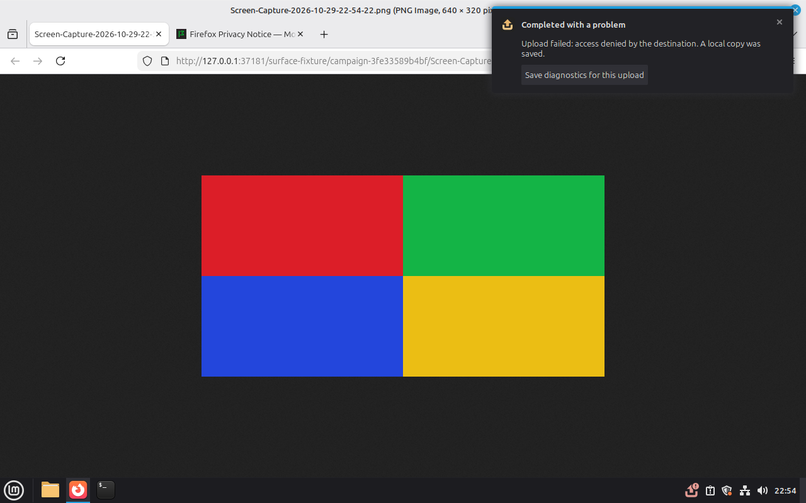
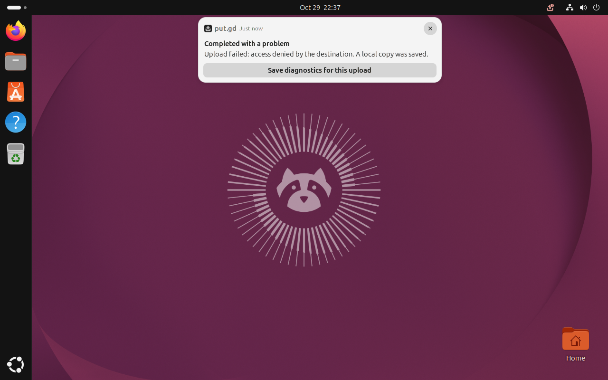

A foreign client's notification (including one that calls itself "put.gd") never
reached the run's log; the private family's own notification did.

## Runtime menus (#675)

These menus were resolved from live `QMenu` popups, which Qt keeps out of the
accessible tree, and clicked with real input. The History row menu's Copy
details put the operation ID on the clipboard. The search field's context menu
did Select All, then Cut: the clipboard held the token and the field was empty.

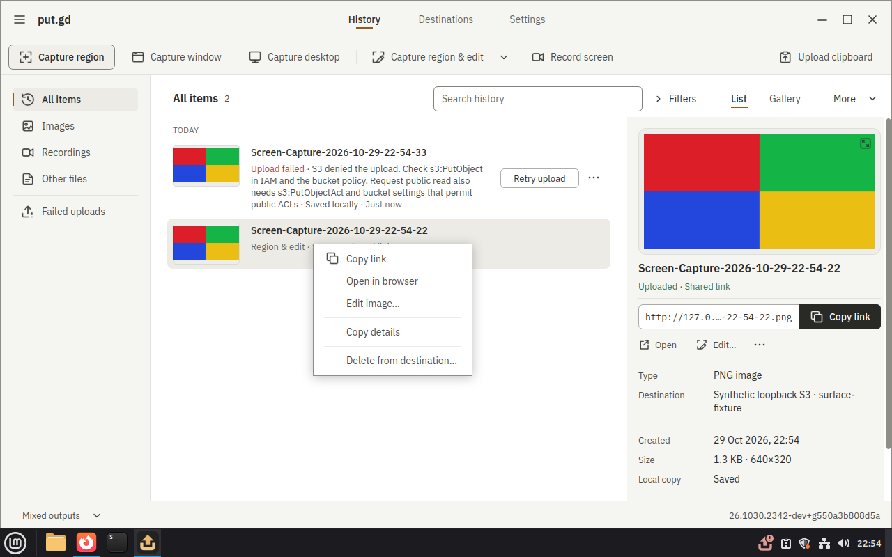
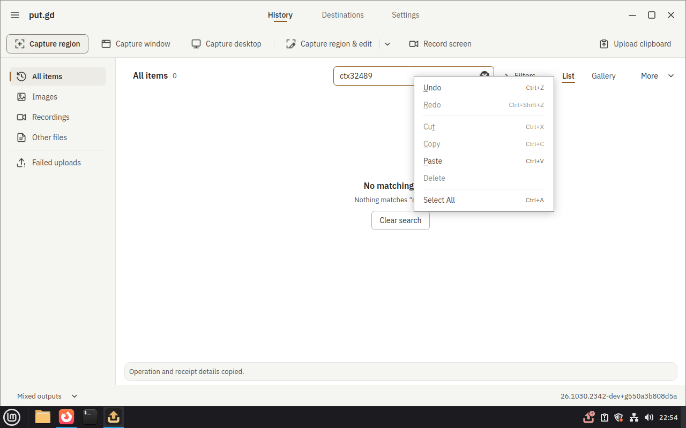
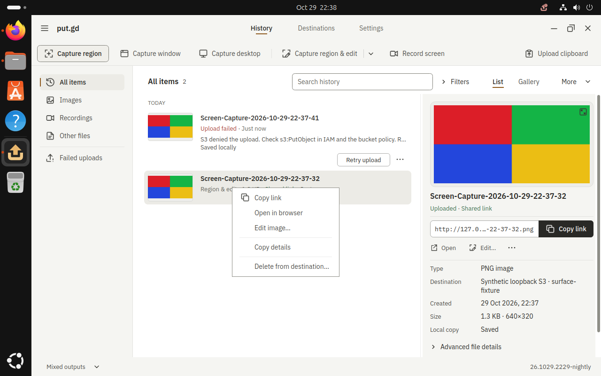
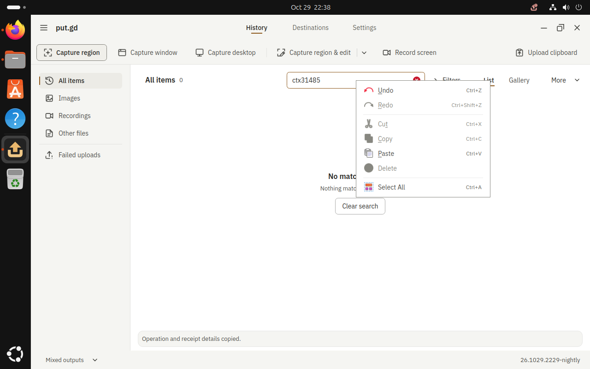

## Occlusion (#699) and startup focus (#750)

A foreign window over the editor refused the click and named the window
(`input target 'editor' is obscured by 'Core 2a obstruction'`). After
`focus('editor', raise_window=True)`, the same click selected the Text tool. On
GNOME the raise used the lab witness's activation, confirmed by compositor
focus. A resident banner over History's toolbar also refused input, naming it.

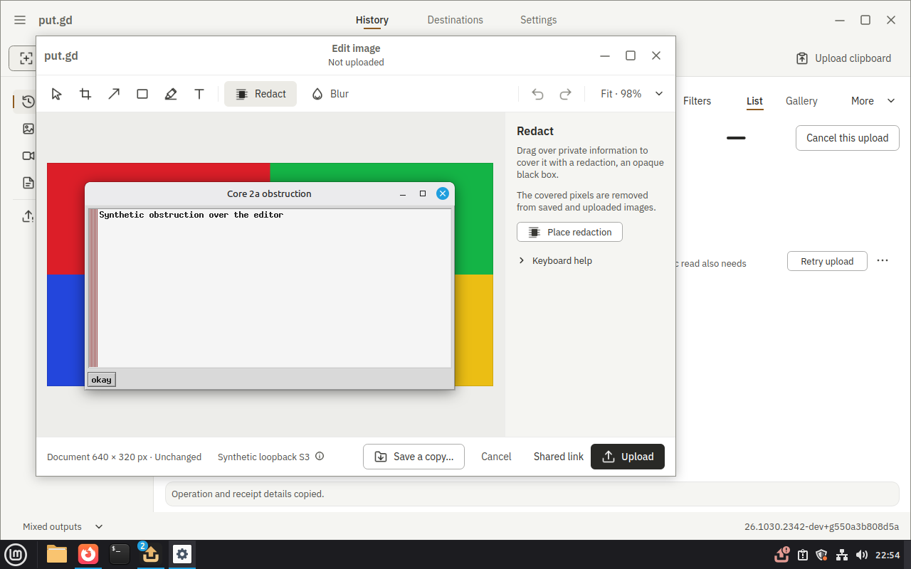
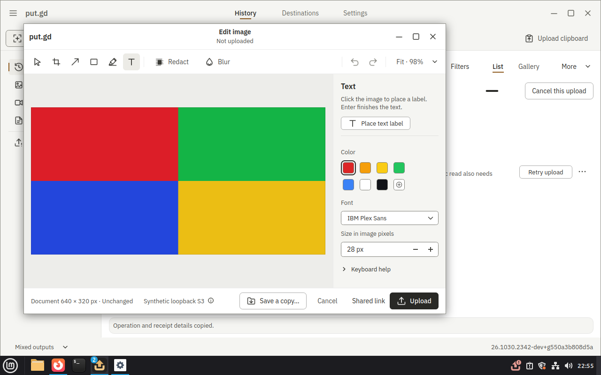
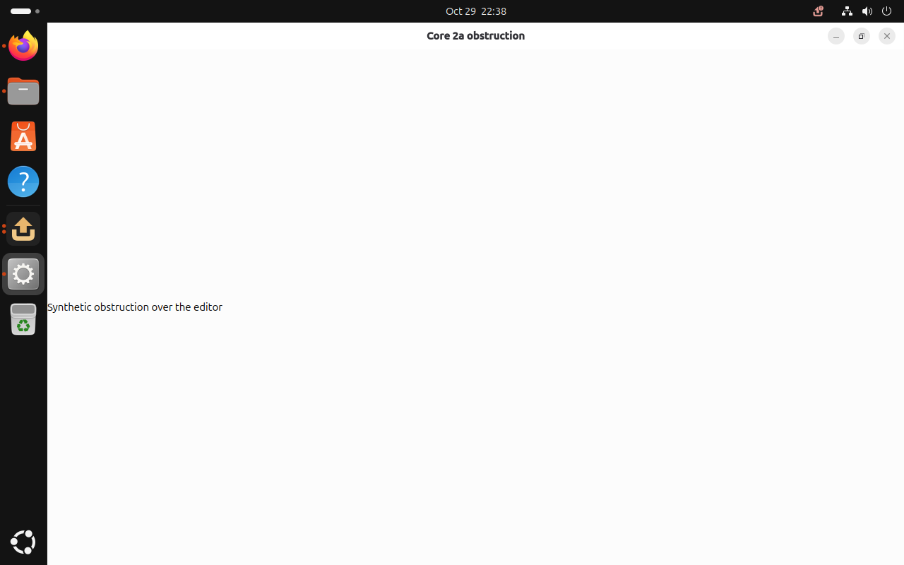

Ten back-to-back fresh-overlay `run.py --recipes core_demo` runs on Cinnamon all
passed every row, with no refusal. Each overlay was retired through guarded
cleanup.

## Selector readback (#701)

Cinnamon's native region selector was found through its focus event, with its
live description. GNOME's was the put.gd Shell extension actor.

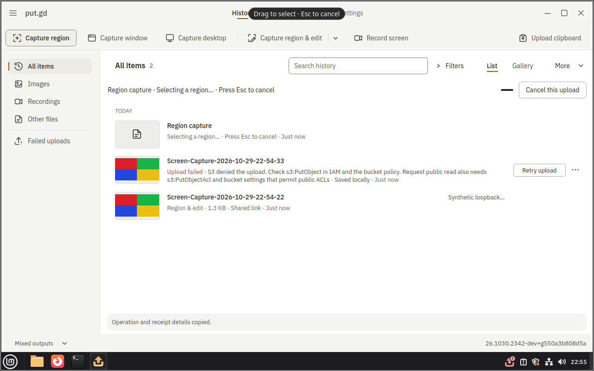

## Wayland coordinates

Qt reported the editor at (0,0). The compositor witnesses placed it at (223,106)
on GNOME and (190,63) on KDE. A crop made from the driver's geometry is exactly
the editor. A click on the placed Text button selected Text. A point on the
shell panel was refused, naming the panel or plasmashell.

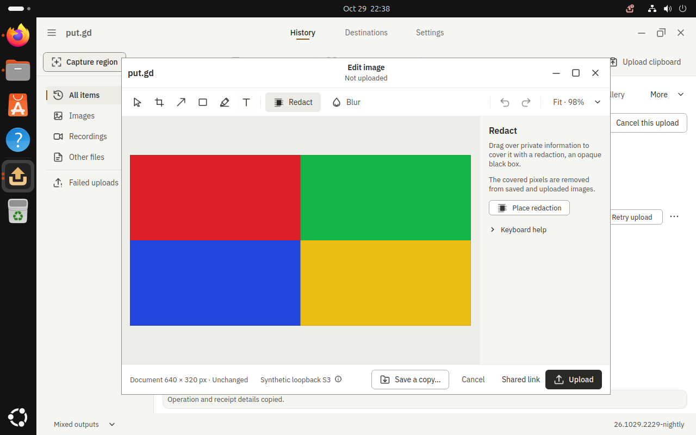
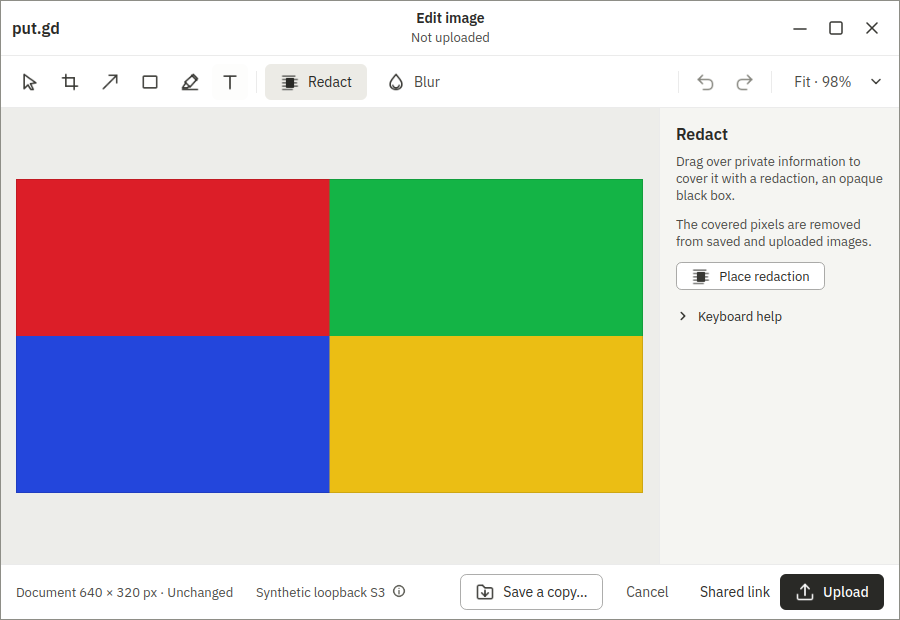
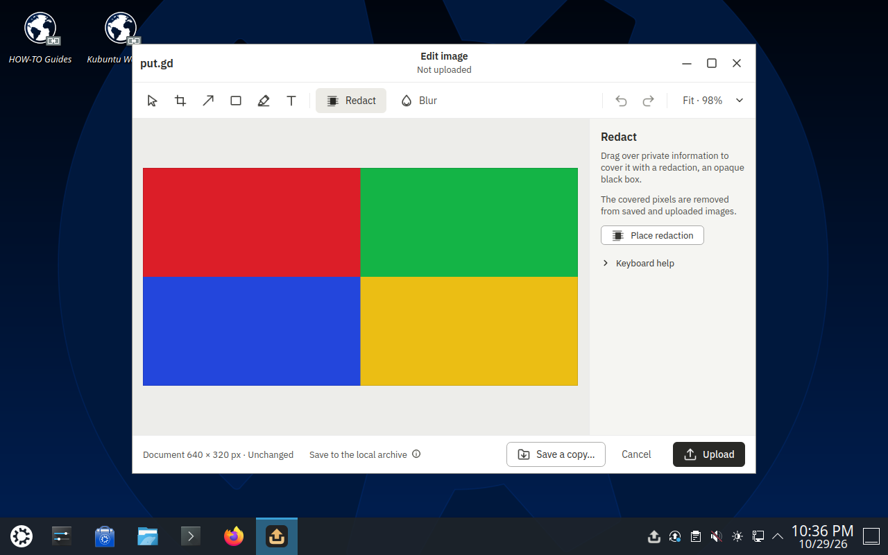
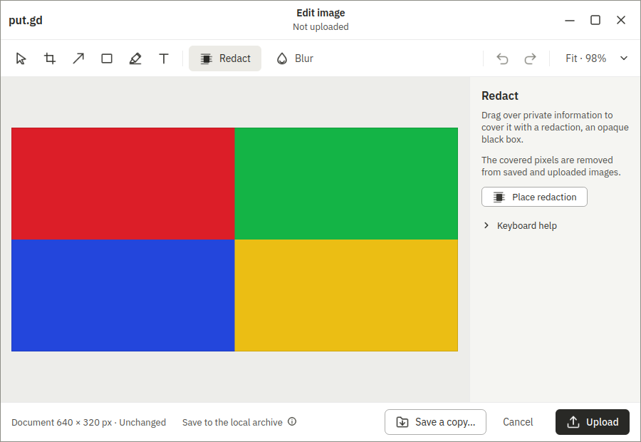
