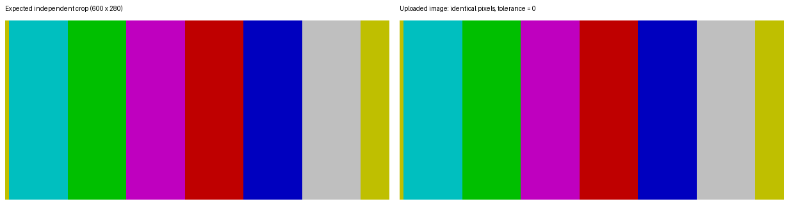
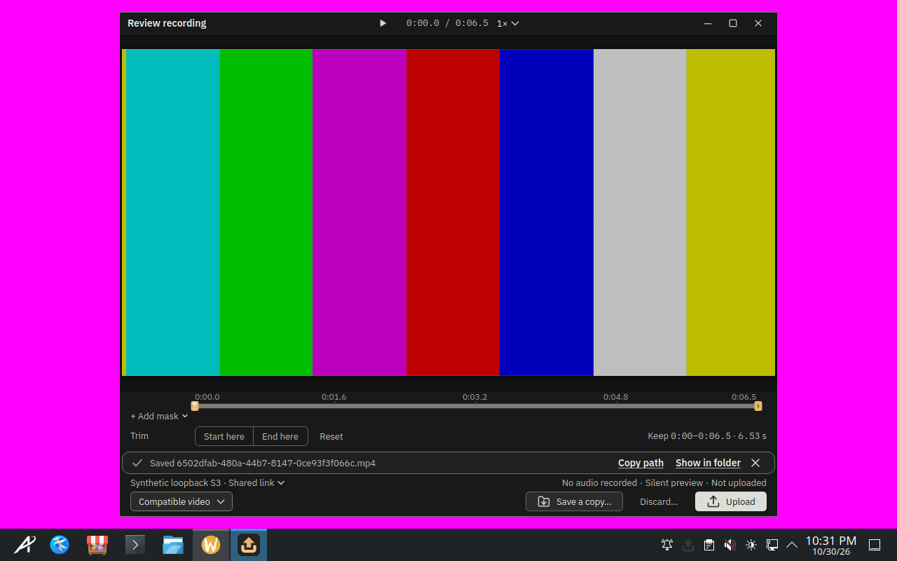
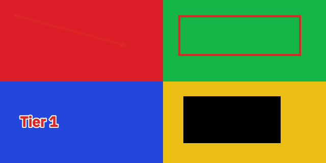

# Tier 1 Phase A — consolidated local results, 2026-10-30

Driver: clean export of `origin/feat/surface-driver-core` at `6e6c0e2347ea15b0aa6ea8371493ccb344051e3b`. Published app: **v26.1030.3203-nightly**, app commit `cc9d9410d6e982dd93d58bcfda82f112c44a82f6`, with matching catalog from CI run `41111404666`. Each published asset was verified against the release’s `SHA256SUMS`. Nothing was compiled or changed in the driver/app.

Placement is **boat**, using owned disposable KVM guests and real mouse/keyboard input. `--destination local` runs the recipes’ isolated synthetic localhost object service; this exercises upload, object hashes, browser links and deletion without live S3/Proton credentials. These are development results, not physical desktop or release acceptance.

| Desktop | Region | Window / desktop | Recording → upload | Edit → upload | Link → browser | History delete |
|---|---|---|---|---|---|---|
| [Cinnamon](cinnamon/receipt.json) | B [#967](https://github.com/patrick-hudson/put.gd-desktop/issues/967) | P | P | P | P | P |
| [GNOME](gnome/receipt.json) | P | P | P | P | P* | P |
| [KDE](kde/receipt.json) | P | P | P | P | P | P |
| [Aurora](aurora/receipt.json) | P* | P* | P* | P* | P* | P* |

**P** passed, **F** failed, **B** blocked. Each final desktop row comes from one complete six-recipe run; coverage contains its twelve interaction rows.

* GNOME’s first run used Snap Firefox and its browser ownership guard blocked: **B [#968](https://github.com/patrick-hudson/put.gd-desktop/issues/968)**. The one full retry explicitly staged the existing SHA512-verified Mozilla fallback and supplied its `browser.command` / `profile_root` fragment. [First receipt](gnome/first-attempt/receipt.json) and [failure frame](gnome/first-attempt/browser-blocked.png) are retained. No guard was relaxed.
* Aurora’s first collection was premature: the recipes reported P, but the controller retired the sandbox before the terminal audit/export completed: **B [#969](https://github.com/patrick-hudson/put.gd-desktop/issues/969)**. Its [incomplete receipt](aurora/first-attempt/receipt.json) is retained; those provisional rows do not become passing map coverage. The one full sandbox retry supplies the final Aurora row.
* Cinnamon region remains **B [#967](https://github.com/patrick-hudson/put.gd-desktop/issues/967)**: no live selector AT-SPI node or authorized geometry (`0 matches`). The raw reason still references earlier #942. Its [saved failure frame](cinnamon/region_upload.png) shows the frozen pattern without the selector. Cinnamon was not retried.

All three issues remain open. This results campaign made no implementation fixes.

## Recording measurements

| Desktop | Native acquisition | Frozen control | Uploaded motion | Uploaded duration |
|---|---|---:|---:|---:|
| Cinnamon | `x11` | 0.018 | 62.94 | 6.666 s |
| GNOME | `mutter-screencast` | 0.015 | 62.836 | 6.666 s |
| KDE | `kde-screencast` | 0.024 | 59.671 | 6.133 s |
| Aurora | `kde-screencast` | 0.019 | 61.834 | 6.533 s |

The unchanged oracle requires frozen motion ≤1.0, uploaded motion >max(1.0, frozen+1.0), at least six comparisons from eight samples, 640×320 decoding, and duration 4–30 seconds. Upload SHA-256 equals the saved file’s SHA-256. The retained private archives contain the frozen, moving and uploaded functional clips.

## Exact identities and evidence

| Desktop | Snapshot | Sandbox | Overlay run |
|---|---|---|---|
| Cinnamon | `putgd-lab-cinnamon-v3` | `bx_s8jxdf93` | `c57e7946-fcf4-4122-8d32-94ed08f5a0a2` |
| GNOME | `putgd-lab-ubuntu-gnome-v4` | `bx_ng72wuxu` | `55e464d7-59ce-4fb3-aa91-f78eac19b639` |
| KDE | `putgd-lab-kubuntu-kde-v1` | `bx_unbdwyhb` | `6852fe21-74d6-4d14-93c3-cd3e49fcc4c5` |
| Aurora | `putgd-lab-aurora` | `bx_wtrrs85y` | `1e02440e-3609-4c2d-a34d-cb9a53c5a2c6` |

Cinnamon used the Ubuntu 24.04 DEB. GNOME and KDE used the Ubuntu 26.04 DEB. Aurora used the AppImage, with `uupd.timer` masked. KDE’s native session is Plasma/KWin 6.6.6; Aurora’s is Plasma/KWin 6.7.5 on Qt 6.11.2. Per-desktop `package.json`, `lab-identity.json`, `source-identity.json`, setup capacity/socket/version receipts, final `exit.txt`, frame masks and cleanup receipts preserve the exact identities and hashes. GNOME/Aurora retry configuration and first attempts are explicit above.

The common run used `python3 -m tools.lab.surface_driver.run --host boat --placement boat --destination local --recipes outcomes --run work/lab-runs/fa1 --catalog /home/user/t1cat --build cc9d9410d6e982dd93d58bcfda82f112c44a82f6 --out /home/user/t1e/a1`. Desktop/profile/package selections match the table and receipts. The raw archives retain the exact run script and all 133 driver/helper source hashes. The driver’s resolved sockets and the harness runtime paths passed the 107-byte UTF-8 limit before launch.

The final collector requires a terminal exit marker, `secret_scan.passed`, both successful/published coverage-export proofs and no cleanup errors before export. Archives are SHA-256 checked and every manifest member is rehashed before guarded overlay retirement. KWin AppImage mirror absence is independently checked in the guest. All owned sandboxes, overlays, wall entries/tunnels and the task SSH agent are retired; named snapshots and immutable bases are preserved.

KDE setup initially exceeded `guest_session`’s 60-second package-command budget; a continuation met the still-running install’s lock. Both errors are retained privately. The same install was allowed to settle, prerequisites were verified, and the one recipe run then proceeded. No compositor/portal packages were upgraded and no test assertion changed. Other small collector command corrections are retained in the linked JSON receipts. Public setup metadata has trailing whitespace normalized; the private archives preserve the original bytes.

The schema-v2 [coverage file](../../../tools/lab/surface_map/coverage/2026-10-30-surface-driver-tier1.json) uses `host: boat`, `placement: boat`, and final receipt/frame paths. The original blocked/incomplete attempts stay readable here without replacing the latest complete row. [Validation](validation.json), [cleanup](cleanup.json), [retention index](retention.json) and [file hashes](files.sha256.json) cover the published packet. The private evidence root is `/home/patrick/work/put.gd/work/campaigns/surface-driver-20261029/tier1-phase-a-final/`; verified `.tgz` files restore each exact raw packet. Private key, protected login, app configuration and credential/session files were never exported.

## Key frames

GNOME’s independent 600×280 expected crop and exact uploaded image:

Aurora’s explicit private review before recording upload:

Aurora’s exported annotations and solid redaction:

