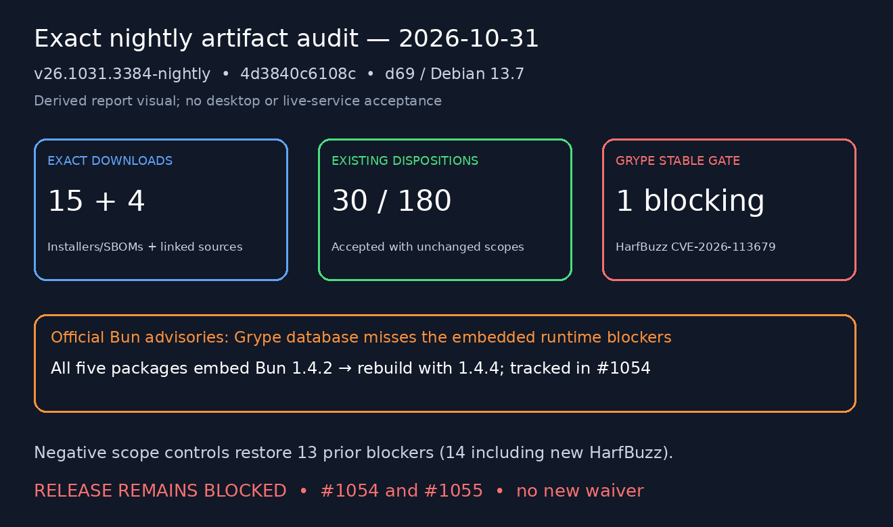

# Exact-asset license, source and CVE rehearsal — 2026-10-31

The newest published installer nightly selected at the start of this campaign was
**v26.1031.3384-nightly**, commit
`4d3840c6108c22546d83c43a1b7d4c77b1df9d6d`. This audit does **not** approve a
stable release. Grype reports one undispositioned High finding, and the upstream
review identifies affected embedded Bun code which Grype misses. See
[#1054](https://github.com/patrick-hudson/put.gd-desktop/issues/1054) and
[#1055](https://github.com/patrick-hudson/put.gd-desktop/issues/1055).
Issues #383 and #511 remain open; exact stable bytes must be rerun under #384.

Code: [PR #1053](https://github.com/patrick-hudson/put.gd-desktop/pull/1053).
The driver is `tools/releases/audit_assets.py`. This evidence and the runbook
changes are deliberately in a separate documentation-only PR, to merge after code.



## Identity and scope

The headless work ran over pinned SSH on physical **d69 / debian**, Debian 13.7,
under `/home/patrick/work/ra383/`. No desktop session, display, login, keychain,
Proton account or user destination was used. No graphical or live-service
acceptance is claimed. A report visual below is derived audit data, not a desktop
screenshot. Heavy extraction, hashing, compilation and Grype ran on d69.

Downloads used `gh release download` for the installer nightly, its
`sources-v26.1031.3384-nightly-files` release and the two immutable
`proton-sources-0.22.2-crypto2.0.1` parts. The current positive inventory is
**15 installer/SBOM/support assets plus four linked source assets**, rather than
the historical issue's 16/21-asset layout. The two Proton transport parts total
2,484,914,096 bytes; six inner source packets verify independently. The complete
AppImage source archive is 758,922,863 bytes. Assets were not rebuilt or replaced
in place.

The original producing run is
[41176529926](https://github.com/patrick-hudson/put.gd-desktop/actions/runs/41176529926).
Cross-distro native executable identities are credited to that CI's audit,
rebound here to every extracted file hash and package SHA-256. AppImage
`--version-json` observations are a new headless check, separate from those CI
receipts. Module/runtime hashes and the installed manifests are checked against
actual extracted bytes. This does not substitute for native runtime/desktop
acceptance on each target distribution.

## Results

The final driver, source `82a197819f23d9ee0040e581df013a8853dc4715`, completed
on d69 with exit **1** for exactly the two security errors in [audit.json](audit.json).
Every artifact/source check completed. [The regenerated-SBOM report](vulnerability-summary.md)
agrees with the published-SBOM scan: 180 findings, 30 accepted, one blocking.
The audit separately records three official Bun advisories affecting all five
packages. Package/source remote snapshots were unchanged across the run. Authenticated
release lookup scans every API page and rejects duplicate draft/tag matches;
the final rerun includes that review fix.


- Both checksum inventories, tag commit/tree/count/date and remote asset digests
  match. The release's source-delivery manifest binds the four linked downloads.
- All four native inventories, root ownership/modes and RPM `%license` placement
  pass. The native notice corpus is `runtime-notices.txt`, DEP-5 `copyright`, the
  AWS/component snapshots and `proton/THIRD-PARTY-NOTICES.txt`; these are the
  corrected merged package materials, rather than the original issue's historical
  filename list. Native Qt stays distro-owned.
- The AppImage has **138** inventoried components, corresponding license texts,
  its combined-work GPL notice and matching AppStream expression. All installed
  files are owned by that inventory; no missing notice/provenance or wrong
  license field was found in these exact bytes. Sixty-two Ubuntu entries retain
  `NOASSERTION` where their raw copyright cannot be safely mapped to SPDX; their
  full copyright and common-license texts remain installed. This verifies the
  materials and preserves the existing boundary on legal conclusions.
- Complete AppImage source closure verifies, including codec and AppImage runtime
  sources. The curated export excludes private work/evidence/plans/credentials
  and verifies its per-file hashes and supplied identity.
- All five helpers match the source catalog/runtime/notices hashes. Both Proton
  parts concatenate to the catalog hash; all six inner packets verify. The
  direct `@openpgp/web-stream-tools` notice is present. The original CI jobs used npm **9.2.0** in Ubuntu/Debian/AppImage and
  **10.9.8** in Fedora 44; [observed packages/log references](npm-ci-observations.json)
  retain each job identity. Ubuntu 24.04 reported Node **18.19.1**; the new d69
  rebuild uses npm **9.2.0**. This revalidates #369 rather than reopening its implementation.
- Published and regenerated SBOM declarations are compared to actual package
  metadata and FFmpeg/ICU library/absent-tool fingerprints. The current policy
  accepts **30** findings until **2027-01-21**. Removing dispositions, changing
  fingerprints, declaring tools present or advancing beyond expiry produces
  **14** blocking findings: the 13 formerly dispositioned threshold findings plus
  the new HarfBuzz finding. See [controls](disposition-controls.json).

### Vulnerabilities and decisions still required

[The published-SBOM scan](published-vulnerability-summary.md) records **180**
findings: 30 accepted, 149 reported, **one blocking**. The database is schema
`v6.1.10`, built `2026-10-31T06:18:17Z`, archive SHA-256
`d574583126b3b0eb72bf49ea72ee382bbfb3adff4358105540a303e9f41b874c`.
All 180 scanner findings are in the AppImage; each native SBOM has zero Grype
findings. Zero scanner findings do not clear the embedded Bun advisories.

- **#1054 — real embedded-runtime blocker.** Bun **1.4.2**, helper hash
  `e93b3b520d20a19e37569c7a97a1680f47bc43fcb5acaf6a5d69fa660e0a34b0`, is in all
  five packages. Official Bun advisories identify High **CVE-2026-111497**
  (Brotli decoder out-of-bounds write), compromised eMudhra CA trust and opt-in
  HTTP/3 QPACK amplification, fixed in **1.4.4**. The helper must be rebuilt;
  updating the host runtime does not repair compiled executables. No exploit was
  attempted and no exception granted. The automated driver now checks Bun's
  official advisories because this Grype database did not report them.
- **#1055 — unresolved stable scan gate.** High **CVE-2026-113679**, Qt's embedded
  HarfBuzz **14.5.0**, scanner fix **15.0.0**. Upstream fixes the experimental WASM
  shaper. Qt's source list omits that shaper, but that source observation is not an
  approved exact-binary disposition. An update or separately justified/approved
  fingerprint scope is required. Existing FFmpeg/ICU dispositions were unchanged.

The dated [dependency and Proton maintenance review](maintenance.json) records
pins, upstream status, security references and the supported asset list. Proton's
README still places its planned cryptographic migration in late 2026/early 2027,
with definitive timing/instructions pending. This is an upstream/source review;
it does not rerun authentication/refresh, protected/unprotected recipient equality,
history/recovery or the wider current-version acceptance campaign. Those remain
separate release gates; no new legal or service compatibility approval is implied.

## Reproduction, failures and retained evidence

The code PR also fixes a real provenance omission: tagged package builds skipped
the source-export rebuild, so this nightly has a null `sourceBuild` CI receipt.
Stable package builds now perform it, and stable collection rejects its absence.
A separate fresh rebuild of this downloaded source **passed** on d69 in
806.12 seconds using the normal Release preset, distro Qt and the pinned official
AWS SDK. All eight rebuilt program identities match supplied commit/tree/count;
both rebuilt helper copies reproduce the exact published runtime SHA-256. See
[results](source-rebuild-results.json) and [parameters](source-rebuild-parameters.json).
This is new compilation evidence, distinct from the nightly's null CI receipt.

```sh
python3 tools/releases/audit_assets.py --tag v26.1031.3384-nightly \
  --directory /home/patrick/work/ra383/assets \
  --output /home/patrick/work/ra383/final3 \
  --reuse-downloads /home/patrick/work/ra383/a2 \
  --source-build-result /home/patrick/work/ra383/rebuild/results.json
```

The initial attempts are preserved on d69 and summarized in `failures.json`:
a missing nightly rebuild receipt; the native CPack filename versus collector
filename; inclusion of `source-info.json` in the outer receipt but not its own
inner hash list; Debian's standard gh 2.46 lacking `--slurp`; and whitespace
in upstream advisory ranges. The corrected driver uses canonical published filenames, compares the proper source member
sets, decodes paginated JSON directly and normalizes comparator whitespace.
Checksum/source-export, draft-snapshot, helper-binding and advisory-range tests
cover these boundaries; collector tests enforce the stable rebuild requirement. No policy was weakened and no missing
receipt was fabricated.

[Raw evidence](raw-evidence.tar.gz) contains all five regenerated SBOMs, all five
raw Grype JSON results, the rebuild log and each failed attempt's receipt/log.
The [restore index](raw-evidence-index.json) records archive and per-member hashes;
those hashes were verified on d69 and again after export to the workstation.
[Evidence checksums](EVIDENCE-SHA256SUMS) cover the sanitized packet. The complete
inventory/license/source data is in [audit.json](audit.json) and
[bundled-components.json](bundled-components.json). The scanner database receipt
is [database.json](database.json). No raw payload or credential is included.

Raw downloads, full rebuild tree/logs, database archive and every attempt remain
private on d69. Exported receipts, summaries, raw findings and source identity
remain in this evidence directory. Bulk scanner JSON is compressed only with a
checksum and restore index. These are artifact/source audit results, with the
failure context retained; no physical graphical acceptance is asserted.
