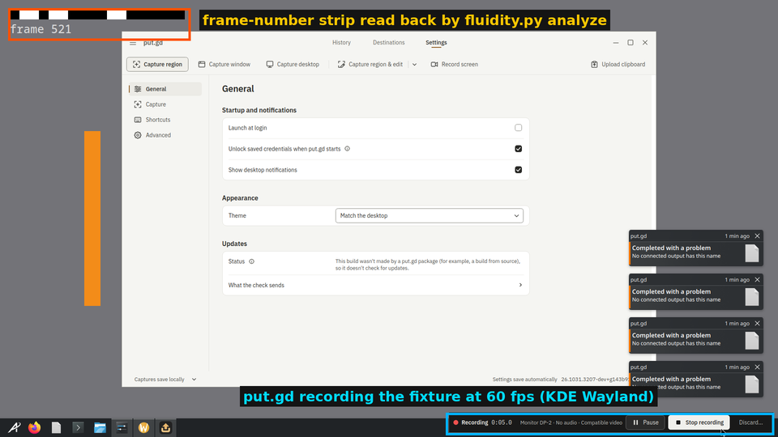
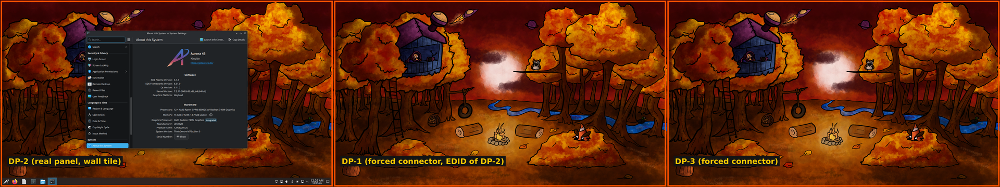
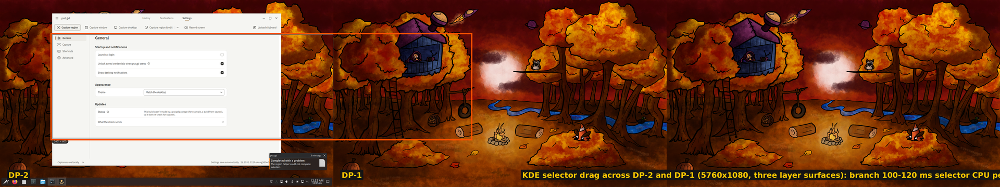
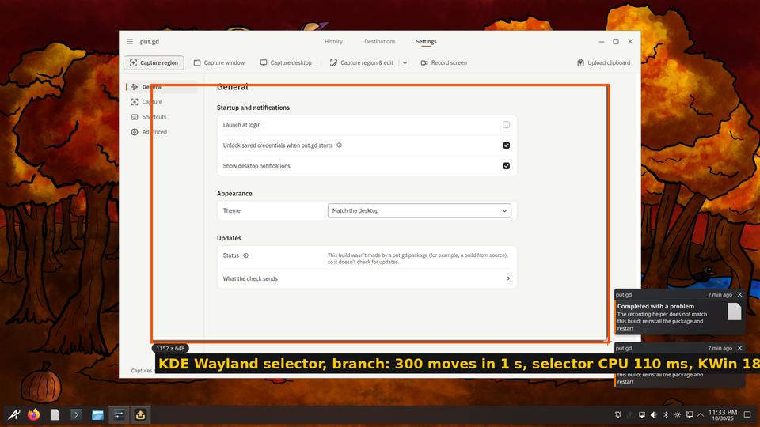
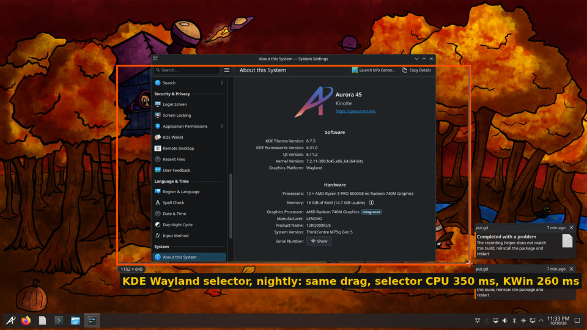
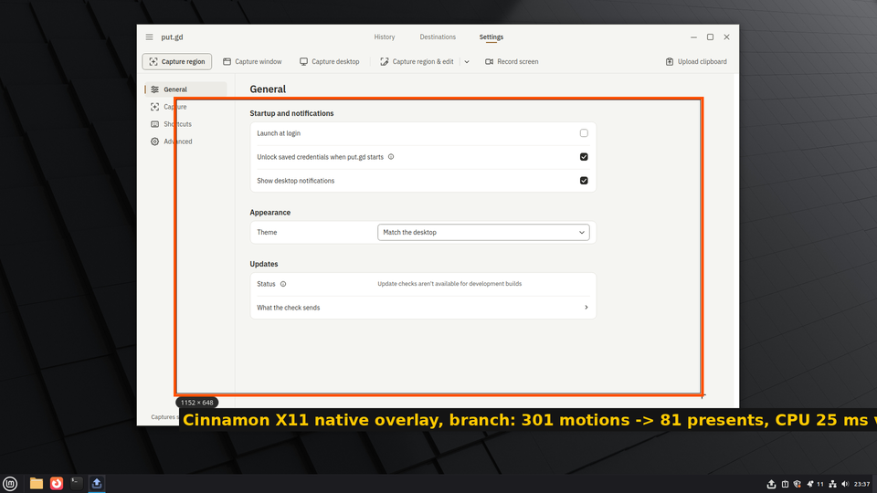

# Fluid motion: region selectors and the 60 fps recorder (issue #6)

PR #981 (code) and this receipt cover the lab runs of 2026-10-31
(04:00–05:00Z). The question was why dragging a region feels laggy and why
recordings look choppy at 60 fps, on every desktop rather than one setup. The
measurements come from `tools/lab/fluidity.py` and `tools/lab/fluidity_run.py`
(this PR): a full-screen fixture stamps every displayed frame with its number,
the analyzer reads those numbers back out of the recording, and the drag test
counts pointer events, repaints or presents and the CPU each side spent. Raw
results (`results.json`, logs, working clips) stay on the hosts under
`~/putgd-lab/fluidity/` (aurora-amd, m74, f44) and `/tmp/pgf-ws` on the
workstation.

## Builds

| Build | Source |
| --- | --- |
| nightly before | release `v26.1030.3203-nightly` AppImage (`55e9596d3132…`); on the workstation Patrick's running `26.1030.2582-nightly` |
| branch | `perf/overlay-recorder-fluidity`: Aurora dev tree at `1cd3f7b0` (`videorate` on X11 added at `0b1dbac6` after the workstation finding); CI run 41167761712 AppImage `putgd-26.1031.3212-dev+g8109714b1c59` (`fab3192d345d…`, selector and pipeline threading changes; before the PipeWire buffer copy) |

## What was wrong

- Every selector repainted every surface on every pointer event. The X11
  native overlay cleared each monitor-sized window per motion with no
  coalescing; the Qt, KDE Wayland and recorder selectors ran a full-window
  `update()` per move. A 300–1000 Hz pointer queued monitor-sized redraws and
  uploads behind itself.
- The recorder ran capture, colour conversion and encoding serially on the
  source thread, with x264 in zerolatency on two sliced threads. On Wayland the
  compositor waited for its stream buffers; on KDE every other frame was lost.
- The bundled `va` encoders stamp their output contiguously: every grab that
  ximagesrc skipped on X11 shortened the clip (a 10 s recording played in 7.4 s
  on the branch before the fix, 9 s in 4.4 s on the nightly).

## Recorder, monitor target at 60 fps, 1080p, 10 s

`distinct/s` is how many different display frames per second the clip holds
(the clip itself is always 60 fps after `videorate`); `fluid` is the share of
consecutive clip frames whose source frame advanced by exactly one.

| Desktop | Acquisition, encoder | nightly distinct/s, fluid, longest stall | branch distinct/s, fluid, longest stall |
| --- | --- | --- | --- |
| aurora-amd, Plasma 6.7.5 Wayland, Radeon 740M | kde-screencast, `vah264enc` | 30.7 / 31.1 (17 in one round), 0.30, 33–233 ms (2+ frame skips) | first pass 47.0 / 46.5, 0.56, 17 ms; with the unthrottled stream and the cadence lock 59.6 / 59.9 / 59.9, 0.99–0.997, 17 ms (1–4 repeats, 1–2 skips in 10 s) |
| m74, Cinnamon 6.6 X11, HD 530 | ximagesrc, `vah264lpenc` | 59.3, 0.99, 17 ms | 58.6 / 59.4, 0.98, 17–33 ms |
| f44, GNOME 50 Wayland, HD 530 | mutter-screencast, bundled `x264enc` | 31.0 / 30.1, 0.48, 17–33 ms (desktop at 31 fps while recording, 60 idle) | 29.7 / 30.8, 0.48, 33–50 ms (same; 15% less CPU) |
| aurora-amd with three outputs, recording DP-2 | kde-screencast, `vah264enc` | 16.1, 0.14, 367 ms | 59.7 / 59.8, 0.99, 17 ms |
| workstation, Cinnamon 6.6 X11, UHD 630 + T2000, 3 monitors, eDP-1 | ximagesrc, bundled `vah264lpenc` | 46.6 of a desktop running at 20 fps; clip 4.4 s for 9 s | 6.6 of a desktop running at 5 fps; clip 7.4 s for 10 s; at 30 fps: 27.7, desktop at its idle 30 fps |

KDE: the compositor delivered 314 source frames to the nightly and 483 to the
first-pass branch in 10 s. KWin 6.7.5 throttles only when the negotiated
`max_framerate` is non-zero, with an integer-millisecond interval stamped
after its synchronous readback (about 20 ms per record), and offers 0/1 as the
minimum: asking for `max-framerate=0/1` turns the throttle off and KWin then
delivers ~66 records per second with 60 distinct contents. The remaining
loss (55 of 60 with raw arrival stamps) was ±8 ms arrival jitter in
`videorate`'s slot choice; identical frames are dropped at the source and
new frames take cadence-locked stamps. Mean-age smoothing (53–54) and the
compositor's header times (51–53) were measured and rejected. KWin offers
2–4 stream buffers, so the branch copies each frame out on the source thread
and returns the buffer at once.

Workstation: the Cinnamon compositor paces windows at about 30 fps on eDP-1
and 21 fps on DP-3 while idle (fixture frame clock), so no selector or
recording can look like 60 fps there. A 1080p60 capture plus conversion plus
encoding drops the desktop to about 6 fps with any encoder (x264 on 8 threads,
`vaapih264enc`, `vah264lpenc`), a pure 60 Hz grab alone costs little (28 fps),
and at 30 fps the desktop keeps its idle pace. That is a hardware budget, not
a pipeline bug; see the follow-ups.

Three outputs on aurora-amd for the multi-monitor checks (`tools/lab/fake_outputs.py add DP-1 DP-3`; the wall tile shows DP-2 only, this is KWin's own full-desktop screenshot):

## Selector drags, 300 pointer events in one second

| Desktop, selector | nightly | branch |
| --- | --- | --- |
| aurora-amd KDE Wayland, `putgd-kde-region` (layer shell) | selector CPU 350–360 ms, KWin 250–260 ms | selector CPU 100–110 ms, KWin 180–200 ms; 297–300 moves → 308–310 paints of 0.18 ms |
| m74 Cinnamon X11, native overlay in `putgd-capture` | selector CPU 80 ms | selector CPU 20–30 ms; 301 motions → 81–83 presents at a 17 ms frame interval, 0.29 ms per present |
| workstation Cinnamon X11, 3 monitors, native overlay | selector CPU 140 ms | selector CPU 30–40 ms; 301 motions → 65–66 presents, 0.3 ms per present |
| aurora-amd KDE Wayland with three outputs (DP-1 and DP-3 forced on with `fake_outputs.py`, 5760×1080, three layer surfaces) | selector CPU 830–860 ms, KWin 380–390 ms | selector CPU 100–120 ms, KWin 180–200 ms; 284–289 moves → ~300 paints of 0.22 ms |
| workstation, recorder's own selector (`putgd-record`, Qt, 3 surfaces) | selector CPU 950–1030 ms (a full core) | 300 moves → 314–334 paints of 0.32 ms; selector CPU 120–140 ms |

## Tests added

- `region_selection_contract`: the dirty region is the outline strips and the
  pills, never the interior or the surface.
- `x11_isolated`: the Qt overlay's paint events after a move cover the old and
  the new edge and not the interior (partial damage, proved by subtraction).
- `native_region_overlay`: 400 motions in a burst are coalesced into paced
  presents, the outline lands on the last motion, old edges are cleared.
- `recording_pipeline_throughput`: 60 fps from a moving Xvfb root, 181 frames
  in 3 s on the grid, none leaked at the capture queue.
- `tests/desktop/test_fluidity.py`: the frame-number strip survives a round
  trip and the analyzer counts repeats and skips.

## Not covered

- GNOME's selector (the Shell extension) was not measured: f44 has no
  extension installed for a private resident. Its per-motion work is a few
  actor moves and relayouts, which Clutter already paces per frame.
- The compositor's CPU on X11 is not measured by `fluidity_run.py` (Xorg runs
  as root; the `cinnamon` process pattern misses `cinnamon --replace`).
