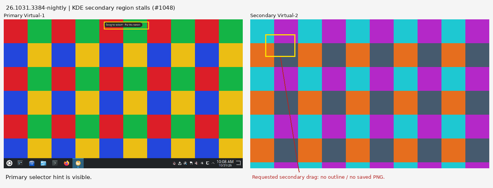
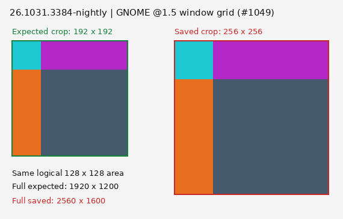
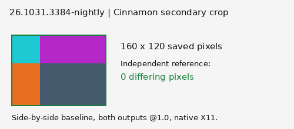
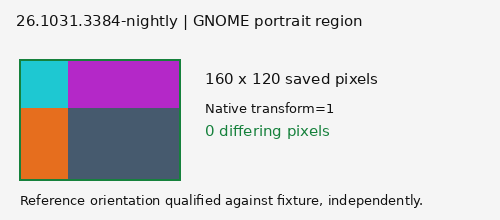

# Multi-head geometry results, 2026-10-31 — #380

The results run is complete; **release acceptance remains blocked**. The requested 75 flow cells contain **46 exact pixel passes, 8 failures, 10 blocked cells and 11 inapplicable cells**. Two distinct app findings were open release blockers at the time of this run: [#1048](https://github.com/patrick-hudson/put.gd-desktop/issues/1048) and [#1049](https://github.com/patrick-hudson/put.gd-desktop/issues/1049). Both issues are now closed; this historical run still does not establish acceptance of a later build.

Published asset: [v26.1031.3384-nightly](https://github.com/patrick-hudson/put.gd-desktop/releases/tag/v26.1031.3384-nightly), the newest `-nightly` at run selection. App commit `4d3840c6108c22546d83c43a1b7d4c77b1df9d6d`, tree `abf0a3c9d5fe23b1341f7a138d67cd1ffa347576`, clean. **No app compilation and no app/harness source changes.** Official lab/oracle source is `caf52592ddc38897e43e7b0e66468483ca5d662b`. The exact-commit `ui-catalog` came from CI run `41176518810`; its manifest checksum is in [results.json](results.json).

P = saved pixels pass `recipes/outcomes.py:pixels_equal`, tolerance **0**. F = app failure. B = unqualified lab/configuration cell. — = inapplicable. R is a secondary-head region, except after removal, when it is a new region on the remaining primary. Window follows the same head choice. D0/D1 are independently compared head crops from the app's single full-virtual-desktop PNG; the API has no per-head desktop action.

| Layout | Desktop / builder | R | Span | Window | D0 | D1 |
| --- | --- | --- | --- | --- | --- | --- |
| Side by side, second @1.5 | Cinnamon X11 / m74 | B | B | B | B | B |
| Side by side, second @1.5 | GNOME Wayland / d69 | P | P | [F #1049](https://github.com/patrick-hudson/put.gd-desktop/issues/1049) | P | P |
| Side by side, second @1.5 | KDE Wayland / k72 | [F #1048](https://github.com/patrick-hudson/put.gd-desktop/issues/1048) | [F #1048](https://github.com/patrick-hudson/put.gd-desktop/issues/1048) | P | P | P |
| Second left of primary | Cinnamon X11 / m74 | P | P | P | P | P |
| Second left of primary | GNOME Wayland / d69 | P | P | P | P | P |
| Second left of primary | KDE Wayland / k72 | P | [F #1048](https://github.com/patrick-hudson/put.gd-desktop/issues/1048) | P | P | P |
| 128 px gap | Cinnamon X11 / m74 | P | P | P | P | P |
| 128 px gap | GNOME Wayland / d69 | — | — | — | — | — |
| 128 px gap | KDE Wayland / k72 | [F #1048](https://github.com/patrick-hudson/put.gd-desktop/issues/1048) | [F #1048](https://github.com/patrick-hudson/put.gd-desktop/issues/1048) | P | P | P |
| Second rotated 90° | Cinnamon X11 / m74 | B | B | B | B | B |
| Second rotated 90° | GNOME Wayland / d69 | P | P | P | P | P |
| Second rotated 90° | KDE Wayland / k72 | [F #1048](https://github.com/patrick-hudson/put.gd-desktop/issues/1048) | [F #1048](https://github.com/patrick-hudson/put.gd-desktop/issues/1048) | P | P | P |
| Second removed while running | Cinnamon X11 / m74 | P | — | P | P | — |
| Second removed while running | GNOME Wayland / d69 | P | — | P | P | — |
| Second removed while running | KDE Wayland / k72 | P | — | P | P | — |

Cinnamon mixed scale is **blocked**, rather than an unsupported-platform waiver: this guest's Muffin reports `global-scale-required: true`; no per-output mixed-scale result is claimed. Cinnamon portrait is blocked by a black secondary QMP/VNC scanout before app capture ([#1050](https://github.com/patrick-hudson/put.gd-desktop/issues/1050)). Mutter rejects disconnected monitor layouts, so GNOME's gap cells are inapplicable. All compositors normalize negative origins: the requested secondary `(-1280,0)` becomes secondary `(0,0)`, primary `(1280,0)`. The left/right relationship and primary identity were verified.

An additional unscaled side-by-side baseline is retained in the JSON: Cinnamon passes all five cells; KDE fails region/span and passes window/both desktop heads; GNOME's two prerequisite attempts remain lab-blocked ([#1051](https://github.com/patrick-hudson/put.gd-desktop/issues/1051)). These baseline cells are excluded from the 75-cell count above.

**App findings and pictures**

- **#1048 — KDE selector:** secondary selection stalls in `acquiring`; crossing heads fails `capture_geometry`. The verified @1.0, @1.5, gap and portrait cases reproduce the same missing-secondary-selector behavior. A left-hand secondary region works, while spanning still fails. Window and desktop controls compare exactly. The failed regions produce no PNG: their saved-image pixel diff is unavailable, not a fabricated blank-image comparison. Operation IDs, expected crop sizes and saved selector frames are retained.
- **#1049 — GNOME fractional window grid:** on a native 1920×1200 @1.5 secondary head (1280×800 logical), region capture saves the correct 240×180 crop with pixel diff 0. Window capture saves **2560×1600**, the integer-2× backing grid, instead of the 1920×1200 output reference. Independent paste matches that saved PNG. This is a dimension failure under the requested head-scale oracle; intended backing-texture preservation would require an explicit product/oracle decision.

**Identities and method**

| Builder | Fresh guest / session | Desktop / compositor | Qt | Run ID |
| --- | --- | --- | --- | --- |
| m74 / 192.168.68.74 | Mint 22.3 / native X11 | Cinnamon 6.6.4, Muffin 6.6.1 | distro 6.4.2, xcb | `3ebef383-23cd-4fd7-b546-b408406fa3c8` |
| d69 / 192.168.68.69 | Ubuntu 26.04.1 / native Wayland | GNOME Shell 50.1, Mutter 50.1; packaged helper v16, lab witness v6 | distro 6.10.2, wayland | `cfbfcfa7-65d5-4665-a9eb-4a82c93ef3db` |
| k72 / 192.168.68.72 | Kubuntu 26.04.1 / native Wayland | Plasma/KWin 6.6.6 | distro 6.10.2, wayland | `a891b51d-be5a-4bc6-bb4b-a7154fda88dd` |

The Ubuntu 24.04 DEB used on Mint has SHA-256 `c0ec0359d3533c6cf693fb64f071f9dabb018710ad6fbf261f62f8c5111ed278`; the Ubuntu 26.04 DEB used on both Wayland guests has SHA-256 `533252f08be2583afd9eaf1f379f623e3f764cead733f1fcc5a5c32905b25b9b`. Running resident hashes were verified against package contents: Mint `9baac5d4773afb87d75ec04947e00bf6de3aac2ec42b246193b7cbfc50133941`, both Wayland guests `78b0b4ae80629f98b365c5c080691b3c77d4c8aace5ac24e11bf5f2c02a7f3fd`.

There was at most one live guest per builder; the three hosts overlapped. All used KVM, fresh overlays, private XDG homes and local synthetic destinations. Capacity, socket lengths, native logind/compositor identity and per-head visible-frame checks were retained. Both VNC heads were tunneled to the wall throughout each guest's use. m74/d69 desktop leases were held and cleanly released. k72's native-desktop holder explicitly allowed the VM alongside its work; the separate owned guest lease was removed. No physical desktop received input.

The existing `multi_output.py` cases `inside-1`, `span`, `window-1`, `desktop`, `output-change` and post-removal `inside-0`/`window-0` supplied real input and production operation IDs. The existing native GTK checkerboard covered the head under test. Exact comparisons used independently captured frozen per-head frames, with the existing checkerboard oracle as a second check. The still-capture worksheet is retained privately with the receipts; this packet adds no harness feature. Scope is the requested synthetic still-capture subset; release-asset acceptance and #380's broader recording/focus gates remain open.

Mixed scale used 1280×800 @1 plus 1920×1200 @1.5; other unscaled heads used 1280×800. The gap was 128 logical pixels. Portrait used the second 1280×800 mode rotated left, yielding 800×1280 logical. Desktop composition uses the highest participating density, nearest-neighbour resampling and transparent unoccupied areas. [desktop-head-crops.json](desktop-head-crops.json) records **25** independent head comparisons including baselines, all with zero differing pixels.

**Retained failures and minimal lab corrections**

- GNOME's first launch used an unpinned port and was rejected before allocation. Its first actual overlay then booted visibly but rejected Debian's builder bootstrap key. A visible-terminal public-key attempt failed; the retained replacement overlay authenticated through the original lab key in a temporary forwarded SSH agent. The private key stayed on the workstation. The failed overlay and replacement were both exported and retired.
- An early KScreen request printed `Output mode 1280x800 not found` despite exit 0, so requested scale/rotation were not applied. Those labels are excluded. Existing native layout verification and numeric mode IDs corrected the run parameters; the final KDE inventories prove density 1.5 and rotation 2 (left). No compositor/portal package was upgraded.
- Raw portrait QMP/VNC scanout stayed landscape on the passing Wayland cases. Its orientation was qualified uniquely against the existing checkerboard oracle **without using the app artifact**, then the reference was rotated 270°. The original incorrect comparisons remain archived. Corrected window/region/span/desktop comparisons are exact where the app produced them.
- The first mixed-scale reference used bilinear enlargement of the primary head. `Geometry.cpp` explicitly disables smooth transformation. Replaying the independent references with the documented nearest-neighbour rule yields zero differences for spanning/desktop captures; original comparisons are preserved. No RGB or percentage tolerance was loosened.
- Wayland prerequisite failures retain 0.625 primary coverage or an unchanged immediate final frame. Cells stopped by that gate are not app failures. Cinnamon's rotated black scanout remains blocked. Follow-ups are #1050/#1051; no new harness capability was built to bypass them.

On **all three desktops**, disabling the second head while selection was active failed safely with `display_changed`, produced no stale artifact, and preserved the independent clipboard sentinel. A new remaining-primary region, window and desktop capture then passed. Exact cancellation IDs are in the raw `removal/output-change.json` files.

**Retention and cleanup**

[restore-index.json](restore-index.json) pins the four private archives by compressed and uncompressed-tar SHA-256, member index and restoration command. Copies remain on their builders and under `/home/patrick/work/put.gd/work/campaigns/surface-driver-20261029/multihead-380-aca13938/`. Archives were copied and checksum-verified before overlay retirement; their Zstd integrity and member indexes were also verified. Original failures, command parameters, package/process identities, frames, payload PNGs, pixel comparisons and worksheet source are retained. No credentials or working share URLs are in this packet.

Guarded retirement receipts: [Mint](m74-retirement.json), [GNOME](d69-retirement.json), [failed GNOME bootstrap overlay](d69-failed-retirement.json), [KDE](k72-retirement.json). Immutable goldens were preserved. [Owned workstation cleanup](workstation-cleanup.json) verifies all three tunnels inactive, guest wall groups removed and the temporary SSH agent stopped; the native desktops and other wall entries were preserved.
