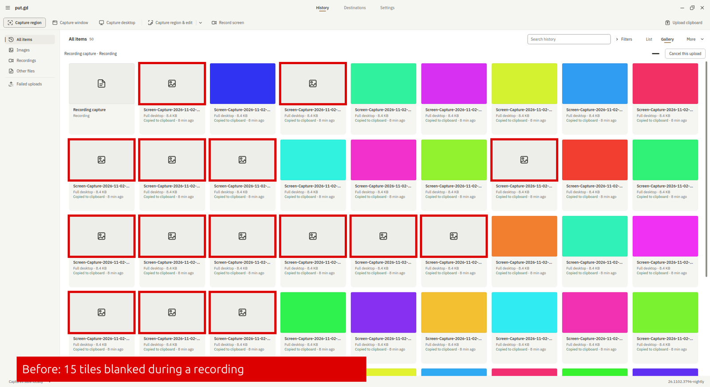
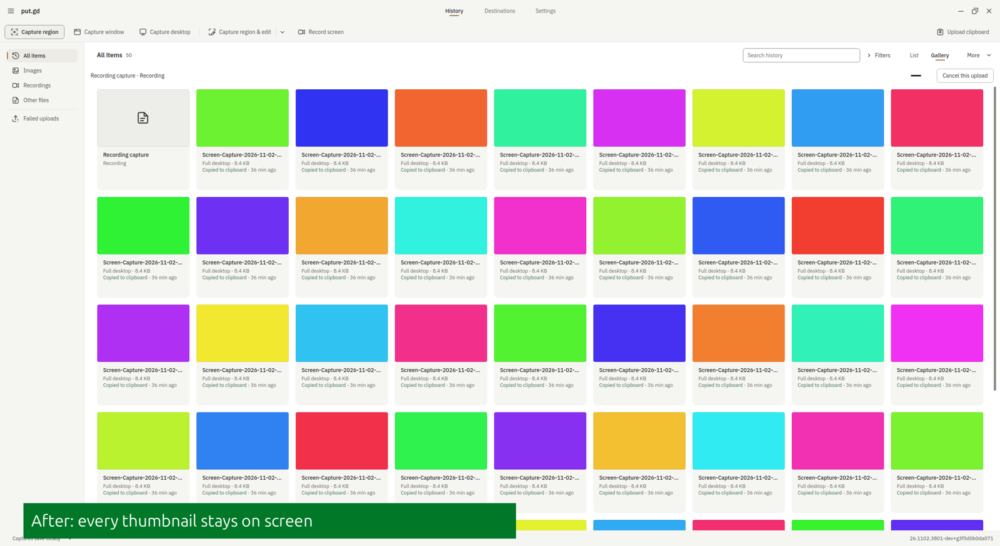

# History gallery blanking, scrolling and gap crash (#1151)

Mint 22.3 Cinnamon on X11 (`m74`), Qt 6.4.2, with the Ubuntu 24.04 DEB unpacked into a private
profile. The X screen was scaled to 2560×1440 to match the reporting display. History held 50
synthetic flat-colour desktop captures and the window was maximized in Gallery, showing about 45 tiles.

| | `v26.1102.3796-nightly` | `26.1102.3801-dev+g3f5d0b0da071` |
| --- | --- | --- |
| Coloured viewport pixels during a desktop recording, pointer still, 15 s: lowest / median | 755,695 / 1,281,081 | 1,280,976 / 1,280,976 |
| The same with the pointer moving over tiles, 12 s | 726,201 / 1,281,213 | 1,280,984 / 1,281,125 |
| `putgd-ui` CPU per wheel notch, 60 notches | 144.5 ms | 59.2 ms |
| Pointer resting on a gap between tiles | `putgd-ui` SIGSEGV in `galleryRow` | No crash |
| Pixels differing from a full repaint after each of 6 wheel notches | Not measured, the gap crashes this build | 0 |

Frames came from `xwd` of the root window, about 4 a second, so a short blank between frames can be missed.
A lower count means tiles were showing the placeholder.

GNOME Wayland (`f44`, Qt 6.11): `scrollingPaintsOnlyWhatScrollsIn` passes on the live session, so
scrolling moves pixels there too. That covers paint regions, not captured frames. Plasma wasn't run.

