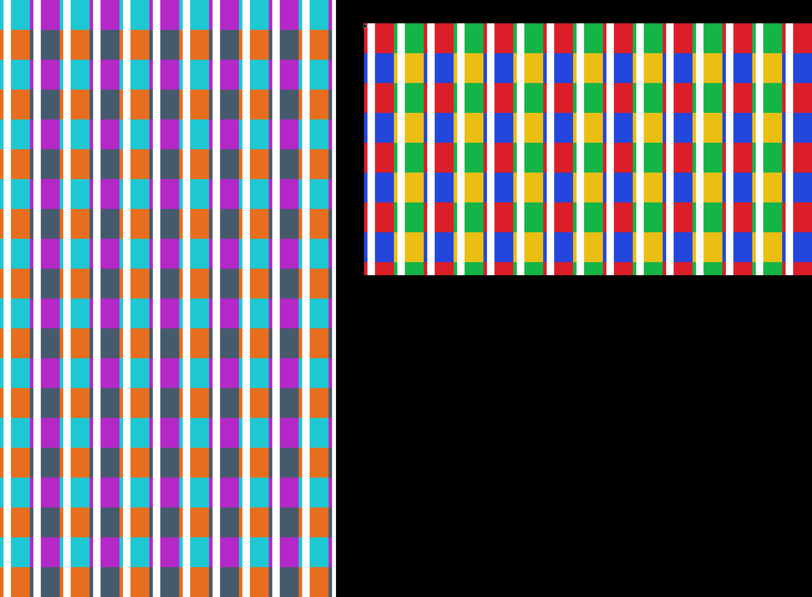
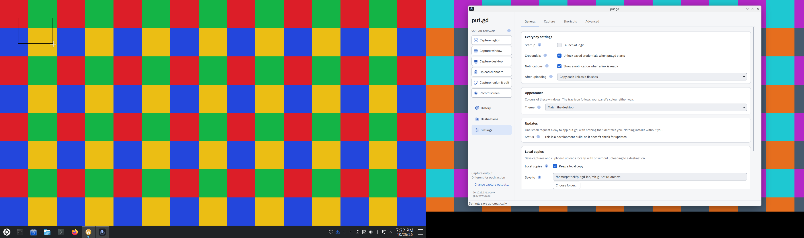
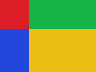
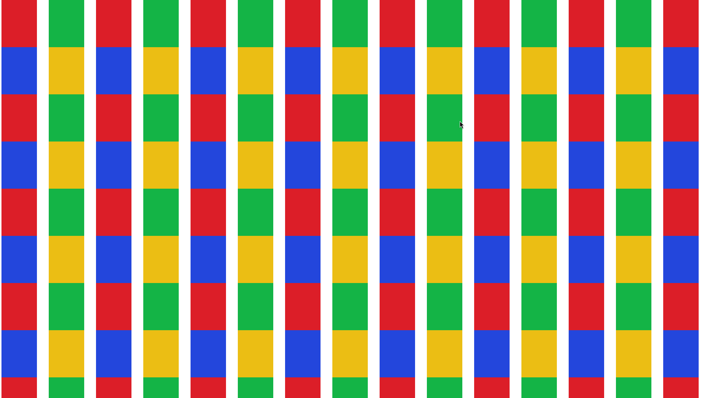
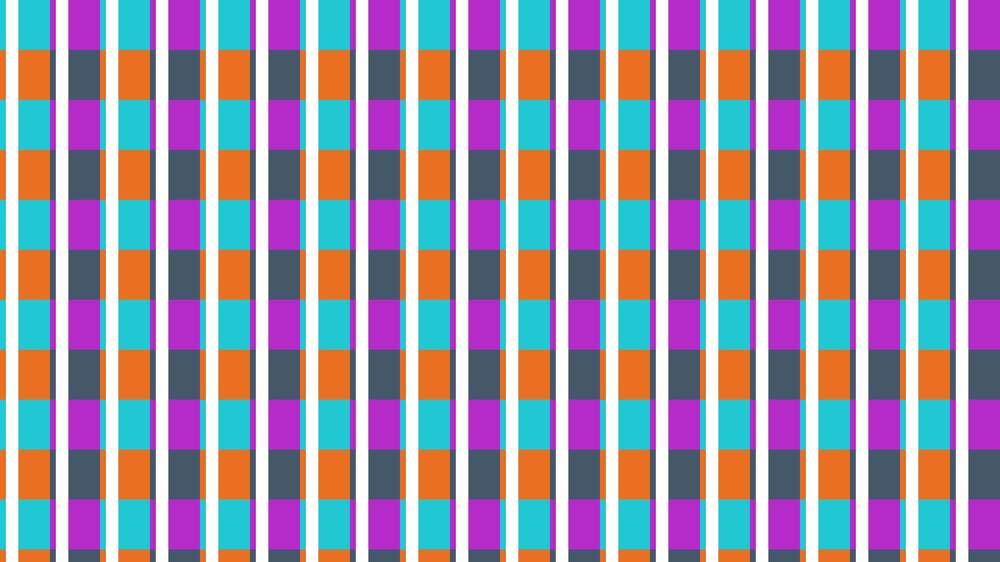

# Headless multi-output pilot — 2026-10-25/26

This is partial geometry evidence, not release acceptance. The executable route
is documented in [the lab guide](../../headless-multi-output.md). Product fix
[#582](https://github.com/patrick-hudson/put.gd-desktop/pull/582) and tooling
[#583](https://github.com/patrick-hudson/put.gd-desktop/pull/583) target nightly.
[#380](https://github.com/patrick-hudson/put.gd-desktop/issues/380) remains open;
[#381](https://github.com/patrick-hudson/put.gd-desktop/issues/381) is unchanged.

## Exact application identities

| Artifact | Source/build | SHA-256 |
| --- | --- | --- |
| Frozen CI AppImage | CI 40244194828, `6b7949f5cab8ee9d9564d5ebb4f2cee81881cbf8`, `26.1025.1362-dev+g6b7949f5cab8` | `b88350ff4ca89d9bba2c76769fb5a864370828b9c90a0072f58d7f7f8cb7b9f3` |
| KDE fix CI AppImage | CI 40251723369, merge `4610dda66a9d8eb30ff8f2b583ebd2c88fea2e0d`, `26.1026.1364-dev+g4610dda66a9d` | `94a3015b33ba7eb21d26038f93d21e9309ecc9441cd9bd692446984d2ed305af` |

The fix merge has parents frozen nightly `6b7949f5` and PR head `2f5a5d6a`.
Its tree `880b394b51a09211b53105039ed9c7bf8039de8f` equals the product-only PR
head's tree. Both are development CI artifacts, distinct from published nightly
or stable assets. Native-host AppImage results below are not DEB/RPM results.

The private remote C++ build at source `687f17d6` (same product patch plus then-current
lab sources) passed all 110 CTests. The new three-screen widget regression fails
with the old constructor (exit 8), passes with the fix, and was restored/retested
after mutation. These are widget/contracts results, not compositor evidence.
PR #582's CI summary passed on its exact CI merge.

## Observed profiles

| Profile | Native GPU/wall feasibility | App geometry scope |
| --- | --- | --- |
| Debian 13 / Plasma 6.3.6 Wayland, Intel HD 530 | Independent pipes, QHD30/60, scale 1.5, rotation and gaps observed; restored | App launch blocked by the then-current wall gate. Earlier secondary-stream attribution needs a retest with the RFB fix. |
| Kubuntu 26.04 / Plasma 6.6.6 Wayland, Intel i915 | FHD + QHD at 1.5; both heads fresh on combined wall | Frozen build reproduced wrong-head selection; fixed build primary region/paste and MP4 motion/bar pass. Full fractional native-grid/reference comparison remains pending. |
| Mint 22.3 / Cinnamon 6.6.4 X11, HD 530 / Mesa 25.2.8 | FHD + QHD, both fresh; rotated left/up/gap profile fresh | Frozen AppImage integral-density region/window/desktop, independent paste and MP4 static/moving/bar checks pass as scoped below. |
| Fedora 44 / native GNOME Wayland, Intel i915 | FHD + QHD on independent pipes; original first-head stream plus separate native second-head portal stream both fresh | No put.gd process launched in this bounded feasibility slot. |
| Ubuntu 26.04.1 / GNOME 50.1 Wayland, fresh KVM overlay | Two separate virtio scanouts and per-head wall listeners | Frozen AppImage adjacent regions/span/windows/desktop/paste/Escape/right-click/MP4 passed. Common guest-preflight correction and remaining profiles are tracked separately. |

The current fractional oracle limitation is documented in the lab guide. The
remaining matrix includes complete scaled/rotated pixel attribution, actual
focus-loss coverage, topology changes on each required compositor and a supported
retained-negative-coordinate profile. No incomplete cell is waived here.

## Saved visual annotations

Mint native rotated arrangement: requested secondary origin `(-1560,-100)`;
XRandR actually placed the rotated QHD head at `(0,0,1440,2560)` and FHD primary
at `(1560,100,1920,1080)`, leaving a 120-unit horizontal gap. This is normalized
left/up evidence, not retained negative coordinates. Distinct palettes identify
the two native outputs; the moving-frame gate passed before the app campaign.

Frozen KDE wrong-head finding: the visible outline is on the left FHD output;
the saved selection returned the right output's palette. It reproduced with
both uinput and portal-VNC pointer routes. The Settings window is the isolated
test instance; no credential value is displayed.

| Frozen primary selection: wrong output, 241×180 | Fixed primary selection: correct output, 160×120 |
| --- | --- |
|  |  |

The fixed primary image also pasted with byte-identical RGBA pixels in the
independent native GTK application. The secondary crop completed after the fix;
its original-grid outward rounding and fractional edge colors require the
separate reference validation, rather than a nominal-DPR assertion.

Fedora native head 0 and head 1 were simultaneously visible on the wall through
separate native portal streams. Their exact stream sizes were 1920×1080 and
2560×1440; changed-pixel counts were 1,036,710 and 1,267,200 respectively. The
synthetic coverage gate was at least 99% on each. These pictures do not show
physical panels or a cable removal.

## Failure context and restoration

The [Mint](mint-case-summary.json), [KDE](kde-case-summary.json) and
[GNOME](gnome-case-summary.json) summaries preserve individual case outcomes.
Mint's first whole-window/desktop mismatch was visibly its preceding success
toast; the separate rerun disabled notifications only in the isolated settings
and passed the unchanged exact pixel check. The initial failures remain in the
summary. The recording fixture was changed to repeat motion across the output,
retaining an earlier narrow-region control that missed a sweeping bar.

The RFB partial-frame fix `421214b4` preserves unchanged pixels and invalidates
them on resize. The old reader produced black areas on GNOME despite complete
QMP frames; two protocol tests cover this correction. The old results retain
their original helper hashes. A Cinnamon VM rotation also produced a black
**QMP** secondary scanout, so that separate rotation block is not attributed to
the RFB reader. Its actual-focus-change attempt did not steal the keyboard grab
and is not a focus-loss pass.

All native trials restored original EDID/force state and the original single
display. KWin files were byte-compared with saved originals; Mint and Fedora
preserved the original absence of `monitors.xml`. Existing user windows, Windows
VMs, collectors, signer and original VNC services were preserved. Owned input
units/sockets, fixtures, supplemental VNC servers, tunnels and tiles were
removed. Only added diagnostic packages were purged. Physical idle/lock/power
policies and boot configuration were unchanged; no physical logout or reboot
was performed.

Verified-clean releases: Mint `01:17:28Z`, Kubuntu corrected completion
`01:50:58Z`, Fedora `02:09:14Z` on 2026-10-26. Fedora's slot took 16m02s,
including package-provider correction and a failed cleanup frame attempt that
overlapped Overview restoration. The corrected sequential frame check passed,
the cover stopped, and the final clean visual/status preceded handoff to RSS.
The failed attempt is retained. Debian's earlier cleanup correction and
original-service preservation remain in the private coordination receipts.

The Cinnamon VM archive is 17,254,183 bytes, SHA-256
`de157b5606d4fae43092e2e48f613b3e5f4f2defb0eed43c9e35d0d677fff1d3`;
all 647 archived members were verified before guarded overlay retirement.
Its original and corrected post-reset manifests remain preserved. The active
GNOME campaign has not yet received a completion/retirement claim in this draft.

Original evidence and cleanup receipts remain in private coordinated builder
runs. Curated PNGs here are unmodified saved evidence;
[asset-sha256.json](asset-sha256.json) indexes their bytes. No SSH private key,
protected login input, payload credentials or VNC restore token is published.
