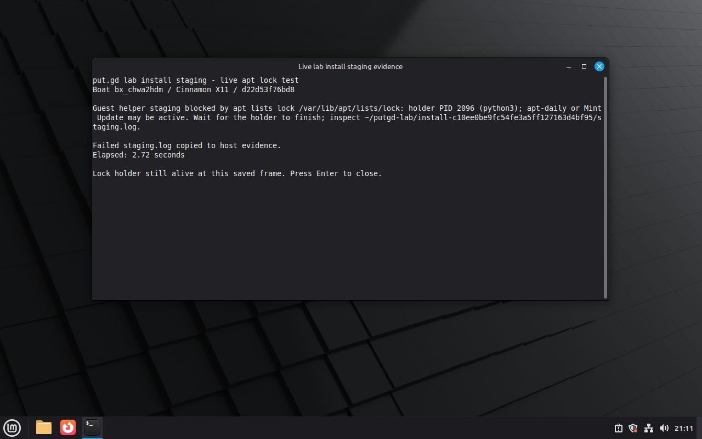

# Guest helper staging polish

Tested controller source: `d22d53f76bd884108faa17d1e35e273514d2ec23`.
[Receipt](receipt.json), [live result](lock-held-result.json),
[failed staging log](staging-failure.log), [unit tests](unit-tests.log),
[driver](live-check.py), [overlay retirement](overlay-cleanup.json), and
[completed sandbox deletion](sandbox-deletion.json).

Exactly one TTL-limited Boat fork of `putgd-lab-cinnamon`, `bx_chwa2hdm`, ran
one fresh KVM overlay. The unmodified Mint 22.3 golden had no package supervisor.
The native session was Cinnamon 6.6.4/X11 (session `c1`); the separate SSH login
was a tty session. The guest stayed visible on the workstation wall through
loopback VNC 5920 forwarded to 5997.

The driver started a Python process through the disposable guest's existing apt
hook authority. It opened the apt lists lock, acquired a POSIX write lock after
the launching apt exited, dropped to the lab UID, and recorded its PID/start
identity. PID 2096 held the lock while the real controller's `install_package`
ran. Staging failed in 2.72 seconds with the holder PID/process in its message.
The host attempt directory contained the copied `staging.log`; no supervisor or
package upload started, and the attempt lock was released. The screenshot shows
the actual controller error in an evidence terminal while that holder remained
alive; it is installer evidence, not an application workflow mock or product
compositor acceptance.

The driver verified the same PID/start identity and UID with a pidfd, then sent
SIGTERM to that exact process. Staging the actual helper after lock release
passed its normal digest, root ownership, permissions and sudo checks. Authorized
keys and cached apt indexes were byte-identical before/after the lock test.
The immutable golden SHA-256 matched before/after the campaign:
`4a21566d5b741e55f349f4f07e1c687c99d1c99b5394ff0d18ed5c9e685693da`.

All 74 targeted tests passed locally and inside Boat: lab 48, supervisor 6,
overlay cleanup 20. The new contracts execute staging with a synthetic apt lock
diagnostic; collect a failed staging log; preserve the original error when log
collection fails or times out; and execute refused-retry inspection against a
10,000-process report, asserting the compact message and unchanged full report.
No C++ or application build was needed for this Python controller change.

Boat's `/home/user` FUSE mount failed the strict inode-accounting preflight.
The failed receipt was retained, and the source/run moved to ext4-backed
`/tmp/sp`; host and guest preflights then passed without changing the gate.
Socket paths were checked before launch. An initial full-source transfer was
stopped by its exact owned scp PID and replaced with a bounded controller/test
archive; an initial host-only CLI preflight invocation lacked the required
`--run`, so the same read-only measurement functions were used for the prelaunch
host check, followed by the full CLI guest check after launch.

The private raw archive retained 35 checksum-verified members, including the
original failed preflight, identities, driver, QMP frame, source hashes and
failure context. Its SHA-256 is recorded in `receipt.json`. After export and
verification, guarded cleanup retired only the stopped overlay using an explicit
completion manifest. Its cleanup receipt was separately exported and verified.
The owned wall tile/tunnel and forwarded agent were removed, and Boat confirmed
sandbox deletion completed. No physical desktop, S3 or Proton session was used.
