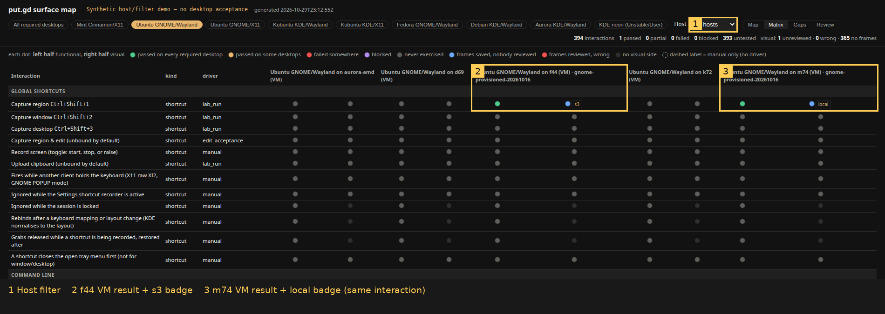
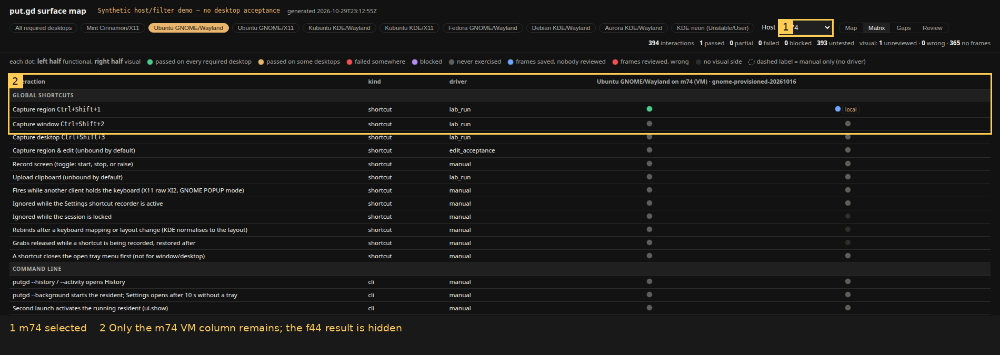
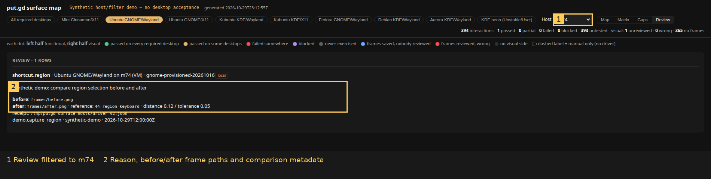

# Surface map per-builder evidence

Code: [PR #667](https://github.com/patrick-hudson/put.gd-desktop/pull/667), source `cf4f4525afc519a3e86f32fd7c1bdde3f55fda2a`, based on nightly `a18d79e762dfa4780522e25d6e3f63df1b3a2258`.

This is synthetic acceptance of the offline map page. No app build, lab desktop, host lock, VM, Proton or storage destination was used. Destination values are badges in synthetic receipts. These pictures establish map behavior, not desktop functionality. Browser, viewport, checks and image SHA-256 values are in [verification.json](verification.json).

## Acceptance

1. **V1 compatibility:** the original existing `_schema-example.json` is retained as [v1.json](v1.json). Before and after build output was `394 interactions, 0 passed, 0 partial, 0 failed, 0 blocked, 394 untested`. All 394 interaction verdicts and desktop summaries match. A nonempty synthetic v1 sample was also compared using the old and new Python implementations with equal summaries; [comparison receipt](v1-comparison.json). The page retains desktop chips/rollups and its default map design, with the additional host and Review controls.
2. **Two builders and filter:** [driver-v2.json](driver-v2.json) contains the same interaction on m74 and f44. Chromium loaded the generated file directly, selected Ubuntu GNOME/Wayland and Matrix, asserted both columns, then selected m74 and asserted f44 was absent. Annotated screenshots show both cells and the filtered result. Planned guest rows without receipts remain grey; the golden-specific rows refine the planned placement. [Browser assertions](browser-checks.json).
3. **Review:** the same run selected Review with the m74 filter and asserted the reason, both paths and local destination badge. Selecting f44 showed the empty Review state. No JavaScript errors were reported. Paths are synthetic; there are no actual captures at those paths.
4. **Placement inventory:** the model test checks all 25 planned `(desktop, host, placement)` rows in the task table. No desktop ids were missing. The Cinnamon golden is Mint 22.3, as documented by `docs/vm-lab.md` under “First Cinnamon golden disk”; its existing `mint-cinnamon-x11` id covers the VMs. Both Ubuntu GNOME profiles are declared on k72/aurora-amd. Rows describe planned placement, not proof of provisioned/accepted guests. Changes outside model desktops and notes were checked to be absent. Neon remains optional. Native Aurora uses the existing desktop id and now accepts the `source` package.
5. **Checks:** `python3 tools/lab/surface_map/surface_map.py check` passes (`9 desktops, 22 surfaces, 394 interactions`). `python3 -m pytest tests/desktop/test_surface_map.py` on Python 3.12.3 / pytest 9.2.0 gives **32 passed, 391 subtests passed, 1 failed**. The original nightly test also fails on `ModelContract::test_receipt_selectors_name_real_checks`: the model still maps `editorShowsImageAt100Percent` while the driver emits `editorFitsWholeImage`. [Issue #661](https://github.com/patrick-hudson/put.gd-desktop/issues/661) tracks this pre-existing gate. This lane was limited to model desktops/notes. Full-green suite acceptance is blocked; no test was skipped or weakened. The nightly job still consumes `tools/lab/surface_map/coverage/[0-9]*.json`; a regression assertion checks that numbered files match and `_schema-example.json` does not.







## Reproduce the page

Use code commit `cf4f4525afc519a3e86f32fd7c1bdde3f55fda2a` and the synthetic input in this directory. Run from the repository root, with a new output directory:

```sh
python3 tools/lab/surface_map/surface_map.py import \
  --coverage /tmp/surface-host-demo.json \
  docs/evidence/surface-map-hosts/driver-v2.json
python3 tools/lab/surface_map/surface_map.py build \
  --coverage /tmp/surface-host-demo.json \
  --output /tmp/surface-host-demo \
  --label 'Synthetic host/filter demo — no desktop acceptance'
```

Open `/tmp/surface-host-demo/map.html` directly in a browser. Select Ubuntu GNOME/Wayland, then Matrix. Select m74 in Host, then Review. No server or network is required. For v1, build with this directory's `v1.json`; use the base commit and its original example file for the before result.

The workstation's system Python lacked pytest and ensurepip, so checks used a private temporary environment with the system Python and pytest/playwright installed through `uv pip`; no system packages or toolchain were replaced. Chromium was the existing `/usr/bin/google-chrome`. No C++ build or CTest was run for these Python/HTML changes.
