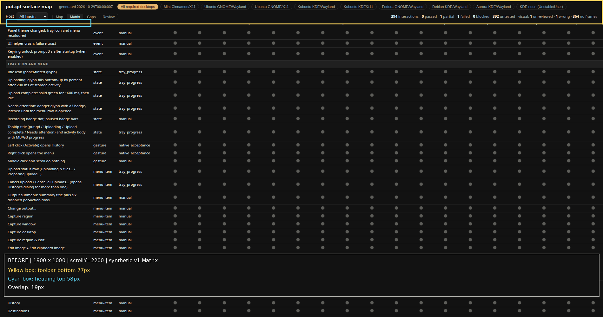
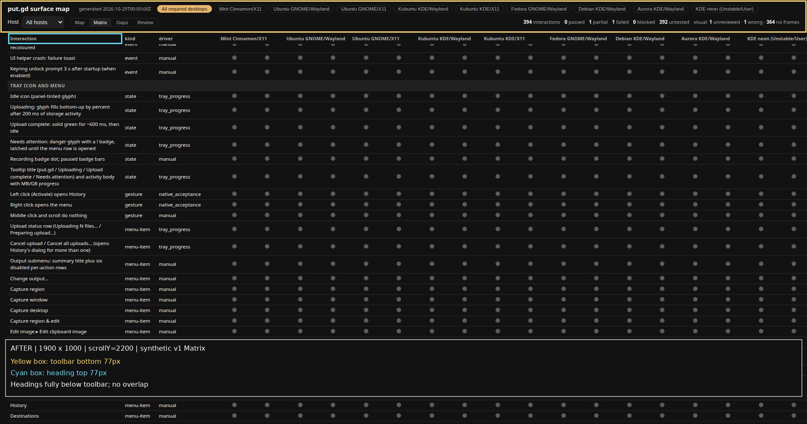
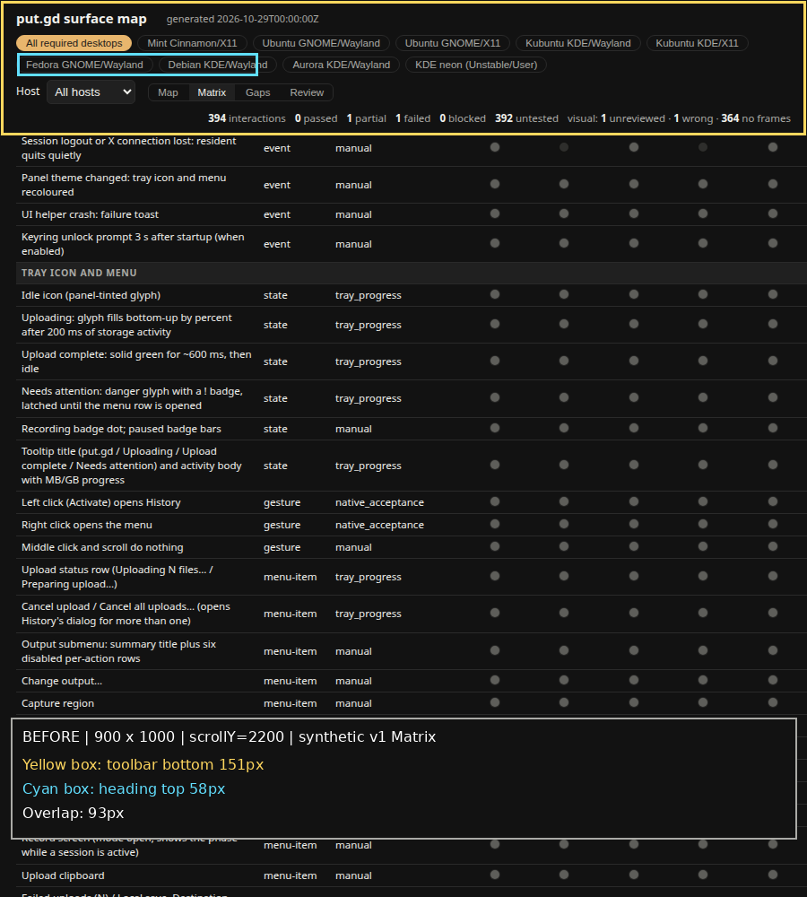
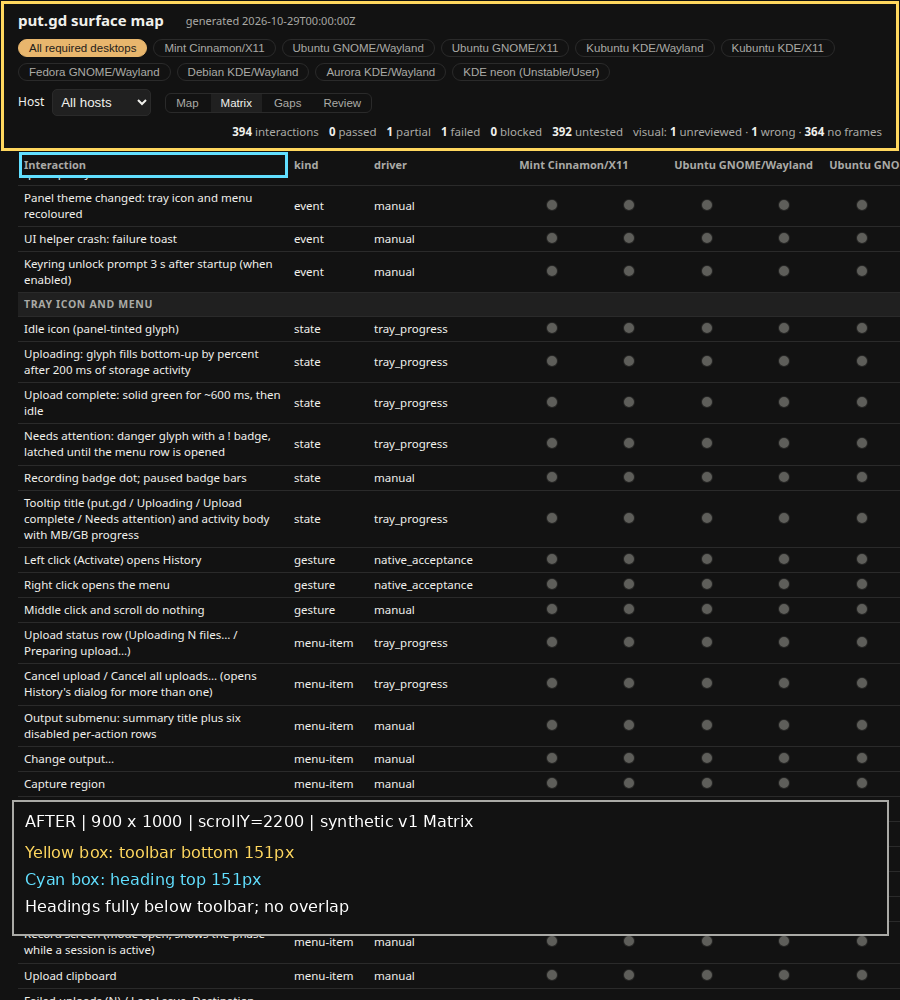

# Per-host slice completion

Code [9ad7a2c9085e066407bd1c3f6c05c9d50ea0b9b0](https://github.com/patrick-hudson/put.gd-desktop/commit/9ad7a2c9085e066407bd1c3f6c05c9d50ea0b9b0) follows merge `9cd26ff96a9da6ec3d52ebb770ffeb0a03d44852`; both code and documentation branches contain nightly `5985e9043ea81a3ac33d2931203384e40bde035e` (including #690). Earlier failure statements in the parent record describe earlier revisions and are superseded here.

This is synthetic offline map acceptance on the workstation, using system Python 3.12.3 and existing Google Chrome 156.0.8078.47 in headless Chromium mode. No C++ builds, physical desktops, VMs or storage destinations were exercised. Exact host/session/source identities and SHA-256 values are in [verification.json](verification.json).

| Item | Commit | Evidence |
| --- | --- | --- |
| Nightly selector correction incorporated | code merge `9cd26ff9`, docs merge `5f9512ab` | Both contain `5985e904`; code suite [39 passed](pytest.txt), docs branch's independent nightly suite 23 passed. |
| #689: sticky headings track actual toolbar size | `9ad7a2c9` | [Chromium geometry/assertions](browser-checks.json): before overlap 19px at 1900×1000 and 93.09375px at 900×1000; after 0px at both widths. Resize 1900→900→1900 while scrolled to y=2200 rechecks the measured offset and heading hit target. |
| Current-run metadata and review state | `9ad7a2c9` | Three regression tests: newer pass without identity drops an older build/recipe/frames; newer functional/visual verdict or explicit `review=False` clears review state/queue; matching build or receipt preserves missing/None build/recipe/frames. Explicit empty/replacement metadata and a current review request remain supported. |
| Remaining review findings | `9ad7a2c9` | Invalid host-without-placement inputs fail validation. Chromium's `matrixPopover` assertion checks Mint remains selected while a clicked Ubuntu cell adds its failed status and receipt to the popover. Optional required-only rollups were already fixed in `05a1ef26`. |
| V1 coverage unchanged | `9ad7a2c9` vs nightly `5985e904` | [Synthetic v1 input](v1.json), [full semantic snapshots (gzip)](v1-snapshots.json.gz), [comparison result](browser-checks.json). Map/Matrix/Gaps text, verdict names/colours and all nine Matrix desktop headings match with All required and Mint selected. Only the previously planned Aurora label change is normalized. No pixel-identical styling claim. |
| Model contract | `9ad7a2c9` | [check output](model-check.txt): 9 desktops, 22 surfaces, 394 interactions. |

The metadata change keeps historical receipts/issues/notes available as evidence. Run metadata carries only across matching build or receipt identities. A fresh verdict supersedes an earlier review request, including within the same run; a current entry can explicitly request review again. This replaces the overly broad carry-over rule described in the historical validator record.

## Annotated before and after

Yellow outlines the toolbar; cyan outlines the first sticky column heading. The caption panel is below the tested toolbar and headings. Unannotated originals remain private at the location recorded in `verification.json`; their hashes are retained there. These four pictures are generated from the same synthetic v1 input at the same scroll position.









## Reproduce

Use the exact code commit above in the code checkout and this evidence directory in the separate docs checkout. The code PR intentionally contains no docs. Install pytest, Playwright and Pillow in a private environment using the system Python; use the existing `/usr/bin/google-chrome`, without downloading a browser/toolchain. Run from the code checkout:

```sh
python3 -m pytest tests/desktop/test_surface_map.py
python3 tools/lab/surface_map/surface_map.py check
run_dir=$(mktemp -d /tmp/surface-completion.XXXXXX)
python3 /absolute/path/to/docs-checkout/docs/evidence/surface-map-hosts/completion/render-check.py \
  --output "$run_dir"
```

The script refuses a nonempty output directory and the wrong code revision, exports the exact before/nightly templates from Git, generates synthetic pages, compares six v1 view/filter combinations, checks Matrix popover context, and saves raw and annotated pictures plus geometry. It needs no server and opens no app/session sockets. [First-attempt context](first-attempt.txt) preserves the corrected baseline-export path from the initial run; this was a harness setup failure before Chromium started.

CI and review status are recorded separately in the PR acceptance comments because they are external states that can change after this immutable evidence commit. No PR was merged or watched.
